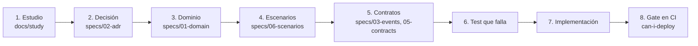

# video-eda

Un ejemplo de **arquitectura orientada a eventos con Kafka**, construido de forma **spec-driven**: primero se estudia, después se decide, después se especifica, y recién entonces se escribe código.

Lo hizo **Laura Carelli**, dejando todo por escrito en este repositorio. El nombre `video-eda` es de trabajo.

> **Estado actual:** hoy el repositorio tiene **estudio, decisiones, especificaciones y cinco spikes ejecutados** (`spikes/`), y **el comienzo del servicio Videos** (`services/videos`: el agregado `Video`, sus casos de uso y la persistencia con outbox sobre PostgreSQL; todavía sin API HTTP ni publicación a Kafka). Lo marcado como verificado en los spikes corrió contra un broker y una base reales; lo demás fue **leído en documentación**. Cada nota lo declara en su sección *No verificado*.

## Qué es y qué no es

| Es | No es |
|---|---|
| Un ejemplo didáctico de eventos, orden, duplicados, contratos y delivery | Un producto ni un sistema pensado para escala de producción |
| Un caso para leer y para correr en una sola máquina | Un catálogo de todas las tecnologías de Kafka |
| Un registro de **por qué** se decidió cada cosa | Una colección de recetas sin justificación |

**Criterio rector: menos es más.** Cada componente entra solo si demuestra una garantía que queremos mostrar (ver [ADR 0008](specs/02-adr/0008-alcance-minimo.md)). Lo que se difirió está documentado como camino de crecimiento: Kubernetes con Strimzi, Debezium, Avro con Schema Registry. La única ampliación deliberada es **CQRS, DDD táctico y event sourcing de un agregado**, que Laura pidió con fines didácticos (notas 14 a 16, ADR 0009 aceptado).

## El dominio

Una plataforma de videos simple: los **creators** publican videos; otras personas los **miran, puntúan y comentan**; los **seguidores** ven las publicaciones en su feed y reciben notificaciones.

Se eligió chico a propósito: el valor está en las garantías, no en la complejidad del negocio. Cuatro contextos, un servicio cada uno: **Videos**, **Interactions**, **Feed**, **Notifications**.

## La filosofía, en cinco ideas

1. **Spec primero, código después.** No se escribe código de servicio sin una especificación y un contrato aprobados.
2. **Cada decisión tiene una razón y una fuente.** Si una afirmación técnica no tiene respaldo, se marca como decisión nuestra.
3. **Se declara lo que no se sabe.** Cada nota termina con *No verificado*. Una corrección se documenta, no se borra.
4. **Una garantía es una garantía solo si tiene una prueba.** "Orden por agregado" o "efecto único" se demuestran con un test, no se afirman.
5. **Menos es más.** Si un componente no demuestra una garantía, se difiere y se documenta.

## Cómo se crea una especificación (el proceso)



*Por qué este diagrama:* es de **actividad**, porque expresa el orden en que se produce cada artefacto.

| Paso | Qué hacemos | Qué pregunta responde | Dónde queda |
|---|---|---|---|
| **1. Estudio** | Laura pasa un tema; leemos fuentes primarias, explicamos y documentamos con ejemplos del dominio y un diagrama | ¿Qué se sabe de esto y qué no? | [`docs/study/`](docs/study/README.md) |
| **2. Decisión** | Convertimos lo estudiado en una decisión con alternativas y consecuencias | ¿Qué elegimos y por qué? | [`specs/02-adr/`](specs/02-adr/) |
| **3. Dominio** | Event storming, contextos, glosario | ¿Qué hechos existen y quién es dueño de cuál? | [`specs/01-domain/`](specs/01-domain/) |
| **4. Escenarios** | Given/When/Then, ordenados con ZOMBIES (cero, uno, muchos) | ¿Cómo se ve "funciona"? | [`specs/06-scenarios/`](specs/06-scenarios/README.md) |
| **5. Contratos** | AsyncAPI y schemas por evento; contratos consumer-driven | ¿Qué se prometen los servicios entre sí? | [`specs/03-events/`](specs/03-events/README.md); `specs/05-contracts/` (por crear) |
| **6. Test que falla** | Cada escenario se vuelve un test rojo | ¿Cómo sabemos que no está hecho? | por crear |
| **7. Implementación** | Lo mínimo para ponerlo en verde | ¿Qué hace falta construir? | [`services/`](services/) (Videos: dominio hecho) |
| **8. Gate** | `can-i-deploy` y los tests en GitHub Actions | ¿Se puede desplegar? | `.github/workflows/` (por crear) |

### Reglas que se cumplen en cada turno de trabajo
Están en [`docs/metodo-de-trabajo.md`](docs/metodo-de-trabajo.md):
- Todo tema estudiado queda en un `.md` explicado por componente.
- Siempre hay links a la documentación de respaldo, con versión y fecha.
- Siempre hay ejemplos del dominio, incluyendo el caso que falla antes del que funciona.
- Siempre hay diagramas, elegidos por la pregunta que responden.
- Si algo cambia, se actualiza todo lo que dependa de ello.

## Las decisiones principales y su porqué

| Decisión | Por qué | Detalle |
|---|---|---|
| **Topic por agregado, sin versión en el nombre** | Los eventos de una misma entidad deben compartir topic y key para conservar el orden; la versión vive en el evento | [Nota 13](docs/study/13-topics-y-particiones.md), [Nota 12](docs/study/12-diseno-y-versionado-de-eventos.md), [ADR 0003](specs/02-adr/0003-ordering-y-keys.md) |
| **Key = id del agregado** | Misma key, misma partición, orden por entidad | [Nota 02](docs/study/02-ordering-en-kafka.md) |
| **3 particiones** | Elección didáctica: no hay carga que medir; con 1 no se vería el orden por key | [Nota 13](docs/study/13-topics-y-particiones.md) |
| **CloudEvents + AsyncAPI + JSON Schema** | Un estándar de envelope, un contrato verificable y un payload legible; sin Avro ni registry | [Nota 01](docs/study/01-envelope-y-contrato-de-eventos.md), [ADR 0002](specs/02-adr/0002-envelope-y-contrato.md) |
| **Outbox transaccional con polling publisher** | Evita escribir en la base y en Kafka por separado; el relay vive dentro del servicio, sin Kafka Connect | [Nota 05](docs/study/05-outbox-y-cdc.md), [ADR 0004](specs/02-adr/0004-publicacion-outbox.md) |
| **Inbox por `source` + `id` y guard por `sequence`** | Kafka entrega al menos una vez; los duplicados y el desorden se vuelven inofensivos | [Nota 03](docs/study/03-duplicados-e-idempotencia.md) |
| **DLQ propia con alerta** | Nada se pierde en silencio | [Nota 04](docs/study/04-reintentos-y-dlq.md) |
| **Share group solo para el worker de video** | Es trabajo tipo cola con procesos largos | [Nota 07](docs/study/07-share-groups.md), [ADR 0005](specs/02-adr/0005-consumo-y-share-groups.md) |
| **Pact + `can-i-deploy`** | Un cambio incompatible se detecta en el pipeline del productor | [Nota 10](docs/study/10-contract-testing.md), [ADR 0006](specs/02-adr/0006-contract-testing.md) |
| **Kotlin 2.4, Spring Boot 4.1, Spring Kafka 4.1, Kafka 4.3.1** | Lo más reciente con soporte verificado de share groups y del protocolo nuevo de consumer | [Nota 09](docs/study/09-clientes-y-lenguajes.md), [ADR 0001](specs/02-adr/0001-stack.md) |
| **DDD táctico + CQRS** | Cada contexto separa el lado que cambia estado del que lo muestra; los agregados tienen por id la key del topic | [Nota 14](docs/study/14-cqrs-y-read-models.md), [Nota 15](docs/study/15-ddd-tactico.md) |
| **Event sourcing solo en `Comment`** | Muestra el patrón en el agregado más chico; el resto queda con estado; `Video` y `Follow` usan outbox porque son los otros agregados que publican. Es una elección didáctica, no una necesidad del dominio | [Nota 16](docs/study/16-event-sourcing.md) |
| **Ids `<prefijo>_<UUIDv7>`** | Se reconocen en un log, ordenan por tiempo (índices sanos) y los genera el servicio antes de guardar; el id del stream es el del agregado | [Nota 17](docs/study/17-identificadores-y-nombres.md), [tabla de ejemplos](specs/01-domain/ids-de-ejemplo.md) |
| **Docker Compose + GitHub Actions** | Un solo archivo levanta Kafka, los servicios y el Pact Broker, igual en local y en CI; Kubernetes queda como camino de crecimiento | [Nota 11](docs/study/11-infraestructura-y-despliegue.md), [ADR 0007](specs/02-adr/0007-infraestructura-y-despliegue.md) |

**Estado de los ADR:** los once ADR están **aceptados** (los nueve primeros el 2026-10-12; el 0010, de observabilidad, el 2026-10-16; el 0011, de resiliencia, el 2026-10-17). Eso habilita escribir los tests y el código que dependan de ellos, pero **las hipótesis que los ADR declaran sin verificar siguen siendo experimentos pendientes**. Un ADR propuesto no habilita código que dependa de él.

## Cómo levantarlo

```
git clone <este repositorio> && cd video-eda
docker compose up --build
```

**Requisito: solo Docker.** No hace falta JDK, Gradle ni Kafka instalados (para desarrollar fuera de contenedor, el proyecto usa **JDK 25 LTS**; `.sdkmanrc` en la raíz). Levanta Kafka 4.3.1, crea los topics, PostgreSQL con una base por servicio, el Pact Broker, una interfaz para ver el tráfico de eventos, el stack de logs (Loki, Alloy y Grafana) y Keycloak:

| Qué | Dónde |
|---|---|
| Ver topics, mensajes (key, headers, value) y consumer groups | http://localhost:8080 |
| Logs de todos los servicios, por `correlationId` (Grafana; usuario `admin`, contraseña `videoeda-dev`) | http://localhost:3000 |
| Keycloak (consola `admin` / `videoeda-dev`; usuarios de ejemplo `lucia` y `mateo`) | http://localhost:8180 |
| Pact Broker | http://localhost:9292 |
| API de Videos (`POST /videos`, `GET /videos/{id}`, `DELETE /videos/{id}`) y `/actuator/health` | http://localhost:8081 |
| Kafka desde tu máquina | `localhost:9092` |
| PostgreSQL desde tu máquina | `localhost:5432` (usuario y contraseña `videoeda`) |

Para empezar de cero: `docker compose down -v` (borra también los datos).

**Evidencia:** en [`docs/evidence/`](docs/evidence/README.md) están las pruebas manuales contra el stack real, con capturas y los eventos tal como salieron de Kafka (por ejemplo, subir un video y verlo publicado en `videos.video`).

> **Estado actual:** el ecosistema base (Kafka, topics, PostgreSQL, Pact Broker, UI) se **ejecutó y verificó** el 2026-10-12 (nota 18). Los spikes S1 a S5 (`spikes/stack-check`, `pact-check`, `event-store-check`, `resilience-check`) verificaron la pila de clientes, los share groups, Pact con `can-i-deploy`, el event store de `Comment` y la DLQ secuenciada con redrive en orden (ADR 0011, aceptado el 2026-10-17). De los cuatro servicios solo existe Videos, y **corre dentro de Docker** (verificado el 2026-10-17): imagen multi-etapa, healthcheck, API con `Idempotency-Key` (repetir el `POST` devuelve el mismo `videoId` y publica un solo evento), errores `application/problem+json`, `X-Correlation-Id` que viaja hasta el CloudEvent en `videos.processing` y logs JSON con el mismo `correlationId`. Subir un video publica la orden `process-video` y el **worker de procesamiento** (share group, en el mismo proceso) la consume: transcodifica de forma simulada, renueva el lock mientras trabaja y deja el video en `PUBLISHED` con `VideoPublished` en `videos.video`. Si falla de forma permanente, o agota 3 entregas, el mensaje va a `videos.processing.dlq` con su causa y el video queda en `FAILED`. Podés verlo poniendo `[falla-transitoria]` o `[falla-permanente]` en el título del video. Interactions, Feed y Notifications todavía no existen.

## Para contribuir

```
./deploy/dev/install-git-hooks.sh   # una vez por clon: activa el hook que busca secretos antes de cada commit
```

Calidad y seguridad avanzan junto con las funcionalidades ([ADR 0012](specs/02-adr/0012-calidad-y-seguridad-desde-el-inicio.md)): el hook corre **gitleaks** desde su imagen de Docker (por eso Docker tiene que estar andando para commitear). Antes de subir cambios: `./deploy/dev/lint.sh` (ktlint, detekt, hadolint, ShellCheck, actionlint y zizmor), `cd services && ./gradlew check` (tests y cobertura) y, con el ecosistema levantado, `./deploy/dev/smoke.sh` (flujo de punta a punta). Son los mismos comandos que corre GitHub Actions. Las vulnerabilidades se reportan según [`SECURITY.md`](SECURITY.md). Licencia: [MIT](LICENSE).

### Pedir un token y usar la API
`POST` y `DELETE` exigen un token de Keycloak; `GET /videos/{id}` y `/actuator/health` son públicos. El `creatorId` sale del token (si lo mandás en el body, tiene que coincidir). Para desarrollo:

```
TOKEN=$(curl -s -X POST http://localhost:8180/realms/video-eda/protocol/openid-connect/token \
  -d grant_type=password -d client_id=video-eda-cli -d username=lucia -d password=lucia-dev-1 \
  | sed 's/.*"access_token":"\([^"]*\)".*/\1/')
curl -X POST http://localhost:8081/videos -H "Authorization: Bearer $TOKEN" -H "Idempotency-Key: $(uuidgen)" \
  -H 'Content-Type: application/json' -d '{"title":"Paella","fileSizeBytes":1048576}'
```

Ese flujo (usuario y contraseña) es solo para desarrollo y pruebas. Un token de `mateo` no puede borrar un video de `lucia` (`403`). Detalle en el [ADR 0013](specs/02-adr/0013-autenticacion-y-autorizacion-de-la-api.md).

### Si tu base local es anterior al 2026-10-19
Ese día se quitaron los comentarios de la migración `V1__create_video_and_outbox.sql` y Flyway rechaza arrancar contra una base que ya la había aplicado (`Migration checksum mismatch for migration version 1`). El esquema no cambió; solo hay que actualizar el checksum del historial, sin perder datos:

```
docker exec postgres psql -U videoeda -d videos -c "update flyway_schema_history set checksum = 1801681012 where version = '1'"
```

Con una base nueva (o con `docker compose down -v`) no hace falta.

### Configuración del stack
- **Puertos:** Grafana (3000), Keycloak (8180) y SonarQube (9000) se publican solo en `127.0.0.1`; Loki, Alloy y el proxy del socket de Docker no se publican.
- **Kafka:** `localhost:9092` es el listener `EXTERNAL` para herramientas en tu máquina; entre contenedores se usa `kafka:19092` (`INTERNAL`). Un solo nodo con factor de replicación 1; el objetivo documentado para producción es 3 (ADR 0008).
- **Contraseñas de ejemplo** (solo para tu máquina): se pueden cambiar con las variables `GRAFANA_ADMIN_PASSWORD`, `KEYCLOAK_ADMIN_PASSWORD` y `SONAR_ADMIN_PASSWORD`.
- **Healthchecks con `bash`:** las imágenes de Videos y Keycloak no traen `curl`, así que se consulta `/actuator/health` y `/health/ready` con `bash` y `/dev/tcp`; con `sh` no funcionaría. La imagen de Loki no trae shell y no tiene healthcheck.
- **SonarQube en Docker Desktop:** el contenedor desactiva los chequeos de arranque de Elasticsearch (`SONAR_ES_BOOTSTRAP_CHECKS_DISABLE`) porque Docker Desktop no garantiza `vm.max_map_count`; es solo para desarrollo local.

### SonarCloud (opcional)
El workflow `sonarcloud.yml` no hace nada hasta que lo actives en GitHub: creá el proyecto en sonarcloud.io, guardá el secreto `SONAR_TOKEN` y creá las variables del repositorio `SONARCLOUD_ENABLED=true`, `SONAR_ORGANIZATION` y `SONAR_PROJECT_KEY`.

### Apple Silicon y `DOCKER_DEFAULT_PLATFORM`
Si tu shell exporta `DOCKER_DEFAULT_PLATFORM=linux/amd64`, Docker corre todo emulado en amd64: es más lento y **SonarQube no arranca** (Elasticsearch falla con `seccomp unavailable`). Para este proyecto, `unset DOCKER_DEFAULT_PLATFORM` antes de `docker compose up`; los scripts de `deploy/dev/sonar.sh` ya lo hacen por su cuenta.

### SonarQube (a pedido)
`./deploy/dev/sonar.sh` levanta SonarQube Community (perfil `quality`, no forma parte del arranque por defecto), corre tests y análisis y muestra el quality gate: http://localhost:9000 (usuario `admin`, contraseña `Videoeda-Sonar-Dev-2026!`). Usa ~2 GB de RAM; `./deploy/dev/sonar.sh --down` lo apaga.

### IntelliJ IDEA
El proyecto usa **JDK 25** (Corretto 25.0.1+8, `.sdkmanrc`) y se compila con Gradle, no con el compilador interno del IDE (que soporta Kotlin hasta 2.4.0 y el proyecto usa 2.4.21). Con IntelliJ cerrado, `./deploy/dev/intellij/apply-intellij-settings.sh` aplica la configuración exacta (`deploy/dev/intellij/gradle.xml`); después, *Reload All Gradle Projects*. El SDK tiene que llamarse `corretto-25` en *Project Structure > SDKs*. **Usá IntelliJ IDEA 2026.2 o posterior**: el plugin de Kotlin de una 2025.2 no lee las librerías de Kotlin 2.4.21 y marca errores falsos en el editor (`Some Kotlin runtime libraries has an unsupported binary format`, `@JvmInline` en rojo) aunque `./gradlew check` compile y pase. No uses *Downgrade all Kotlin runtime libraries*.

### Dependencias verificadas
Gradle comprueba el SHA-256 de cada dependencia contra `services/gradle/verification-metadata.xml`. Al cambiar una versión: `./deploy/dev/update-gradle-verification.sh` y revisar el diff.

## Cómo leer este repositorio

1. [`specs/00-vision.md`](specs/00-vision.md): qué problema y qué alcance.
2. [`specs/01-domain/`](specs/01-domain/): los hechos y los contextos.
3. [`docs/study/README.md`](docs/study/README.md): el índice de estudio; las notas 01 a 04 son las que explican el núcleo.
4. [`specs/02-adr/`](specs/02-adr/): las decisiones.
5. [`specs/06-scenarios/`](specs/06-scenarios/README.md): cómo se ve el comportamiento esperado.

## Estructura

```
video-eda/
  README.md              este archivo
  docs/metodo-de-trabajo.md  reglas de trabajo
  docs/study/            notas de estudio con fuentes y "No verificado"
  specs/                 visión, dominio, ADR, escenarios y garantías
  compose.yaml           el ecosistema completo con un solo comando
  deploy/                scripts de topics y de bases de datos que usa compose.yaml
  services/              videos (dominio hecho); interactions, feed, notifications por crear
```

## Licencia
Por definir.
