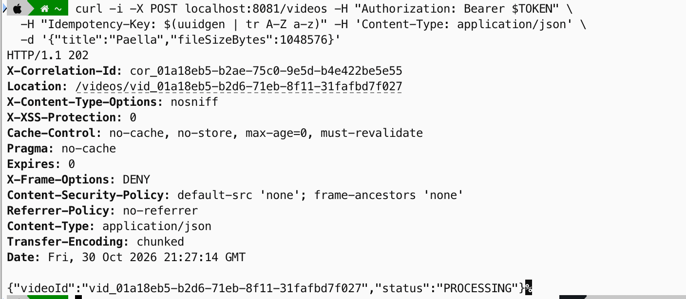
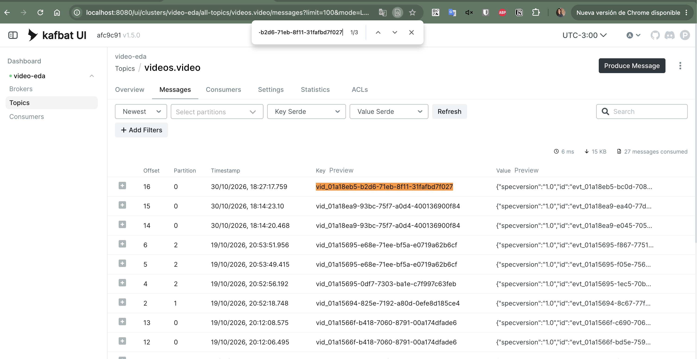

# Evidencia

Pruebas manuales contra el stack real (`docker compose up`), con lo que se vio en cada paso.

## 2026-10-30 — Subir un video y verlo publicado

Token real de Keycloak (usuaria `lucia`), `POST /videos` desde la terminal:



- La API responde `202 Accepted` con `Location`, el `X-Correlation-Id` generado (`cor_01a18eb5-b2ae-…`) y el video en `PROCESSING`.
- Los encabezados de seguridad (`X-Frame-Options`, `Content-Security-Policy`, `Cache-Control`, …) vienen de Spring Security.

El outbox publica la orden de procesamiento en `videos.processing` (key = `videoId`, `sequence` 1, mismo `correlationid`):

```json
{"specversion":"1.0","id":"evt_01a18eb5-b2db-7752-83fe-5f73d2b1b894","source":"/videos",
 "type":"dev.videoeda.videos.process-video","subject":"vid_01a18eb5-b2d6-71eb-8f11-31fafbd7f027",
 "time":"2026-10-30T21:27:14.902294Z","correlationid":"cor_01a18eb5-b2ae-75c0-9e5d-b4e422be5e55","sequence":1,
 "data":{"videoId":"vid_01a18eb5-b2d6-71eb-8f11-31fafbd7f027",
         "storageRef":"storage://uploads/vid_01a18eb5-b2d6-71eb-8f11-31fafbd7f027",
         "requestedAt":"2026-10-30T21:27:14.902294305Z"}}
```

El worker (share group) lo procesa y, 2,3 segundos después, `VideoPublished` sale por `videos.video`:

```json
{"specversion":"1.0","id":"evt_01a18eb5-bc0d-7087-a24b-0216979740e5","source":"/videos",
 "type":"dev.videoeda.videos.video-published","subject":"vid_01a18eb5-b2d6-71eb-8f11-31fafbd7f027",
 "time":"2026-10-30T21:27:17.247979Z","correlationid":"cor_01a18eb5-b2ae-75c0-9e5d-b4e422be5e55","sequence":1,
 "data":{"title":"Paella","videoId":"vid_01a18eb5-b2d6-71eb-8f11-31fafbd7f027",
         "creatorId":"usr_01a13161-11be-7119-8e3e-bf07f13eb833",
         "publishedAt":"2026-10-30T21:27:17.247979333Z","durationSeconds":184}}
```

En Kafbat UI (`localhost:8080`, topic `videos.video`) el evento aparece en la partición 0, offset 16, con el `videoId` como key:



`GET /videos/vid_01a18eb5-b2d6-71eb-8f11-31fafbd7f027` devuelve el estado final:

```json
{"videoId":"vid_01a18eb5-b2d6-71eb-8f11-31fafbd7f027","status":"PUBLISHED","title":"Paella",
 "creatorId":"usr_01a13161-11be-7119-8e3e-bf07f13eb833"}
```

El `creatorId` no viaja en el body: sale del token de Keycloak (ADR 0013).

Cómo leer los eventos de un video desde la terminal:

```bash
docker exec kafka /opt/kafka/bin/kafka-console-consumer.sh --bootstrap-server localhost:9092 \
  --topic videos.video --from-beginning --timeout-ms 8000 --property print.key=true | grep <videoId>
```
