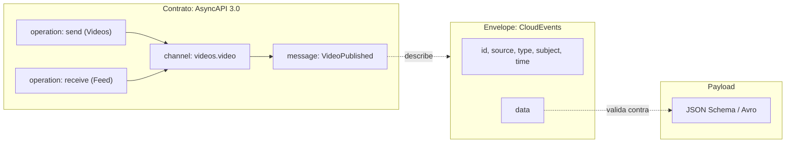
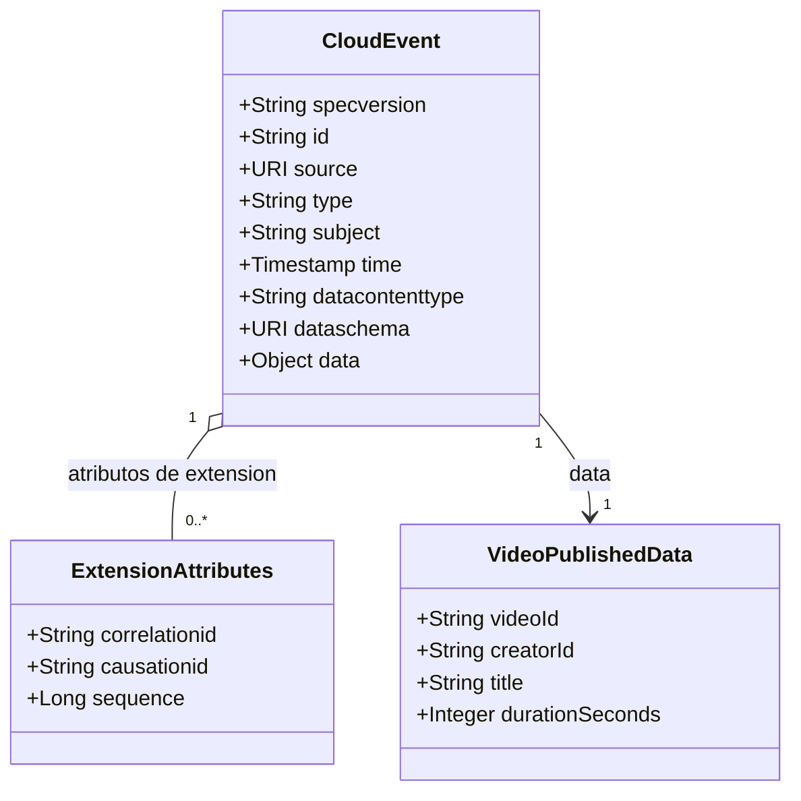

# Envelope y contrato de eventos (CloudEvents, AsyncAPI, JSON:API)

> **Estado:** vigente · **Versión de referencia:** CloudEvents 1.0, AsyncAPI 3.0.0, JSON:API 1.1 · **Última actualización:** 2026-10-12

## Resumen
Un evento de dominio necesita tres capas distintas: un **envelope** con metadatos (CloudEvents), un **payload** con los datos (JSON Schema o Avro) y un **contrato** que describe canales, operaciones y mensajes (AsyncAPI). JSON:API no es un formato de eventos: describe la representación de recursos sobre HTTP. Decisión provisoria: CloudEvents + AsyncAPI 3.0, y JSON:API solo si exponemos una API de consulta REST.

## Por qué importa
Sin envelope estándar, cada servicio inventa su forma de identificar, deduplicar y rastrear eventos. Sin contrato escrito, el contract testing no tiene contra qué verificar. El `id` + `source` del envelope es la base de la deduplicación (nota 03) y el `subject`/key es la base del orden (nota 02).

## Cómo funciona

### Las tres capas



*Por qué este diagrama:* es un diagrama de **componentes** (flowchart con subgraph): muestra qué pieza contiene a cuál y cómo se relacionan, no un flujo en el tiempo.

### Estructura de un evento



*Por qué este diagrama:* es de **clases**, porque responde cómo se estructura el evento y cómo se relacionan sus partes.

### CloudEvents (envelope)
- **Requeridos:** `id`, `source`, `specversion` (`1.0`), `type` (con prefijo reverse-DNS).
- **Opcionales:** `datacontenttype` (RFC 2046), `dataschema` (URI), `subject`, `time` (RFC 3339).
- **Extensiones:** se admiten atributos propios con las mismas reglas de nombre y tipo.
- **Identidad:** el par `source` + `id` debe ser único por evento. Un reenvío puede conservar el `id` y el consumidor puede tratar los repetidos como duplicados.
- **`subject`:** identifica el sujeto del evento dentro del `source`, útil para filtrar sin interpretar `data`.

### AsyncAPI 3.0 (contrato)
- **Raíz:** `asyncapi` e `info` requeridos; además `servers`, `channels`, `operations`, `components`, `defaultContentType`.
- **Canales y operaciones separados:** un `channel` tiene `address` (el nombre del topic) y `messages`; una `operation` tiene `action: send | receive` y una referencia al canal. Permite describir quién publica y quién consume por separado.
- **Message:** `headers` (solo headers de aplicación, nunca de protocolo), `payload`, `correlationId`, `contentType`, `traits`, `bindings`, `examples`.
- **Payload multi-formato:** `schemaFormat` + `schema` permite referenciar, por ejemplo, un schema Avro.
- **Kafka binding:** declara la `key` del mensaje y la configuración de Schema Registry. Acá se documenta el ordering.

### JSON:API (por qué no para eventos)
- Modela **representación de recursos sobre HTTP**: `type` + `id`, `attributes`, `relationships`, `included`, media type `application/vnd.api+json`, métodos y códigos de estado.
- Un evento es un **hecho en pasado**, no el estado actual de un recurso.
- Su `type` es el tipo de recurso; en un evento `type` debe ser el tipo de evento. Choque de significado.
- `included` y los links no tienen sentido en un mensaje asíncrono.
- Su lugar posible en el proyecto: la API síncrona de consulta (lado query de CQRS; ver [nota 14](14-cqrs-y-read-models.md)).

## Aplicación por componente

| Componente | Cómo aplica | Decisión / regla |
|---|---|---|
| Videos | Publica `VideoPublished` y `VideoDeleted` en `videos.video`, y `ProcessVideo` en `videos.processing` | `subject = videos/{videoId}`, `type` sin sufijo hasta el primer cambio incompatible |
| Interactions | Publica `CommentPosted`, `CommentEdited` y `CommentDeleted` en `interactions.comment`; puntuaciones y vistas no se publican (regla de publicación) | Extensión `sequence` = versión del stream del comentario |
| Feed | Consume `VideoPublished`; no publica (el feed es una proyección) | Declara en AsyncAPI una `receive` sobre `videos.video` |
| Notifications | Consume `videos.video` e `interactions.comment`; de dónde sale la lista de seguidores está abierto (`03-events/README.md`) | Usa `correlationid` para trazar la notificación hasta el evento origen |

## Ejemplos del dominio

Evento `VideoPublished` en CloudEvents (modo structured, JSON):

```json
{
  "specversion": "1.0",
  "id": "evt_01a13161-12e6-7e09-b67f-10ca57c43328",
  "source": "/videos",
  "type": "dev.videoeda.videos.video-published",
  "subject": "vid_01a13161-1277-7e7b-9435-b109a7e95989",
  "time": "2026-10-12T14:03:11Z",
  "datacontenttype": "application/json",
  "dataschema": "https://schemas.videoeda.dev/videos/video-published/1",
  "correlationid": "cor_01a13161-13c4-7752-b78c-4c2b8c8039fb",
  "causationid": "evt_01a13161-1355-79ea-92a1-85411003d528",
  "sequence": 1,
  "data": {
    "videoId": "vid_01a13161-1277-7e7b-9435-b109a7e95989",
    "creatorId": "usr_01a13161-11be-7119-8e3e-bf07f13eb833",
    "title": "Mi primer tutorial",
    "durationSeconds": 312
  }
}
```

Fragmento del contrato AsyncAPI:

```yaml
asyncapi: 3.0.0
info: { title: Videos service, version: 1.0.0 }
channels:
  videoEvents:
    address: videos.video
    messages:
      videoPublished: { $ref: '#/components/messages/VideoPublished' }
operations:
  publishVideoPublished:
    action: send
    channel: { $ref: '#/channels/videoEvents' }
components:
  messages:
    VideoPublished:
      payload: { $ref: 'schemas/video-published.json' }
      bindings:
        kafka:
          key: { type: string, description: videoId, define el orden por video }
```

Caso con JSON:API (lado query): `GET /videos/vid_01a13161-1277-7e7b-9435-b109a7e95989` devolvería un recurso `{ "data": { "type": "videos", "id": "vid_01a13161-1277-7e7b-9435-b109a7e95989", "attributes": {...}, "relationships": { "creator": ... } } }`. Eso es una **respuesta HTTP**, no el evento.

## Alternativas y trade-offs

| Opción | Ventaja | Costo | Cuándo |
|---|---|---|---|
| CloudEvents + AsyncAPI | Vocabulario estándar, idempotencia y trazabilidad definidas | Atributos extra en cada mensaje | Recomendado para este proyecto |
| Envelope propio | Total control | Reinventa identidad, versionado y tooling | Solo si hay un requisito que CloudEvents no cubre |
| JSON:API como formato de evento | Reusa tooling REST | Choque semántico, mezcla HTTP con datos | No recomendado |
| Structured vs binary mode en Kafka | Structured: autocontenido. Binary: atributos como headers, `data` en el body | Hay que decidirlo con el tooling y Schema Registry | Decisión pendiente (ADR) |

## Reglas para el spec
1. Todo evento publicado es un CloudEvent 1.0 con `id`, `source`, `type`, `subject` y `time`.
2. `type` sin sufijo de versión; un cambio incompatible es un `type` nuevo con sufijo `.v2` (decisión de Laura, 2026-10-12; nota 12).
3. Cada evento tiene su mensaje en AsyncAPI con `payload` referenciando su schema y `key` declarada en el Kafka binding.
4. Extensiones propias a decidir en ADR: `correlationid`, `causationid`, `sequence`.
5. `source` + `id` es la clave de deduplicación del consumer (nota 03).
6. JSON:API no se usa para eventos.

## Fuentes
- [CloudEvents spec 1.0](https://github.com/cloudevents/spec/blob/main/cloudevents/spec.md) — atributos, identidad, extensiones. Consultado 2026-10-12.
- [AsyncAPI 3.0.0 specification](https://www.asyncapi.com/docs/reference/specification/v3.0.0) — estructura, message, operations. Consultado 2026-10-12 (leído hasta el carácter 100.000 de ~112.000).
- [AsyncAPI Kafka bindings](https://www.asyncapi.com/docs/reference/bindings/kafka) — key y Schema Registry, vía resultado de búsqueda.
- [JSON:API format](https://jsonapi.org/format/) — estructura y semántica HTTP. Consultado 2026-10-12.

## No verificado
- **Kafka protocol binding de CloudEvents:** que en binary mode los atributos van como headers con prefijo `ce_` es conocimiento previo; no lo leí en la spec `cloudevents/spec`.
- **Nombres de topics** (`videos.video.v1` y similares): el formato era nuestro para los ejemplos. Corrección posterior (nota 12): la guía de nombres de Confluent sí sugiere `v1`/`v2` en el topic, pero solo ante cambios incompatibles; ponerlo desde el inicio en todos los topics no tiene respaldo. Corregido el 2026-10-12 al detectarlo Laura: los topics quedan por agregado y sin versión (ADR 0003). El `v1` del `type` del evento y de los nombres de schema tampoco tiene fuente propia y sigue pendiente de revisión.
- **Nombres de extensiones** (`correlationid`, `causationid`, `sequence`): son decisión de diseño nuestra y no verifiqué las reglas de nombres de extensión de la spec más allá de "mismas convenciones que los atributos estándar".
- **Final de la spec AsyncAPI:** los últimos ~11.800 caracteres no fueron leídos.
- **Diferencias 2.x → 3.0:** la página no las compara; no se afirman.
- **Integración AsyncAPI con Schema Registry:** solo vi la descripción del binding, no un ejemplo operativo.

## Historial

| Fecha | Cambio |
|---|---|
| 2026-10-12 | Creación a partir del estudio en conversación |
| 2026-10-12 | Topics renombrados: por agregado y sin versión en el nombre (el `v1` era invención nuestra); ver ADR 0003 |
| 2026-10-12 | Corregida la afirmación sobre el `v1` en el topic; ver nota 12 |
| 2026-10-12 | `type` sin sufijo `v1`: el sufijo aparece recién con el primer cambio incompatible (ADR 0002) |
| 2026-10-12 | Los contratos reales usan AsyncAPI 3.1.0 (la nota estudió 3.0.0; 3.1.0 es compatible por la regla de versionado de minor y validó sin gobernanza pendiente); ver `specs/03-events/` |
| 2026-10-12 | Referencia al lado query de CQRS ahora apunta a la nota 14 |
| 2026-10-12 | Tabla de aplicación alineada con la regla de publicación y con los contratos reales |
| 2026-10-12 | Ids alineados con la nota 17 (alias de `specs/01-domain/ids-de-ejemplo.md` en prosa y diagramas, ids reales en payloads y SQL) |
| 2026-10-12 | `source` del ejemplo alineado con los contratos reales (`/videos`) |
