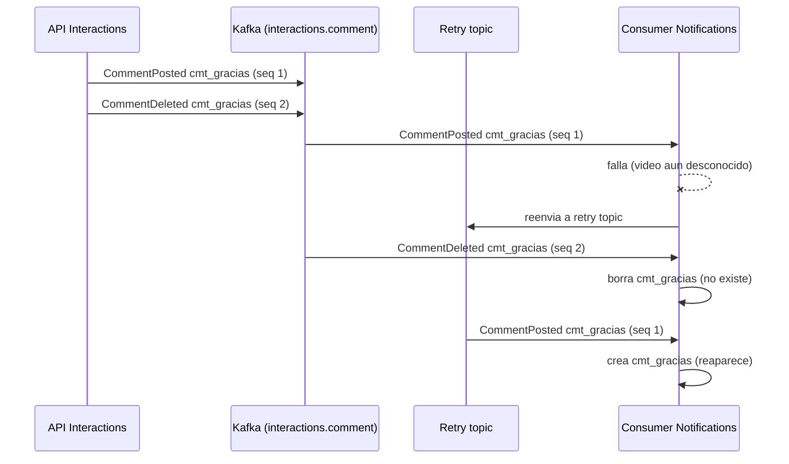
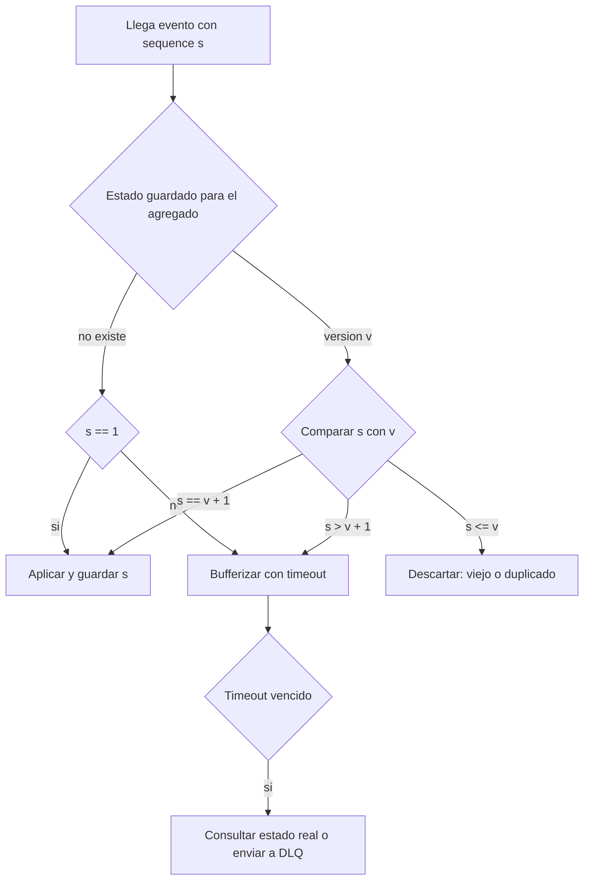

# Ordering en Kafka

> **Estado:** vigente · **Versión de referencia:** Kafka 4.1 (configs y diseño), 4.3 (share groups) · **Última actualización:** 2026-10-12

## Resumen
Kafka garantiza orden total **dentro de una partición** y nada más. Para que los eventos de un mismo agregado se lean en orden, tienen que compartir key. El orden que Kafka preserva es el de **llegada al broker**, no el de la intención del usuario, y varios mecanismos (reintentos no bloqueantes, procesamiento paralelo, cambio de particiones) lo rompen aunque la key esté bien.

## Por qué importa
Un `CommentDeleted` que se procesa antes que su `CommentPosted` deja el comentario "vivo" para siempre. Un `CreatorUnfollowed` anterior a `CreatorFollowed` deja el estado al revés. Es el desafío central del dominio.

## Cómo funciona

### Qué garantiza y qué no

| Alcance | Garantía | Fuente |
|---|---|---|
| Dentro de una partición | Orden total ("totally ordered partitions") | Design 4.1 |
| Entre particiones | Ninguna declarada | Design 4.1 |
| Entre topics | Ninguna | Consecuencia de lo anterior |
| Compactación | "Ordering of messages is always maintained" | Design 4.1 |
| Share groups | Orden por batch y partición; no entre batches ni por key | KIP-932 (nota 07) |

### Key y partición
- Sin partición explícita y con key, el partitioner por defecto elige "based on a hash of the key". Sin key, usa partición *sticky*.
- `partitioner.ignore.keys=true` hace que el producer ignore las keys. Un partitioner custom cambia las reglas. Cualquiera de los dos rompe el ordering sin error.

### Producer
- `enable.idempotence` es **`true` por defecto** si no hay configuración en conflicto.
- Con idempotencia, el orden se preserva con `max.in.flight.requests.per.connection` ≤ 5 (default 5).
- Requiere `acks=all` y `retries` > 0. Si la pedís explícitamente con valores en conflicto, lanza `ConfigException`.
- Sin idempotencia y con reintentos y más de un request en vuelo, un batch reintentado puede quedar detrás de uno posterior.

### Qué rompe el orden aunque la key esté bien

| Causa | Mecanismo |
|---|---|
| Reintentos del producer sin idempotencia | Un batch fallido se reenvía después de uno posterior |
| Retry topics (no bloqueante) | Spring: "By using this strategy you lose Kafka's ordering guarantees for that topic" |
| Procesamiento paralelo en el consumer | Se lee en orden pero se procesa con un pool sin respetar la key |
| Cambio de cantidad de particiones | La misma key puede mapear a otra partición (no verificado en doc) |
| Rebalance | La partición pasa a otro consumer (no verificado en doc) |
| Intención decidida antes de Kafka | Dos requests del mismo usuario compiten en el API |
| Entre topics | `VideoPublished` y `CommentPosted` viajan por separado |

> **Nota 2026-10-12:** por la regla de publicación, `VideoRated` y `FeedEntryAdded` ya no se publican en Kafka (los eventos de follow sí: `feed.follow`, porque Notifications los consume). Los recorridos de esta nota los usan como **ejemplo del mecanismo**, que vale igual para `CommentPosted`; el caso concreto cambió en los escenarios (RAT-*, FEED-*).

## Aplicación por componente

| Componente | Caso | Key | Estrategia |
|---|---|---|---|
| Interactions | `CommentPosted` → `CommentEdited` → `CommentDeleted` | `commentId` | `sequence` por comentario + retry bloqueante |
| Interactions | `VideoRated` 4 → 2 → 5 | `videoId:raterId` | Guardar estado final por `(userId, videoId)` con versión |
| Feed | `CreatorFollowed` / `CreatorUnfollowed` | `followerId:creatorId` | Last-write-wins con versión |
| Notifications | Comentario sobre un video que todavía no conoce | no resuelve la key | Buffer con timeout o placeholder |
| Videos | `VideoUploaded` → `VideoProcessed` → `VideoPublished` | `videoId` | Máquina de estados que rechaza transiciones inválidas |

## Ejemplos del dominio

### El caso que falla



*Por qué este diagrama:* es de **secuencia**, porque el problema es el orden de los mensajes en el tiempo.

### El caso que funciona: guard por versión



*Por qué este diagrama:* es de **actividad**, porque expresa una decisión con ramas, no un intercambio entre actores.

```gherkin
Escenario: el delete llega antes que el post
  Dado que Interactions publica CommentDeleted(cmt_gracias, seq=2) y CommentPosted(cmt_gracias, seq=1)
  Cuando Notifications procesa primero seq=2 y después seq=1
  Entonces el comentario cmt_gracias no aparece en el read model
  Y el evento seq=1 tardío se descarta por tener sequence menor al registrado
```

## Alternativas y trade-offs

| Opción | Ventaja | Costo | Cuándo |
|---|---|---|---|
| Key por aggregate id | Simple, nativo de Kafka | No cubre orden entre topics ni orden de intención | Siempre |
| Versión/sequence por agregado | Detecta viejo, duplicado y hueco | Hay que generarla y persistirla | Entidades con varias mutaciones |
| Offset como versión | Gratis | Solo vale dentro de una partición | Solo si todo el agregado está en una partición |
| Retry bloqueante | Preserva el orden | Un mensaje venenoso frena la partición | Flujos con orden estricto |
| Retry no bloqueante | No frena el tráfico | Pierde orden (Spring) | Trabajo independiente |
| Todo en un topic por agregado | Evita desorden entre tipos de evento del mismo agregado | Un topic con varios tipos de evento | **Elegido** (ADR 0003, 2026-10-12) |

## Reglas para el spec
1. Cada topic documenta su key en AsyncAPI; la key es el aggregate id o el par que defina el orden.
2. Prohibido configurar `partitioner.class` o `partitioner.ignore.keys` en los productores. Test que lo verifique.
3. Idempotencia del producer activa (default); test que falle si se desactiva.
4. Todo evento que muta un agregado lleva `sequence` (nota 01).
5. Los consumers con orden por key no usan pool de threads sin particionar por key.
6. Cambiar la cantidad de particiones de un topic requiere ADR y plan de migración.
7. Todo caso de orden entre topics define explícitamente su política (buffer, placeholder o tolerancia).

## Fuentes
- [Kafka 4.1 – Design](https://kafka.apache.org/41/design/design/) — orden por partición, compactación, idempotencia. Consultado 2026-10-12.
- [Kafka 4.1 – Producer Configs](https://kafka.apache.org/41/configuration/producer-configs/) — idempotencia, in-flight, partitioner. Consultado 2026-10-12.
- [Spring Kafka – How the pattern works](https://docs.spring.io/spring-kafka/reference/retrytopic/how-the-pattern-works.html) — pérdida de orden en retry topics.
- [Debezium Outbox Event Router](https://debezium.io/documentation/reference/stable/transformations/outbox-event-router.html) — `aggregateid` como key.
- [Conduktor: event sourcing con Kafka](https://conduktor.io/blog/event-sourcing-kafka-patterns-pitfalls) — guard por versión y buffering (fuente secundaria).

## No verificado
- **Cambio de cantidad de particiones:** efecto sobre la key no leído en documentación oficial.
- **Algoritmo de hash** (murmur2) no confirmado en esta sesión.
- **Rebalances y orden:** apoyado en un resumen de búsqueda del javadoc de `KafkaConsumer`; el protocolo nuevo (nota 06) no dice nada sobre orden.
- **Límite de 5 batches por producer en el broker:** aparece en un resumen de búsqueda, no en el fragmento leído.
- **Guard por versión y buffering con timeout:** salen de blogs; es consenso de la industria, no estándar. Hay que demostrarlo con un test.
- **Retry topics rompen orden:** confirmado por Spring; la generalización a "cualquier retry no bloqueante" es inferencia.

## Historial

| Fecha | Cambio |
|---|---|
| 2026-10-12 | Creación a partir del estudio en conversación |
| 2026-10-12 | Topics renombrados: por agregado y sin versión en el nombre (el `v1` era invención nuestra); ver ADR 0003 |
| 2026-10-12 | Keys de Interactions alineadas con el ADR 0003 (`commentId`, `videoId:raterId`); la decisión de un topic por agregado deja de estar pendiente |
| 2026-10-12 | La key es la identidad del agregado (Evans, nota 15); si se aprueba event sourcing de `Comment`, su `sequence` pasa a ser la `version` del stream (nota 16, propuesta) |
| 2026-10-12 | Aviso: `VideoRated`, `FeedEntryAdded` y follows ya no se publican; los ejemplos quedan como ilustración del mecanismo |
| 2026-10-12 | `feed.follow` vuelve (opción a de Laura): `CreatorFollowed` y `CreatorUnfollowed` se publican con key `followerId:creatorId`; ver ADR 0003 y `specs/03-events/README.md` |
| 2026-10-12 | Ids alineados con la nota 17 (alias de `specs/01-domain/ids-de-ejemplo.md` en prosa y diagramas, ids reales en payloads y SQL) |
