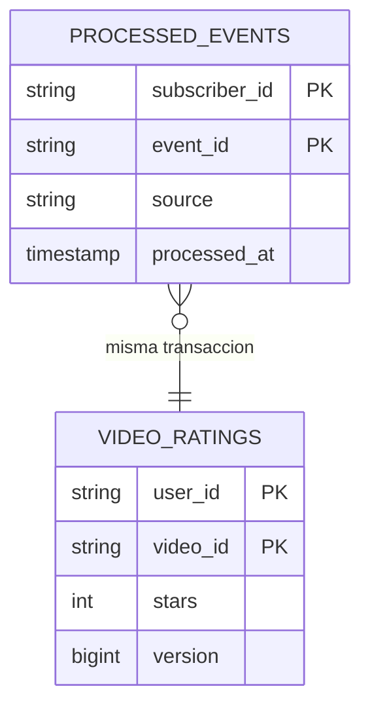
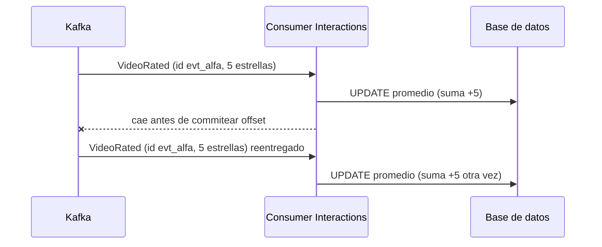
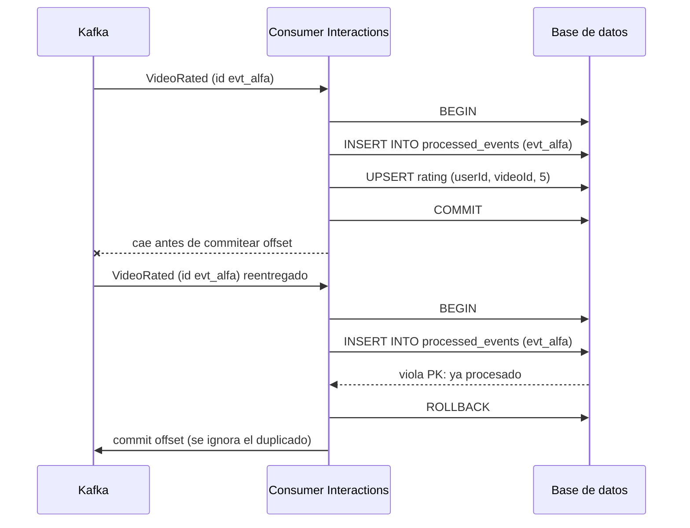

# Duplicados e idempotencia

> **Estado:** vigente · **Versión de referencia:** Kafka 4.1 / 4.3 · **Última actualización:** 2026-10-12

## Resumen
En Kafka "Kafka guarantees at-least-once delivery by default", así que los duplicados son esperables y la defensa es en capas: producer idempotente (broker), outbox (publicación), inbox/consumer idempotente (consumo) e idempotency keys (borde HTTP). Exactly-once solo vale dentro de Kafka; en cuanto un consumer escribe en una base de datos propia, la idempotencia es responsabilidad nuestra.

## Por qué importa
Una puntuación duplicada distorsiona el promedio; una notificación duplicada molesta al usuario; un contador inflado destruye la confianza en las métricas.

## Cómo funciona

### De dónde salen los duplicados

| Origen | Ejemplo en el dominio |
|---|---|
| Reintento del producer | `VideoRated` reenviado tras un timeout |
| El relay del outbox publica y se cae antes de marcar | `VideoPublished` publicado dos veces |
| El consumer procesa y se cae antes de commitear el offset | `CommentPosted` aplicado dos veces |
| Reenvío del cliente al API | El usuario toca "puntuar" dos veces con mala conexión |
| Reproceso desde DLQ o replay | Se reinyectan eventos ya aplicados |
| Lock expirado en share groups | Otro consumer toma un trabajo que sigue en curso (nota 07) |

### Estrategias

| Estrategia | Qué hace | Límite |
|---|---|---|
| **Producer idempotente** | El broker asigna ID de producer y deduplica por número de secuencia | Solo reenvíos del mismo producer |
| **Transactional Outbox** | Evento y cambio de negocio en la misma transacción de DB | El relay puede publicar dos veces |
| **Idempotent Consumer (inbox)** | Registra IDs procesados; PK `(subscriberId, messageId)` | La tabla crece: hace falta retención |
| **Transacciones Kafka (EOS)** | Consume-process-produce atómico; fencing de zombies por `transactional.id` y epoch | No cubre efectos en sistemas externos |
| **Offset junto al resultado** | Dato y offset se actualizan juntos | Requiere cooperación del destino |
| **Idempotency key en el API** | El cliente manda una clave; si ya terminó se devuelve el resultado guardado | Recuperación parcial depende de la implementación |
| **Operación naturalmente idempotente** | Guardar estado final (`rating = 4`), no deltas (`+1`) | No siempre aplicable (contadores) |

### Transacciones v2
Desde Kafka 4.0, con `transaction.version=2`, el epoch del producer se incrementa en cada transacción para que los duplicados no se filtren a la siguiente. Los consumers transaccionales usan `isolation.level=read_committed` y `enable.auto.commit=false`.

### Diseño del inbox



*Por qué este diagrama:* es **ER** (no UML puro), porque responde qué tablas hay y cómo se relacionan.

## Recorrido completo: cómo se evita el duplicado en nuestros procesos

Caso: el creator publica un video y Feed agrega la entrada. Cada capa ataca un origen distinto de duplicado (tabla "De dónde salen los duplicados").

```mermaid
sequenceDiagram
    participant U as Creator
    participant V as Videos (API y DB)
    participant D as Debezium
    participant K as Kafka (videos.video)
    participant F as Feed (consumer)
    participant FD as Feed (DB)
    U->>V: PublishVideo (Idempotency-Key)
    V->>V: BEGIN; estado PUBLISHED; INSERT outbox (id evt_alfa, aggregateid videoId); COMMIT
    D->>K: VideoPublished (id evt_alfa, key videoId)
    Note over D,K: Si Debezium se reinicia, puede publicar evt_alfa de nuevo
    K->>F: VideoPublished (evt_alfa)
    F->>FD: BEGIN; INSERT processed_events (source, evt_alfa); guard por sequence; UPSERT feed; COMMIT
    F--xK: cae antes de commitear el offset
    K->>F: VideoPublished (evt_alfa) reentregado
    F->>FD: INSERT processed_events (source, evt_alfa) viola PK
    F->>K: commit offset (duplicado ignorado)
```

*Por qué este diagrama:* es de **secuencia**, porque cada defensa actúa en un punto distinto del tiempo.

| Capa | Dónde | Qué duplicado evita | Qué NO evita |
|---|---|---|---|
| `Idempotency-Key` y operación idempotente | API de Videos | El usuario reenvía el mismo `PublishVideo` | Reenvíos entre Debezium y Kafka |
| Outbox transaccional | Videos | Perder o publicar un evento sin cambio de estado | Que el relay lo publique dos veces |
| Producer idempotente | Debezium/Connect hacia Kafka | Reintentos de red del mismo producer | Un reinicio que reenvía desde el WAL |
| **Inbox por `source` + `id`** | Consumer | Reentrega por crash, rebalance, reinicio del relay, reproceso de DLQ | Efectos fuera de la base (ver abajo) |
| Guard por `sequence` | Consumer | Eventos viejos o repetidos del mismo agregado | Duplicados de otro agregado |

Las dos últimas capas parecen la misma pero responden preguntas distintas: el **inbox** pregunta "¿ya procesé *este evento*?" (por `id`), y el **guard** pregunta "¿este evento es *más nuevo* que el estado del agregado?" (por `sequence`). El guard cubre también el orden; el inbox cubre repeticiones exactas.

### Qué no cubre el inbox
El inbox hace atómico "registrar el evento + actualizar la base". Si el efecto es **externo** (enviar un email desde Notifications), la transacción no lo incluye: si el proceso cae después de enviar y antes de commitear, el evento se reentrega y el aviso se envía dos veces. La mitigación (clave de idempotencia ante el proveedor, estilo Stripe) depende de que el proveedor la ofrezca; no verificado.

> **Nota 2026-10-12:** por la regla de publicación, `VideoRated` y `FeedEntryAdded` ya no se publican en Kafka (los eventos de follow sí: `feed.follow`, porque Notifications los consume). Los recorridos de esta nota los usan como **ejemplo del mecanismo**, que vale igual para `CommentPosted`; el caso concreto cambió en los escenarios (RAT-*, FEED-*).

## Aplicación por componente

| Componente | Estrategia | Detalle |
|---|---|---|
| Videos | Outbox + operación idempotente | `VideoPublished` desde outbox; publicar un video ya publicado no cambia el estado |
| Interactions | Idempotency key en el API + upsert | `Idempotency-Key` en `POST /videos/{id}/ratings`; PK `(userId, videoId)` |
| Interactions (vistas) | Dedupe por ventana | Se acepta aproximación; el orden no importa |
| Feed | Inbox por `eventId` + unicidad `(followerId, videoId)` | Una entrada por seguidor y video aunque `VideoPublished` se reentregue |
| Notifications | Inbox + dedupe por ventana | Una notificación por evento origen |

## Ejemplos del dominio

### El caso que falla



### El caso que funciona



*Por qué estos diagramas:* son de **secuencia**, porque el defecto está en el orden entre crash, escritura y commit.

```gherkin
Escenario: puntuación reentregada no altera el promedio
  Dado que el promedio del video vid_ramen es 4.0 con 10 puntuaciones
  Cuando llega dos veces VideoRated(evt_alfa, user usr_ana, 5 estrellas)
  Entonces el video tiene 11 puntuaciones
  Y processed_events contiene evt_alfa una sola vez
```

## Alternativas y trade-offs

| Opción | Ventaja | Costo | Cuándo |
|---|---|---|---|
| Inbox en tabla separada | Genérico, funciona para cualquier handler | Tabla que crece; join en la transacción | Handlers con efectos variados |
| ID en la entidad de negocio | Sin tabla extra | Acopla dedupe al modelo | Entidades con identidad natural (rating por usuario y video) |
| Operación idempotente por diseño | Sin infraestructura | No sirve para acumulados | Estado final |
| Transacciones Kafka | Atómico dentro de Kafka | No cubre la DB | Pipelines internos a Kafka |
| Ventana de dedupe | Barata | Aproximada | Contadores de vistas |

## Reglas para el spec
1. Todo consumer que escribe en una base propia aplica inbox por `source` + `id` en la misma transacción que el read model.
2. Los consumers no asumen exactly-once.
3. Los comandos HTTP no idempotentes por naturaleza aceptan `Idempotency-Key`.
4. Preferir estado final a deltas cuando el dominio lo permita.
5. Definir retención del inbox por ADR (decisión pendiente).
6. El `id` del evento es estable entre reenvíos (el outbox no lo regenera).

## Fuentes
- [Kafka 4.1 – Design](https://kafka.apache.org/41/design/design/) — semántica de entrega, idempotencia, transacciones.
- [Kafka 4.3 – Design](https://kafka.apache.org/43/design/design/) — requisitos del consumer transaccional, taxonomía de excepciones.
- [Kafka 4.3 – Transaction Protocol](https://kafka.apache.org/43/operations/transaction-protocol/) — epoch por transacción, `transaction.version`.
- [microservices.io – Idempotent Consumer](https://microservices.io/patterns/communication-style/idempotent-consumer.html)
- [microservices.io – Transactional Outbox](https://microservices.io/patterns/data/transactional-outbox.html)
- [Confluent – Transactions in Apache Kafka](https://www.confluent.io/blog/transactions-apache-kafka/) — consume-process-produce, fencing, límites (post de 2017).
- [Stripe – Idempotency](https://stripe.com/blog/idempotency) — claves de idempotencia, backoff con jitter.
- [Debezium Outbox Event Router](https://debezium.io/documentation/reference/stable/transformations/outbox-event-router.html) — `id` para deduplicar.

## No verificado
- **Retención y limpieza del inbox:** ninguna fuente lo cubre; decisión nuestra.
- **Idempotencia entre reinicios del producer:** creo que el ID de producer vale por sesión y que solo `transactional.id` lo mantiene; no leído.
- **Esquema de almacenamiento de Stripe** y fases atómicas: el artículo no los detalla.
- **Operación naturalmente idempotente:** conclusión propia a partir del ejemplo `AccountDebited` de microservices.io.
- **Confluent 2017:** los conceptos siguen vigentes, pero la API debe contrastarse con la 4.x.

## Historial

| Fecha | Cambio |
|---|---|
| 2026-10-12 | Creación a partir del estudio en conversación |
| 2026-10-12 | Agregado el recorrido completo de deduplicación (capas, inbox vs guard por sequence, límite con efectos externos) |
| 2026-10-12 | Relación con el proyector idempotente y la reproyección: nota 14; el duplicado sobre un stream con versión esperada: nota 16 |
| 2026-10-12 | Aviso: `VideoRated`, `FeedEntryAdded` y follows ya no se publican; los ejemplos quedan como ilustración del mecanismo |
| 2026-10-12 | Ids alineados con la nota 17 (alias de `specs/01-domain/ids-de-ejemplo.md` en prosa y diagramas, ids reales en payloads y SQL) |
| 2026-10-16 | El guard por `sequence` descarta lo viejo pero no detecta huecos; propuesta de guard estricto en la nota 19 |
