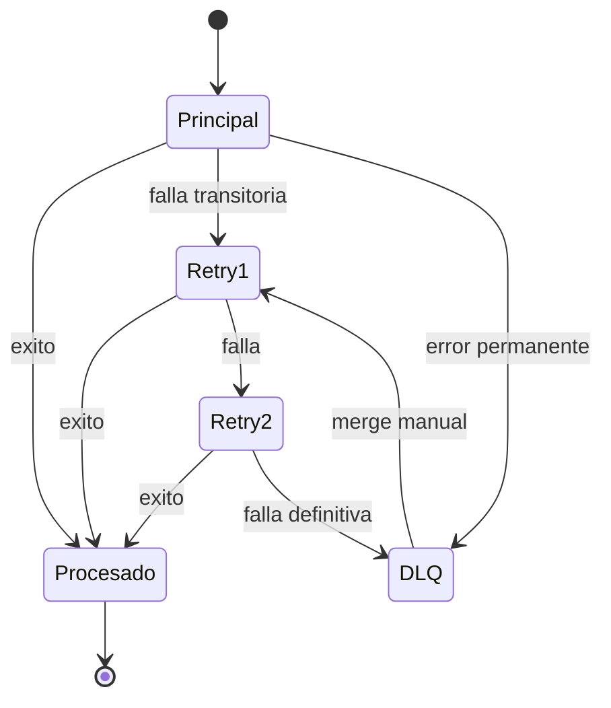
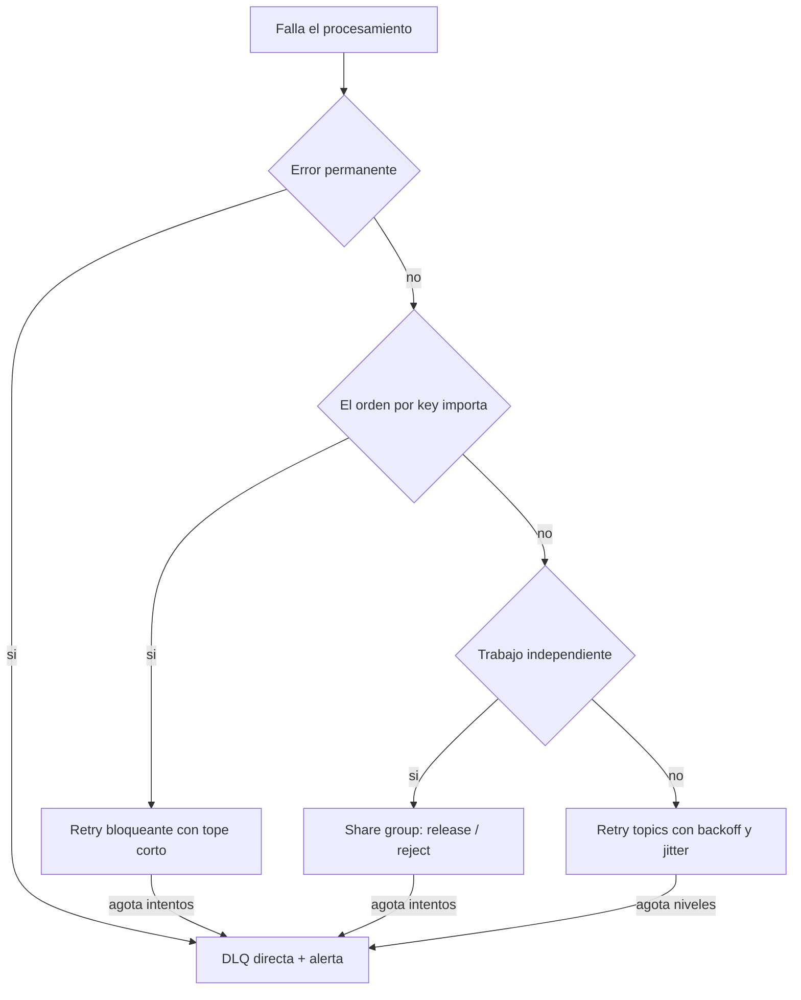

# Reintentos y DLQ

> **Estado:** vigente · **Versión de referencia:** Spring Kafka (retry topics), Kafka 4.3 (share groups) · **Última actualización:** 2026-10-12

## Resumen
Cuando un consumer falla hay dos familias de reintento: **bloqueante** (el consumer reintenta el mismo mensaje y no avanza, preserva el orden) y **no bloqueante** (el mensaje va a un retry topic y el consumer sigue, pierde el orden). Los errores se clasifican: los transitorios se reintentan con backoff y jitter; los permanentes van directo a una DLQ. En Kafka 4.2+ los share groups traen conteo de entregas y rechazo nativos, pero sin DLQ integrada.

## Por qué importa
Un reintento mal elegido o frena una partición entera por un mensaje venenoso (bloqueante) o desordena los eventos de un agregado (no bloqueante). La DLQ sin operación (listar, reprocesar, alertar) es un cementerio.

## Cómo funciona

### Escalera de reintentos (patrón de Uber y de Spring)



*Por qué este diagrama:* es una **máquina de estados**, porque describe los estados por los que pasa un mensaje fallido y sus transiciones.

### Cómo lo hacen las fuentes
- **Uber:** tras agotar los reintentos locales, el consumer publica el mensaje a un retry topic y commitea el offset original. Cada nivel tiene sus propios consumers con un delay creciente ("at least after the configured timeout but possibly later"). El último nivel termina en la DLQ, con herramientas para listar, purgar y reinyectar (merge) al primer retry.
- **Spring Kafka:** con `@RetryableTopic` crea `main-topic-retry-1000`, `main-topic-retry-2000`, `main-topic-retry-4000` y `main-topic-dlt` (ejemplo: backoff 1000 ms, multiplicador 2, 4 intentos). El consumer del retry topic pausa la partición hasta que vence el timestamp de backoff.
- **No soporta:** batch listeners ni container transactions con retry no bloqueante.
- **Orden:** Spring: "By using this strategy you lose Kafka's ordering guarantees for that topic". Uber: "it must be acceptable for an application to handle events outside of the exact order".

### Clasificar errores
Uber recomienda separar errores transitorios (red, timeouts) de errores de código (por ejemplo un null pointer), que "should go straight into the DLQ because retries would not fix them".

AWS lo formula como dos recuperaciones: ante una falla de plataforma, recuperación **hacia adelante** (reintentar el paso local y continuar); ante una falla de aplicación, recuperación **hacia atrás** (compensar). Ver nota 08.

### Backoff
Exponencial (proporcional a 2^n) con jitter para evitar el "thundering herd" (Stripe).

### Decisión



*Por qué este diagrama:* es de **actividad**, porque expresa una decisión con ramas.

## Aplicación por componente

| Componente | Tipo de error típico | Estrategia |
|---|---|---|
| Interactions (comentarios) | Video aún desconocido (transitorio, orden entre topics) | Retry bloqueante corto; si no aparece el video, DLQ |
| Interactions (comentarios) | Payload que no cumple el schema | DLQ directa |
| Videos (procesamiento) | Transcodificación que falla a veces | Share group con release y límite de intentos; DLQ propia al rechazar |
| Feed | Fallo al escribir la timeline | Retry con backoff; el orden por creator importa poco |
| Notifications | Proveedor de envío caído | Share group o retry topics con backoff y jitter |

## Ejemplos del dominio

El caso que falla: `CommentPosted` falla por el video desconocido, va a un retry topic, y mientras tanto procesa `CommentDeleted` del mismo comentario (ver diagrama de secuencia en la nota 02). Resultado: el comentario reaparece.

El caso que funciona: ese consumer usa retry **bloqueante** con tope de 3 intentos y 500 ms de espera; la partición no avanza hasta resolverlo, y si no se resuelve se manda a `interactions.dlq` con headers que indican causa, intentos y `eventId`.

```gherkin
Escenario: evento con schema inválido va directo a DLQ
  Dado que llega un CommentPosted sin el campo videoId
  Cuando el consumer lo valida
  Entonces no se reintenta
  Y se publica en interactions.dlq con la causa y el eventId
  Y se emite una alerta
```

## Alternativas y trade-offs

| Opción | Ventaja | Costo | Cuándo |
|---|---|---|---|
| Retry bloqueante | Preserva el orden | Un mensaje venenoso frena la partición | Flujos con orden estricto |
| Retry topics | No frena el tráfico | Pierde orden; más topics; delays best-effort | Eventos independientes |
| Share group | Conteo de entregas y reject nativos | Sin orden; sin DLQ integrada; archivado silencioso | Trabajo tipo cola |
| Sin DLQ | Simple | Se pierde el mensaje o se bloquea para siempre | No recomendado |

## Reglas para el spec
1. Cada consumer declara su política: bloqueante, no bloqueante o share group, con justificación.
2. Los errores se clasifican; los permanentes no se reintentan.
3. Todo reintento usa backoff exponencial con jitter y un tope.
4. Toda DLQ tiene dueño, alerta y procedimiento de reproceso.
5. Los mensajes en DLQ conservan `eventId`, causa, intentos y topic de origen.
6. Reprocesar desde la DLQ pasa por el inbox (nota 03): es una fuente de duplicados.

## Fuentes
- [Uber – Reliable Reprocessing](https://www.uber.com/en-ES/blog/reliable-reprocessing/) — retry topics, DLQ, clasificación de errores (la URL global dio 404; se usó la versión regional).
- [Spring Kafka – How the pattern works](https://docs.spring.io/spring-kafka/reference/retrytopic/how-the-pattern-works.html) — topics generados y pérdida de orden.
- [Spring Kafka – Non-blocking retries](https://docs.spring.io/spring-kafka/reference/retrytopic.html) — introducción y limitaciones.
- [Stripe – Idempotency](https://stripe.com/blog/idempotency) — backoff exponencial con jitter.
- [AWS Prescriptive Guidance – Saga patterns](https://docs.aws.amazon.com/prescriptive-guidance/latest/cloud-design-patterns/saga-patterns.html) — recuperación hacia adelante vs hacia atrás.
- [Kafka 4.3 – Design](https://kafka.apache.org/43/design/design/) — share groups: reject, release, conteo de entregas.

## No verificado
- **Uber:** no dice textualmente que los reintentos pierdan el orden; es inferencia a partir de su frase sobre particiones.
- **Spring:** la página "Combining Blocking and Non-Blocking Retries" no se leyó.
- **Cantidad de niveles y delays de Uber:** el artículo no los da.
- **Política óptima de tope y espera** para nuestro dominio: no hay fuente; hay que medirla en experimentos.

## Historial

| Fecha | Cambio |
|---|---|
| 2026-10-12 | Creación a partir del estudio en conversación |
| 2026-10-12 | Topics renombrados: por agregado y sin versión en el nombre (el `v1` era invención nuestra); ver ADR 0003 |
| 2026-10-16 | Hueco detectado: apartar a la DLQ solo el mensaje fallido rompe el orden por key; propuesta (guard estricto, redrive en orden) en la nota 19 y ADR 0011 (propuesto) |
