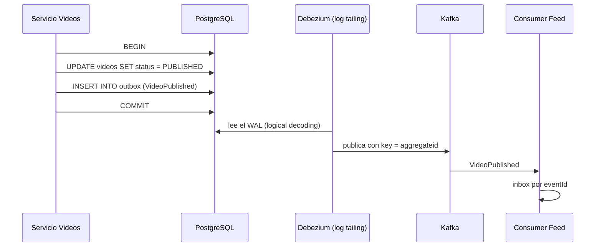
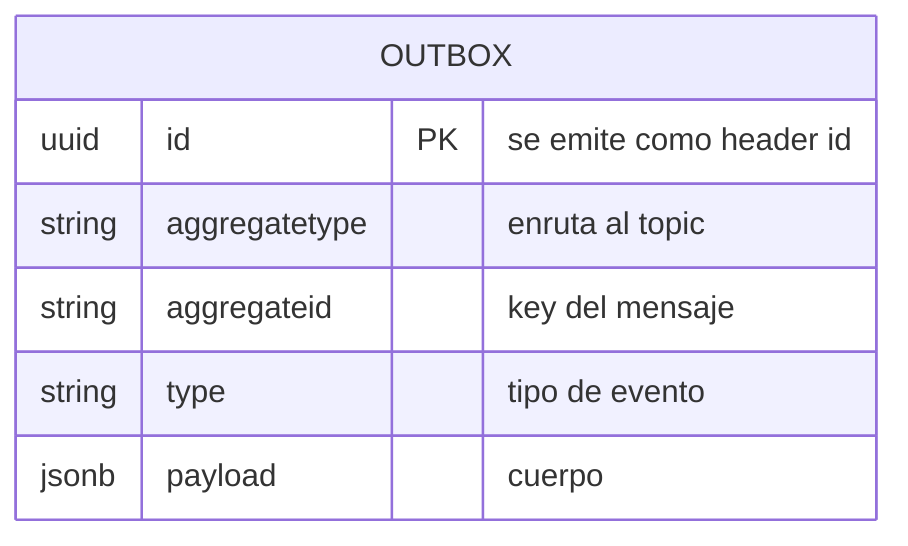

# Outbox y CDC

> **Estado:** vigente (con vacíos) · **Versión de referencia:** Debezium stable, PostgreSQL 13+ · **Última actualización:** 2026-10-12

## Resumen
El **Transactional Outbox** resuelve el *dual write*: el evento se guarda en una tabla `outbox` en la misma transacción que el cambio de negocio, y un relay lo publica a Kafka. El relay puede ser un *polling publisher* o *transaction log tailing* (CDC con Debezium). La garantía es "enviado si y solo si la transacción commitea", pero el relay es at-least-once: los consumers deben ser idempotentes.

## Por qué importa
Sin outbox, "guardar el video y publicar `VideoPublished`" son dos operaciones que pueden quedar inconsistentes: video guardado sin evento (el feed nunca lo ve) o evento sin video (los seguidores ven algo inexistente).

## Cómo funciona



*Por qué este diagrama:* es de **secuencia**, porque lo importante es el orden entre commit, lectura del log y publicación.

### Relays

| Relay | Cómo funciona | Estado de lo estudiado |
|---|---|---|
| **Polling publisher** | Un proceso consulta la tabla outbox y publica | Nombrado en microservices.io, **no leído** |
| **Transaction log tailing (CDC)** | Debezium lee el log de transacciones de la base | Leído a través de la documentación de Debezium |

### Tabla outbox esperada por Debezium (Event Router)



*Por qué este diagrama:* es **ER**, porque responde qué columnas tiene la tabla.

- Por defecto el topic es `outbox.event.${aggregatetype}`; se cambia con `route.by.field` o `route.topic.regex`.
- `aggregateid` es la key del mensaje: "important for maintaining correct order in Kafka partitions". Con la opción `partition` se puede elegir la partición directamente.
- La tabla se comporta como una cola: las actualizaciones no están permitidas (`table.op.invalid.behavior`, default `warn`) y los `DELETE` se filtran.
- El `id` sirve para deduplicar.

### Garantías y límites (microservices.io)
- Los mensajes se envían "if and only if the database transaction commits".
- Se envían en el orden en que la aplicación los envió.
- El relay puede publicar duplicados si se cae entre publicar y registrar que publicó.
- Riesgo: "error prone since the developer might forget to publish the message".

### Lecciones operativas (fuentes secundarias)
- **Crecimiento del WAL:** si el conector se atrasa o muere, el slot retiene WAL sin límite y puede tumbar la primaria. Mitigar con `max_slot_wal_keep_size` (PostgreSQL 13+) y alertas por lag del slot.
- **Failover:** un slot nuevo tras una promoción puede empezar más allá del último offset durable de Debezium y dejar un hueco. Tratar slot y offset de Kafka Connect como un único checkpoint distribuido.
- **Limpieza de la tabla outbox:** sin ella hay bloat.
- **Réplicas:** las réplicas standby de PostgreSQL 16 admiten slots, pero el conector inicialmente falló por consultas no soportadas en modo recuperación (issue de Debezium).

## Aplicación por componente

| Componente | Cómo aplica | Detalle |
|---|---|---|
| Videos | Publica desde outbox | `aggregatetype=video`, `aggregateid=videoId` |
| Interactions | `Comment`: el event store ocupa el lugar del outbox (nota 16, ADR 0009 aceptado); puntuaciones y vistas no se publican | `CommentPosted`, `CommentEdited`, `CommentDeleted` salen de `comment_events` |
| Feed | Publica `CreatorFollowed` y `CreatorUnfollowed` desde outbox (`feed.follow`); el feed no se publica | Consume `videos.video` con inbox; sus tablas son proyecciones |
| Notifications | No publica (ADR 0008) | Consume `videos.video`, `interactions.comment` y `feed.follow` con inbox; el estado y la lista de seguidores viven en sus tablas |

## Ejemplos del dominio

Publicar un video, dentro de una sola transacción:

```sql
BEGIN;
UPDATE videos SET status = 'PUBLISHED' WHERE id = 'vid_01a13161-1277-7e7b-9435-b109a7e95989';
INSERT INTO outbox (id, aggregatetype, aggregateid, type, payload)
VALUES ('evt_01a13161-12e6-7e09-b67f-10ca57c43328', 'video', 'vid_01a13161-1277-7e7b-9435-b109a7e95989', 'VideoPublished',
        '{"videoId":"vid_01a13161-1277-7e7b-9435-b109a7e95989","creatorId":"usr_01a13161-11be-7119-8e3e-bf07f13eb833","title":"Mi primer tutorial"}');
COMMIT;
```

El caso que falla: el servicio hace `UPDATE` + `producer.send()` sin outbox, la aplicación cae entre ambos y el feed nunca se entera.

```gherkin
Escenario: el evento no se pierde si el servicio cae después del commit
  Dado que Videos commiteó la publicación del video vid_ramen con su fila en outbox
  Cuando el proceso de Videos cae antes de hablar con Kafka
  Entonces Debezium publica igualmente VideoPublished con key vid_ramen
  Y Feed lo procesa una sola vez gracias al inbox
```

## Alternativas y trade-offs

| Opción | Ventaja | Costo | Cuándo |
|---|---|---|---|
| Outbox + CDC (log tailing) | Baja latencia, sin consultas repetidas | Operar Debezium y el slot | Recomendado para el proyecto |
| Outbox + polling | Simple, sin CDC | Latencia y carga por consultas | Sin Kafka Connect disponible |
| Event sourcing | El log es la fuente de verdad | Cambia todo el modelo | Dominios de auditoría estricta |
| 2PC | Atomicidad fuerte | Soporte y disponibilidad | No recomendado |

## Reglas para el spec
1. Ningún servicio publica a Kafka directamente desde un handler; todo pasa por outbox.
2. `aggregateid` = key del topic (nota 02).
3. El `id` del outbox es el `id` del CloudEvent y no se regenera en reenvíos.
4. Tabla outbox con limpieza programada (retención a decidir por ADR).
5. Alertas: lag del slot, tamaño del WAL, edad del evento más viejo sin publicar.
6. Los consumers aplican inbox (nota 03).

## Fuentes
- [microservices.io – Transactional Outbox](https://microservices.io/patterns/data/transactional-outbox.html) — problema, solución, garantías.
- [Debezium – Outbox Event Router](https://debezium.io/documentation/reference/stable/transformations/outbox-event-router.html) — columnas, routing, key, `id`.
- [ShiftMag – Debezium y PostgreSQL en producción](https://shiftmag.dev/how-to-survive-database-failover-debezium-and-postgresql-in-production-11676/) — failover y slots (fuente secundaria).
- [Conduktor – Outbox pattern](https://www.conduktor.io/glossary/outbox-pattern-for-reliable-event-publishing) — buenas prácticas (fuente secundaria).

## No verificado
- **Polling publisher y log tailing en profundidad:** microservices.io los nombra sin explicarlos; no leí sus páginas.
- **Mapeo a nuestro naming:** cómo lograr `videos.video` con `route.by.field` o `route.topic.regex` está documentado como opción, pero no lo probé.
- **Envelope CloudEvents desde Debezium:** apareció una página de Debezium sobre exportar CloudEvents en los resultados, pero no la leí.
- **Logical decoding messages de PostgreSQL** como alternativa a la tabla: apareció un artículo, no leído.
- **Fechas de las lecciones operativas:** los blogs no tienen fecha clara; tratarlas como señales.
- **Versiones de Debezium** y compatibilidad con PostgreSQL: no verificadas.

## Historial

| Fecha | Cambio |
|---|---|
| 2026-10-12 | Creación a partir del estudio en conversación |
| 2026-10-12 | Topics renombrados: por agregado y sin versión en el nombre (el `v1` era invención nuestra); ver ADR 0003 |
| 2026-10-12 | ADR 0008 aprobado: el relay del proyecto es un polling publisher (leído en microservices.io); Debezium queda como camino de crecimiento |
| 2026-10-12 | Event sourcing deja de ser solo alternativa descartada: nota 16 lo estudia para `Comment`, donde el event store ocuparía el lugar del outbox (propuesta, falta ADR) |
| 2026-10-12 | Tabla de aplicación alineada con la regla de publicación (solo Videos usa outbox; Comment usa event store) |
| 2026-10-12 | `Follow` usa outbox: Notifications consume `feed.follow` (opción a, Laura) |
| 2026-10-12 | Ids alineados con la nota 17 (alias de `specs/01-domain/ids-de-ejemplo.md` en prosa y diagramas, ids reales en payloads y SQL) |
| 2026-10-12 | ADR 0009 aceptado por Laura: el event store de `Comment` reemplaza al outbox para ese agregado |
