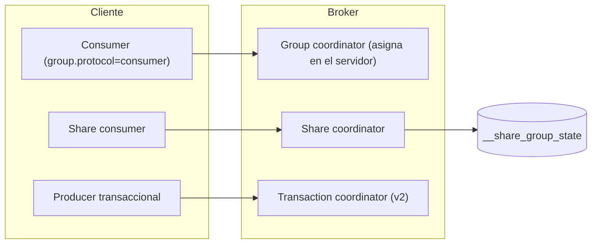

# Novedades de Kafka 4.x

> **Estado:** vigente · **Versión de referencia:** Kafka 4.0 a 4.3 · **Última actualización:** 2026-10-12

## Resumen
Cuatro cambios de Kafka 4.x afectan nuestras decisiones: el **nuevo protocolo de rebalance** (KIP-848, GA en 4.0), las **transacciones v2** (KIP-890, habilitadas en 4.0), los **share groups** (KIP-932, production-ready en 4.2) y la **DLQ en Kafka Streams** (KIP-1034, en 4.2). Los patrones de fondo (outbox, inbox, key por agregado) siguen vigentes.

## Por qué importa
Parte de lo que se escribía a mano hace unos años (retry topics, DLQ, conteo de entregas) tiene ahora soporte nativo, y algunas configuraciones del consumer clásico dejan de funcionar con el protocolo nuevo.

## Cómo funciona

| Novedad | Estado | Qué cambia |
|---|---|---|
| **Protocolo de rebalance (KIP-848)** | 3.7 acceso temprano · 4.0 GA · 5.0 default del `KafkaConsumer` · 6.0 solo este protocolo | Rebalances incrementales, sin barrera global; el broker asigna y controla heartbeat y session timeout |
| **Transacciones v2 (KIP-890)** | Habilitado en servidor desde 4.0 (`transaction.version=2`) | El epoch del producer se incrementa en cada transacción; verificación más barata |
| **Share groups (KIP-932)** | Early access 4.0 · preview 4.1 · production-ready 4.2 | Reparto por registro, conteo de entregas, ack individual (nota 07) |
| **DLQ en Kafka Streams (KIP-1034)** | 4.2 | Los handlers de excepciones pueden mandar registros fallidos a un topic DLQ |
| **Taxonomía de excepciones transaccionales** | Documentada en 4.3 | `RetriableException`, `RefreshRetriableException`, `AbortableException`, `ApplicationRecoverableException`, `InvalidConfigurationException`, `KafkaException` |

### Dónde vive cada pieza



*Por qué este diagrama:* es de **componentes**, porque muestra qué pieza del cliente habla con qué pieza del broker.

### Protocolo de rebalance: lo que hay que saber
- El cliente opta con `group.protocol=consumer`; el broker lo tiene habilitado por defecto desde 4.0 (flag `group.version`).
- Dejan de aplicar `heartbeat.interval.ms`, `session.timeout.ms`, `partition.assignment.strategy` y `enforceRebalance(...)`.
- Assignors del servidor: `uniform` (default) y `range`. Mapeo desde el clásico: RangeAssignor → `range`; CooperativeSticky, Sticky y RoundRobin → `uniform`.
- No hay assignors del lado del cliente. La asignación consciente de rack no está completa (KAFKA-19387).
- Migración online posible si el assignor clásico no embebe metadata custom.

### Calidad de versión
- Fuente secundaria (Instaclustr, vía búsqueda): 4.2.0 tenía un deadlock crítico en el camino de share groups corregido en 4.2.1, y un bug en migración offline classic → streams (KAFKA-20254).

## Aplicación por componente

| Componente | Qué usa | Decisión |
|---|---|---|
| Interactions (comentarios, puntuaciones) | Consumer group con protocolo nuevo | `group.protocol=consumer` en el spec |
| Feed | Consumer group con protocolo nuevo | Idem |
| Videos (procesamiento) | Share group | Nota 07 |
| Notifications | Share group | Nota 07 |
| Pipelines de agregación (vistas) | Kafka Streams con DLQ | Evaluar KIP-1034 en el experimento |
| Productores con transacciones | Transacciones v2 | Solo para pipelines internos a Kafka |

## Ejemplos del dominio

El caso que falla: el spec no fija `group.protocol` y el equipo copia una config con `partition.assignment.strategy=CooperativeStickyAssignor`. Con el protocolo nuevo esa propiedad deja de aplicar y el comportamiento cambia sin aviso.

El caso que funciona: la config del consumer de Interactions fija `group.protocol=consumer` y un test de configuración falla si aparece alguna de las propiedades que dejan de funcionar.

```gherkin
Escenario: la configuración del consumer es compatible con el protocolo nuevo
  Dado que el consumer de Interactions usa group.protocol=consumer
  Cuando se valida su configuración en CI
  Entonces no contiene partition.assignment.strategy ni session.timeout.ms
```

## Alternativas y trade-offs

| Opción | Ventaja | Costo | Cuándo |
|---|---|---|---|
| Protocolo nuevo | Menos pausas en rebalances | Sin assignors de cliente; rack-aware incompleto | Por defecto en proyectos nuevos |
| Protocolo clásico | Conocido, todas las opciones | Será legado (6.0 solo el nuevo) | Si hay assignor custom indispensable |
| Retry topics manuales | Funciona en cualquier versión | Más topics, sin conteo nativo | Si no se puede usar 4.2+ |
| Share groups | Cola nativa | Sin orden, sin DLQ integrada | Trabajo independiente |

## Reglas para el spec
1. Fijar versión mínima: Kafka ≥ 4.2.1 si se usan share groups.
2. Los consumers por key fijan `group.protocol=consumer` y no usan propiedades del protocolo clásico.
3. Las transacciones solo se usan en pipelines que permanecen dentro de Kafka.
4. Los clientes y el broker de share groups deben coincidir en versión menor (4.0 y 4.1 no son compatibles entre sí).

## Fuentes
- [Kafka 4.3 – Consumer Rebalance Protocol](https://kafka.apache.org/43/operations/consumer-rebalance-protocol/)
- [Kafka 4.3 – Transaction Protocol](https://kafka.apache.org/43/operations/transaction-protocol/)
- [Kafka 4.3 – Design](https://kafka.apache.org/43/design/design/)
- [Apache Kafka 4.2.0 release announcement](https://kafka.apache.org/blog/2026/02/17/apache-kafka-4.2.0-release-announcement/)
- [KIP-1034](https://cwiki.apache.org/confluence/display/KAFKA/KIP-1034%3A+Dead+letter+queue+in+Kafka+Streams)
- [Spring: share consumer](https://spring.io/blog/2025/10/14/introducing-spring-kafka-share-consumer/) — compatibilidad entre versiones 4.0 y 4.1.

## No verificado
- **Kafka 4.3:** aparece en la navegación de la documentación, pero no encontré sus release notes ni novedades.
- **KIP-890:** la página oficial solo confirma el incremento de epoch y la verificación server-side. Que corrija hanging transactions y zombies viene de resúmenes de búsqueda.
- **KIP-1034:** nombres de API (`handleError`, `Response`) y estado exacto (el KIP explorer lo mostraba como "Discussion" con target 4.2) no contrastados con el javadoc.
- **Bugs de 4.2.0:** de Instaclustr vía búsqueda; no verificado en release notes oficiales.
- **Efecto del protocolo nuevo sobre orden y duplicados:** la página no dice nada.

## Historial

| Fecha | Cambio |
|---|---|
| 2026-10-12 | Creación a partir del estudio en conversación |
