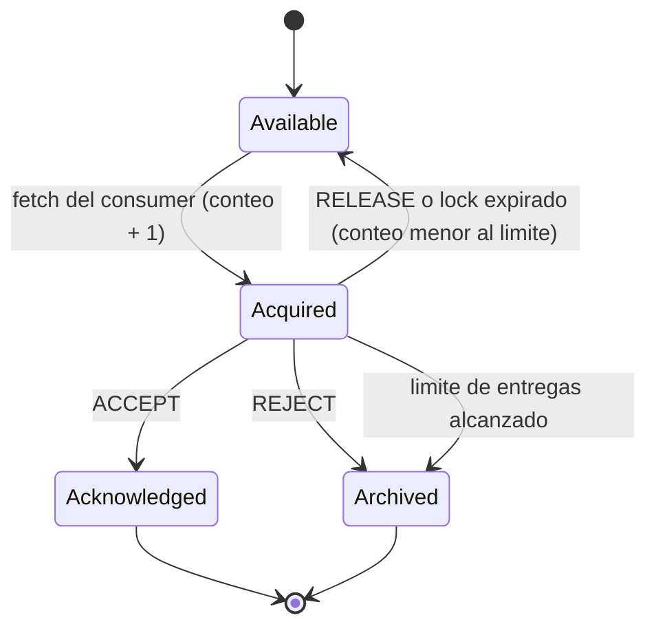
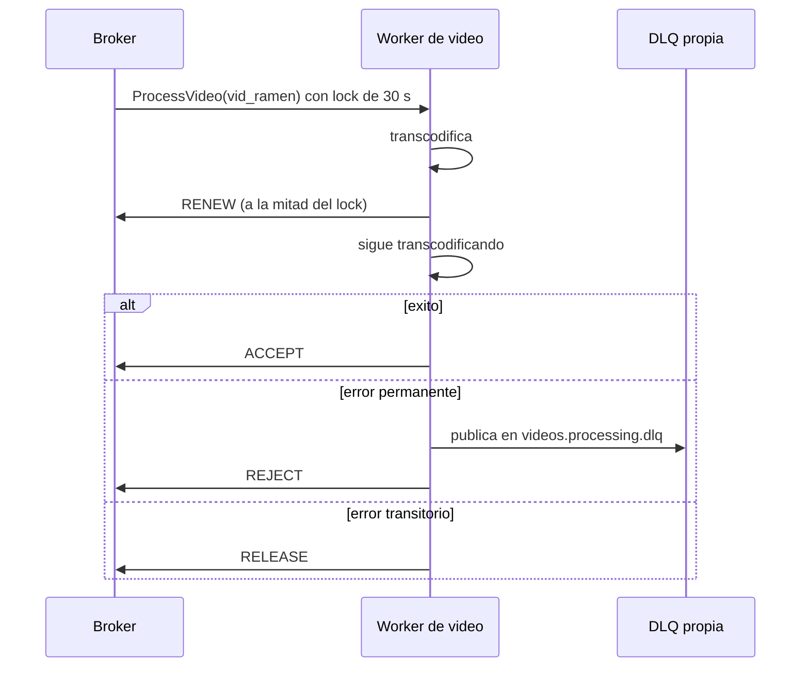
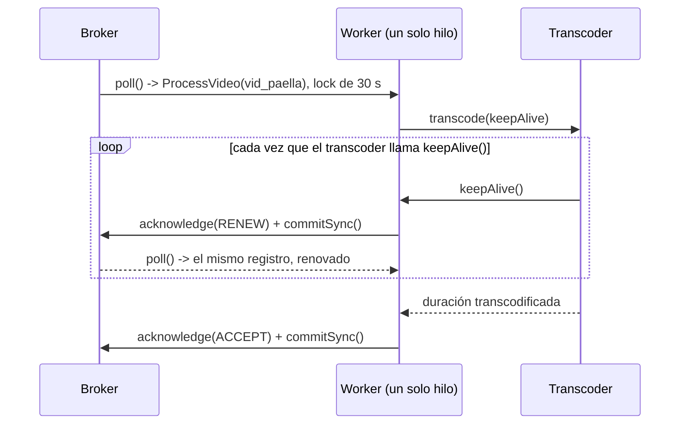

# Share groups (Queues for Kafka)

> **Estado:** vigente · **Versión de referencia:** Kafka 4.3 (docs y configs), KIP-932 · **Última actualización:** 2026-10-12

## Resumen
Un share group reparte **registros** entre los consumers del grupo, sin dueño exclusivo de partición. Cada registro se adquiere con un lock temporal y se confirma uno por uno (ACCEPT, RELEASE, REJECT, RENEW). A cambio de poder escalar más allá de la cantidad de particiones, **se pierde el orden** y **no hay DLQ integrada**: los registros que agotan sus intentos se archivan.

## Por qué importa
Es la herramienta natural para el procesamiento de videos y las notificaciones, pero tiene trampas que pasan sin error: `share.auto.offset.reset=latest` por defecto, archivado silencioso y duplicados por lock expirado.

## Cómo funciona

### Ciclo de vida de un registro



*Por qué este diagrama:* es una **máquina de estados**, porque describe estados y transiciones de un registro.

### Acknowledgements

| Tipo | Efecto | Cuándo |
|---|---|---|
| ACCEPT | Procesado, registro terminado | Éxito |
| RELEASE | Disponible para otro intento | Error transitorio |
| REJECT | No hay más entregas | Error permanente |
| RENEW | Extiende el lock | Procesamiento más largo que el lock |
| Nada | El lock expira y el registro vuelve a estar disponible | Fallo del consumer |

- **Implícito (default):** `poll`, `commitSync` o `commitAsync` aceptan lo entregado; `close()` libera sin confirmar.
- **Explícito:** cada registro debe confirmarse antes del siguiente `poll`; si no, `IllegalStateException`.
- En Spring (modo implícito) una excepción equivale a REJECT y no está disponible RELEASE.

### Orden
- Dentro de un batch, los registros de una partición vienen en offset creciente.
- Entre batches no hay garantía; las redeliveries pueden llegar desordenadas.
- No hay orden por key. El javadoc lo plantea como "at the expense of record ordering".
- La unidad natural de reparto es el *record batch*.

### Configuración verificada (4.3)

| Nivel | Config | Default | Notas |
|---|---|---|---|
| Grupo | `share.record.lock.duration.ms` | 30000 | Entre los límites del broker |
| Grupo | `share.delivery.count.limit` | 5 | Mínimo 2 |
| Grupo | `share.partition.max.record.locks` | 2000 | Tope de registros en vuelo por partición |
| Grupo | `share.auto.offset.reset` | `latest` | Ver riesgo 1 |
| Grupo | `share.isolation.level` | `read_uncommitted` | `read_committed`: una transacción abierta bloquea |
| Grupo | `share.renew.acknowledge.enable` | `true` | |
| Broker | `group.share.record.lock.duration.ms` y `min`/`max` | 30 s; 15 s a 60 s | Acotan el valor del grupo |
| Broker | `group.share.delivery.count.limit` | 5 | Rango 2 a 10 |
| Broker | `group.share.max.size` | 200 | Miembros por grupo |
| Consumer | `share.acknowledgement.mode` | `implicit` | `implicit` o `explicit` |
| Consumer | `share.acquire.mode` | `batch_optimized` | `record_limit` respeta `max.poll.records` |
| Infra | `__share_group_state` | 50 particiones, RF 3, min ISR 2 | Ajustar en clusters de menos de 3 brokers |

### Procesamiento largo con RENEW



*Por qué este diagrama:* es de **secuencia**, porque lo importante es el intercambio entre broker y worker en el tiempo.

> **Corregido el 2026-10-17:** este diagrama omite el `poll()` que sigue a cada `RENEW`; el diagrama correcto está en la sección siguiente.

### Lo aprendido implementando el worker (2026-10-17)

El worker de `Videos` (`ProcessVideoShareWorker`) se probó contra Kafka 4.3.1 real (`ProcessVideoShareWorkerTest`, PUB-01, PUB-03, PUB-04, PUB-07). Tres hallazgos corrigen o precisan lo anterior:

1. **El `RENEW` exige un `poll` después, y se confirma la instancia nueva.** `acknowledge(record, RENEW)` + `commitSync()` renueva el lock, pero el mismo `ConsumerRecord` ya no se puede volver a confirmar (`IllegalStateException: The record cannot be acknowledged` en la segunda renovación). El `poll` siguiente devuelve el registro renovado y ése es el que hay que usar en el `RENEW` posterior y en el `ACCEPT` final. El diagrama de arriba omitía ese `poll`.
2. **Cada partición va a un solo miembro mientras haya miembros para repartirlas.** Con 2 workers y un topic de 3 particiones, un registro con el lock vencido volvió al **mismo** worker (que estaba ocupado), no al otro. Solo con un topic de 1 partición los dos workers recibieron el mismo registro. Consecuencia: el paralelismo "más allá de las particiones" que ofrecen los share groups necesita **más workers que particiones**; con `videos.processing` de 3 particiones y una instancia, no hay segundo worker que robe un registro.
3. **Un `ACCEPT` con el lock ya vencido no lanza excepción: el broker lo rechaza.** `commitSync()` devuelve el error por partición (`The record state is invalid`) y el worker lo registra como advertencia. Por eso la idempotencia por estado del video es indispensable: el trabajo ya hecho no se puede "retirar".



*Por qué este diagrama:* es de **secuencia**, porque lo que corrige es el orden de las llamadas al consumer; todo ocurre en el hilo del worker (el consumer no es thread-safe) y es el transcoder quien decide cada cuánto llama a `keepAlive()`.

Otros hechos observados:
- `share.acquire.mode=record_limit` y `max.poll.records=1` son configuraciones reconocidas por el cliente 4.3.1 (aparecen con su valor en el volcado de `ShareConsumerConfig`, sin aviso de configuración desconocida).
- El broker de pruebas necesita `group.share.min.record.lock.duration.ms` bajo (se usó 1000) para locks de pocos segundos; el mínimo por defecto no se midió acá.
- `kafka-configs.sh --alter --entity-type groups --entity-name <grupo> --add-config share.auto.offset.reset=earliest` funciona en 4.3.1 y el `--describe` muestra el valor por defecto `latest` como sinónimo.
- Sin `RENEW`, el video de 7 s con lock de 3 s se transcodificó dos veces (2 llamadas al transcoder) y `VideoPublished` salió una sola vez; con `RENEW`, una llamada.
- **Medido (`ShareRenewBehaviourTest`, 1 partición, lock de 3 s, 3 mensajes en cola):** tras cada uno de 4 `RENEW` + `commitSync()`, el `poll` devolvió **solo** el mismo registro (no uno nuevo) y su `deliveryCount()` se mantuvo en 1: renovar no suma entregas. Con `max.poll.records=1` el worker no recibe otro mensaje mientras renueva; su rama que libera un registro ajeno es defensiva. En modo explícito un segundo `poll` con un registro sin confirmar lanza `IllegalStateException: All records must be acknowledged in explicit acknowledgement mode`.
- Un mensaje subido a `videos.processing` antes de que existiera el worker se procesó al arrancar (grupo en `earliest`).

## Aplicación por componente

| Componente | Usa share group | Detalle |
|---|---|---|
| Videos (procesamiento) | Sí | `ProcessVideo` con RENEW, DLQ propia, inbox por `videoId` |
| Notifications | **No** (ADR 0008) | Usa consumer group: necesita orden entre `VideoPublished` y `VideoDeleted` |
| Interactions (comentarios, puntuaciones) | **No** | Necesitan orden por key |
| Feed (follow) | **No** | Necesita orden del par |

## Ejemplos del dominio

El caso que falla: el worker transcodifica durante 90 s con lock de 30 s y sin RENEW. El lock expira, otro worker toma el mismo `VideoUploaded` y el video se transcodifica dos veces.

El caso que funciona: el worker usa `share.acknowledgement.mode=explicit`, `share.acquire.mode=record_limit` y `max.poll.records=1`, renueva a la mitad del lock, y el handler es idempotente por `videoId`.

```gherkin
Escenario: un registro que agota intentos no se pierde en silencio
  Dado que ProcessVideo(vid_ramen) falla en 5 entregas consecutivas
  Cuando el worker detecta el último intento
  Entonces publica el evento en videos.processing.dlq con la causa
  Y emite una alerta
  Y el registro queda archivado en el share group
```

### Cómo lo expone Spring Kafka 4.1.1

Resumen de la página [Kafka Queues (Share Consumer)](https://docs.spring.io/spring-kafka/reference/kafka/kafka-queues.html) (consultada 2026-10-12). Detalle y estado de KIP-848 en la nota 09.

| Aspecto | Qué dice Spring |
|---|---|
| Madurez | "As of Spring for Apache Kafka 4.1, backed by Apache Kafka 4.2, share consumers are promoted to full production support." |
| Clases | `DefaultShareConsumerFactory`, `ShareKafkaMessageListenerContainer`, `ShareKafkaListenerContainerFactory`; se usa con `@KafkaListener(containerFactory = ...)` |
| Ack | `ShareAckMode`: `EXPLICIT` (default, el container hace ACCEPT; ante error decide el recoverer), `MANUAL` (el listener llama `acknowledge()`, `release()`, `reject()` o `renew()`), `IMPLICIT` (el broker acepta todo) |
| Errores | `ShareConsumerRecordRecoverer`: `REJECTING` (default) o `RELEASING`; no devuelve RENEW |
| DLQ | "There is no seek or dead-letter topic integration in the share container." |
| Conteo de entregas | "not exposed to consumer applications"; el límite por defecto es 5 |
| Concurrencia | `setConcurrency(n)`: n threads, cada uno miembro del share group |
| No soporta | Message converters, batch listeners, `CommonErrorHandler`, assignment explícito, patrones de topic |

**Consecuencias para nuestro spec:**
- La DLQ propia de la regla 2 se implementa en un `ShareConsumerRecordRecoverer` propio o en modo `MANUAL`; Spring no la trae. *(Inferencia mía: la página no describe esta receta.)*
- Sin message converters, la deserialización del envelope CloudEvents y del payload queda a nuestro cargo (deserializer o código del listener).
- Sin batch listeners: un registro por vez, coherente con `max.poll.records=1`.
- En `MANUAL`, un registro sin confirmar bloquea los `poll` siguientes de ese thread.

## Alternativas y trade-offs

| Opción | Ventaja | Costo | Cuándo |
|---|---|---|---|
| Share group | Paralelismo mayor que las particiones, conteo y reject nativos | Sin orden, sin DLQ integrada | Trabajo independiente |
| Consumer group + retry topics | Orden por key | Más infraestructura propia | Flujos ordenados |
| Cola externa (SQS/RabbitMQ) | Maduras | Otro sistema que operar | Si no se puede usar Kafka 4.2+ |

## Reglas para el spec
1. `share.auto.offset.reset=earliest` explícito en todo share group.
2. Toda DLQ de share group es propia: publicar antes de REJECT y alertar sobre archivados.
3. Handlers idempotentes por `eventId` o por id de negocio (nota 03).
4. Procesos largos usan RENEW con `share.acquire.mode=record_limit` y `max.poll.records=1`.
5. No usar share groups donde el orden por key importe.
6. Fijar Kafka ≥ 4.2.1 y la misma versión menor en clientes y broker.
7. Consumer no thread-safe: un consumer por thread.
8. Tras un `RENEW` + `commitSync()` hay que hacer `poll()` y usar el registro devuelto para confirmar después (hallazgo del 2026-10-17).
9. El tope de entregas lo cuenta el worker con `deliveryCount()`: si lo cuenta Kafka, el registro se archiva sin pasar por la DLQ.
10. Para que otro worker pueda tomar un registro con el lock vencido hace falta más workers que particiones.

## Fuentes
- [KIP-932: Queues for Kafka](https://cwiki.apache.org/confluence/display/KAFKA/KIP-932%3A+Queues+for+Kafka) — estados, locks, orden, límites. Leídos 100.000 de ~225.000 caracteres.
- [KafkaShareConsumer javadoc 4.3](https://kafka.apache.org/43/javadoc/org/apache/kafka/clients/consumer/KafkaShareConsumer.html) — modos de ack, RENEW, thread-safety.
- [Kafka 4.3 – Group Configs](https://kafka.apache.org/43/configuration/group-configs/)
- [Kafka 4.3 – Consumer and Share Consumer Configs](https://kafka.apache.org/43/configuration/consumer-configs/)
- [Kafka 4.3 – Broker Configs](https://kafka.apache.org/43/configuration/broker-configs/) — leído hasta ~100.000 de ~192.500 caracteres.
- [Kafka 4.3 – Design](https://kafka.apache.org/43/design/design/) — sección Share groups.
- [Spring: share consumer](https://spring.io/blog/2025/10/14/introducing-spring-kafka-share-consumer/) — implícito vs explícito, estados de preview.
- [Spring Kafka 4.1.1 – Kafka Queues (Share Consumer)](https://docs.spring.io/spring-kafka/reference/kafka/kafka-queues.html) — soporte en producción, `ShareAckMode`, recoverer, límites. Leída completa por extracción automática, 2026-10-12.
- [Spring Kafka 4.1.1 – What's new](https://docs.spring.io/spring-kafka/reference/whats-new.html) — `renew()` (KIP-1222, Kafka 4.2), `syncShareCommits`, eventos de ciclo de vida.

## No verificado
- **Resto de la KIP-932:** no leí los ~125.000 caracteres finales.
- **La KIP está desactualizada en algo:** dice que no hay renovación de lock, pero RENEW existe desde 4.2; para detalles finos prevalecen el javadoc y las configs.
- **Nombres inconsistentes en el javadoc:** menciona `group.share.record.lock.partition.limit`, que no coincide con `group.share.partition.max.record.locks` de la página de configs; se tomó el de la página de configs. El blog de Spring usa `group.share.delivery.attempt.limit`, inexistente en 4.3.
- **[Cerrado, ver abajo] Si el consumer ve el conteo de entregas** de cada registro: lo recuerdo como `deliveryCount()` en `ConsumerRecord`. Spring 4.1.1 afirma que el conteo "is not exposed to consumer applications" y que no hay API para consultarlo. **Cerrada el 2026-10-12 (spike S2):** `ConsumerRecord.deliveryCount()` con `kafka-clients` 4.3.1 devuelve `Optional<Short>` con 1, 2, 3 y llega al listener de Spring; la afirmación de Spring está desactualizada o se refiere a que no ofrece API propia. Es un valor aproximado según la KIP-932.
- **Nombres de configuración:** la página de Spring cita `group.share.record.lock.duration.ms`, `group.share.partition.max.record.locks` y `group.share.delivery.count.limit` (nivel broker), coherentes con la tabla de arriba; la tabla de Spring no cita los de nivel grupo.
- **Bug de 4.2.0** (deadlock) vía Instaclustr; no verificado en release notes oficiales.
- **Soporte de clientes:** Spring Kafka 4.1.1 lo soporta en producción (ver arriba). `librdkafka` marcaba share consumer como preview y no se revisó para 4.2/4.3. Falta probar Spring Kafka 4.1.x contra un broker 4.2.1+ y la versión exacta de `kafka-clients` (la tabla de compatibilidad dice 4.2.x).
- **Todo es lectura de documentación:** no se ejecutó un broker. *(Desactualizado desde el 2026-10-12: los spikes S1/S2 y el worker de Videos ya corrieron contra Kafka 4.3.1; lo que no se ejecutó sigue siendo lectura.)*
- **Asignación de particiones a miembros (hallazgo 2 del worker):** es una observación de un test con 2 miembros, no leí la parte de la KIP-932 sobre el assignor ni su configuración; puede depender de la cantidad de miembros y particiones de otro modo.

## Historial

| Fecha | Cambio |
|---|---|
| 2026-10-12 | Creación a partir del estudio en conversación |
| 2026-10-12 | Agregada la sección de Spring Kafka 4.1.1 (soporte, ack modes, límites); discrepancia abierta sobre el conteo de entregas |
| 2026-10-12 | Notifications dividido en intake (consumer group) y envío (share group), por el orden entre `VideoPublished` y `VideoDeleted` |
| 2026-10-12 | ADR 0008 aprobado: el único share group del proyecto es el worker de video |
| 2026-10-12 | Ids alineados con la nota 17 (alias de `specs/01-domain/ids-de-ejemplo.md` en prosa y diagramas, ids reales en payloads y SQL) |
| 2026-10-12 | Verificado ejecutando en Kafka 4.3.1 (nota 18): `share.auto.offset.reset` es `latest` por defecto y con `earliest` el mensaje previo se entrega; `share.version` viene finalizada en 1 sin configuración extra |
| 2026-10-12 | Spike S2: `deliveryCount()` se expone; `ShareAcknowledgment.renew()` dentro del listener no mantiene el lock (el `RENEW` funciona con el cliente directo: `acknowledge(RENEW)` + `commitSync()` + `poll()`); el paralelismo depende de las particiones |
| 2026-10-17 | Worker de Videos implementado y probado contra Kafka 4.3.1 real: el `RENEW` requiere `poll` posterior y confirmar la instancia nueva (corrige el diagrama anterior), cada partición va a un solo miembro, el `ACCEPT` con lock vencido lo rechaza el broker sin excepción; reglas 8 a 10 |
| 2026-10-17 | Medido que el `poll` posterior al `RENEW` devuelve solo el mismo registro y que renovar no suma entregas (cerradas dos dudas de "No verificado") |
| 2026-10-19 | El worker procesa en un solo hilo: el transcoder recibe `keepAlive()` y lo llama periódicamente, y cada llamada renueva el lock (se eliminaron el hilo aparte, el `Future` y el bucle de timeout); el diagrama se actualizó |
