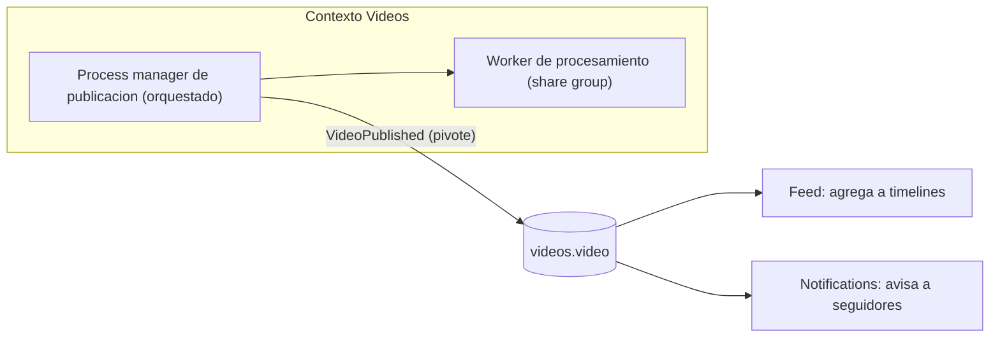
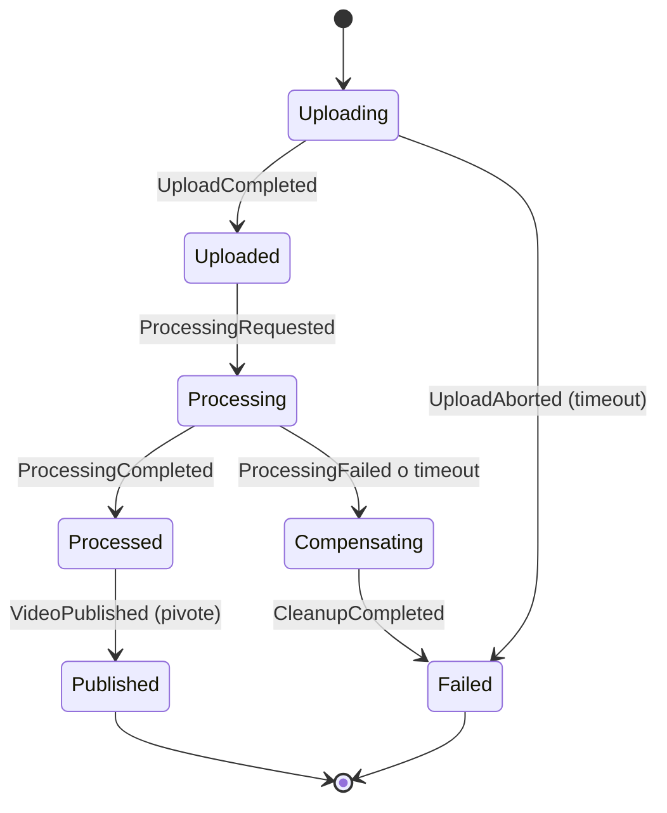
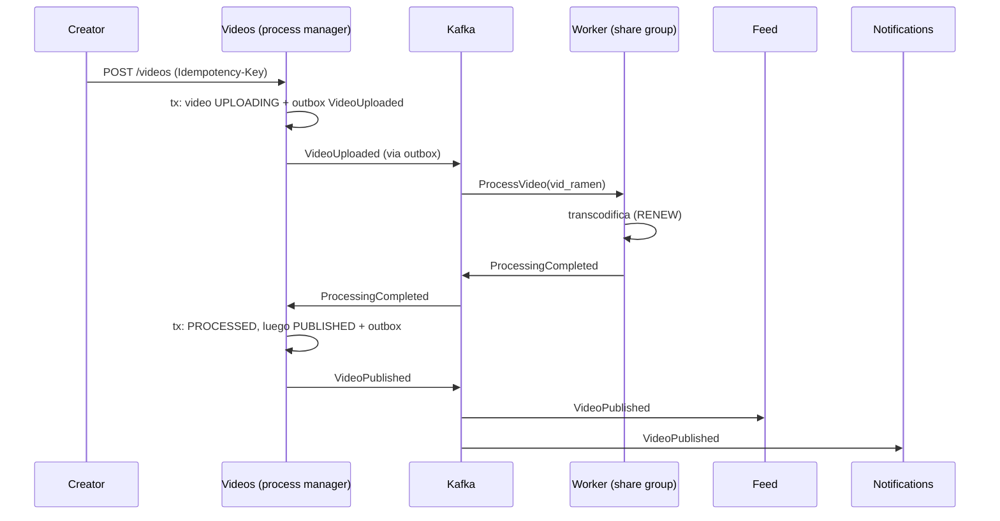
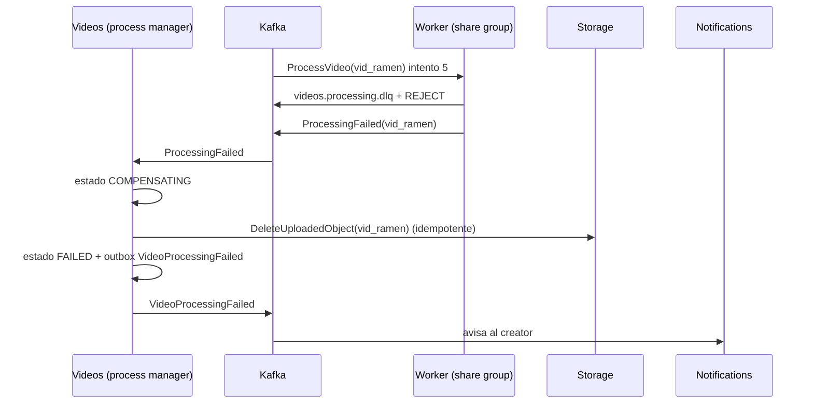

# Sagas y compensación

> **Estado:** vigente · **Versión de referencia:** patrón (microservices.io, Azure Architecture Center, página actualizada en 2026) · **Última actualización:** 2026-10-12

## Resumen
Una **saga** implementa una transacción de negocio que cruza servicios como una secuencia de transacciones locales; si un paso falla, **transacciones compensatorias** deshacen los pasos previos. Hay dos estilos: **coreografía** (cada servicio reacciona a eventos) y **orquestación** (un coordinador ordena los pasos). En nuestro dominio no todo es una saga: la **subida y procesamiento de un video** es una saga orquestada dentro de Videos; la **reacción de Feed y Notifications** a `VideoPublished` es coreografía simple, sin compensación.

## Por qué importa
Cada servicio tiene su base y "2PC is not an option". Sin un diseño explícito, un video puede quedar "procesando" para siempre, con archivos huérfanos en el storage, o publicado sin haber terminado de procesarse. Además, usar saga donde un simple reintento alcanza agrega complejidad innecesaria.

## Cómo funciona

### Conceptos
- **Transacción local:** completa su trabajo de forma atómica en un servicio y dispara el siguiente paso con un evento o mensaje.
- **Compensable:** se puede deshacer con otra transacción de efecto opuesto.
- **Pivote (pivot):** punto de no retorno. Después de que tiene éxito, los pasos compensables dejan de ser relevantes y todo lo que sigue debe completarse.
- **Reintentable (retryable):** pasos posteriores al pivote, idempotentes, que garantizan que la saga llegue a su estado final.
- **Compensación ≠ rollback:** no devuelve el sistema al estado inicial; compensa el trabajo que sí se completó, y puede requerir reglas de negocio (por ejemplo, un reembolso parcial).

### Coreografía vs orquestación

| | Coreografía | Orquestación |
|---|---|---|
| Coordinación | Los servicios intercambian eventos sin controlador central | Un orquestador guarda el estado de cada paso y ordena qué hacer |
| Ventajas | Simple con pocos servicios; sin punto único de falla | Mejor para flujos complejos; evita dependencias cíclicas; separa responsabilidades |
| Desventajas | Difícil de seguir al agregar pasos; riesgo de ciclos; testing de integración difícil | Lógica de coordinación adicional; el orquestador es un punto de falla |
| Cuándo (AWS) | "only a few participants… simple implementation with no single point of failure"; comunicación entre bounded contexts; participantes independientes y débilmente acoplados | "many participants, and loose coupling is required"; el orquestador encapsula la complejidad |
| Resiliencia | Timeouts, reintentos y otros patrones hay que implementarlos "on individual components" | Se aplican a nivel del orquestador |
| Observabilidad | Seguimiento de punta a punta más difícil | Más simple de lograr |
| Auditoría | Conviene guardar los eventos en orden (event sourcing) para auditoría, debugging y replay | El orquestador guarda el estado de cada paso |

> **Tensión con nuestra decisión.** AWS inclina la coreografía hacia "pocos participantes" y la orquestación hacia "muchos". La saga de publicación tiene pocos participantes (Videos, worker, storage), así que por ese criterio caería del lado de la coreografía. Elegimos orquestación por otra razón: hay **estado, timeouts por estado y compensaciones ordenadas**, y el coordinador vive **dentro de un solo contexto** (Videos), así que no acopla servicios entre sí. Es un criterio razonable, pero es juicio nuestro: AWS y Azure no lo respaldan de forma directa. Queda como hipótesis a validar en el experimento.

### Recuperación hacia adelante y hacia atrás

AWS lo plantea como dos principios: la **continuación** decide la recuperación hacia adelante (reintentar) y la **compensación** decide la recuperación hacia atrás (volver al estado previo).

| Tipo de falla | Ejemplo en el dominio | Recuperación |
|---|---|---|
| A nivel de plataforma (infraestructura) | El worker pierde la conexión con el storage | **Hacia adelante:** reintentar el paso local y continuar |
| A nivel de aplicación (regla de negocio o error permanente) | El archivo subido está corrupto y no se puede transcodificar | **Hacia atrás:** compensar (borrar objeto, marcar `FAILED`) |

Esto coincide con la clasificación de errores de la nota 04: los transitorios se reintentan, los permanentes no.

### Dónde aplica en nuestro dominio



*Por qué este diagrama:* es de **componentes**, porque muestra el límite entre la parte orquestada (dentro de Videos) y la coreografiada (entre contextos).

### Estados de la saga de publicación



*Por qué este diagrama:* es una **máquina de estados**, porque la saga es un estado persistido con transiciones válidas e inválidas.

### Clasificación de pasos

| Paso | Tipo | Compensación o garantía |
|---|---|---|
| Reservar objeto de subida (storage) | Compensable | Borrar el objeto (idempotente) |
| Crear registro `UPLOADING` | Compensable | Marcar `FAILED` |
| Procesar video (renditions) | Compensable | Borrar renditions generadas |
| Publicar (`VideoPublished`) | **Pivote** | No se deshace; quitar un video es una acción de negocio nueva (`VideoRemoved`) |
| Agregar a feed | Reintentable | Idempotente por `eventId` |
| Notificar a seguidores | Reintentable | Idempotente; una notificación enviada no se "des-envía" |

## Aplicación por componente

| Componente | Rol en la saga | Decisión |
|---|---|---|
| Videos | Dueño del process manager y de los estados | Orquestación; estado persistido; timeouts por estado |
| Videos (worker) | Ejecuta el procesamiento | Share group con RENEW y DLQ propia (nota 07) |
| Interactions | Participa como lector del estado | Solo acepta puntuaciones y comentarios si el video está `PUBLISHED` (semantic lock) |
| Feed | Reacciona a `VideoPublished` | Coreografía: sin compensación, con inbox |
| Notifications | Reacciona a `VideoPublished` y a `VideoProcessingFailed` | Coreografía; paso reintentable |

## Ejemplos del dominio

### El caso que funciona



### El caso que falla: compensación



*Por qué estos diagramas:* son de **secuencia**, porque el valor está en el orden de pasos, mensajes y compensaciones entre actores.

```gherkin
Escenario: falla el procesamiento y se compensa
  Dado que el video vid_ramen está en estado PROCESSING
  Cuando el procesamiento agota 5 intentos
  Entonces el video pasa a COMPENSATING
  Y se borra el objeto subido de forma idempotente
  Y el video queda en FAILED
  Y el creator recibe una notificación

Escenario: la compensación se reintenta sin duplicar efectos
  Dado que el video vid_ramen está en COMPENSATING
  Cuando el comando DeleteUploadedObject se entrega dos veces
  Entonces el objeto se borra una sola vez
  Y el estado final es FAILED

Escenario: no se puede puntuar un video que no está publicado
  Dado que el video vid_ramen está en PROCESSING
  Cuando usr_ana intenta puntuar vid_ramen (comando RateVideo)
  Entonces se rechaza porque el read model local no lo conoce como PUBLISHED
```

### Anomalías por falta de aislamiento

| Anomalía | Ejemplo en el dominio | Contramedida |
|---|---|---|
| Lectura sucia | Interactions acepta un comentario sobre un video que luego falla el procesamiento | **Semantic lock**: solo aceptar si el estado local es `PUBLISHED` |
| Actualización perdida | El creator edita el título mientras la saga publica | **Versión** del agregado con compare-and-set |
| Lectura no repetible | Un paso lee metadata que otro modificó | **Reread values** antes de actualizar |
| Orden de aplicación | Puntuaciones y vistas concurrentes | **Commutative updates** (estado final, no deltas; nota 03) |

## Alternativas y trade-offs

| Opción | Ventaja | Costo | Cuándo |
|---|---|---|---|
| Coreografía pura | Sin coordinador | Flujo difícil de seguir, ciclos | Pocos pasos y sin compensación (Feed y Notifications) |
| Orquestación (process manager) | Estado explícito, timeouts, compensación ordenada | Más lógica; punto de falla | Publicación de video |
| Solo reintentos | Simple | No cubre fallas permanentes ni limpieza | Si no hay efectos que deshacer |
| Motor de workflows externo | Visibilidad y reintentos listos | Otro sistema que operar | Flujos largos y numerosos (no ahora) |
| Intervención humana | Evita compensaciones erróneas | Latencia | Casos ambiguos o de alto impacto |

## Reglas para el spec
1. La saga de publicación de video se implementa como process manager dentro de Videos, con estado persistido y timeouts por estado.
2. Cada paso se clasifica como compensable, pivote o reintentable en el spec.
3. Todo comando de la saga y toda compensación es idempotente.
4. El estado cambia y el evento se publica en la misma transacción (outbox, nota 05).
5. Los reintentos de pasos van antes que la compensación; se compensa solo al agotar reintentos o ante error permanente (nota 04).
6. Una compensación fallida se reintenta y, si no se resuelve, genera alerta con datos de correlación.
7. Interactions solo acepta puntuaciones y comentarios para videos `PUBLISHED` (semantic lock).
8. El cliente conoce el resultado por un endpoint de estado y por notificación.
9. Todo evento de la saga lleva `correlationid` y `causationid` (nota 01).
10. Los pasos de la saga evitan llamadas síncronas encadenadas: las compensaciones suman latencia y las llamadas síncronas la aumentan más (AWS).
11. Los participantes son idempotentes frente a caídas del orquestador, no solo frente a fallas transitorias (AWS).
12. Se conserva el historial ordenado de eventos de cada saga para auditoría y replay (en nuestro caso, el log de Kafka y la tabla de estado; a decidir por ADR).

## Fuentes
- [microservices.io – Saga](https://microservices.io/patterns/data/saga.html) — definición, estilos, compensación, falta de aislamiento. Consultado 2026-10-12.
- [Azure Architecture Center – Saga](https://learn.microsoft.com/en-us/azure/architecture/patterns/saga) — pivote, reintentables, anomalías y contramedidas, cuándo no usarla. Consultado 2026-10-12.
- [Azure Architecture Center – Compensating Transaction](https://learn.microsoft.com/en-us/azure/architecture/patterns/compensating-transaction) — compensación no es rollback, idempotencia, puntos de no retorno. Consultado 2026-10-12.
- [AWS Prescriptive Guidance – Saga patterns](https://docs.aws.amazon.com/prescriptive-guidance/latest/cloud-design-patterns/saga-patterns.html) — continuación y compensación, recuperación hacia adelante y hacia atrás, criterio de elección. Leída completa, 2026-10-12.
- [AWS Prescriptive Guidance – Saga orchestration](https://docs.aws.amazon.com/prescriptive-guidance/latest/cloud-design-patterns/saga-orchestration.html) — consideraciones y ejemplo con Step Functions. Leída completa, 2026-10-12.
- [AWS Prescriptive Guidance – Saga choreography](https://docs.aws.amazon.com/prescriptive-guidance/latest/cloud-design-patterns/saga-choreography.html) — consideraciones, outbox, event sourcing, ejemplo con EventBridge. Leída completa, 2026-10-12.

## No verificado
- **Ejemplos de AWS:** usan Step Functions, Lambda y EventBridge, no Kafka. Los conceptos aplican, la implementación no se traslada. Los diagramas de las páginas son imágenes y no pude verlos; solo leí el texto que los acompaña.
- **Código de ejemplo de AWS:** se leyó pero no se evaluó ni se ejecutó; el ejemplo es el clásico de orders/inventory/payment.
- **Criterio de elección orquestación vs coreografía:** las fuentes lo ligan a la cantidad de participantes; nuestra elección se apoya en otra razón (ver tensión arriba) y no tiene respaldo directo.
- **Origen académico del patrón:** no consulté el paper original.
- **Persistencia del estado del process manager:** las fuentes describen el concepto, no una implementación concreta en Kafka. Cómo almacenarlo (tabla propia, event sourcing) es decisión nuestra y pendiente de ADR.
- **Estructura exacta de las contramedidas en microservices.io:** la página menciona "countermeasures" sin nombrarlas; los nombres vienen de la guía de Azure.
- **Que nuestra publicación de video se modele con pivote en `VideoPublished`:** es una propuesta de diseño, no una afirmación de las fuentes.
- **Herramientas de workflow** (Temporal u otras): no investigadas.
- **Latencia y costos reales:** nada medido; sin experimentos.

## Historial

| Fecha | Cambio |
|---|---|
| 2026-10-12 | Creación |
| 2026-10-12 | Lectura completa de las 3 páginas de AWS: se agregan recuperación hacia adelante/atrás, criterios de elección, resiliencia y observabilidad, y la tensión con nuestra decisión de orquestar |
| 2026-10-12 | Topics renombrados: por agregado y sin versión en el nombre (el `v1` era invención nuestra); ver ADR 0003 |
| 2026-10-12 | El process manager queda fuera del agregado (nota 15); `Video` sigue con estado + outbox y no con event sourcing (nota 16) |
| 2026-10-12 | Diagrama sin `feed.entry` y semantic lock expresado como comando (regla de publicación) |
| 2026-10-12 | Ids alineados con la nota 17 (alias de `specs/01-domain/ids-de-ejemplo.md` en prosa y diagramas, ids reales en payloads y SQL) |
