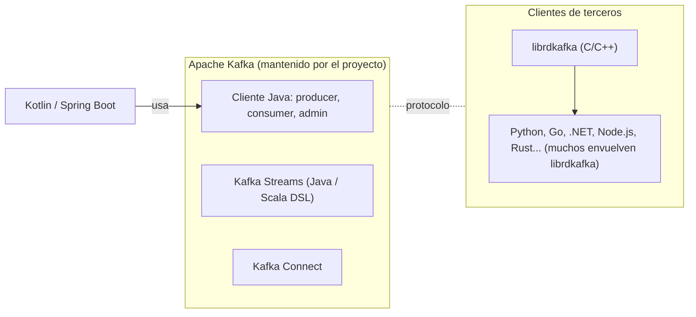

# Clientes de Kafka y lenguajes

> **Estado:** vigente (con vacíos) · **Versión de referencia:** Kafka 4.3 (docs de Streams) · **Última actualización:** 2026-10-12

## Resumen
La documentación oficial de Kafka habla de **Java y Scala** porque el proyecto Apache Kafka mantiene solo el cliente Java (producer, consumer, admin, Streams, Connect). Los clientes de otros lenguajes son proyectos aparte, casi siempre envoltorios de `librdkafka` (C/C++). Kotlin no tiene cliente propio: corre sobre la JVM y usa el cliente Java. Para nuestro proyecto, elegir un lenguaje define **qué features de Kafka 4.x podemos usar y cuándo**.

## Por qué importa
Varias decisiones vigentes dependen de funciones nuevas (protocolo de consumer KIP-848, share groups KIP-932). El cliente de referencia las recibe primero; un cliente de terceros puede tardar o no implementarlas. Elegir stack sin mirar esto puede dejarnos con una decisión del spec que el cliente no soporta.

## Cómo funciona



*Por qué este diagrama:* es de **componentes**, porque muestra qué piezas mantiene el proyecto, cuáles son de terceros y de cuál depende nuestra opción de stack.

### Lo leído en la fuente primaria
- La guía de Kafka Streams (4.3) define: "Any Java or Scala application that makes use of the Kafka Streams library is considered a Kafka Streams application." Menciona una librería DSL para Scala. **No menciona Kotlin.**
- Dos formas de definir la topología: **DSL** (alto nivel, recomendada para empezar) y **Processor API** (bajo nivel, state stores).
- Pasos: definir topología → crear `KafkaStreams` con `Properties` → handler de excepciones (opcional) → `start()` → shutdown hook con `close()`.

### Lo que dicen fuentes secundarias (no primarias)
- El proyecto distribuye oficialmente solo el cliente Java; el resto es comunitario o de Confluent.
- `librdkafka` es la base de la mayoría de los clientes no-JVM.

### Soporte verificado en Spring Kafka (consultado 2026-10-12)

Versión estable: **Spring for Apache Kafka 4.1.1** (preview 4.2.0-M2).

| Feature | Soporte | Fuente | Detalle |
|---|---|---|---|
| KIP-848 (`group.protocol=consumer`) | **Sí, desde 4.0** | [Rebalancing listeners](https://docs.spring.io/spring-kafka/reference/kafka/receiving-messages/rebalance-listeners.html) | Se habilita con `spring.kafka.consumer.properties.group.protocol=consumer` o por código; el default sigue siendo `classic` |
| Share groups (KIP-932) | **Sí, producción desde 4.1** (en 4.0 era early access) | [Kafka Queues](https://docs.spring.io/spring-kafka/reference/kafka/kafka-queues.html) | "backed by Apache Kafka 4.2"; detalle en nota 07 |
| `renew()` (KIP-1222) | Sí, Kafka 4.2 | [What's new](https://docs.spring.io/spring-kafka/reference/whats-new.html) | |
| Protocolo `streams` (KIP-1071) | Configurable en `StreamsBuilderFactoryBean` | What's new | Fuera de alcance por ahora |

**Compatibilidad con `kafka-clients`** ([spring.io](https://spring.io/projects/spring-kafka)):

| Spring Kafka | `kafka-clients` | Spring Boot |
|---|---|---|
| 4.1.x | 4.2.x | 4.1.x |
| 4.0.x | 4.1.2 | 4.0.x |
| 3.3.x | 3.8.0 a 3.9.0 | 3.4.x |

Dos consecuencias:
- **Share groups en producción exigen Spring Kafka 4.1.x** (cliente 4.2.x), coherente con nuestro piso de Kafka ≥ 4.2.1.
- **Limitaciones de KIP-848 en Spring:** los assignors personalizados del cliente se **ignoran** (con warning); `onPartitionsAssigned` puede llamarse varias veces con subconjuntos de particiones. Del lado de Kafka: no hay assignors de cliente y la asignación rack-aware no está completa (ver [consumer rebalance protocol](https://kafka.apache.org/43/operations/consumer-rebalance-protocol/); leído solo en el resumen de búsqueda).

### Versiones más recientes (consultadas 2026-10-12)

| Pieza | Versión | Fuente | Nota |
|---|---|---|---|
| Apache Kafka | **4.3.1** (supported, 2.13) | [Downloads](https://kafka.apache.org/community/downloads/) | También soportadas: 4.2.2 y 4.1.2. La página tiene fechas incoherentes (4.2.2 figura con fecha posterior a 4.3.1); confiar en el número de versión, no en el orden de fechas |
| Spring Kafka | **4.1.1** estable; **4.2.0-M2** preview | [spring.io](https://spring.io/projects/spring-kafka), [change history](https://docs.spring.io/spring-kafka/reference/appendix/change-history.html) | La matriz oficial solo cubre 4.1.x ↔ `kafka-clients` 4.2.x |
| Spring Boot | **4.1.1** (último estable al 2026-10-14; 4.2.0-M2 es milestone) | [System requirements](https://docs.spring.io/spring-boot/system-requirements.html) | Java 17 a 26; Gradle 8.14+ o 9.x; Spring Framework 7.0.9+. El proyecto usa **JDK 25 LTS** (ADR 0001) |
| Kotlin | **2.4.21** (2026-10-08) | [Releases](https://kotlinlang.org/docs/releases.html) | La página tiene el pie con fecha anterior a la release; confirmar con el plugin real |

**Tensión abierta:** el broker más nuevo es Kafka 4.3.1, pero la matriz de Spring Kafka 4.1.1 usa `kafka-clients` 4.2.x, y nuestra regla 6 (nota 07) pide la misma versión menor en cliente y broker. Opciones: (a) broker 4.3.1 y sobrescribir `kafka-clients` a 4.3.x (la página dice que se puede, sin garantía de Spring); (b) broker 4.2.2 con el cliente que trae Spring. Spring Kafka 4.2.0-M2 podría alinear con 4.3, sin verificar.

## Aplicación por componente

| Componente | Qué necesita del cliente | Implicancia |
|---|---|---|
| Videos | Producer idempotente, transacciones si se usan, outbox vía Debezium (Kafka Connect) | Cliente Java cubre todo |
| Interactions | Consumer group con `group.protocol=consumer` | Spring Kafka ≥ 4.0; sin assignors propios; listeners de rebalance idempotentes |
| Feed | Consumer con orden por key; eventualmente Kafka Streams para agregaciones | Streams solo existe en JVM |
| Notifications | Share group (KIP-932) | Spring Kafka ≥ 4.1 (producción); sin DLQ ni converters, se arman a mano |
| Transversales | Contract testing sobre mensajes, Schema Registry | Se estudia en la nota de contract testing |

## Ejemplos del dominio
- **Falla:** elegimos un cliente de terceros y un share group para `notifications.notification`; el cliente no implementa KIP-932 y nos quedamos sin la funcionalidad que justificó la decisión de la nota 07.
- **Funciona:** Notifications en Kotlin con el cliente Java, versión fijada ≥ 4.2.1, y un test de arranque que falla si el broker no soporta share groups. **Verificado en el spike S1 (2026-10-12)**: Boot 4.1.1 + Spring Kafka 4.1.1 + `kafka-clients` 4.3.1 + broker 4.3.1.

```gherkin
Escenario: el stack soporta lo que el spec exige
  Dado que el spec declara group.protocol=consumer para Interactions
  Y share groups para Notifications
  Cuando se fija la versión del cliente
  Entonces existe un test que arranca un consumer de cada tipo contra un broker real
  Y el pipeline falla si alguno no se puede crear
```

## Alternativas y trade-offs

| Opción | Ventaja | Costo |
|---|---|---|
| Kotlin + Spring Boot sobre cliente Java | Cliente de referencia, features nuevas primero, Streams disponible | Atada a la JVM; Spring puede ir detrás del cliente en features nuevas (sin verificar) |
| Java puro | Idéntico al ejemplo de la documentación | Más verboso |
| Go / Python / .NET con `librdkafka` | Ecosistema propio | Soporte de KIP-848 y KIP-932 sin verificar; Streams no existe |

**Recomendación:** mantener Kotlin + Spring Boot. La documentación de Spring Kafka 4.1.1 confirma soporte de KIP-848 y de share groups en producción. Queda pendiente probarlo contra un broker real, que es lo que convierte "lo dice la documentación" en "lo verificamos".

## Reglas para el spec
1. El ADR de stack lista las features de Kafka que exige y la versión mínima del cliente.
2. Cada feature exigida tiene un test de arranque contra un broker real.
3. Si una feature depende de un cliente de terceros, se documenta el estado de soporte con fecha y fuente.

## Fuentes
- [Kafka 4.3 – Writing a Streams application](https://kafka.apache.org/43/streams/developer-guide/write-streams-app/) — consultada 2026-10-12; leída completa vía extracción automática.
- [Spring Kafka 4.1.1 – Rebalancing listeners (KIP-848)](https://docs.spring.io/spring-kafka/reference/kafka/receiving-messages/rebalance-listeners.html) — consultada 2026-10-12.
- [Spring Kafka 4.1.1 – Kafka Queues (Share Consumer)](https://docs.spring.io/spring-kafka/reference/kafka/kafka-queues.html) — consultada 2026-10-12.
- [Spring Kafka 4.1.1 – What's new](https://docs.spring.io/spring-kafka/reference/whats-new.html) — consultada 2026-10-12.
- [Spring for Apache Kafka – project page](https://spring.io/projects/spring-kafka) — tabla de compatibilidad con `kafka-clients` y Spring Boot.
- [Conduktor – Kafka SDK list](https://www.conduktor.io/kafka/kafka-sdk-list) — fuente secundaria, solo apareció en resultados de búsqueda.
- [Confluent – Clients](https://docs.confluent.io/legacy/platform/5.5.15/clients/index.html) — fuente secundaria, versión legacy.

## No verificado
- **Que Apache Kafka distribuya solo el cliente Java:** viene de resúmenes de búsqueda; falta la página oficial de clientes (wiki de Kafka).
- **Soporte de KIP-848 y KIP-932 en `librdkafka` y otros clientes:** no leído.
- **Spring Kafka con Kotlin:** la documentación de Spring está escrita en Java; que funcione igual desde Kotlin es inferencia (JVM), sin fuente ni prueba.
- **Spring Boot:** no verifiqué cómo configura Boot 4.1 los share consumers (propiedades, autoconfiguración); los ejemplos de Spring usan `@KafkaListener` con `containerFactory` explícito.
- **Limitaciones de KIP-848 en Kafka:** vienen del resumen de una búsqueda sobre las páginas 4.0 a 4.3; no leí esas páginas completas.
- **Todo lo anterior es lectura de documentación:** nada se ejecutó contra un broker. Las páginas de Spring se leyeron por extracción automática, no línea por línea.
- **Kafka Streams con Kotlin:** no hay mención oficial; funciona por ser JVM, sin verificar.
- La página de Streams se leyó mediante extracción automática, no línea por línea.

## Historial

| Fecha | Cambio |
|---|---|
| 2026-10-12 | Creación a partir de la observación de que la documentación oficial solo menciona Java y Scala |
| 2026-10-12 | Verificado el soporte de KIP-848 y KIP-932 en Spring Kafka 4.1.1; agregada la tabla de compatibilidad con `kafka-clients` |
| 2026-10-12 | Agregadas las versiones más recientes (Kafka 4.3.1, Spring Kafka 4.1.1, Spring Boot 4.1.1, Kotlin 2.4.21) y la tensión broker 4.3 vs cliente 4.2 |
| 2026-10-12 | Topics renombrados: por agregado y sin versión en el nombre (el `v1` era invención nuestra); ver ADR 0003 |
| 2026-10-12 | Spike S1: la combinación arranca con los tres tipos de consumer (CTR-08) |
| 2026-10-14 | Versiones revisadas el 2026-10-14: Boot y Spring Kafka 4.1.1 siguen siendo el último estable; JDK 25 LTS adoptado; `kafka-clients` 4.4.0 existe pero sin GA confirmado |
