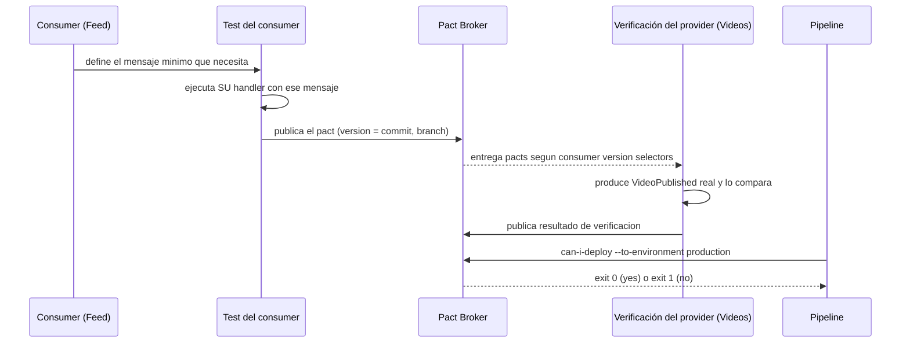
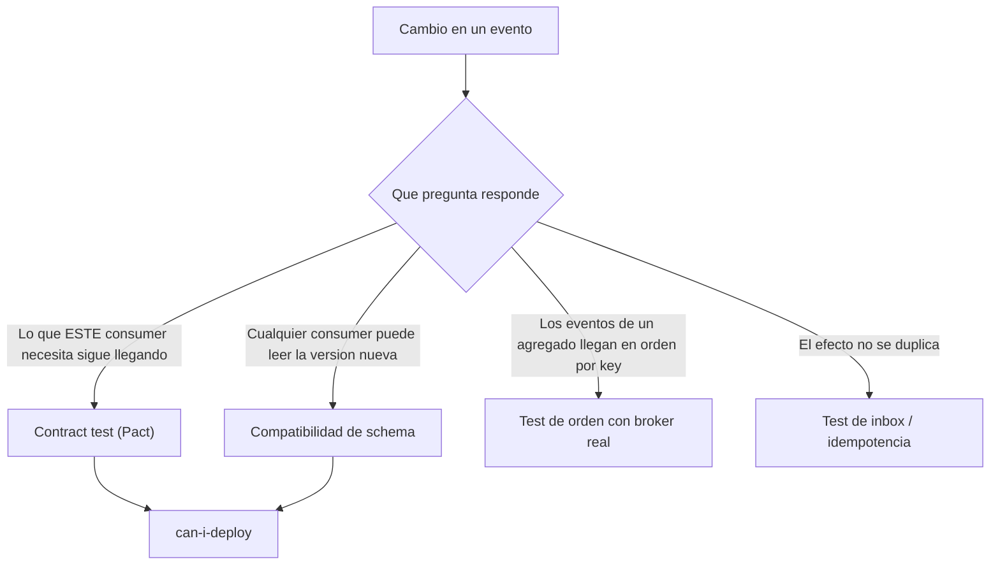

# Contract testing de eventos

> **Estado:** vigente (con vacíos) · **Versión de referencia:** Pact JVM 4.7.5 (última release listada), Pact Broker (docs 2026-10-12), Spring Cloud Contract 5.0.3, Confluent Schema Registry (docs `current`) · **Última actualización:** 2026-10-12

## Resumen
Un contract test verifica que dos servicios se entienden **sin levantar ambos juntos**. En eventos significa dos cosas: el **consumer** prueba que sabe manejar el mensaje que espera, y el **productor** prueba que genera ese mensaje. Pact lo hace con un archivo de contrato que se publica en un broker, y `can-i-deploy` consulta ese broker antes de desplegar. Pact no reemplaza la compatibilidad de schemas: son dos controles distintos que se complementan. Y hay cosas que Pact **no** prueba, entre ellas la key de Kafka, que para nosotros es central.

## Por qué importa
El rol que motivó el proyecto pide "introducir contract tests entre servicios y sacar equipos de un staging compartido". El caso que lo justifica en nuestro dominio: Videos renombra `videoId` a `id` en `VideoPublished`; Interactions, Feed y Notifications se rompen en producción, no en CI.

## Cómo funciona

### Flujo de Pact con mensajes



*Por qué este diagrama:* es de **secuencia**, porque el valor de Pact está en el orden entre test del consumer, broker, verificación del productor y gate de despliegue.

### Lo leído en fuentes primarias
- **Pact** es "the contract between a consumer and a provider… a collection of interactions"; para mensajes, "the minimal message the consumer needs". La verificación pasa si el mensaje real "contains at least the data described in the minimal expected response".
- **Mensajes:** Pact cubre mensajería "focusing on the messages rather than the transport"; reemplaza al intermediario en los tests. El consumer prueba que puede *manejar* el evento, y el provider que puede *producir* el mensaje correcto.
- **Receta oficial de Kafka (Java, JUnit 5):** no hay broker ni topic; Pact entrega los bytes. Consumer: `@PactTestFor(providerType = ProviderType.ASYNCH, pactVersion = PactSpecVersion.V3)` y `MessagePactBuilder`. Provider: `MessageTestTarget` y un método `@PactVerifyProvider("descripcion")` que devuelve `MessageAndMetadata`. La descripción del consumer y la del provider **deben coincidir**.
- **Receta con Schema Registry:** funciona con `MockSchemaRegistryClient` y `mock://anything`; el content type `application/vnd.schemaregistry.v1+json` agrega los 5 bytes mágicos. Para JSON; la página dice que Avro y Protobuf pueden no estar implementados.
- **Pact V4:** permite mensajes asincrónicos con `expectsToReceiveMessageInteraction` y una `reference("asyncapi", "messageId", "...")`, un enlace explícito al mensaje de AsyncAPI.
- **`can-i-deploy`:** "checks whether a version of an application can be deployed to an environment without breaking its integrations". Salida con exit code 0 (yes) o 1 (no). Se registra lo desplegado con `pact-broker record-deployment`. La documentación recomienda "the new deployments and releases features over tags". Tiene modo `dry run` (exit code siempre 0) para probar el pipeline sin bloquear.
- **Versiones y branches:** la versión "should map 1:1 to a commit"; se publica con `--branch`; `mainBranch` se autodetecta para `develop`, `main`, `master`.
- **Pending pacts:** una nueva expectativa del consumer no rompe el build del provider hasta que el provider la verifica por primera vez en esa branch; los fallos se publican igual, así que el consumer sabe que no puede desplegar. **WIP pacts** hacen que los contratos nuevos se verifiquen solos en el pipeline del provider (`includeWipPactsSince`, ventana sugerida de 30 días).
- **Compatibilidad de schemas (Confluent):** BACKWARD (default), BACKWARD_TRANSITIVE, FORWARD, FORWARD_TRANSITIVE, FULL, FULL_TRANSITIVE, NONE. Con BACKWARD hay que actualizar primero los consumers; con FORWARD, primero los productores; con FULL, en cualquier orden. Para JSON Schema influye `additionalProperties` (abierto o cerrado).

### Dos controles complementarios



*Por qué este diagrama:* es de **actividad**, porque ayuda a decidir qué tipo de test responde cada pregunta.

## Aplicación por componente

| Componente | Rol | Contratos | Qué verifica |
|---|---|---|---|
| Videos | Provider | `VideoPublished`, `VideoDeleted` hacia Interactions, Feed, Notifications | Produce mensajes que cumplen lo que cada consumer necesita |
| Interactions | Consumer y provider | Consume `VideoPublished`; provee `CommentPosted`, `CommentEdited` y `CommentDeleted` a Notifications | Su handler tolera el mensaje; su evento cumple |
| Feed | Consumer y provider | Consume `VideoPublished`; provee `CreatorFollowed` y `CreatorUnfollowed` a Notifications (`feed.follow`) | Su handler tolera el mensaje; sus eventos cumplen. La key `followerId:creatorId` no la cubre Pact (CTR-05) |
| Notifications | Consumer | Consume `VideoPublished`, `CommentPosted` y `CreatorFollowed` / `CreatorUnfollowed` | Su handler procesa el mensaje mínimo |
| Pipeline | Gate | `can-i-deploy` por servicio y entorno | Nadie se despliega con un contrato roto |

## Ejemplos del dominio

**El caso que falla:** Videos elimina el campo `creatorId` de `VideoPublished` porque "nadie lo usa". Feed lo necesita para saber a quiénes notificar. Sin contract test, falla en producción. Con Pact, el pact de Feed incluye `creatorId`; la verificación del provider falla y `can-i-deploy` bloquea a Videos.

**Qué sí atrapa y qué no:**

| Cambio | Pact | Compat. de schema | Test de orden |
|---|---|---|---|
| Quitar `creatorId` | Falla (Feed lo usa) | Falla (BACKWARD) | — |
| Renombrar `videoId` a `id` | Falla | Falla | — |
| Agregar campo opcional | Pasa | Pasa | — |
| Cambiar la key de `videoId` a `creatorId` | **Pasa** | **Pasa** | Falla |

La última fila es la importante: la receta oficial de Kafka declara que las keys "not covered", así que **cambiar la key rompe el orden y ni Pact ni el schema lo ven**. Es el motivo de la garantía G1 con test propio.

```gherkin
Escenario: un cambio incompatible en el productor bloquea su despliegue
  Dado que Feed publicó un pact que exige creatorId en VideoPublished
  Cuando Videos propone un cambio que elimina creatorId
  Entonces la verificación del provider falla en el pipeline de Videos
  Y can-i-deploy responde "no" para Videos hacia production
  Y el cambio no se despliega
```

## Alternativas y trade-offs

| Opción | Ventaja | Costo |
|---|---|---|
| **Pact (consumer-driven)** | Cada consumer declara lo que usa; hay broker, `can-i-deploy` y pending/WIP | Pide que los equipos se comuniquen; no cubre keys, headers ni efectos |
| **Spring Cloud Contract** | Integrado con Spring; genera tests y stubs | La página de mensajería 5.0.3 lista Camel, Spring Integration, Spring Cloud Stream y JMS, **no menciona Kafka ni Spring Kafka**; sin Kotlin DSL mencionado |
| **Solo compatibilidad de schemas** | Simple, a nivel de registro | No sabe qué usa cada consumer; no hay gate por entorno |
| **Tests end to end en staging** | Prueban de verdad | Lentos, frágiles, staging compartido (justo lo que queremos eliminar) |

**Recomendación:** Pact como contrato entre servicios + compatibilidad de schema como red de seguridad + tests propios para key y orden. Spring Cloud Contract queda descartado salvo que se verifique su soporte con Spring Kafka.

Lo que la propia documentación de Pact dice que **no** es bueno para: APIs públicas, equipos que no se comunican, pruebas de performance, y no prueba efectos secundarios ("Pact does not test the side effects of a request being executed on a provider"). En nuestro proyecto controlamos ambos lados, así que encaja.

## Reglas para el spec
1. Cada par productor–consumer tiene un pact; el consumer lo define con el mensaje **mínimo** que usa.
2. Los pacts se publican con la versión igual al commit y con `--branch`.
3. La verificación del provider usa `enablePending`, `includeWipPactsSince` y selectores `mainBranch` y `deployedOrReleased`.
4. Cada despliegue pasa por `can-i-deploy` y registra con `record-deployment`.
5. El contrato de mensajes referencia el mensaje de AsyncAPI (`reference("asyncapi", ...)`).
6. La key, los headers y el orden no los cubre Pact: se prueban aparte (ADR 0003).
7. Un `description` de interacción es único por consumer y provider; es la clave que une ambos lados.

## Fuentes
- [Pact – How Pact works](https://docs.pact.io/getting_started/how_pact_works) — conceptos, mensajes. Consultada 2026-10-12.
- [Pact – What is Pact good for](https://docs.pact.io/getting_started/what_is_pact_good_for) — límites.
- [Pact – Kafka recipe](https://docs.pact.io/recipes/kafka) — receta oficial para Kafka (JSON y Schema Registry).
- [Pact – can-i-deploy](https://docs.pact.io/pact_broker/can_i_deploy) — matriz, `record-deployment`, exit codes.
- [Pact – Branches](https://docs.pact.io/pact_broker/branches), [Pending pacts](https://docs.pact.io/pact_broker/advanced_topics/pending_pacts), [WIP pacts](https://docs.pact.io/pact_broker/advanced_topics/wip_pacts)
- [Pact JVM – JUnit 5 consumer](https://github.com/pact-foundation/pact-jvm/blob/master/consumer/junit5/README.md) — `MessagePactBuilder`, V4 con `reference("asyncapi", ...)`.
- [Pact JVM – verificación JUnit 5](https://docs.pact.io/implementation_guides/jvm/provider/junit5) — `MessageTestTarget`, `@PactVerifyProvider`, selectores, propiedades.
- [Pact JVM – releases](https://github.com/pact-foundation/pact-jvm/releases) — 4.7.5 última listada.
- [Pact – Docker images](https://docs.pact.io/pact_broker/docker_images) — imagen oficial del broker.
- [Spring Cloud Contract – Messaging](https://docs.spring.io/spring-cloud-contract/reference/project-features-messaging.html) — integraciones, versión 5.0.3.
- [Confluent – Schema evolution and compatibility](https://docs.confluent.io/platform/current/schema-registry/fundamentals/schema-evolution.html) — tipos de compatibilidad. Leídos 100.000 de ~154.000 caracteres.

## No verificado
- **Ejecución:** verificado en el spike S3 (2026-10-12, nota 18): message pact de `VideoPublished` con consumer y provider reales, y flujo completo contra el Pact Broker 3.0.0. Quedan sin probar pending/WIP pacts, el plugin de Gradle, un `KafkaProducer` real y GitHub Actions.
- **Pact JVM con Kotlin y Spring Boot 4:** **verificado** en S3 con Pact JVM 4.7.5, Kotlin 2.4.21, JUnit 5 y Boot 4.1.1 (JDK 21). Los `$id` relativos de nuestros JSON Schema los rechaza `networknt 3.0.8`; los schemas pasaron a URN (`urn:videoeda:schema:<nombre>`, ADR 0002, 2026-10-16) y validan sin parche.
- **Fecha de las releases de Pact JVM:** la página no muestra el año; "4.7.5, 10 Aug" se asumió de 2026.
- **Pact y key/headers de Kafka:** la receta no los cubre. **Probado en S3:** la key se verifica como metadata (`kafka_key` con matcher regex), pero solo falla el pact que la declara; hay que exigirla en todos los pacts y mantener el test propio CTR-05.
- **Spring Cloud Contract:** que no soporte Kafka directo es lo que **no aparece** en la página, no una afirmación explícita; vía Spring Cloud Stream podría funcionar. Su caracterización como "orientado al productor" es conocimiento previo sin fuente en esta sesión.
- **`pact-broker` OSS:** el comando para correr la imagen y la base de datos requerida no estaban en la página leída.
- **Compatibilidad de schema:** no leí el 35 % final de la página; las tablas de cambios permitidos venían aplanadas y no se pudieron mapear a columnas.
- **Cómo validar contra AsyncAPI en CI:** idea nuestra, sin fuente (validar el contenido de cada pact contra el schema).
- **Bi-directional contract testing de PactFlow:** no leído.

## Historial

| Fecha | Cambio |
|---|---|
| 2026-10-12 | Creación a partir del estudio en conversación |
| 2026-10-12 | Tabla de aplicación alineada con la regla de publicación |
| 2026-10-12 | Feed pasa a provider hacia Notifications (`feed.follow`, opción a de Laura) |
| 2026-10-12 | Spike S3: Pact JVM 4.7.5 con Kotlin 2.4/Boot 4.1 verificado; key como metadata; `can-i-deploy` verde y rojo contra el broker real |
| 2026-10-16 | `$id` de los schemas pasa a URN; la validación con `networknt` ya no necesita ajuste |
