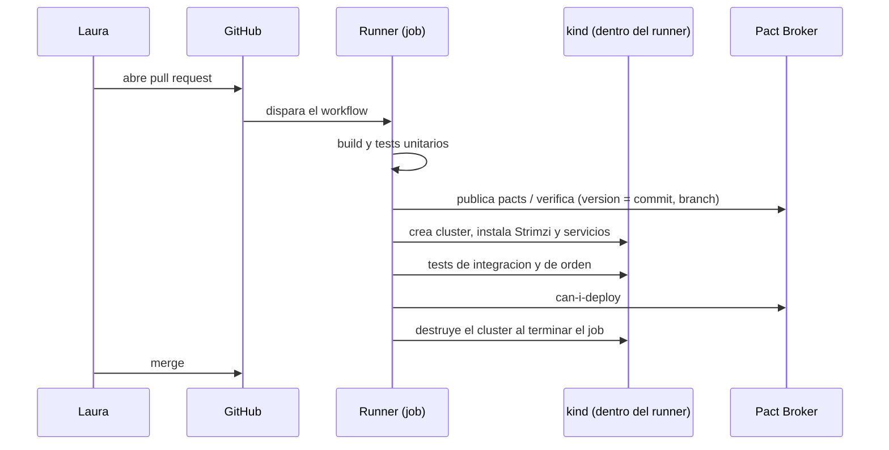
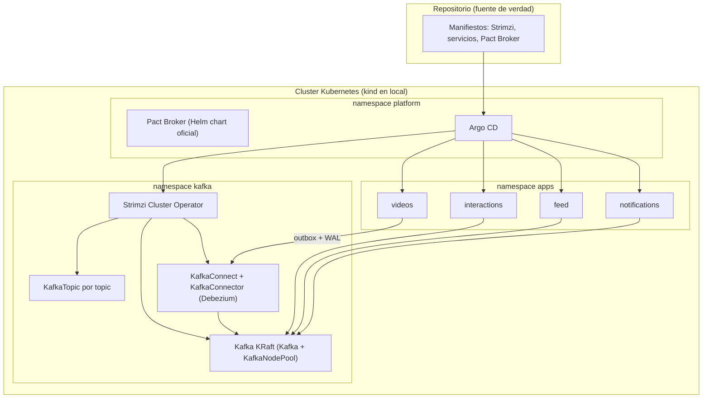
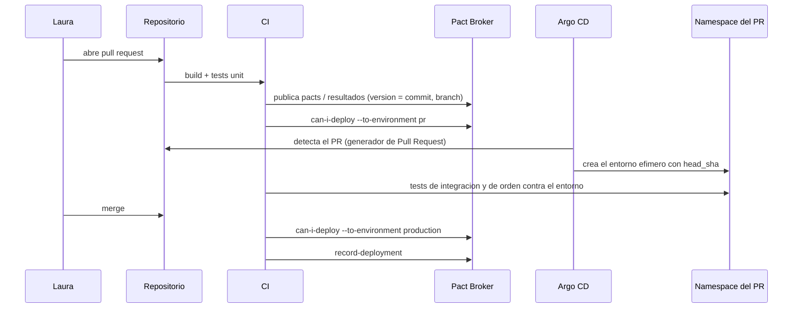

# Infraestructura y despliegue (IaC)

> **Estado:** estudio conservado; **la decisión fue reducida a Docker Compose por el ADR 0008** (esta nota queda como camino de crecimiento) · **Versión de referencia:** Strimzi 1.3.0, Argo CD stable, Debezium 3.7 (docs), kind, Pact Broker Helm chart · **Última actualización:** 2026-10-12

## Resumen
Para levantar todo de forma declarativa y orquestada, la combinación con más respaldo en lo que leí es **Kubernetes + Strimzi** (Kafka, topics, usuarios y Connect como recursos declarativos) **desplegado por GitHub Actions**, que en cada pull request levanta un cluster **kind dentro del runner**, instala todo, corre las pruebas y lo descarta. **Argo CD no hace falta mientras no exista un cluster persistente** (corrección del 2026-10-12: lo había propuesto sin que fuera necesario). Terraform/OpenTofu solo haría falta para crear un cluster en la nube. Esta elección cubre tres pedidos a la vez: orquestar el despliegue de varios servicios, tener Kafka con buenas prácticas declaradas como código, y integrar contract testing en el pipeline.

## Por qué importa
El rol que motivó el proyecto pide "sacar equipos de un staging compartido" y release gates. Sin entornos efímeros y un despliegue declarativo, `can-i-deploy` no tiene dónde apoyarse: solo dice "sí" o "no", pero algo tiene que desplegar.

## GitHub Actions o Argo CD: qué hace cada uno

| | GitHub Actions | Argo CD |
|---|---|---|
| Rol | CI/CD por eventos: corre cuando algo ocurre (push, PR) | Controlador dentro del cluster que compara Git con lo desplegado |
| Cómo despliega | El workflow ejecuta `helm`/`kubectl` (empuja) | Lee Git y aplica (tira); corrige desvíos |
| Necesita | Un runner; un cluster al que llegar o crear | Un cluster **persistente** donde instalarlo |
| Entorno por PR | Crea un cluster kind en el runner y lo descarta al terminar | Crea una `Application` por PR en un cluster existente |
| Costo | Minutos de CI | Operar Argo CD y el cluster |

**Lo que cambia la decisión:** nuestro cluster es local o efímero. Un runner de GitHub no puede llegar a un cluster en tu laptop, pero sí puede crear uno propio: `helm/kind-action` crea un cluster kind dentro del job y requiere Docker, que los runners `ubuntu-latest` traen. Entonces el entorno efímero por PR se resuelve **sin Argo CD**. Argo CD empieza a aportar cuando hay un cluster persistente y se quiere reconciliación continua y rollback desde Git.

### Pipeline por pull request con GitHub Actions



*Por qué este diagrama:* es de **secuencia**, porque muestra el orden dentro de un solo job y que el entorno muere con él.

**Release gates:** los *environments* de GitHub permiten exigir revisores y esperas antes de que un job continúe, pero esas reglas, y los secrets por environment, **solo están disponibles en repositorios públicos** en el plan Free; en privados hacen falta GitHub Pro o Team.

**Recursos del runner:** `ubuntu-latest` tiene 4 vCPU y 16 GB en repositorios públicos, y 2 vCPU y 8 GB en privados. Si Kafka, Strimzi, Debezium, cuatro servicios, sus bases y el Pact Broker entran en 8 GB es un riesgo sin medir.

## Cómo funciona

### Qué se declara y quién lo aplica



*Por qué este diagrama:* es de **despliegue**, porque responde qué corre dónde y qué componente aplica cada recurso.

### Lo leído en fuentes primarias
- **Strimzi 1.3.0** soporta Kafka "4.2.0, 4.2.1, 4.2.2, 4.3.0, 4.3.1" y fue probado en Kubernetes 1.32 a 1.37 ([Downloads](https://strimzi.io/downloads/)).
- **Recursos de Strimzi:** `Kafka` (el cluster), `KafkaNodePool` (grupos de nodos con roles KRaft, "a dedicated node pool of three or more controller nodes" recomendado), `KafkaTopic` (el Topic Operator los observa y los configura), `KafkaUser` (credenciales y reglas de acceso), `KafkaConnect` y `KafkaConnector` ([Overview](https://strimzi.io/docs/operators/latest/overview)).
- **Debezium sobre Strimzi:** el `KafkaConnect` puede construir la imagen con el plugin (`build.plugins`, `build.output`), lleva la anotación `strimzi.io/use-connector-resources: "true"`, y el conector se declara como `KafkaConnector` ligado al cluster por la etiqueta `strimzi.io/cluster`. Las credenciales salen de un Secret por `KubernetesSecretConfigProvider` ([Debezium en Kubernetes](https://debezium.io/documentation/reference/stable/operations/kubernetes.html), docs 3.7).
- **Argo CD, generador de Pull Request:** "fits well with the style of building a test environment when you create a pull request". Crea una `Application` por PR abierto y la elimina cuando deja de cumplir el criterio; expone `number`, `branch` y `head_sha` para nombrar el entorno y fijar la revisión. Refresca por polling (30 min por defecto) o por webhook ([ApplicationSet PR generator](https://argo-cd.readthedocs.io/en/stable/operator-manual/applicationset/Generators-Pull-Request/)).
- **kind:** corre clusters Kubernetes locales con "nodos" en contenedores Docker; "may be used for local development or CI"; soporta clusters multi-nodo ([kind](https://kind.sigs.k8s.io/)).
- **Pact Broker:** chart de Helm oficial documentado en [docs.pact.io](https://docs.pact.io/pact_broker/kubernetes/readme), sobre la imagen `pactfoundation/pact-broker` (puerto 9292).

### Pipeline por pull request (variante con Argo CD y cluster persistente)



*Por qué este diagrama:* es de **secuencia**, porque el valor está en el orden entre CI, broker, Argo CD y el entorno.

## Aplicación por componente

| Componente | Cómo se despliega | Qué declara |
|---|---|---|
| Videos, Interactions, Feed, Notifications | Un manifiesto (Helm o Kustomize) por servicio | Imagen, configuración del producer/consumer, base de datos propia |
| Kafka | `Kafka` + `KafkaNodePool` (KRaft) | Versión 4.3.1, nodos, listeners |
| Topics | Un `KafkaTopic` por topic de AsyncAPI | Particiones, réplicas, retención, `min.insync.replicas` |
| DLQ | `KafkaTopic` con sufijo `.dlq` | Retención larga, alerta |
| Debezium | `KafkaConnect` (build) + `KafkaConnector` por servicio | Outbox y ruteo hacia `<contexto>.<agregado>` |
| Acceso | `KafkaUser` por servicio | Solo escritura en sus topics y lectura de los que consume |
| Pact Broker | Helm chart oficial | Base de datos, URL, credenciales |
| Entornos por PR | `ApplicationSet` con generador de Pull Request | Un namespace por PR con la versión del commit |

## Ejemplos del dominio

**Caso que falla:** el topic `interactions.comment` se crea a mano en el broker con 1 partición y sin DLQ; en el entorno real tiene otra configuración. El test de orden pasa en local y falla en producción. Con `KafkaTopic` en Git, el entorno efímero y el real parten del mismo recurso.

**Caso que funciona:** el PR que cambia la key de `interactions.comment` modifica el AsyncAPI y el `KafkaTopic` correspondiente; el entorno del PR se crea con ambos y el test de orden por key (CTR-05) lo detecta antes del merge.

```gherkin
Escenario: un cambio de servicio se prueba en su propio entorno
  Dado que se abre un pull request que modifica Feed
  Cuando Argo CD crea el entorno del PR con head_sha
  Entonces Feed corre con sus topics, su Kafka y su Pact Broker de pipeline
  Y los tests de integración se ejecutan contra ese entorno
  Y al cerrar el PR el entorno se elimina
```

## Alternativas y trade-offs

| Opción | Ventaja | Costo | Cuándo |
|---|---|---|---|
| **GitHub Actions + kind (en el runner) + Strimzi** | Todo declarativo; entorno por PR sin infraestructura persistente | Entorno descartable; depende de los recursos del runner | **Recomendada** |
| kind + Strimzi + Argo CD | Reconciliación continua; mismas piezas local y nube | Exige un cluster persistente; más conceptos | Cuando haya cluster en la nube |
| Docker Compose | Arranca en minutos, sin operadores | Sin entornos por PR ni GitOps; Kafka y topics sin operador | Primer día / spikes |
| Testcontainers | Ya decidido para tests (ADR 0001) | Efímero por test, no es un entorno | Siempre, en las pruebas |
| Terraform / OpenTofu | Crea infraestructura de nube | No orquesta el despliegue de aplicaciones por sí solo | Solo si hay cluster en la nube |
| Pulumi | Infra con lenguajes de programación | Sin lectura en esta sesión | A evaluar si se quiere Kotlin en infra |
| Kafka gestionado (MSK, Confluent Cloud) | Menos operación | Costo; menos control de versiones; no lo evaluamos | Si el objetivo cambia a producción real |

**Recomendación por fases:**
1. **Testcontainers** (ya decidido): tests contra Kafka 4.3.1 real.
2. **kind + Strimzi + Helm/Kustomize**, aplicando manifiestos a mano: valida el despliegue.
3. **GitHub Actions + kind en el runner**: entorno por PR, tests de integración y `can-i-deploy` en cada pull request.
4. **(Opcional) cluster persistente en la nube** con Terraform/OpenTofu y, recién ahí, Argo CD.

## Reglas para el spec
1. Todo recurso de Kafka (cluster, topic, usuario, conector) vive en Git como manifiesto; no se crea a mano.
2. Cada topic de `03-events/` tiene su `KafkaTopic`; un test verifica que no haya topics sin AsyncAPI ni AsyncAPI sin topic.
3. Cada servicio tiene su `KafkaUser` con permisos mínimos.
4. Cada pull request despliega un entorno propio, creado y destruido por el workflow; no hay staging compartido.
5. El pipeline publica pacts con versión = commit y rama, y consulta `can-i-deploy` antes de desplegar.
6. Las credenciales viven en Secrets, nunca en el manifiesto.
7. La versión de Kafka y de Strimzi se fija explícitamente.

## Fuentes
- [Strimzi – Downloads y versiones soportadas](https://strimzi.io/downloads/) — Strimzi 1.3.0 con Kafka 4.2.x y 4.3.x. Consultada 2026-10-12.
- [Strimzi – Overview](https://strimzi.io/docs/operators/latest/overview) — recursos y KRaft. Consultada 2026-10-12.
- [Debezium – Deploying on Kubernetes](https://debezium.io/documentation/reference/stable/operations/kubernetes.html) — `KafkaConnect` con build y `KafkaConnector`. Docs 3.7.
- [Argo CD – Pull Request generator](https://argo-cd.readthedocs.io/en/stable/operator-manual/applicationset/Generators-Pull-Request/) — entorno por PR.
- [kind](https://kind.sigs.k8s.io/) — clusters locales.
- [GitHub – runners alojados](https://docs.github.com/en/actions/reference/runners/github-hosted-runners) — 4 vCPU/16 GB en públicos, 2 vCPU/8 GB en privados. Consultada 2026-10-12.
- [GitHub – deployments y environments](https://docs.github.com/en/actions/reference/workflows-and-actions/deployments-and-environments) — revisores, esperas, restricciones por plan.
- [helm/kind-action](https://github.com/helm/kind-action) — cluster kind dentro de un job.
- [Pact – nivel PR pipelines](https://docs.pact.io/pact_nirvana/step_5) — herramientas CLI, incluidas GitHub Actions; no cubre `can-i-deploy` en CI.
- [Pact – Deploy with Helm](https://docs.pact.io/pact_broker/kubernetes/readme) — chart oficial del broker (solo resumen de búsqueda).
- [Strimzi – releases en GitHub](https://github.com/strimzi/strimzi-kafka-operator/releases) — CRD v1 desde 1.0.0 (solo resumen de búsqueda).

## No verificado
- **Share groups en Strimzi:** no encontré que la documentación diga si las configuraciones de grupo (`share.*`) se aplican por un recurso de Strimzi o por la Admin API; tampoco si hace falta habilitar algo en el broker. Experimento pendiente.
- **Debezium y Kafka 4.3:** la página es de la versión 3.7 de Debezium; no verifiqué su compatibilidad con Kafka 4.3.1.
- **Argo CD:** no verifiqué cómo crea el namespace por PR (opción de sync), ni la versión estable actual.
- **kind con Kafka:** no verifiqué requisitos de memoria; un cluster Kafka KRaft de tres nodos más servicios puede no entrar en una laptop.
- **Pact Broker en Kubernetes:** la base de datos requerida y los valores del chart no se leyeron.
- **Helm y Kustomize:** no leí su documentación; la elección entre ambos es pendiente.
- **Terraform, OpenTofu, Pulumi, Compose:** conocimiento previo, sin fuente en esta sesión.
- **Strimzi 1.0.0 y CRD v1:** salen de un resumen de búsqueda.
- **GitHub Actions:** la sintaxis para referenciar un environment no se leyó; tampoco si Docker viene preinstalado en `ubuntu-latest` (la página de runners no lo dice; `helm/kind-action` afirma que sí).
- **Cabida en el runner:** que Kafka, Strimzi, Debezium, cuatro servicios y sus bases entren en 8 GB no está medido.
- **`record-deployment` con entornos descartables:** no se definió qué "entorno" de Pact corresponde a un cluster que muere con el job.
- **Repositorio público (decidido 2026-10-12):** por eso valen los datos de runner y de environments de repositorios públicos. No leí la guía de seguridad de GitHub Actions para PRs de forks ni el manejo de secrets en ese contexto.
- **Nada se desplegó:** todo es lectura de documentación.

## Historial

| Fecha | Cambio |
|---|---|
| 2026-10-12 | Creación a partir de la consulta sobre qué IaC usar para orquestar el despliegue |
| 2026-10-12 | Corrección: GitHub Actions con kind en el runner reemplaza a Argo CD como recomendación; Argo CD queda para un cluster persistente |
| 2026-10-12 | ADR 0008 aprobado: Docker Compose reemplaza a Kubernetes + Strimzi + Argo CD; la nota se conserva como camino de crecimiento |
| 2026-10-12 | Fase 0 del spike ejecutada: el ecosistema base con Docker Compose se verificó de verdad (nota 18); la decisión de Compose queda confirmada y el camino con Kubernetes sigue siendo crecimiento |
