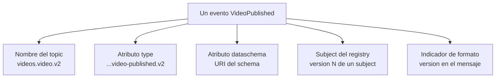
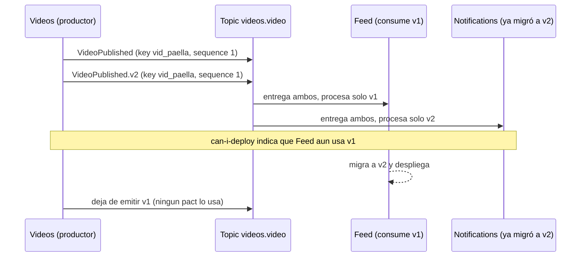

# Diseño y versionado de eventos

> **Estado:** vigente (con vacíos) · **Versión de referencia:** CloudEvents 1.0.3-wip, Confluent Platform `current` (docs), Zalando API Guidelines, Kleppmann 2018 · **Última actualización:** 2026-10-12

## Resumen
Hay **cinco lugares** donde puede vivir la versión de un evento: el nombre del topic, el `type` del evento, el `dataschema`, el *subject* del schema registry o un indicador dentro del mensaje. Las fuentes no coinciden en uno solo. Lo que sí es consistente: **versionar solo ante cambios incompatibles**, preferir cambios aditivos, y que la versión del topic no es lo que define cuántos consumidores lo leen (eso lo define el consumer group). Para nuestro caso la fuente más cercana a tu intuición es CloudEvents: *"When a CloudEvent's data changes in a backwardly-incompatible way, the value of the `type` attribute should generally change."* El topic queda estable y la versión vive en el evento.

## Corrección a lo que dije antes
En la nota 01 y en el ADR 0003 escribí que `v1` en el nombre del topic era "invención nuestra, sin fuente". **Era una afirmación imprecisa.** La guía de nombres de Confluent sí recomienda versión en el topic: *"Apply version numbers, such as v1, v2, etc., to the topic name for schema changes that affect compatibility"*, con el ejemplo `finance.transactions.v1` y `finance.transactions.v2`. Lo que sí es cierto: ponerlo **desde el primer día en todos los topics** no lo recomienda ninguna fuente que leí; la recomendación es usarlo **cuando un cambio es incompatible**.

## Segunda lectura: ¿el camino es correcto?
Después de leer más fuentes (Confluent *Best Practices* y *Revisited*, Zalando #213 y #197–#247, Kleppmann 2012, Dudycz, Arkency y un artículo de DEV), el balance es: **el camino se sostiene, con cuatro ajustes**.

### Qué confirman las fuentes

| Decisión nuestra | Respaldo |
|---|---|
| Un topic por agregado con varios tipos de evento | Kleppmann (orden por entidad); Yokota/Confluent describen cómo hacerlo con un registry |
| La key es la entidad que cambia | Zalando #204: "keyed on the changed entity rather than on `eid` or a timestamp" |
| `sequence` en vez de timestamp para ordenar | Zalando #203: claves de orden estrictamente monótonas; "Timestamps are discouraged" |
| Cambio incompatible = tipo nuevo | CloudEvents; Zalando #213 (`customer-personal-data.email-changed.v2`); Dudycz (`shopping_cart_initialised_v1`, `_v2`) |
| Preferir cambios aditivos | Zalando #209; Dudycz ("the best approach is to not need to do versioning at all") |
| Metadatos propios | Equivalencia con Zalando #247 (tabla abajo) |
| Consumidores tolerantes a duplicados y desorden | Zalando #214 y #212 |

**Equivalencia con Zalando:**

| Nuestro atributo | Zalando | CloudEvents |
|---|---|---|
| `id` | `eid` | `id` |
| `time` | `occurred_at` | `time` |
| `correlationid` | `flow_id` | (extensión) |
| `causationid` | `parent_eids` | (extensión) |
| `sequence` | `ordering_key_fields` (monótono) | (extensión) |

### Ajustes que surgen

1. **Estrategia de subject con varios tipos por topic (discrepancia entre fuentes).**
   - Kleppmann (2018) y Yokota (2020) presentan `RecordNameStrategy` / `TopicRecordNameStrategy` como una opción, con el costo de perder la restricción subject-topic: *"the set of event types in the topic can grow unbounded"*.
   - La guía *Best Practices* de Confluent **va en otra dirección**: evitar las estrategias basadas en el record para topics con varios tipos, y usar la estrategia por topic con `union` / `oneOf`, que "allows for a bounded and known set of types".
   - Para nosotros el conjunto de eventos de un agregado es **conocido y acotado**, así que la segunda opción encaja mejor. Consecuencia: agregar un evento nuevo es una nueva versión del schema del topic. Para JSON Schema, Yokota muestra un `oneOf` con `$ref` y un ajuste de serializer (`auto.register.schemas=false`, `use.latest.version=true`). Esto **corrige la regla 9** anterior.

2. **El fallo silencioso existe también en nuestro enfoque.**
   - Un artículo de DEV (anécdota de un equipo no nombrado, fuente débil) describe consumidores que quedan "healthy, with zero lag" pero sin datos cuando el productor deja de escribir en el topic viejo.
   - El mismo fallo ocurre con tipos: si el productor deja de emitir el tipo original y un consumidor solo entiende ese tipo e **ignora** lo desconocido, no falla: simplemente no recibe nada útil.
   - Ajuste: ignorar un tipo desconocido debe **contarse y alertar** si el volumen ignorado crece (CTR-11 y CTR-12), y retirar un tipo exige que ningún pact lo use (CTR-10). Los consumidores sin pact son el hueco.

3. **`v1` desde el inicio o solo cuando hace falta.** Zalando hace el sufijo de versión **opcional** (`order-cancelled`, y recién `...v2` ante un cambio incompatible); CloudEvents dice que se puede no incluir versión. **Decisión de Laura (2026-10-12): sin `v1`**; el sufijo aparece con el primer cambio incompatible.

4. **Hay alternativas a emitir dos tipos a la vez.** Upcasting o downcasting en la lectura (Dudycz, Arkency), expand-contract (DEV) o migración dentro del topic con reglas (Confluent Enterprise). Nuestra mecánica de emitir ambos tipos está respaldada de forma indirecta: la tabla de contenidos del libro de Greg Young incluye "Double Write" dentro de "Basic Type Based Versioning" (solo el índice, no el texto).

### Lo que **no** cambia
- Topic sin versión en el nombre.
- Varios consumidores por topic, cada uno con su grupo.
- Retiro de un tipo guiado por `can-i-deploy`.

## Qué es Avro y por qué no lo usamos
**Apache Avro** es un sistema de serialización de datos. Según su documentación 1.12.0: ofrece "a compact, fast, binary data format", los schemas "are defined with JSON", y como el schema del escritor está siempre disponible al leer, los valores no llevan información de campos y la serialización es pequeña y rápida. Cuando el lector espera un schema distinto al del escritor, Avro reconcilia ambos ("schema resolution").

En Kafka suele usarse junto a un **Schema Registry**: un servicio que guarda los schemas y deja un identificador en cada mensaje.

| | JSON + JSON Schema (elegido) | Avro + Schema Registry |
|---|---|---|
| Legibilidad | Texto; se lee en una consola | Binario; hace falta decodificar |
| Tamaño del mensaje | Mayor | Menor |
| Componentes a operar | Ninguno extra | El registry |
| Evolución | Reglas de compatibilidad más laxas y dependientes de `additionalProperties` | Reglas estrictas (defaults obligatorios para agregar o quitar campos, según Kleppmann 2012) |
| Integración con Pact (mensajes) | Directa | La receta oficial la soporta con un registry simulado, y avisa que Avro puede no estar implementado |

**Decisión (Laura, 2026-10-12): menos es más.** A nuestro volumen el tamaño no importa y un registry es un componente más. Usamos JSON Schema, sin Avro ni registry (ADR 0008). Lo que sí perdemos es la verificación de compatibilidad que hace el registry; la cubrimos con Pact y la validación de schema en CI.

## Por qué importa
La versión del nombre es difícil de revertir: un topic renombrado obliga a migrar productores y consumidores. Elegir mal el lugar de la versión decide si una evolución incompatible es un cambio de tipo o una migración de infraestructura.

## Cómo funciona

### Dónde puede vivir la versión



*Por qué este diagrama:* es de **componentes**, porque muestra qué piezas pueden portar la versión.

| Lugar | Qué dice la fuente | Fuente |
|---|---|---|
| **Nombre del topic** | Sugiere `v1`, `v2` "for schema changes that affect compatibility"; mantener ambos durante la migración y eliminar el viejo después | [Confluent – naming](https://www.confluent.io/learn/kafka-topic-naming-convention/) |
| **Nuevo topic para cambios incompatibles** | "more likely, create a brand-new topic" y migrar las aplicaciones, para no manejar dos versiones incompatibles en el mismo topic | [Confluent – schema evolution](https://docs.confluent.io/platform/current/schema-registry/fundamentals/schema-evolution.html) |
| **`type` del evento** | Consumidores lo usan como identificador principal; si los datos cambian de forma incompatible "the value of the `type` attribute should generally change"; también puede no llevar versión | [CloudEvents primer](https://github.com/cloudevents/spec/blob/main/cloudevents/primer.md) |
| **`dataschema`** | "Incompatible changes to the schema SHOULD be reflected by a different URI" | [CloudEvents spec](https://github.com/cloudevents/spec/blob/main/cloudevents/spec.md) |
| **Nombre del tipo de evento (Zalando)** | `<functional-name>.<event-name>[.<version>]`, donde la versión es opcional y es "major version of non compatible schemas" (regla #213) | [Zalando API Guidelines](https://opensource.zalando.com/restful-api-guidelines/#events) |
| **Subject del registry** | "A version is a position within a subject's sequence"; "The Kafka topic name can be independent of the schema name" | [Confluent – fundamentals](https://docs.confluent.io/platform/current/schema-registry/fundamentals/index.html) |
| **Indicador en el mensaje** | Patrón *Format Indicator*: número de versión, clave foránea o documento de formato dentro del mensaje | [EIP – Format Indicator](https://www.enterpriseintegrationpatterns.com/patterns/messaging/FormatIndicator.html) |
| **Contratos de datos (Confluent)** | `compatibilityGroup` con `application.major.version` y reglas UPGRADE/DOWNGRADE permiten romper compatibilidad **dentro del mismo topic**; "intra-topic migrations" | [Confluent – data contracts](https://docs.confluent.io/platform/current/schema-registry/fundamentals/data-contracts.html) |

**Disponibilidad de data contracts:** las reglas de schema requieren Confluent Platform Enterprise (7.4 o superior) o Confluent Cloud con Stream Governance Advanced. No verifiqué que exista en versión de código abierto, y no encajaría con nuestro stack sin un registry de Confluent.

### Varios tipos de evento por topic
Kleppmann razona que los eventos de una misma entidad deben ir en el mismo topic y con la misma key, porque *"different topics mean different partitions, and ordering is not preserved across partitions"*. Sus reglas, resumidas:

1. Eventos que deben conservar orden (los de la misma entidad) van en el mismo topic con la misma key.
2. Entidades relacionadas pueden compartir topic; entidades no relacionadas o de equipos distintos, mejor separadas.
3. Si varios consumidores leen el mismo grupo de topics, conviene considerar unirlos.
4. Agrupar por tipo de evento es el último criterio.

**Consecuencia para el registry:** con `TopicNameStrategy` "the schemas of all messages in the topic must be compatible with each other"; para varios tipos por topic hace falta `RecordNameStrategy` o `TopicRecordNameStrategy` ([Kleppmann, 2018](https://martin.kleppmann.com/2018/01/18/event-types-in-kafka-topic.html)). Si adoptamos un registry, el subject va por tipo de evento.

### Varios consumidores por topic
Un topic no tiene "un" consumidor: cada contexto lee con su propio consumer group (o share group), de forma independiente y con su propio offset. La versión en el nombre del topic **no** habilita ni impide esto; lo que sí hace es obligar a cada consumidor a elegir de qué topic lee, y a migrar en bloque. Con la versión en el `type`, consumidores en distinta versión conviven en el mismo topic y filtran por tipo.

### Evolución con la versión en el `type`



*Por qué este diagrama:* es de **secuencia**, porque la migración es una convivencia en el tiempo entre dos tipos en el mismo topic.

Esto combina dos fuentes: CloudEvents (un cambio incompatible cambia el `type`) y Kleppmann (varios tipos en un mismo topic conservan el orden). **La mecánica de publicar los dos tipos a la vez es inferencia nuestra**, no la describe ninguna fuente que leí.

## Estructura de un evento: qué recomiendan las fuentes

| Práctica | Fuente |
|---|---|
| Tratar los eventos como parte de la interfaz del servicio; schema disponible para revisión (#194, #195) | Zalando |
| Metadatos obligatorios: identificador único (`eid`) y timestamp de creación (`occurred_at`) (#247, #211) | Zalando |
| Diferenciar eventos generales de eventos de cambio de datos (#198, #201, #202) | Zalando |
| Orden explícito en eventos de cambio de datos; preferir contadores crecientes antes que timestamps (#242, #203) | Zalando |
| Clave de partición = la entidad que cambia, no el id del evento ni el timestamp (#204) | Zalando |
| Los consumidores deben tolerar duplicados y desorden idempotente: incluir identificador de entidad, clave de orden y estado posterior (#214, #212) | Zalando |
| Evitar `additionalProperties` en los schemas (#210) | Zalando |
| Cambios aditivos y compatibles; agregar enum values es **incompatible** (#209) | Zalando |
| No escribir datos sensibles en eventos (#200) | Zalando |
| Dos estilos: *event notification* (pequeño, receptor consulta de vuelta) o *event-carried state transfer* (lleva datos; sin callbacks, más copias) | [Fowler](https://martinfowler.com/articles/201701-event-driven.html) |
| `source` + `id` único; `subject`; `time`; `dataschema`; extensiones con la misma convención de nombres | CloudEvents |

### Ejemplo para nuestro dominio (propuesta)

```json
{
  "specversion": "1.0",
  "id": "evt_01a13161-12e6-7e09-b67f-10ca57c43328",
  "source": "/videos",
  "type": "dev.videoeda.videos.video-published",
  "subject": "vid_01a13161-1277-7e7b-9435-b109a7e95989",
  "time": "2026-10-12T19:30:00Z",
  "datacontenttype": "application/json",
  "dataschema": "https://videoeda.dev/schemas/video-published/1.0.0",
  "correlationid": "cor_01a13161-13c4-7752-b78c-4c2b8c8039fb",
  "causationid": "evt_01a13161-1355-79ea-92a1-85411003d528",
  "sequence": 1,
  "data": {
    "videoId": "vid_01a13161-1277-7e7b-9435-b109a7e95989",
    "creatorId": "usr_01a13161-11be-7119-8e3e-bf07f13eb833",
    "title": "Mi primer video",
    "durationSeconds": 184,
    "publishedAt": "2026-10-12T19:29:58Z"
  }
}
```

El payload lleva lo que Feed y Notifications necesitan (`creatorId`, `title`) para armar su read model sin llamar a Videos: es *event-carried state transfer* acotado. No lleva datos sensibles ni el estado interno de la saga.

## Aplicación por componente

| Componente | Qué aplica |
|---|---|
| Videos | Emite `VideoPublished` con el estado que necesitan los consumidores; versiona por `type` solo ante un cambio incompatible |
| Interactions | Sus eventos de comentario comparten topic y key; el consumidor ignora tipos que no conoce |
| Feed | Consume `VideoPublished` por `type`; lleva en su read model lo que el evento trae |
| Notifications | Idem; no consulta a Videos por callback |
| Pipeline | `can-i-deploy` indica qué consumidores aún usan la versión vieja antes de retirarla |

## Alternativas y trade-offs

| Opción | Ventaja | Costo |
|---|---|---|
| **Topic sin versión, versión en el `type`** (recomendada) | Orden por entidad intacto; consumidores migran de a uno; un solo topic por agregado | Consumidores deben ignorar tipos desconocidos; productor emite dos tipos durante la migración |
| Topic versionado (`videos.video.v2`) | Separación limpia; fuente: Confluent | Dos topics por agregado durante la migración; se pierde el orden entre ellos; migración de offsets |
| Data contracts con migración (Confluent Enterprise/Cloud) | Migra dentro del mismo topic | Producto de pago/ecosistema Confluent; no verificado en OSS |
| Cambios solo aditivos, sin nueva versión | Más simple | No cubre renombres ni quitar campos requeridos |

## Reglas para el spec
1. El topic no lleva versión; la versión vive en el `type`, **sin sufijo** hasta el primer cambio incompatible y luego `.v2`, `.v3`.
2. Cambio aditivo y compatible: mismo `type`, nueva versión semántica en `dataschema`.
3. Cambio incompatible: nuevo `type` en el mismo topic, con ambos tipos emitidos durante la migración.
4. Retirar un tipo viejo solo cuando ningún pact lo usa (`can-i-deploy`).
5. Los consumidores ignoran los `type` que no conocen.
6. Los schemas no admiten `additionalProperties` salvo decisión explícita.
7. Los enum nuevos se tratan como cambio incompatible hasta definir enums extensibles.
8. Ningún dato sensible en eventos.
9. Si se adopta un registry, un subject por topic cuyo schema es un `oneOf` / `union` con los tipos del agregado (conjunto acotado, Confluent *Best Practices*); `RecordNameStrategy` queda como alternativa si el conjunto de tipos no está acotado.
10. Los eventos con `type` desconocido se **cuentan** y generan alerta si el volumen ignorado supera un umbral por definir.
11. Todo consumidor del topic tiene un pact; un consumidor sin pact no se considera en el retiro de un tipo.

## Fuentes
- [Confluent – Kafka topic naming conventions](https://www.confluent.io/learn/kafka-topic-naming-convention/) — versión en el topic ante cambios incompatibles. Consultada 2026-10-12.
- [Confluent – Schema evolution and compatibility](https://docs.confluent.io/platform/current/schema-registry/fundamentals/schema-evolution.html) — "create a brand-new topic". Leídos 100.000 de ~154.000 caracteres.
- [Confluent – Schema Registry fundamentals](https://docs.confluent.io/platform/current/schema-registry/fundamentals/index.html) — subjects y versiones. Leídos 100.000 de ~139.000.
- [Confluent – Data contracts](https://docs.confluent.io/platform/current/schema-registry/fundamentals/data-contracts.html) — migración dentro del topic. Leídos 100.000 de ~169.000.
- [CloudEvents spec](https://github.com/cloudevents/spec/blob/main/cloudevents/spec.md) (1.0.3-wip) y [primer](https://github.com/cloudevents/spec/blob/main/cloudevents/primer.md) — atributos y versionado.
- [Zalando RESTful API Guidelines – Events](https://opensource.zalando.com/restful-api-guidelines/#events) — reglas de eventos. Leídos 100.000 y un tramo desde 280.000 de ~367.000 caracteres.
- [Kleppmann – Should you put several event types in the same Kafka topic?](https://martin.kleppmann.com/2018/01/18/event-types-in-kafka-topic.html) (2018).
- [Fowler – What do you mean by "Event-Driven"?](https://martinfowler.com/articles/201701-event-driven.html)
- [Confluent – Schema Registry Best Practices](https://www.confluent.io/blog/best-practices-for-confluent-schema-registry/) — modo BACKWARD preferido, subjects, uniones para varios tipos, compatibility groups, registrar schemas por CI. Consultada 2026-10-12.
- [Yokota – Putting Several Event Types in the Same Topic, Revisited](https://www.confluent.io/blog/multiple-event-types-in-the-same-kafka-topic/) (Confluent, 2020-07-08) — unión con referencias, `oneOf`, estrategias por record.
- [Kleppmann – Schema evolution in Avro, Protocol Buffers and Thrift](https://martin.kleppmann.com/2012/12/05/schema-evolution-in-avro-protocol-buffers-thrift.html) (2012) — reglas de evolución: defaults en Avro, tags en Protobuf.
- [Dudycz – Simple patterns for events schema versioning](https://event-driven.io/en/simple_events_versioning_patterns/) — campos opcionales, valores por defecto, upcasting. Fuente secundaria.
- [DEV – Event schema evolution: 4 versioning strategies](https://dev.to/gabrielanhaia/event-schema-evolution-4-versioning-strategies-1-that-quietly-breaks-consumers-1093) — fuente débil: anécdota sin datos.
- [Greg Young – Versioning in an Event Sourced System](https://leanpub.com/esversioning) — solo la tabla de contenidos (Double Write, Weak Schema, Copy and Replace).
- [Apache Avro 1.12.0 – Documentation](https://avro.apache.org/docs/1.12.0/) — definición y características (leído).
- [EIP – Format Indicator](https://www.enterpriseintegrationpatterns.com/patterns/messaging/FormatIndicator.html) — resumen del patrón; sin sección de consecuencias.
- Libros localizados, **no leídos**: Bellemare, *Building Event-Driven Microservices* (2.ª ed., O'Reilly, 2025); Stopford, *Designing Event-Driven Systems* (O'Reilly, 2018, gratuito vía Confluent, con un capítulo sobre evolución de schemas); Kleppmann, *Designing Data-Intensive Applications* (capítulo de codificación y evolución).

## No verificado
- **Libros:** solo verifiqué listados y tablas de contenido; ninguno se leyó.
- **Zalando:** leí las reglas #197 a #247 por extracción; el documento tiene ~367.000 caracteres y los últimos ~5.000 no se leyeron. Los ejemplos de #213 vienen del resumen de la herramienta, no de una transcripción.
- **Confluent schema-evolution y data contracts:** al pedir la parte posterior a los 100.000 caracteres la herramienta devolvió solo la navegación, así que el resto de ambas páginas **sigue sin leerse**.
- **Fecha de Confluent *Best Practices*:** no la encontré; puede ser anterior a la versión actual de la plataforma.
- **Libro de Greg Young y los demás libros:** la herramienta solo mostró índices (Leanpub) o devolvió 403 (O'Reilly). Si descargás el PDF de Stopford (gratis en el bundle de Confluent) y me das la ruta, lo leo con `Read`.
- **Que `v1` en el topic sea una práctica mayoritaria:** la guía de Confluent lo recomienda; una nota de un blog advierte que los topics versionados "quietly break consumers" más que otras estrategias, sin fuente primaria.
- **Data contracts en código abierto:** no verifiqué si existen fuera de Confluent Enterprise y Cloud.
- **Publicar dos tipos a la vez en el mismo topic:** inferencia nuestra.
- **Compatibilidad en JSON Schema con varios tipos por topic:** no verifiqué cómo se comporta un registry con nuestros schemas.
- **Tolerancia a tipos desconocidos:** se asume como regla; ninguna fuente leída lo exige explícitamente.
- **Nada se probó.**

## Historial

| Fecha | Cambio |
|---|---|
| 2026-10-12 | Creación a partir de la pregunta de Laura sobre el lugar de la versión y varios consumidores por topic; corrige la afirmación previa de que `v1` en el topic "no tenía fuente" |
| 2026-10-12 | Segunda lectura: balance del camino, equivalencia con Zalando, discrepancia sobre estrategias de subject (corrige la regla 9), alertas por tipos ignorados |
| 2026-10-12 | Agregada la explicación de Avro y la decisión de no usar Avro ni registry |
| 2026-10-12 | Decisión de Laura: el `type` no lleva `v1`; el sufijo aparece con el primer cambio incompatible |
| 2026-10-12 | El payload publicado es el *published language* del context map (nota 15); los eventos guardados son inmutables y exigen upcasting (nota 16) |
| 2026-10-12 | `feed.follow` vuelve (opción a de Laura): `CreatorFollowed` y `CreatorUnfollowed` se publican con key `followerId:creatorId`; ver ADR 0003 y `specs/03-events/README.md` |
| 2026-10-12 | Ids alineados con la nota 17 (alias de `specs/01-domain/ids-de-ejemplo.md` en prosa y diagramas, ids reales en payloads y SQL) |
