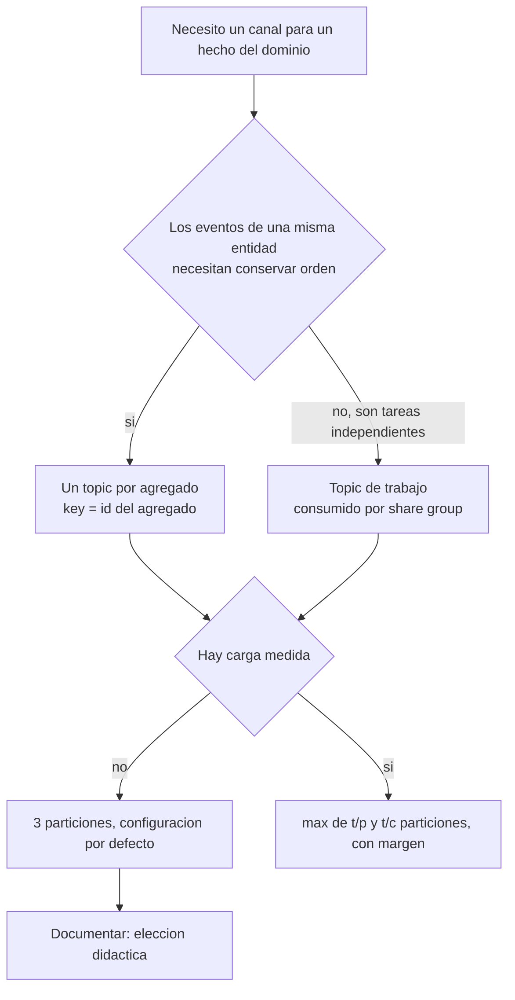

# Topics y particiones: cómo los manejamos y por qué

> **Estado:** vigente (con vacíos) · **Versión de referencia:** Kafka 4.3 (configs de topic) · **Última actualización:** 2026-10-12

## Resumen
Un **topic** es un canal con nombre; una **partición** es la unidad de paralelismo y de orden de ese topic. Nuestras decisiones son tres (más la regla de publicación: solo hay topic para lo que otro contexto consume): **un topic por agregado** (para conservar el orden de cada entidad), **pocas particiones** (3, una elección didáctica porque no tenemos carga que medir) y **configuración por defecto salvo donde hay una razón**. Esta nota explica cada decisión, de dónde sale y cuál es el respaldo; y deja explícito qué es decisión nuestra sin fuente.

**Criterio general (decisión de Laura, 2026-10-12): menos es más.** Este es un ejemplo de arquitectura orientada a eventos bien implementada, no un sistema para escala de producción. Donde una compañía grande necesita maquinaria, nosotros usamos el valor por defecto.

## Cómo lo resuelven otras compañías (y qué nos sirve)

| Compañía | Qué hace | Por qué (según la fuente) | Qué tomamos |
|---|---|---|---|
| **Netflix** | Un topic por tipo de evento/stream en su pipeline Keystone | "isolation and buffering": que una caída de un destino no afecte a los publicadores | **Nada directo:** es un pipeline de datos con muchos destinos; el orden entre tipos de una entidad no es su objetivo |
| **Netflix** | Dos perfiles de replicación: alta disponibilidad (RF 2, `min.insync.replicas` 1, elección no limpia permitida) y consistencia fuerte (RF 3, `min.insync.replicas` 2, no permitida) | La diapositiva no explica el criterio | Los dos perfiles como vocabulario para nuestra decisión de replicación |
| **Pinterest** | Cantidad de particiones estimada por un asistente según el throughput proyectado; retención por defecto reducida; compresión obligatoria; replicación 2 en dev y test | Evitar costos sin darse cuenta; ahorrar costo | La idea de **no elegir retención larga sin razón** y de **replicar menos en entornos de prueba** |
| **Uber** | Un proxy de consumo (uForwarder) que empuja mensajes por gRPC y hace commits fuera de orden | "the impedance mismatch of Kafka partitions for message queuing use cases", más head-of-line blocking | La **motivación** de los share groups: trabajo tipo cola no encaja bien con particiones |
| **Instagram** | No encontré una fuente primaria sobre su uso de Kafka | — | — |

Todas estas compañías operan a una escala (miles de brokers, petabytes) que no tenemos. **Lo que hacen no es lo que debemos copiar: es lo que nos explica por qué existen ciertas opciones.**

## Cómo decidimos



*Por qué este diagrama:* es de **actividad**, porque expresa las decisiones y sus ramas en el orden en que se toman.

## Decisiones, una por una

| # | Decisión | Valor | Por qué | Respaldo | Tipo |
|---|---|---|---|---|---|
| T1 | Granularidad del topic | Un topic por **agregado** (`videos.video`, `interactions.comment`, `feed.follow`) | Los eventos de una entidad deben compartir topic y key para conservar el orden; entre topics no hay orden | Kleppmann (2018); Kafka Design (nota 02) | Con fuente |
| T2 | Nombre | `<contexto>.<agregado>`, sin versión | Versión en el `type` del evento; el topic no cambia ante una evolución | CloudEvents primer; decisión de Laura (nota 12) | Con fuente y decisión |
| T3 | Key | El id del agregado (`videoId`, `commentId`, `followerId:creatorId`) | Misma key, misma partición, orden por entidad | Kafka Design; Zalando #204 | Con fuente |
| T4 | Cantidad de particiones | **3** por topic de dominio | Ver explicación abajo | Jun Rao (2015) fija el criterio; el valor es nuestro | **Nuestra, sin carga que la justifique** |
| T5 | Particiones de DLQ | 1 | El orden de una DLQ no importa y reprocesar es manual | — | Nuestra |
| T6 | Replicación (objetivo) | RF 3, `min.insync.replicas` 2 | Un broker puede caer sin perder escrituras confirmadas | Perfil de consistencia fuerte de Netflix; `unclean.leader.election.enable=false` es el default de Kafka | Con fuente (perfil) y nuestra (adopción) |
| T7 | Replicación (entorno local y de CI) | RF 1, `min.insync.replicas` 1 | Un solo broker; no hace falta más para demostrar las garantías de la aplicación | Pinterest reduce la replicación en dev y test | Nuestra |
| T8 | Retención | `retention.ms=-1` en `videos.video`, `interactions.comment` y `feed.follow` (esta última a confirmar por Laura); default (7 días) en `videos.processing` y DLQ | Los read models de otros contextos se reconstruyen desde esos topics (nota 14); con 7 días no se podría. Pinterest redujo el default para que nadie elija una larga sin saberlo: acá la elegimos **con** una razón escrita | Kafka 4.3 topic configs (default); decisión de Laura, 2026-10-12 (`feed.follow`: derivada, a confirmar) | Con fuente (default) y nuestra (valor) |
| T9 | `cleanup.policy` | `delete`, no `compact` | Nuestros topics guardan hechos, no el último estado por key; con `retention.ms=-1` nada se borra por tiempo | Kafka 4.3 topic configs | Con fuente (default) |
| T10 | Tamaño del mensaje | Default (~1 MB), y **el video nunca viaja por Kafka** | Los eventos llevan metadatos y una referencia al archivo | Kafka 4.3 topic configs | Con fuente (default) y nuestra (regla) |
| T11 | Compresión | Default (`producer`) | A nuestro volumen no aporta; Pinterest la exige por costo de transferencia | Kafka 4.3 topic configs | Con fuente (default) |
| T12 | Creación de topics | Declarados en el repositorio y creados por script; sin creación automática | Que el AsyncAPI y los topics reales coincidan | ADR 0007 | Nuestra |
| T13 | Consumidores | Un consumer group (o share group) por contexto y topic | Cada contexto lee a su ritmo, con su propio offset | Kafka (nota 07) | Con fuente |

### Por qué 3 particiones (T4)
- **El criterio:** Jun Rao: *"a topic partition is the unit of parallelism in Kafka"*; hay que partir de max(t/p, t/c) y dejar margen para crecer, porque cambiar la cantidad después puede romper el mapeo key → partición y con él el orden.
- **Lo que no tenemos:** `t`, `p` ni `c`. No hay carga, así que no hay cálculo posible.
- **Por qué 3 y no 1:** con una sola partición no se vería que el orden es **por key** y no global. Con 3 hay reparto de keys y un consumer group de hasta 3 miembros.
- **Por qué no más:** cada partición suma archivos, tiempo de elección de líder y memoria de cliente (Jun Rao). Para un ejemplo, nada de eso se compensa.
- **Aviso:** es una elección **didáctica**. Cambiarla después exige un ADR (ADR 0003).

### Los límites de la regla "pocas particiones"
Jun Rao da cotas de producción (por ejemplo, limitar a 100 × b × r particiones por broker, con b brokers y r réplicas, por latencia, y 2.000 a 4.000 por broker por disponibilidad). Con 4 topics (`videos.video`, `interactions.comment`, `feed.follow`, `videos.processing`) y 3 particiones estamos órdenes de magnitud por debajo, así que no aplican.

## Aplicación por componente

| Componente | Topic que publica | Particiones | Quién lo consume |
|---|---|---|---|
| Videos | `videos.video` | 3 | Interactions, Feed, Notifications (un grupo cada uno) |
| Videos (trabajo) | `videos.processing` | 3 | Worker, share group |
| Interactions | `interactions.comment` | 3 | Notifications |
| Feed | `feed.follow` (`CreatorFollowed`, `CreatorUnfollowed`); las entradas del feed no se publican | 3 | Notifications |
| Notifications | *(ninguno: no publica eventos; consume `videos.video`, `interactions.comment` y `feed.follow`)* | — | — |
| Transversal | `interactions.dlq`, `feed.dlq`, `notifications.dlq`, `videos.processing.dlq` | 1 cada una | Operación manual |

## Ejemplos del dominio

**Caso que falla:** `interactions.comment` creado con 1 partición "porque total es un ejemplo". El test de orden pasa porque *todo* está ordenado, y no demuestra nada sobre la key. Al subir a 3 particiones más adelante, el mapeo key → partición cambia y un `CommentDeleted` puede quedar delante de su `CommentPosted`.

**Caso que funciona:** el topic se crea con 3 particiones desde el principio, el test publica eventos de 10 comentarios distintos y verifica el orden **dentro de cada `commentId`**, no global.

```gherkin
Escenario: el orden es por key y no global
  Dado que interactions.comment tiene 3 particiones
  Cuando se publican 10 comentarios con tres eventos cada uno
  Entonces para cada commentId los eventos se consumen en orden
  Y no se afirma ningún orden entre comentarios distintos
```

## Alternativas y trade-offs

| Opción | Ventaja | Costo |
|---|---|---|
| **Un topic por agregado (elegida)** | Orden por entidad; pocos topics | Un topic con varios tipos de evento |
| Un topic por tipo de evento (Netflix) | Aislamiento y consumo selectivo | Sin orden entre los tipos de una entidad |
| Un topic único para todo | Un solo canal | Cada consumidor lee todo; sin filtro |
| 1 partición | Orden total | No escala y no demuestra el orden por key |
| Muchas particiones "por las dudas" | Margen de crecimiento | Costo operativo sin beneficio medido |

## Reglas para el spec
0. Un evento se publica solo si otro contexto lo consume (`specs/03-events/README.md`, aplicada el 2026-10-12).
1. Cada topic documenta su key, su cantidad de particiones y la razón.
2. Los valores que no tienen carga que los justifique se marcan como "elección didáctica".
3. Todo cambio de cantidad de particiones requiere un ADR.
4. Ningún topic de dominio lleva configuración propia salvo que haya una razón escrita.
5. Ningún archivo de video ni contenido binario grande viaja por Kafka.
6. Los topics se declaran en el repositorio; no se crean automáticamente.

## Fuentes
- [Jun Rao – How to choose the number of topics/partitions in a Kafka cluster](https://www.confluent.io/blog/how-choose-number-topics-partitions-kafka-cluster/) (2015-03-12) — fórmula de throughput, costos de más particiones, key y cambio de cantidad.
- [Kafka 4.3 – Topic configs](https://kafka.apache.org/43/configuration/topic-configs/) — defaults: `cleanup.policy=delete`, `retention.ms` 7 días, `min.insync.replicas` 1, `max.message.bytes` ~1 MB, `compression.type=producer`, `unclean.leader.election.enable=false`.
- [Kleppmann – Several event types in the same topic](https://martin.kleppmann.com/2018/01/18/event-types-in-kafka-topic.html) (2018).
- [Confluent/Pinterest – Running Kafka at scale at Pinterest](https://www.confluent.io/blog/running-kafka-at-scale-at-pinterest/) — brokersets, asistente de particiones, retención y compresión, replicación en dev y test.
- [InfoQ – Netflix Keystone](https://www.infoq.com/news/2016/03/netflix-keystone-data-pipeline) — un topic por tipo de evento y aislamiento.
- [Netflix – Self-hosting Kafka at Scale (diapositivas)](https://www.slideshare.net/slideshow/self-hosting-kafka-at-scale-netflix-s-journey-challenges/272172619) — perfiles de replicación y escala. Texto extraído de diapositivas; muchas son imágenes.
- [Uber – Introducing uForwarder](https://www.uber.com/en-IN/blog/introducing-ufowarder/) (2026-02-05) — consumer proxy y "impedance mismatch".

## No verificado
- **Netflix, Keystone:** no pude leer el artículo original (`netflixtechblog.com` devolvió 403); me apoyé en InfoQ y en diapositivas. No hay cantidades de particiones por topic.
- **Uber:** el post no cuantifica el modelo partición ↔ paralelismo; no hay fuente sobre sus topics ni particiones.
- **Instagram:** no encontré una fuente primaria. No afirmo nada.
- **El valor 3** y el de la DLQ (1) son decisiones nuestras sin fuente.
- **RF 3 / `min.insync.replicas` 2** no se despliegan en nuestro entorno (un solo broker); es el valor objetivo documentado, sin probar.
- **Configuración del broker:** no verifiqué el default de `auto.create.topics.enable` en 4.3; la regla T12 lo evita.
- **Retención infinita:** `retention.ms=-1` está en la página de topic configs de 4.3 como valor válido; no se probó el crecimiento de disco ni la reconstrucción de un read model desde el principio del topic.
- **`feed.follow`:** existe por la opción (a) elegida por Laura (2026-10-12). Su retención infinita se derivó del mismo criterio que los otros dos topics y no fue decidida explícitamente: a confirmar.
- **Todo es lectura de documentación:** nada se desplegó.

## Historial

| Fecha | Cambio |
|---|---|
| 2026-10-12 | Creación a partir de la pregunta de Laura sobre cómo manejan otras compañías los topics y particiones, y cómo decidimos los nuestros |
| 2026-10-12 | Actualizada por el ADR 0008: sin `notifications.notification`, una DLQ por contexto, creación de topics por script |
| 2026-10-12 | Hallazgo de la nota 14: la retención por defecto de Kafka 4.3 es de 7 días y con ella un read model no se puede reconstruir desde el topic; se propone `retention.ms=-1` en los topics reproyectables (pendiente de decidir). Un topic por agregado queda respaldado por Evans (nota 15) |
| 2026-10-12 | Regla de publicación aplicada: solo `videos.video`, `interactions.comment` y `videos.processing`; sin `interactions.rating`, `interactions.view`, `feed.follow` ni `feed.entry`. Retención `-1` en los dos topics de dominio (T8 pasa de default a decisión nuestra) |
| 2026-10-12 | Vuelve `feed.follow` por la opción (a) de Laura (Notifications consume los follows): 4 topics, Feed pasa a productor, retención `-1` derivada (a confirmar) |
