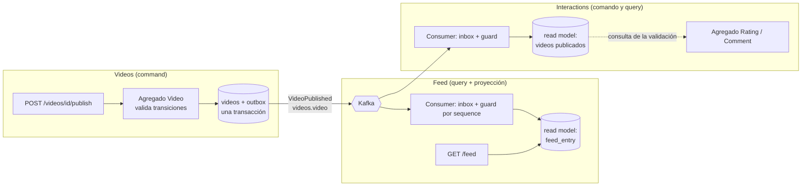
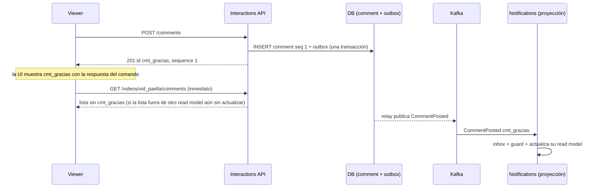
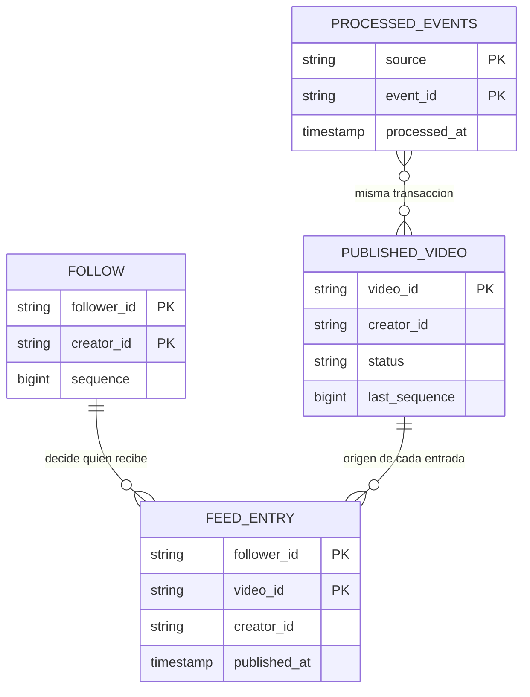

# CQRS y read models

> **Estado:** borrador · **Versión de referencia:** Kafka 4.3 (patrón independiente de versión) · **Última actualización:** 2026-10-12

## Resumen
CQRS (Command Query Responsibility Segregation) separa el modelo que **cambia** el estado (command) del modelo que **lo muestra** (query). No exige event sourcing, ni un bus de comandos, ni dos bases de datos: esas son variantes, no el patrón. Nosotros ya hacemos CQRS sin nombrarlo: cada contexto guarda lo que necesita de los otros en tablas propias alimentadas por eventos. Esta nota le pone nombre, fija **cuánto** CQRS usamos (el mínimo) y deja las reglas verificables.

## Por qué importa
- Sin entender el patrón, el feed se arma llamando por HTTP a Videos: un servicio caído tira abajo a otro y se pierde la autonomía que justifica un servicio por contexto.
- Sin entender la consistencia eventual, "el comentario que acabo de publicar no aparece" se vive como un bug y no como una propiedad del diseño.
- Se conecta con el resto: el read model es lo que el **inbox** y el **guard por `sequence`** (nota 03) protegen, y lo que el **outbox** (nota 05) alimenta.

## Cómo funciona

### Qué es y qué no es

| Es | No es |
|---|---|
| Dos modelos con responsabilidades distintas: uno decide (valida invariantes, cambia estado), otro responde (devuelve datos con la forma que la pantalla necesita) | Event sourcing. Fowler lo trata como complemento posible; Microsoft dice que "algunas implementaciones" lo incorporan |
| Un patrón **por contexto acotado**, no por sistema (Fowler) | Un bus de comandos, un mediator o un framework: Microsoft habla de colas como opción, no como requisito |
| Una decisión sobre cuánto separar (ver niveles) | Una obligación de tener dos bases de datos |
| Pura estructura: la query nunca modifica estado | Lo mismo que CQS. CQS es por método (Meyer); CQRS parte el objeto o el servicio en dos (Young) |

Dos precisiones de Young que sirven para el proyecto: (1) en el lado query "la mayoría de los sistemas pueden ser eventualmente consistentes", mientras que en el command "es mucho más fácil procesar transacciones con datos consistentes"; (2) tras separar, el dominio solo atiende comandos y los repositorios casi no necesitan métodos de consulta más allá de `GetById`.

### Cuánto separar: niveles

| Nivel | Qué es | Fuente | ¿Lo usamos? |
|---|---|---|---|
| **0** | Un solo modelo para leer y escribir (CRUD) | Fowler: "single model" | Solo donde no hay nada que proyectar (Notifications) |
| **1** | Modelos separados, **misma base**: el lado query lee tablas con SQL directo, sin pasar por el agregado | Microsoft: "separate models in a single data store"; Young: "Thin Read Layer" | **Sí, dentro de cada servicio** |
| **2** | Bases separadas sincronizadas por eventos | Microsoft: "separate models in different data stores"; Young, figura 12; microservices.io: *view database* | **Sí, entre contextos**: la "base de lectura" de Feed es una tabla de Feed alimentada por eventos de Videos |
| **3** | Nivel 2 con el event store como modelo de escritura | Microsoft, Young | Se estudia en la nota 16; no se asume acá |

**Recomendación:** nivel 1 dentro de cada servicio y nivel 2 entre contextos, **sin** bus de comandos ni segunda base por servicio. Es lo mínimo que muestra el patrón y lo que Fowler pide: aplicarlo solo donde paga.

### Qué vive de cada lado



*Por qué este diagrama:* es de **componentes**, porque responde qué vive de cada lado (command, query, proyección) y qué es lo único que cruza entre contextos.

Tres cosas que muestra y que importan:
1. **Lo único que cruza es el evento.** Feed nunca lee tablas de Videos (regla 1 de bounded-contexts).
2. **El read model tiene dueño y se escribe solo desde la proyección** (un consumer) o desde el propio comando del contexto; nada más lo toca.
3. **El lado command también puede leer un read model** (línea punteada): Interactions valida "¿está PUBLISHED?" contra su copia local. Eso es consistencia eventual *dentro del comando* (semantic lock, nota 08): un video recién borrado puede aceptar una puntuación durante un instante. Es un riesgo aceptado, no un defecto.

### Consistencia eventual: qué ve la persona

Entre el commit del comando y la proyección hay latencia sin cota fija (relay, retry, lag del consumer; `07-nfr/garantias.md` no la mide todavía). Qué se puede hacer:

| Técnica | Qué hace | Costo | ¿La usamos? |
|---|---|---|---|
| **El comando devuelve lo creado** (id, `sequence`, el estado resultante) | El cliente no necesita consultar para mostrar su propio cambio | Casi nulo | **Sí** |
| **Versión mínima esperada**: la query acepta `minSequence` y responde 409/espera si el read model aún no llegó | Lectura "al menos tan nueva como mi escritura" | Parámetro extra y espera | No por ahora; es la opción si apareciera el requisito |
| **Polling corto** del read model o servir el dato del write model para esa petición | Esconde el lag | Complejidad en el borde | No |
| **Aceptar el lag y mostrarlo** (la UI no promete inmediatez) | Cero | La persona ve "todavía no" | Para listados ajenos (feed) |

La versión mínima esperada es **inferencia nuestra** a partir de que `sequence` ya existe en cada evento; ninguna de las fuentes leídas la propone con ese nombre. El polling y el servir desde el write model están descritos en una fuente secundaria (ver No verificado).



*Por qué este diagrama:* es de **secuencia**, porque la pregunta es qué ve la persona *en cada momento* y la respuesta depende del orden temporal.

### Reproyección (rebuild) de un read model

Un read model es **derivado**: se puede tirar y rehacer. Esa propiedad es la que lo distingue de un dato de verdad. Rehacerlo exige dos cosas:
1. **Una fuente completa**: Confluent recomienda un topic con retención infinita para poder reconstruir o crear vistas nuevas. En Kafka 4.3 `retention.ms` por defecto es 7 días, `cleanup.policy=delete`. **Nuestra configuración por defecto (nota 13) no permite reconstruir desde el topic.**
2. **Un proyector idempotente**: procesar de nuevo el mismo evento no puede cambiar el resultado (inbox y guard por `sequence`, nota 03).

Opciones para tener fuente completa (la decisión es de Laura; ver Reglas):

| Opción | Costo | Comentario |
|---|---|---|
| Retención infinita en los topics de dominio (`retention.ms=-1`) | Una línea de config; el disco crece | Es lo que recomienda Confluent; para un ejemplo es trivial |
| Reconstruir desde el estado del dueño (el contexto productor reemite o expone snapshot) | Un mecanismo más | Más trabajo, sin ventaja acá |
| No reconstruir; los read models son "lo que quedó" | Cero | Pierde la propiedad que hace valioso al patrón |

**Recomendación:** retención infinita en `videos.video` e `interactions.comment` y un escenario de reconstrucción (QRY-02 a QRY-04).

### Relación con lo ya decidido (nota 03)

| Mecanismo | Qué protege del read model |
|---|---|
| Inbox por `source` + `id` | Que un evento duplicado aplique su efecto una vez |
| Guard por `sequence` (`last_sequence` por agregado en la fila) | Que un evento viejo llegado tarde no pise a uno nuevo |
| Misma transacción: inbox + guard + upsert | Que no queden a mitad: o aplica todo o nada |
| Outbox | Que el comando y el evento sean atómicos del lado productor |

Sin estos cuatro, el read model puede divergir de la verdad sin que nadie se entere ("projection drift"; fuente secundaria). CQRS convierte esas garantías de "buenas prácticas" en **requisito**: si hay una proyección, hay inbox.



*Por qué este diagrama:* es **ER** (no UML puro), porque la pregunta es qué tablas tiene Feed y cuáles son estado propio (`FOLLOW`, escrito por su comando) y cuáles proyección (`PUBLISHED_VIDEO`, `FEED_ENTRY`).

## Aplicación por componente

| Componente | Lado command | Lado query / read models | Decisión / regla |
|---|---|---|---|
| **Videos** | Agregado `Video` y process manager de publicación (`UploadVideo`, `PublishVideo`) | `GET /videos/{id}`: estado desde su propia tabla, nivel 1 | No consume eventos de dominio; su read model es su estado |
| **Interactions** | Agregados `Rating` y `Comment` (`RateVideo`, `PostComment`) | Read model `published_video` (alimentado por `videos.video`) usado por la validación; resumen de puntuaciones (conteo, promedio); lista de comentarios | El resumen se actualiza **en la misma transacción** que el comando (nivel 1, misma base); ver "Servicio que consume sus propios eventos" |
| **Feed** | Agregado `Follow` (`FollowCreator`, `UnfollowCreator`) | `feed_entry` y `published_video`: proyección pura de `VideoPublished` y `VideoDeleted`; el follow es su propio comando y además publica `feed.follow` (opción a) | Es el caso de manual del patrón: casi todo su valor es el lado query |
| **Notifications** | Casi no hay comando de negocio: lo dispara un evento | Su tabla `notification` con estado (REQUESTED/SENT/FAILED/CANCELLED) | Nivel 0: una tabla, sin separar. Forzar CQRS acá sería sobreingeniería (ADR 0008) |
| **Borde / API** | Endpoints `POST`/`PUT`/`DELETE` devuelven el recurso creado con su `sequence` | Endpoints `GET` leen read models, no tocan el agregado ni el outbox | Un `GET` no escribe nada (QRY-05) |

### Servicio que consume sus propios eventos
Los escenarios originales (RAT-03, RAT-04, FEED-03) describían a Interactions y Feed **consumiendo del broker eventos que ellos mismos produjeron** (`interactions.rating`, `feed.follow`). **Resuelto el 2026-10-12:** la regla de publicación quitó `interactions.rating`, y `feed.follow` volvió porque **Notifications** sí consume los follows (opción a). Lo que queda como proyección local es el estado propio de cada servicio; los follows se publican hacia otro contexto. Para el análisis original, la regla de publicación señalaba que nadie más consumía `VideoRated` ni `CreatorFollowed`. Visto desde CQRS, la proyección dentro del mismo servicio no necesita Kafka: se actualiza en la transacción del comando (nivel 1). Pasarla por el broker agrega latencia, lag y duplicados para un caso sin ganancia.

Qué se pierde si se cierra así: RAT-03/RAT-04 y FEED-03/FEED-04 ya no ejercitan duplicados y desorden por esa vía. **Se siguen demostrando** con los consumidores que sí cruzan contextos: `VideoPublished` hacia Feed, Interactions y Notifications; `CommentPosted` hacia Notifications. Esta nota no lo resolvió: lo cerró la regla de publicación y la opción (a).

## Ejemplos del dominio

### El caso que falla: el feed armado por consulta síncrona

```gherkin
Escenario: el feed consulta a Videos en cada lectura (NO es nuestro diseño)
  Dado que usr_ana sigue a usr_lucia y Videos está caído
  Cuando usr_ana abre su feed
  Entonces Feed llama por HTTP a Videos para traer los videos de usr_lucia
  Y la llamada falla
  Y el feed completo falla aunque Feed esté sano
```

Es el problema que microservices.io plantea para *Database per Service*: las consultas que juntan datos de varios servicios. La solución que ellos describen es una vista propia actualizada con eventos, que es exactamente `feed_entry`.

### El caso que funciona: lectura desde el read model propio

```gherkin
Escenario: QRY-06 el feed responde con Videos caído (propuesto)
  Dado que Feed procesó VideoPublished de vid_paella de usr_lucia y usr_ana sigue a usr_lucia
  Y Videos no responde
  Cuando usr_ana abre su feed
  Entonces ve vid_paella desde feed_entry
  Y no hay ninguna llamada a Videos
```

### Consistencia eventual, el caso que falla antes del que funciona

```gherkin
Escenario: la persona no ve su propio comentario (NO es nuestro diseño)
  Dado que usr_ana publicó el comentario cmt_gracias
  Cuando la UI vuelve a pedir la lista y el read model aún no lo tiene
  Entonces la UI reemplaza lo que mostraba por la lista sin cmt_gracias
  Y usr_ana cree que el comentario se perdió
```

```gherkin
Escenario: QRY-01 el comando devuelve lo creado (propuesto)
  Dado que usr_ana publica el comentario cmt_gracias en vid_paella
  Cuando la API responde 201
  Entonces el cuerpo trae id cmt_gracias, sequence 1 y el texto
  Y la UI lo muestra sin consultar la lista
  Y la lista de vid_paella incluye cmt_gracias una vez procesada la proyección
```

### Reproyección, en orden ZOMBIES

```gherkin
@zero @integracion
Escenario: QRY-02 reconstruir con el topic vacío (propuesto)
  Dado que feed_entry tiene filas y videos.video no tiene eventos retenidos
  Cuando se vacía el read model y se reproyecta desde el offset inicial
  Entonces feed_entry queda vacío y no hay error
```

```gherkin
@one @integracion
Escenario: QRY-03 reconstruir con un evento (propuesto)
  Dado que videos.video tiene un VideoPublished de vid_paella (usr_lucia) y usr_ana sigue a usr_lucia
  Cuando se vacía y se reproyecta
  Entonces existe exactamente una entrada (usr_ana, vid_paella)
```

```gherkin
@many @integracion @G4
Escenario: QRY-04 reconstruir con muchos eventos y duplicados (propuesto)
  Dado que videos.video tiene 1.000 eventos, 10 de ellos duplicados y 5 fuera de orden
  Cuando se vacía y se reproyecta
  Entonces feed_entry es idéntico al que existía antes
  Y reproyectar una segunda vez no cambia nada
```

```gherkin
@unit
Escenario: QRY-05 una consulta no modifica estado (propuesto)
  Dado que existe el comentario cmt_gracias
  Cuando se ejecuta GET /videos/vid_paella/comments cinco veces
  Entonces no se escribió ninguna fila en outbox ni en ninguna tabla
```

## Alternativas y trade-offs

| Opción | Ventaja | Costo | Cuándo |
|---|---|---|---|
| **Sin CQRS** (CRUD + API composition: el cliente o un gateway junta datos de varios servicios) | Cero piezas nuevas | Acopla en lectura; disponibilidad = producto de las disponibilidades | Pocas consultas cruzadas y servicios muy estables |
| **Nivel 1** (modelos separados, misma base) | Barato; orden mental claro | Poca ganancia de escala | Siempre que haya lógica de dominio y consultas con otra forma |
| **Nivel 2** (proyección por eventos entre contextos) | Autonomía de cada servicio; lecturas rápidas y a medida | Consistencia eventual, inbox, reproyección | Cuando el dato vive en otro contexto (nuestro caso) |
| **Nivel 3** (con event sourcing) | Historia completa; read models rehacibles desde el store propio | Todo el modelo cambia; upcasting | Auditoría estricta; en este proyecto es una decisión didáctica (nota 16) |
| **Kafka Streams / ksqlDB** como motor de la vista | La vista y las consultas interactivas viven en Kafka | Otra tecnología que operar y probar | Camino de crecimiento; fuera de alcance (ADR 0008) |
| **Bus de comandos / mediator** | Pipeline de cross-cutting (validación, logging) | Una capa más | No: el controlador llama al caso de uso |

## Reglas para el spec
1. **Alcance:** nivel 1 dentro del servicio y nivel 2 entre contextos. Prohibidos: bus de comandos, segunda base por servicio. (ADR nuevo o parte del ADR de CQRS + event sourcing.)
2. **Un caso de uso por comando** (`PublishVideo`, `RateVideo`, `PostComment`): carga el agregado, valida invariantes, guarda estado y outbox en una transacción.
3. **Los `GET` no escriben**: ni en tablas de dominio ni en outbox (QRY-05).
4. **Todo read model alimentado por eventos** lleva inbox por `source` + `id` y guard por `sequence` en la misma transacción que el upsert (nota 03, ADR 0005).
5. **Los `POST`/`PUT`/`DELETE` devuelven el recurso con su `sequence`**; la consulta no promete lectura inmediata (QRY-01). *(`minSequence` queda como extensión, no incluida.)*
6. **Todo read model es reconstruible**: hay un escenario de reproyección en cero, uno y muchos (QRY-02 a QRY-04). Requiere decidir la retención de `videos.video` e `interactions.comment`.
7. **El lado command puede consultar un read model local** para validar (semantic lock) y se documenta como riesgo aceptado (NOT-11 es el mismo tipo de riesgo).
8. **Una proyección dentro del mismo servicio no pasa por el broker** si la regla de publicación se confirma (ver "Servicio que consume sus propios eventos").
9. **Garantía nueva (propuesta, a numerar en `07-nfr`)**: *el read model es una función de los eventos*; prueba: reproyectar desde cero y comparar.

## Fuentes
- [Martin Fowler – CQRS](https://martinfowler.com/bliki/CQRS.html) — publicado 2011-07-14; la página no muestra fecha de actualización. Consultado 2026-10-12, leído completo (vía resumen de WebFetch). Definición, "for most systems CQRS adds risky complexity", aplicarlo a un bounded context.
- [Microsoft Learn – CQRS Pattern (Azure Architecture Center)](https://learn.microsoft.com/en-us/azure/architecture/patterns/cqrs) — `ms.date` 2025-02-20, `updated_at` 2026-10-11. Consultado 2026-10-12, leído completo. Dos niveles de separación, outbox + consumer idempotente, cuándo usar y cuándo no, combinación con event sourcing.
- [Greg Young – CQRS Documents (PDF, 56 págs.)](https://cqrs.wordpress.com/wp-content/uploads/2010/11/cqrs_documents.pdf) — 2010 (por la ruta del archivo). Consultado 2026-10-12 con `pdftotext`. **Leído:** capítulo "Command and Query Responsibility Segregation" (págs. 17 a 24) y "CQRS and Event Sourcing" (págs. 50 a 51). El resto (arquitectura estereotípica, UI basada en tareas, event storage) solo por el índice.
- [microservices.io – CQRS (Chris Richardson)](https://microservices.io/patterns/data/cqrs.html) — sin fecha de página (copyright 2026). Consultado 2026-10-12. El motivo "consultas que cruzan servicios" y los inconvenientes (complejidad, lag).
- [Confluent Developer – Event Sourcing: CQRS](https://developer.confluent.io/courses/event-sourcing/cqrs/) — Anna McDonald y Ben Stopford; sin fecha de módulo (copyright 2014-2026). Consultado 2026-10-12. Retención infinita para reconstruir, varias vistas por log, consistencia eventual.
- [Apache Kafka 4.3 – Topic configs](https://kafka.apache.org/43/configuration/topic-configs/) — consultado 2026-10-12. Defaults de `retention.ms` (604800000), `retention.bytes` (-1) y `cleanup.policy` (`delete`).

## No verificado
- **Fowler:** leí un resumen de la página generado por WebFetch, no el HTML crudo. Las dos imágenes del artículo no pude verlas; su descripción es inferida.
- **Young:** solo los capítulos señalados. No leí "Task Based User Interface" ni "Building an Event Storage". La afirmación "CQRS no exige event sourcing" la **infiero** de que el capítulo separa los modelos con bases relacionales (figura 12) y trata event sourcing aparte; Young no lo dice con esas palabras en lo que leí.
- **Confluent:** un solo módulo del curso, sin fecha; no revisé guías más nuevas de Confluent sobre el tema. El resumen de WebFetch indicó que el módulo cubre ksqlDB y no Kafka Streams, aunque otras páginas de Confluent (resultados de búsqueda sin abrir) sí hablan de Interactive Queries.
- **Fuentes secundarias solo por resumen de búsqueda (no abiertas):** AxonOps y otros blogs. De ahí salen "polling corto del read model", "servir el dato del write model" y "projection drift". Sirven como lecciones operativas, no como respaldo.
- **Inferencias propias:** `minSequence` como mecanismo de lectura mínima; que una proyección dentro del mismo servicio deba hacerse en la misma transacción; que `retention.ms=-1` sea una línea de configuración sin otros efectos; la tabla de decisiones por componente.
- **Retención infinita:** no probé qué hace Kafka 4.3 con `retention.ms=-1` en un topic de 3 particiones en una sola máquina; Confluent la recomienda, no verifiqué el costo de disco.
- **Discrepancias entre fuentes:**
  - **Costo/riesgo.** Fowler: "for most systems CQRS adds risky complexity" y "should only be used on specific portions". Young: "in the worst case, the cost should work out to be equal" y en muchos casos baja el costo. Microsoft: "no conviene" si el dominio es simple o alcanza CRUD. Se resuelven por el **nivel**: Young describe el nivel 1 (mover una responsabilidad); Fowler y Microsoft hablan del nivel 2 y del costo de la consistencia eventual.
  - **Motivo de uso.** Young y Fowler lo justifican por la complejidad del modelo y la escala de lectura. microservices.io lo justifica por las **consultas que cruzan servicios**. Nuestro motivo es el de microservices.io.
  - **Lógica en el lado query.** Young admite que "es factible incluso que el lado de lectura siga usando el dominio"; Microsoft dice que las queries devuelven DTO "sin lógica de dominio". Seguimos a Microsoft.
  - **Event sourcing.** Confluent dice que CQRS es "por lejos la forma más común" de implementar event sourcing (la dependencia va de ES hacia CQRS); Young lo llama "simbiótico"; Fowler y Microsoft lo presentan como opcional. Nadie lo exige para CQRS.

## Historial
| Fecha | Cambio |
|---|---|
| 2026-10-12 | Creación. Cubre el tema que `docs/study/README.md` listaba como pendiente ("CQRS y read models"). Propone nivel 1 + nivel 2 sin bus de comandos; deja abiertas la retención de topics para reconstruir y la proyección intra-servicio sin broker. |
| 2026-10-12 | Hallazgo 2 resuelto: sin `interactions.rating`; `feed.follow` vuelve porque lo consume Notifications (opción a). Retención de `feed.follow` derivada, a confirmar |
| 2026-10-12 | Ids alineados con la nota 17 (alias de `specs/01-domain/ids-de-ejemplo.md` en prosa y diagramas, ids reales en payloads y SQL) |
