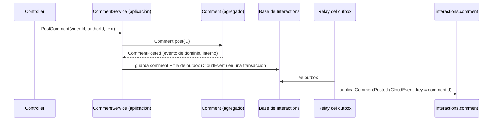
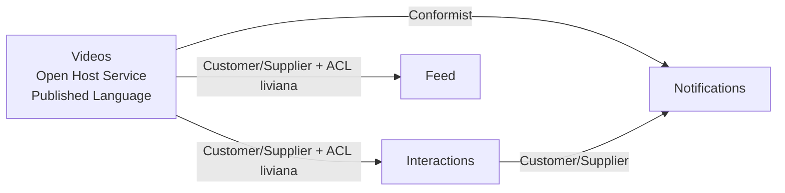
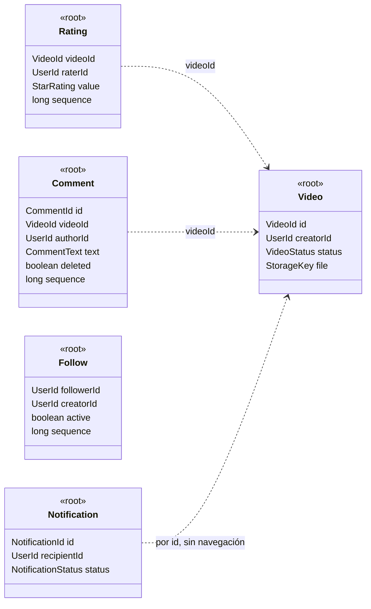

# DDD táctico: agregados, eventos de dominio y context map

> **Estado:** borrador para revisión · **Versión de referencia:** Evans, *DDD Reference* (marzo 2015); Vernon, *Effective Aggregate Design* (2011); Spring Data Relational 4.1.1 · **Última actualización:** 2026-10-12

## Resumen
El DDD **estratégico** (contextos, glosario, event storming) ya está hecho en `specs/01-domain/`. Lo que falta es el **táctico**: qué es un agregado en cada contexto, qué invariantes protege, cómo se diferencia un evento de dominio de un evento publicado en Kafka y qué relación hay entre contextos (context map). Esta nota fija las reglas de diseño (Evans, Vernon) y **propone** los agregados del proyecto para revisión. Recomendación: agregados chicos con id = key del topic, proyecciones que no son agregados, y un mapeo explícito entre el evento de dominio (interno) y el CloudEvent (publicado).

> **Alcance:** este dominio es simple. Las fuentes dicen que el DDD táctico se aplica a servicios con reglas de negocio significativas. Acá se aplica por **motivo didáctico** (decisión de Laura, 2026-10-12), no porque el negocio lo exija. Donde un servicio es casi solo una proyección (Feed), la nota recomienda no forzar el modelo rico.

## Por qué importa
- **Ordering:** la key de Kafka es el id del agregado (ADR 0003). Si el agregado está mal elegido, la key ordena lo que no hay que ordenar o deja desordenado lo que sí.
- **Idempotencia y concurrencia:** un agregado demasiado grande genera conflictos de versión entre usuarios que no tienen nada que ver (ver el ejemplo de `Video` con comentarios adentro).
- **Contratos:** si el evento publicado es el objeto de dominio serializado, cada refactor interno rompe a los consumidores. Eso es lo que Pact (nota 10) detecta tarde.
- **Specs:** sin invariantes nombradas, los escenarios "se rechaza" (RAT-02, COM-05, PUB-02) no tienen dueño.

## Cómo funciona

### Qué ya tenemos y qué falta

| Nivel | Qué es | Dónde está | Estado |
|---|---|---|---|
| Estratégico | Bounded contexts, lenguaje ubicuo, relaciones | `bounded-contexts.md`, `glosario.md`, `event-storming.md` | Hecho (borrador) |
| Estratégico | Context map con tipo de relación | Hoy dice "publicador → suscriptor" | **Falta** (esta nota) |
| Táctico | Agregados, invariantes, value objects | Se nombran agregados, no invariantes | **Falta** (esta nota) |
| Táctico | Evento de dominio vs evento publicado | Mezclados en `event-storming.md` | **Falta** (esta nota) |
| Táctico | Estructura de código por servicio | No existe `services/` | **Falta** (esta nota, propuesta) |

### Los bloques, uno por uno

| Bloque | Definición (Evans 2015) | En nuestro dominio |
|---|---|---|
| **Entity** | Objeto definido por su identidad, no por sus atributos; el modelo debe definir "qué significa ser la misma cosa" | `Video`, `Comment`, `Notification` |
| **Value object** | Se clasifica así cuando solo importan sus atributos y su lógica; inmutable, sin identidad, operaciones sin efectos secundarios | `VideoStatus`, `Title`, `StarRating`, `CommentText`, `StorageKey` |
| **Aggregate** | Grupo de entidades y value objects con una raíz; desde afuera solo se referencia la raíz; las invariantes las hace cumplir la raíz; consistencia síncrona adentro, asíncrona entre agregados | Ver "Agregados propuestos" |
| **Domain event** | Algo que ocurrió y le importa a los expertos del dominio; inmutable; lleva timestamp e identidad de las entidades involucradas | `CommentPosted`, `VideoPublished` (en su forma interna) |
| **Repository** | Simula una colección en memoria de las raíces de un tipo; solo para raíces que necesitan acceso directo | Uno por agregado raíz: `VideoRepository`, `CommentRepository`, … |
| **Factory** | Encapsula la creación de un agregado completo y consistente | `Comment.post(...)`, `Video.upload(...)`: alcanza un método de la clase |
| **Domain service** | Operación significativa del dominio que no es responsabilidad natural de una entidad o value object | Casi ninguno por ahora (ver abajo) |
| **Module** | Paquetes que cuentan la historia del sistema; sus nombres son parte del lenguaje ubicuo | Un paquete por agregado |

*Dónde discrepan las fuentes:* Evans no distingue servicio de dominio de servicio de aplicación; Microsoft Learn sí (el de aplicación orquesta casos de uso, maneja transacciones y no tiene lógica de negocio). Usamos la distinción de Microsoft porque es la que ordena el código (ver "Estructura del código").

### Las cuatro reglas de Vernon

| # | Regla | Qué dice | Qué implica acá |
|---|---|---|---|
| 1 | **Modelar invariantes verdaderas dentro de la frontera de consistencia** | Una invariante es una regla de negocio que debe ser consistente en todo momento; agregado es sinónimo de frontera de consistencia transaccional | Se enumera la invariante antes de agrupar nada |
| 2 | **Diseñar agregados pequeños** | Raíz más el mínimo de atributos necesarios; ante la duda, value object en vez de entidad hija | `Video` no contiene comentarios ni puntuaciones |
| 3 | **Referenciar otros agregados por identidad** | Se guarda el id, no un puntero al objeto | `Comment` guarda `videoId`, no un `Video` |
| 4 | **Consistencia eventual fuera de la frontera** | Lo que cruza agregados se resuelve con eventos y subscriptores en transacciones separadas | `VideoDeleted` oculta comentarios en otra transacción, en otro servicio |

Vernon agrega un desempate práctico, que dice haber hablado con Evans: preguntar **"¿es trabajo del usuario que ejecuta el caso de uso dejar los datos consistentes?"** Si sí, consistencia transaccional (respetando las demás reglas). Si es trabajo de otro usuario o del sistema, puede ser eventual.

Evans lo resume en una línea que es el puente con Kafka: *"Use the same aggregate boundaries to govern transactions and distribution"*. Por eso **la key del topic es el id del agregado** (ADR 0003) y por eso hay un topic por agregado (nota 13): el agregado es la unidad que se ordena, se transacciona y se distribuye.

### Evento de dominio vs evento publicado

Son dos objetos distintos que cuentan el mismo hecho.

| | Evento de dominio | Evento publicado (integración) |
|---|---|---|
| Quién lo ve | El propio contexto | Otros contextos |
| Forma | Clase Kotlin interna, puede cambiar con un refactor | CloudEvents + JSON Schema (ADR 0002), contrato público |
| Cuándo existe | Cuando el agregado acepta el comando | Después del commit, vía outbox (ADR 0004) |
| Quién lo define | El modelo de dominio | El *published language* |
| Si cambia | Se cambia el código | Se versiona (nota 12) y pasa por Pact |



*Por qué este diagrama:* es de **secuencia**, porque la pregunta es cuándo y quién transforma el hecho interno en el hecho publicado.

Decisión propuesta: **sin dispatcher de eventos de dominio en memoria**. El método del agregado **devuelve** el evento y el servicio de aplicación lo mapea a CloudEvent y lo escribe en el outbox. Microsoft Learn muestra la alternativa (acumular eventos en una lista del agregado y despacharlos antes o después del commit con un mediador); agrega una pieza que este proyecto no necesita porque hay un solo efecto por comando: el outbox (ADR 0008, "menos es más"). Es inferencia nuestra, no una recomendación de las fuentes.

### Context map: qué relación hay entre cada par

Evans define los patrones; las relaciones organizacionales (equipos que negocian) **no existen** acá porque hay un solo equipo. Se clasifican por forma técnica. Es propuesta, no está en ningún spec.

| Upstream → Downstream | Patrón propuesto | Por qué | Dónde se ve |
|---|---|---|---|
| Videos → Interactions | **Open Host Service + Published Language** del lado de Videos; **Customer/Supplier** probado con Pact; Interactions traduce a su read model (**ACL liviana**) | Videos define un protocolo para varios consumidores (CloudEvents + AsyncAPI); Pact es lo que Evans describe como "pruebas de aceptación conjuntas en la CI del upstream"; Interactions guarda lo suyo con su propio nombre (`PublishedVideo`) | AsyncAPI, ADR 0006 |
| Videos → Feed | Igual que el anterior | Mismo evento, mismo contrato | |
| Videos → Notifications | **Conformist** | Notifications toma `creatorId` y `title` tal cual vienen; no tiene motivo para otro modelo | Nota 12 (event-carried state transfer) |
| Interactions → Notifications | **Customer/Supplier** + Published Language | `CommentPosted` es el único evento que cruza | `interactions.comment` |
| Feed → Feed | Interno | Es el mismo contexto | |
| Moderación (opcional) | **Separate Ways** hasta que exista | Sin relación definida | `bounded-contexts.md` |

**Lo que no usamos y por qué:**
- **Shared Kernel:** compartir un módulo con las clases de eventos entre servicios es un shared kernel de hecho. Evans dice que debe ser pequeño y que no se cambia sin consulta. Acá lo compartido es el **schema** (JSON Schema), no el código; cada servicio declara su propia clase. Regla propuesta: no hay librería de dominio compartida.
- **Partnership:** exige planificación conjunta de releases; con un equipo no distingue nada.
- **ACL completa:** se justifica ante un modelo upstream débil o legado. Acá el upstream es nuestro y está bien definido.



*Por qué este diagrama:* es un **mapa de contextos** (flowchart), porque la pregunta es qué patrón rige cada relación y en qué dirección.

### Agregados propuestos

Cada fila responde primero "¿cuál es la invariante?" (regla 1 de Vernon). Si no hay una más allá de la unicidad, no es un agregado: es una proyección.

| Contexto | Candidato | ¿Agregado? | Identidad | Invariantes verdaderas | Value objects |
|---|---|---|---|---|---|
| Videos | **Video** | Sí | `videoId` | Solo se permiten las transiciones `UPLOADED → PROCESSING → PUBLISHED \| FAILED` y `PUBLISHED → DELETED` (PUB-02); `VideoPublished` ocurre una sola vez; un video borrado no vuelve | `VideoStatus`, `Title`, `StorageKey` |
| Interactions | **Rating** | Sí | `(videoId, raterId)` | Una sola puntuación vigente por par (RAT-05); el valor está en rango *(1 a 5 supuesto; los escenarios dicen "5 estrellas" sin fijar el rango)*; `sequence` crece | `StarRating` |
| Interactions | **Comment** | Sí | `commentId` | Un comentario borrado no se edita ni se vuelve a borrar (COM-05); `sequence` crece en 1 por cambio (COM-02); texto no vacío *(supuesto)* | `CommentText` |
| Interactions | Resumen de puntuaciones (conteo y promedio) | **No: proyección** | `videoId` | Ninguna transaccional: es derivado de los ratings | — |
| Interactions | Videos publicados (read model) | **No: proyección** | `videoId` | Ninguna | — |
| Feed | **Follow** | Sí | `(followerId, creatorId)` | Una sola relación por par; follow y unfollow se alternan; `sequence` crece (FEED-03) | — |
| Feed | Entrada de feed `(followerId, videoId)` | **No: fila de proyección** | `(followerId, videoId)` | Solo unicidad (FEED-11), que lo resuelve una restricción de la base | — |
| Notifications | **Notification** | Sí | `notificationId` | `REQUESTED → SENT \| FAILED \| CANCELLED`; una `SENT` no pasa a `CANCELLED` (NOT-10); una por destinatario y causa (idempotencia, nota 03) | `NotificationStatus` |
| — | Creator, Viewer, usuario | **No existen como agregado** | solo `userId` | No hay perfil ni autenticación en el alcance | `UserId` |

**Decisiones de diseño que salen de esa tabla:**

1. **La puntuación y el comentario no viven dentro de `Video`.** Es la trampa que Vernon describe con `Product` y sus `BacklogItem` (ver el ejemplo más abajo). Además viven en otro servicio.
2. **"Solo se puntúa un video publicado" no es una invariante de `Rating`.** Depende del estado de otro agregado (`Video`), en otro servicio. Por la regla 4 de Vernon se resuelve con consistencia eventual: se consulta el read model local de videos publicados (RAT-02, RAT-07) y se acepta una ventana de desactualización. Es una decisión consciente, no un olvido.
3. **El promedio no es una invariante.** Es una vista derivada; si se desfasa, se recalcula (RAT-03).
4. **La entrada de feed no es un agregado.** Un feed por seguidor como agregado crecería sin cota (Vernon: "large cluster aggregate"), y la única regla que tiene es la unicidad.
5. **El process manager de publicación no es un agregado.** Coordina; el estado que consulta vive en `Video.status` (semantic lock, nota 08). Dónde guarda sus intentos queda abierto en la nota 08.
6. **La identidad del agregado es la key de Kafka.** `Rating` y `Follow` tienen identidad compuesta (`videoId:raterId`, `followerId:creatorId`): coincide con las keys ya definidas en `event-storming.md`.



*Por qué este diagrama:* es de **clases**, porque la pregunta es qué contiene cada agregado y que entre ellos solo hay referencias por id (líneas punteadas, que además cruzan servicios).

## Aplicación por componente

| Componente | Agregados | Qué se aplica | Qué NO se aplica |
|---|---|---|---|
| **Videos** | `Video` | Raíz con máquina de estados; el servicio de aplicación orquesta la saga (nota 08) | Value object para estado y clave de storage; sin bus interno |
| **Interactions** | `Rating`, `Comment` | Dos agregados chicos; solo `Comment` publica (`interactions.comment`); `Rating` es estado local sin topic (regla de publicación); resumen y videos publicados como proyecciones | Ningún agregado "Interacciones de un video" |
| **Feed** | `Follow` | Un agregado chico que publica `CreatorFollowed` y `CreatorUnfollowed` en `feed.follow` (Notifications los consume; usa outbox); el feed es proyección pura | Modelo rico para `FeedEntry`: sería una tabla con una restricción de unicidad |
| **Notifications** | `Notification` | Estado con transiciones válidas; deduplicación por causa | Agregado por usuario con su lista de notificaciones |
| Transversal | — | Repositorio por raíz; mapeo dominio → CloudEvent en la capa de aplicación | Librería de dominio compartida; hexagonal ceremonial |

## Ejemplos del dominio

### 1. El que falla: `Video` como agregado grande
Alguien arma `Video` con sus comentarios adentro porque "un video tiene comentarios" (es el "Products have backlog items" de Vernon).

```gherkin
Escenario: AGG-01 (falla) comentarios concurrentes sobre un Video grande
  Dado que Video vid_paella contiene la lista de sus comentarios y tiene version 7
  Cuando usr_ana y usr_diego comentan vid_paella al mismo tiempo, ambos sobre la version 7
  Entonces el primero confirma y sube vid_paella a la version 8
  Y el segundo falla por conflicto de version, aunque no tocaron el mismo comentario
```
Con COM-12 (100 viewers) son 99 conflictos y reintentos sobre una entidad que ni siquiera cambió. Vernon lo llama *false invariants*: nada exige que "comentar" y "publicar" sean consistentes entre sí.

**El que funciona:** `Comment` es su propio agregado con `videoId` como referencia. Cada comentario tiene su `commentId` y su versión; 100 comentarios son 100 transacciones que no compiten (COM-12).

### 2. El que falla: serializar el evento de dominio tal cual
```gherkin
Escenario: AGG-02 (falla) refactor interno rompe a Feed
  Dado que Videos publica VideoPublished serializando la clase de dominio
  Cuando alguien renombra el campo title a name en la entidad Video
  Entonces el payload publicado cambia sin que nadie cambie un contrato
  Y Feed deja de poder leer el titulo
```
**El que funciona:** el mapeo a CloudEvent es una función explícita en la capa de aplicación; el payload sale del schema de `03-events/` y el cambio interno no lo toca. Si el schema cambia, falla el contrato (ADR 0006), no el consumidor en producción.

### 3. La invariante que cruza agregados
```gherkin
Escenario: AGG-03 puntuar con el read model desactualizado
  Dado que Interactions aún no procesó VideoDeleted de vid_paella
  Cuando usr_ana puntúa vid_paella
  Entonces la puntuación se acepta (el read model local dice PUBLISHED)
  Y al procesarse VideoDeleted, las puntuaciones de vid_paella dejan de contarse (RAT-07)
```
Intentar evitarlo exigiría que Interactions consulte la base de Videos, que la regla 1 de `bounded-contexts.md` prohíbe. Es el costo explícito de la regla 4 de Vernon.

### Fragmento de Kotlin (ilustrativo, no compilado)
```kotlin
// domain/Comment.kt: sin Spring, sin Kafka, sin JDBC
class Comment private constructor(
    val id: CommentId,
    val videoId: VideoId,          // referencia por identidad
    val authorId: UserId,
    private var text: CommentText, // value object: valida que no esté vacío
    private var deleted: Boolean,
    private var sequence: Long,
) {
    fun edit(newText: CommentText): CommentEdited {
        check(!deleted) { "un comentario borrado no se edita" }   // COM-05
        text = newText
        sequence += 1
        return CommentEdited(id, newText, sequence)  // evento de dominio, interno
    }

    companion object {
        fun post(id: CommentId, videoId: VideoId, authorId: UserId, text: CommentText) =
            Comment(id, videoId, authorId, text, deleted = false, sequence = 1) to
                CommentPosted(id, videoId, authorId, text, sequence = 1)
    }
}
```

La forma de `Comment` acá es **de estado**. Si la nota 16 y el ADR 0009 aprueban event sourcing para este agregado, cambia cómo se persiste y se reconstruye, pero **la frontera, la identidad y las invariantes son las mismas**.

## Estructura del código

Recomendación: **un módulo Gradle por servicio**, con tres paquetes. Sin puertos y adaptadores por cada cosa.

```
services/interactions/src/main/kotlin/dev/videoeda/interactions/
  domain/          Comment, Rating, value objects, eventos de dominio,
                   interfaces CommentRepository, RatingRepository
  application/     PostCommentHandler, mapeo a CloudEvent, handler de VideoPublished,
                   actualización de proyecciones
  infrastructure/  repositorios JDBC, listener de Kafka, relay del outbox, controllers
```

| Regla | Por qué |
|---|---|
| `domain` no importa nada de `application` ni `infrastructure`, ni Spring, ni Kafka | Microsoft Learn: "the domain model layer should not take a dependency on any other layer" |
| La interfaz del repositorio vive en `domain`; la implementación en `infrastructure` | Es la única inversión de dependencias que se justifica: permite probar el agregado sin base |
| `application` coordina y no tiene reglas de negocio | Evans (citado por Microsoft): la capa de aplicación "is kept thin" |
| Los consumers de Kafka son infraestructura; el handler que actualiza la proyección es aplicación | Separa el protocolo del caso de uso |
| Sin módulos Gradle separados por capa, sin mappers para cada cruce | "Menos es más" (ADR 0008): el paquete alcanza; un test de arquitectura puede vigilar la regla |

**Qué no se justifica:** hexagonal completo con un port y un adapter por cada dependencia, un `UseCase` por clase, un mediador interno. Todo eso agrega indirección sin demostrar una garantía del proyecto.

**Servicios casi sin dominio:** Feed y la mitad consumidora de Notifications son proyecciones. Microsoft Learn dice que DDD aplica "only if you are implementing complex microservices with significant business rules" y que lo simple puede ir en una sola capa. Para Feed, una proyección con consumer, inbox y tabla es suficiente; el único agregado es `Follow`.

**Persistencia (decisión abierta):** ningún ADR fija todavía cómo se persisten los agregados. Spring Data JDBC está pensado alrededor del agregado: un repositorio por raíz, todo lo alcanzable desde la raíz es parte del agregado y las referencias entre agregados "become consistent eventually" (documentación 4.1.1). Encaja con esta nota, pero **no está decidido** y hace falta un ADR (o ampliar el 0001).

## Alternativas y trade-offs

| Opción | Ventaja | Costo | Cuándo |
|---|---|---|---|
| **Agregados chicos con proyecciones** (propuesta) | Sin contención; cada agregado es una key y una transacción | Más piezas; consistencia eventual visible (AGG-03) | Siempre que las reglas lo permitan |
| Agregado grande por video | Un lugar para todo; consultas simples | Conflictos de versión y crecimiento sin cota | Solo si una regla exige consistencia inmediata entre las partes |
| **Una transacción por agregado** (Evans, Vernon) | Escala, aísla fallas | Compensación y reintentos entre agregados | Por defecto |
| Varios agregados en una transacción para efectos del mismo comando (Bogard, citado por Microsoft) | Más simple con un ORM y una base | Mayor bloqueo; no sirve entre servicios | Dentro de un servicio, si un experto de negocio exige atomicidad |
| Dispatcher de eventos de dominio en memoria | Desacopla handlers de efectos | Una pieza más | Cuando un comando dispara varios efectos locales (acá hay uno: el outbox) |
| Hexagonal completo | Aislamiento total del dominio | Mucha indirección | Dominios grandes; no acá |
| Librería de dominio compartida | Menos duplicación | Es un shared kernel; acopla releases | No usar (schema compartido, código no) |

## Reglas para el spec
Propuestas; ninguna está aprobada ni en `specs/`.

1. Cada agregado declara su identidad y esa identidad es la key de su topic (ADR 0003).
2. Un comando modifica **un** agregado por transacción.
3. Los agregados se referencian por id; ningún agregado contiene la colección de otro.
4. Una regla que cruza agregados se verifica contra un read model local y se documenta como eventualmente consistente, con su escenario (RAT-02, RAT-07, AGG-03).
5. El evento de dominio es interno; el evento publicado se arma con una función de mapeo explícita contra el schema de `03-events/`. El payload no expone la clase interna (regla 4 de `bounded-contexts.md`).
6. `domain` no depende de Spring, Kafka ni JDBC.
7. Cada invariante tiene un test de agregado sin infraestructura, en orden ZOMBIES (agregado nuevo, un cambio, muchos cambios).
8. Las proyecciones no tienen repositorio de dominio ni invariantes más allá de la unicidad.
9. No hay módulo de clases de dominio compartido entre servicios.
10. Escenarios nuevos a escribir: AGG-01 a AGG-03 y las pruebas de invariantes de `Video`, `Rating`, `Follow` y `Notification`.

## Fuentes
Todas consultadas el **2026-10-12**.

- [Evans, *Domain-Driven Design Reference* (domainlanguage.com, PDF, marzo 2015)](https://www.domainlanguage.com/wp-content/uploads/2016/05/DDD_Reference_2015-03.pdf) — **primaria**. PDF de 59 páginas extraído con `pdftotext`; leí las secciones de Entities, Value Objects, Domain Events, Services, Modules, Aggregates, Repositories, Factories, Context Map y los patrones de relación (Partnership, Shared Kernel, Customer/Supplier, Conformist, Anticorruption Layer, Open-host Service, Published Language, Separate Ways, Big Ball of Mud). No leí el resto (lenguaje ubicuo, supple design, destilación, large-scale structure). Es un resumen de patrones del libro de 2003; marca con asterisco los términos nuevos desde 2004 (Domain Events y Partnership, entre ellos).
- [Vernon, *Effective Aggregate Design, Part I* (dddcommunity.org, 2011)](https://www.dddcommunity.org/wp-content/uploads/files/pdf_articles/Vernon_2011_1.pdf) — primaria. Leído completo (6 páginas): reglas "Model True Invariants In Consistency Boundaries" y "Design Small Aggregates".
- [Vernon, *Effective Aggregate Design, Part II* (dddcommunity.org, 2011)](https://www.dddcommunity.org/wp-content/uploads/files/pdf_articles/Vernon_2011_2.pdf) — primaria. Leídas las secciones "Reference Other Aggregates By Identity", "Use Eventual Consistency Outside the Boundary" y "Ask Whose Job It Is". **No** leí el resto (ver No verificado).
- [Fowler, *DDD Aggregate*](https://martinfowler.com/bliki/DDD_Aggregate.html) — 2013-04-23. Definición, raíz y regla de que las transacciones no cruzan agregados.
- [Fowler, *Value Object*](https://martinfowler.com/bliki/ValueObject.html) — 2016-11-14. Igualdad por valor e inmutabilidad.
- [Fowler, *Bounded Context*](https://martinfowler.com/bliki/BoundedContext.html) — 2014-01-15. Contexto como eje del diseño estratégico y el context map.
- [Microsoft Learn, *Use tactical DDD to design microservices*](https://learn.microsoft.com/en-us/azure/architecture/microservices/model/tactical-ddd) — página con fecha 2026-02-25, actualizada 2026-09-29. Entidades, value objects, agregados, servicios de dominio y de aplicación, distinción entre eventos de dominio internos y eventos de integración.
- [Microsoft Learn, *Domain events: design and implementation* (.NET Microservices)](https://learn.microsoft.com/en-us/dotnet/architecture/microservices/microservice-ddd-cqrs-patterns/domain-events-design-implementation) — 2018-10-08, actualizada 2024-01-03. Domain events vs integration events; la discusión Evans/Vernon vs Bogard sobre una transacción por agregado. **Secundaria** para las citas de Evans, Vernon y Bogard.
- [Microsoft Learn, *Designing a DDD-oriented microservice*](https://learn.microsoft.com/en-us/dotnet/architecture/microservices/microservice-ddd-cqrs-patterns/ddd-oriented-microservice) — 2021-01-13, actualizada 2022-04-13. Capas de dominio, aplicación e infraestructura y regla de dependencias; advertencia sobre aplicar DDD a servicios simples.
- [Spring Data Relational 4.1.1, *Domain Driven Design and Relational Databases*](https://docs.spring.io/spring-data/relational/reference/jdbc/domain-driven-design.html) — 4.1.1 estable; la página no muestra fecha. Agregado, raíz, un repositorio por raíz, consistencia eventual entre agregados.

## No verificado
- **Vernon Parte II incompleta y Parte III no leída.** De la Parte II leí las reglas 3 y 4 y el desempate "Ask Whose Job It Is"; no leí "Reasons To Break the Rules" ni el cierre. La Parte III (donde el equipo revisa los límites) no la busqué.
- **Libro de Evans (2003) y *Implementing DDD* de Vernon:** no leídos. El *Reference* de 2015 es un resumen del libro; la cita "Any rule that spans AGGREGATES..." (p. 128 del libro) la leí **a través de Microsoft Learn**, no en el libro.
- **Posiciones de Bogard y Dahan:** conocidas solo por la cita de Microsoft Learn; no leí sus entradas originales.
- **Discrepancia sobre la transacción:** Fowler (2013) dice sin matices que "Transactions should not cross aggregate boundaries"; Vernon lo plantea como "rule of thumb" y "should be the goal in most cases", y Bogard acepta varios agregados en una transacción si son efectos del mismo comando. No son compatibles en el absoluto; adoptamos la versión de Vernon con una transacción por agregado por defecto, y es **decisión nuestra**.
- **Discrepancia sobre eventos:** Evans (2015) modela el evento de dominio como objeto del dominio sin distinguir ámbito; Microsoft Learn separa evento de dominio (en proceso) de evento de integración (entre contextos); Vernon usa el mismo mecanismo localmente y distribuido ("the same technique can also be applied in a distributed fashion"). Elegimos la separación de Microsoft porque coincide con el outbox y el contrato público; no es una convención universal del DDD.
- **Spring Data JDBC:** no leí las páginas de eventos de agregado (`AbstractAggregateRoot`, `@DomainEvents`, "Publishing Events from Aggregate Roots"); no sé cómo interactuaría con el outbox. La compatibilidad con Spring Boot 4.1.1 y Kotlin 2.4 no la probé.
- **Context map:** los patrones asignados a cada par son **inferencia nuestra** a partir de la forma técnica; Evans los define para relaciones entre equipos y acá hay uno solo. La asignación de Conformist a Notifications y de ACL liviana a Interactions y Feed es opinable.
- **Invariantes marcadas como supuesto:** rango de la puntuación (1 a 5), texto de comentario no vacío. No están en ningún escenario existente.
- **Quién puede editar o borrar un comentario** (el autor) no se modeló: la autorización está fuera de alcance.
- **Código Kotlin:** el fragmento es ilustrativo; **no se compiló**.
- **Diagramas Mermaid:** no se renderizaron.
- **Test de arquitectura** para vigilar la regla de dependencias: no elegí herramienta ni probé ninguna.
- **Nada se ejecutó** contra un broker ni contra una base.

## Historial
| Fecha | Cambio |
|---|---|
| 2026-10-12 | Creación. Propuesta de agregados, context map, regla de evento de dominio vs publicado y estructura de código; pendiente de revisión de Laura. |
| 2026-10-12 | Corregida la fila de Interactions: `interactions.rating` ya no existe por la regla de publicación |
| 2026-10-12 | Follow pasa a publicar en `feed.follow` (opción a de Laura): usa outbox y hay una relación Customer/Supplier Feed → Notifications en el context map |
| 2026-10-12 | Ids alineados con la nota 17 (alias de `specs/01-domain/ids-de-ejemplo.md` en prosa y diagramas, ids reales en payloads y SQL) |
