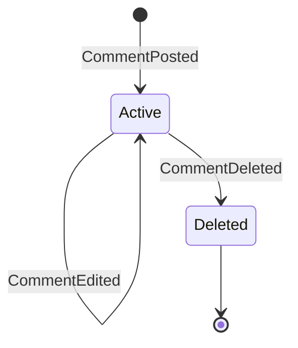
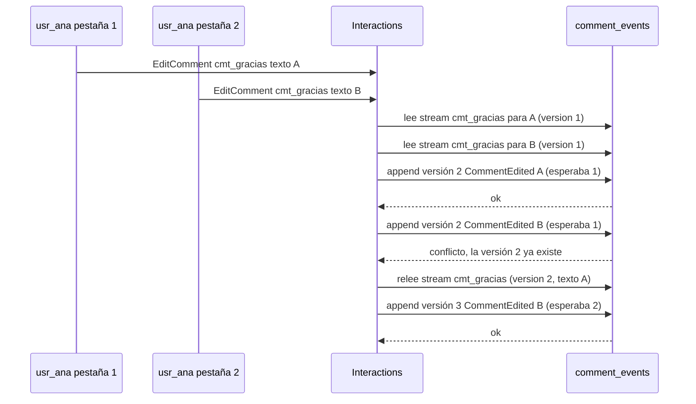
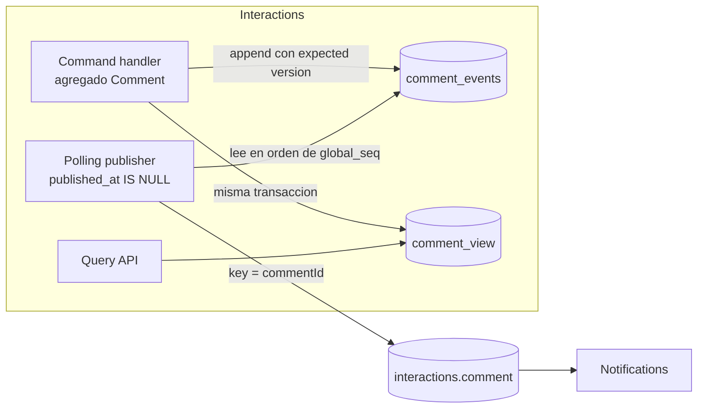
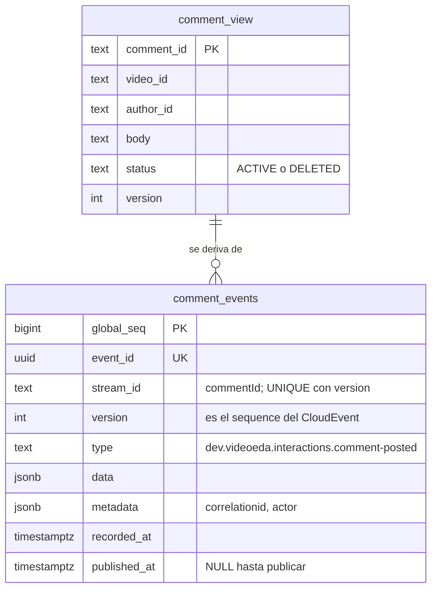

# Event sourcing

> **Estado:** borrador · **Versión de referencia:** sin versión de producto (patrón); KurrentDB .NET client v1.4, Marten latest (v9.x) · **Última actualización:** 2026-10-12

## Resumen
Event sourcing guarda **los eventos como fuente de verdad** y deriva el estado reproduciéndolos; el estado actual es una consecuencia, no el dato. Laura aprobó aplicarlo a **un solo agregado: `Comment`** (contexto Interactions). El resto de los agregados sigue con estado + outbox.
Las fuentes confirman la hipótesis de diseño: el event store va **en la base del servicio**, no en Kafka; Kafka es el canal de publicación. La decisión es **didáctica**, no de negocio: ninguna fuente lo recomienda para un dominio sin necesidad de historia.

## Por qué importa
- **Ordering:** la versión del stream (1, 2, 3…) es el `sequence` que ya definimos para `CommentPosted/Edited/Deleted`. Deja de ser un contador que alguien incrementa y pasa a ser una consecuencia del orden de escritura.
- **Idempotencia y concurrencia:** dos ediciones simultáneas sobre `cmt_gracias` no pueden quedar ambas como `sequence 2`; el store tiene que rechazar una.
- **Publicación:** el event store es a la vez el estado y lo que se publica. Reemplaza al outbox **para este agregado** (ADR 0004).
- **Contratos:** los eventos guardados son inmutables, así que el versionado de nota 12 (`type` sin `v1`, `.v2` al primer cambio incompatible) deja de ser solo un problema de mensajería y pasa a ser un problema de datos guardados.

## Qué es y qué NO es

| Confusión común | Qué dicen las fuentes | Para nosotros |
|---|---|---|
| "Event sourcing es CQRS" | Se usan juntos con frecuencia, pero son patrones distintos (Microsoft: "commonly combined"; Richardson: CQRS resuelve las consultas porque el store es difícil de consultar) | CQRS es otra nota (14). Acá solo hace falta una vista para leer |
| "Es usar Kafka" | "Event streaming is not event sourcing" (Dudycz). Un event store puede publicar hacia una plataforma de streaming | Kafka solo distribuye |
| "Es tener un log de auditoría" | El log de auditoría es una tabla aparte *además* del estado; en event sourcing los eventos **son** el estado ("events are the state") | Si el log y el estado pueden divergir, no es event sourcing |
| "Es guardar todo lo que pasa" | Microsoft: el evento captura la **intención de negocio**, no el estado resultante (`SeatsReserved`, no `RemainingSeatsChanged`) | `CommentEdited` lleva el texto nuevo y quién editó |
| "Es publicar los eventos tal cual" | Dudycz: eventos internos ≠ eventos externos; exponer los internos acopla | Ver "Publicar desde el event store" |

## Cómo funciona

Cada entidad tiene su propio **stream**: la secuencia ordenada de sus eventos. Para ejecutar un comando se **rehidrata** el agregado leyendo su stream, se decide, y se **agrega** (append) un evento diciendo qué versión se esperaba. Si el stream cambió desde que se leyó, el store rechaza la escritura (Microsoft; KurrentDB docs).

### Estados que resultan de los eventos



*Por qué este diagrama:* es de **máquina de estados**, porque la pregunta es qué estado resulta de reproducir los eventos en orden. Un stream sin eventos no tiene estado: el comentario no existe.

### Qué pasa cuando dos escrituras compiten



*Por qué este diagrama:* es de **secuencia**, porque el conflicto existe por el orden en el tiempo de dos lecturas y dos escrituras.

### Componentes



*Por qué este diagrama:* es de **componentes**, porque muestra qué pieza escribe dónde y dónde está la frontera transaccional.

### El event store como tabla (propuesta, PostgreSQL)



*Por qué este diagrama:* es **ER**, porque la pregunta es qué tablas hay y qué columna cumple cada rol.

```sql
-- Propuesta, no ejecutada. Un solo agregado, una sola tabla.
CREATE TABLE comment_events (
  global_seq   BIGINT GENERATED ALWAYS AS IDENTITY PRIMARY KEY,
  event_id     TEXT        NOT NULL UNIQUE,            -- evt_<uuidv7> = id del CloudEvent
  stream_id    TEXT        NOT NULL,                   -- cmt_<uuidv7> = commentId = key en Kafka
  version      INT         NOT NULL,                   -- = sequence del CloudEvent
  type         TEXT        NOT NULL,
  data         JSONB       NOT NULL,
  metadata     JSONB       NOT NULL,
  recorded_at  TIMESTAMPTZ NOT NULL DEFAULT now(),
  published_at TIMESTAMPTZ,
  UNIQUE (stream_id, version),                         -- concurrencia optimista
  CHECK (stream_id ~ '^cmt_[0-9a-f]{8}-[0-9a-f]{4}-7[0-9a-f]{3}-[89ab][0-9a-f]{3}-[0-9a-f]{12}$'),
  CHECK (event_id  ~ '^evt_[0-9a-f]{8}-[0-9a-f]{4}-7[0-9a-f]{3}-[89ab][0-9a-f]{3}-[0-9a-f]{12}$')
);
```

La estructura sigue la de Marten (`seq_id`, `id`, `stream_id`, `version`, `data`, `type`, `timestamp`), que es la fuente leída. La restricción única es **inferencia propia** (ver No verificado).

### Componente por componente

**Event store (append-only).** Solo se hace `INSERT`. Nunca `UPDATE` ni `DELETE` de `data`. Microsoft: "you should never update the event data"; para deshacer algo se agrega un evento compensatorio. El único `UPDATE` permitido es `published_at`, que no es dato de dominio.

**Versión esperada.** El handler lee el stream, recuerda la última `version` y escribe `version + 1`. Si otro proceso ya la ocupó, el `INSERT` falla por la restricción y se reintenta releyendo (KurrentDB: se pasa el estado o la revisión esperada y, si no coincide, lanza excepción; Dudycz: la versión es el número de secuencia del evento en el stream).

**Rehidratación (cero, uno, muchos).**

| Eventos en el stream | Resultado |
|---|---|
| Cero | El comentario no existe: `EditComment` se rechaza y no se escribe nada |
| Uno (`CommentPosted`) | `Active`, con el texto original |
| Muchos | Se aplican en orden; el último estado gana. Un `CommentDeleted` es terminal |

**Snapshots.** Guardan el estado en un punto para no reproducir todo (Microsoft, Confluent: "snapshots are simply an optimization"). Dudycz los trata como último recurso y prefiere **streams cortos**. Un comentario tiene un puñado de eventos: **no hacen falta**. Queda como regla: no se implementan hasta que una medición lo pida.

**Proyecciones.** `comment_view` es la lectura (lista de comentarios de un video). Se puede actualizar en la misma transacción del append (consistente) o de forma asíncrona (eventualmente consistente). **Recomendación: en la misma transacción**, porque hay una sola base y es lo más simple; el camino asíncrono queda como crecimiento y se estudia en la nota 14.

**Reproyección.** Como la vista se deriva del stream, se puede vaciar y reconstruir leyendo `comment_events` por `global_seq` (Fowler: "discard the state and recreate it by re-running the events"). Fowler advierte que **durante un replay no deben dispararse efectos externos**: en nuestro caso la vista no tiene efectos y el publisher se guía por `published_at`, así que un replay no republica.

## Publicar desde el event store

El `id` del CloudEvent es `event_id`, la key es `stream_id` y el `sequence` es `version`. El **polling publisher** del ADR 0004 lee `published_at IS NULL`, ordena por `global_seq`, publica y marca. La tabla ocupa el lugar del outbox: no hay tabla `outbox` para `Comment`.

- **Atomicidad:** guardar el evento es una sola operación, así que "is inherently atomic" (Richardson). No hay doble escritura estado + outbox.
- **Orden:** dentro de un stream, la versión 3 solo existe si la versión 2 ya estaba confirmada (el handler lo leyó antes de escribir). Entre streams no hay orden y no se necesita. Por eso la lectura debe hacerse con una **marca** (`published_at`) y no con un cursor de "última posición vista": con un cursor, una fila de menor `global_seq` que confirma tarde quedaría saltada. Es razonamiento propio, no una fuente.
- **Evento interno vs externo:** Dudycz recomienda no exponer los eventos internos tal cual, sino un evento resumen. Confluent dice lo mismo (domain event = detalle interno; integration event = API pública). **Decisión propuesta para no sobreingeniar:** el evento guardado *es* el contrato (`CommentPosted` ya lleva lo que Notifications necesita). El costo es que **el formato guardado queda atado al contrato**, con las consecuencias de la sección siguiente.

## Eventos guardados como contrato inmutable

Hoy nota 12 resuelve el versionado emitiendo un `type` nuevo (`.v2`) y, durante la migración, ambos. Con event sourcing aparece algo más: **los eventos viejos siguen en el stream para siempre** y el agregado tiene que poder leerlos.

| Técnica | Qué hace | Fuente | Para nosotros |
|---|---|---|---|
| Cambio no disruptivo | Agregar campo opcional o con default | Dudycz, Microsoft ("tolerant deserialization") | **Primera opción**, siempre |
| Evento con tipo nuevo | `...comment-edited.v2`; el viejo sigue existiendo | Dudycz, Microsoft | Es lo que ya decidimos en nota 12 |
| **Upcasting** | Función que convierte `v1` a `v2` *al leer*, sin tocar lo guardado | Microsoft, Dudycz, Axon 4 | Se aplica al rehidratar; el código del agregado solo conoce la última forma |
| Publicar en ambos esquemas | Los consumidores viejos siguen andando hasta migrar | Dudycz | Es la mecánica de nota 12 |
| Migrar los eventos guardados | Reescribir el stream | Microsoft: "last resort"; Dudycz: se desaconseja | **No**: rompe la inmutabilidad |

La ausencia de sufijo equivale a `v1` (nota 12). El upcaster lee `type` sin sufijo como `v1` y lo lleva a la forma actual. Dudycz menciona nombres con `_v1.._v3` en el tipo guardado; coincide con nuestro `.v2` aunque nosotros no sufijamos el primero.

## Borrar en un log inmutable

`CommentDeleted` es un **evento de dominio**: el estado pasa a `Deleted` y la vista deja de mostrarlo. **El texto original sigue en `CommentPosted` y `CommentEdited`**, y en los mensajes ya publicados. Esto no es un descuido: es lo que el patrón implica (Microsoft: el almacenamiento inmutable "conflicts with data protection regulations").

Las salidas que mencionan las fuentes son guardar el dato personal fuera del evento y referenciarlo (*forgettable payload*) o cifrar con clave por sujeto y destruir la clave (*crypto-shredding*). **Quedan fuera de alcance** (seguridad y privacidad no son parte del proyecto, decisión de Laura). Lo que sí hacemos es **declararlo** en el README: "borrar" es borrado lógico.

## Aplicación por componente

| Componente | Cómo aplica | Decisión / regla |
|---|---|---|
| **Videos** | No usa event sourcing. Su agregado `Video` tiene ciclo de vida y un process manager (nota 08) | Estado + outbox (ADR 0004). Usar event sourcing acá mezclaría el patrón con la saga y complicaría el ejemplo |
| **Interactions** | `Comment` es un agregado con event sourcing. `Rating` sigue con estado y no publica (regla de publicación; sin outbox) | Un store por agregado: `comment_events` para comentarios; las puntuaciones son filas de estado sin publicar. Muestra que se **elige por agregado** |
| **Feed** | No aplica: es un consumidor que mantiene su proyección | Sin cambios |
| **Notifications** | No aplica. Consume `interactions.comment` como hasta ahora | Los guards por `sequence` (COM-04, COM-13) **siguen valiendo** del lado consumidor |
| **Transversal: publicación** | El polling publisher lee dos tablas distintas según el agregado | Dos fuentes, un mismo mecanismo (marca de publicado + orden) |
| **Transversal: contratos** | El evento guardado es el contrato | Pact y schema siguen igual; el upcasting se prueba aparte |

## Ejemplos del dominio

### Primero lo que falla: estado final + outbox sin versión

```gherkin
@problema
Escenario: dos ediciones concurrentes pisan una a la otra
  Dado que la tabla comments guarda solo el estado final de cmt_gracias (texto, sequence 1)
  Cuando usr_ana edita desde dos pestañas a la vez, ambas leen sequence 1
  Y cada una escribe sequence 2 con su texto
  Entonces la base queda con el último UPDATE (texto B)
  Y se publican dos CommentEdited con sequence 2 y textos distintos
  Y Notifications descarta uno como "ya visto" según su guard por sequence
  Y la base de Interactions y la de Notifications quedan con textos distintos
```

Dos cosas para ser justos con las fuentes:
1. Una columna `version` y un `UPDATE ... WHERE version = ?` en el modelo de estado resuelve **exactamente** esa concurrencia sin event sourcing. Lo que solo da event sourcing es **la historia** y **la reproyección**.
2. Con estado + outbox y borrado de filas publicadas (ADR 0004, punto 6), la pregunta "¿qué decía el comentario antes de la edición?" no tiene respuesta.

```gherkin
@problema
Escenario: no se puede saber qué decía el comentario antes de editarlo
  Dado que cmt_gracias fue publicado con "Muy bueno" y editado a "Muy bueno, gracias"
  Cuando alguien consulta el texto anterior
  Entonces la tabla de estado solo tiene "Muy bueno, gracias"
  Y la fila del outbox ya fue borrada tras publicarse
```

### Ahora el que funciona

```gherkin
Escenario: dos ediciones concurrentes, una gana y la otra reintenta
  Dado que el stream de cmt_gracias tiene CommentPosted (version 1)
  Cuando dos EditComment leen la version 1 y ambos agregan version 2
  Entonces el primero queda guardado como CommentEdited version 2
  Y el segundo falla por conflicto de versión
  Y el segundo relee el stream (version 2), decide de nuevo y agrega version 3
  Y el stream tiene tres eventos sin huecos ni repetidos
```

Fila del store y evento publicado (misma información, dos formas):

```json
{
  "event_id": "evt_01a13161-130b-746b-a4cf-411498498e7c",
  "stream_id": "cmt_01a13161-129c-76ff-af15-e5821d573d09",
  "version": 2,
  "type": "dev.videoeda.interactions.comment-edited",
  "data": { "commentId": "cmt_01a13161-129c-76ff-af15-e5821d573d09", "videoId": "vid_01a13161-1208-73ad-b8df-5e1e8e69b948", "body": "Muy bueno, gracias", "editedBy": "usr_01a13161-112a-7681-b280-02ac0205cd15" },
  "metadata": { "correlationid": "cor_01a13161-596e-7cc9-94db-a57740b2d002" }
}
```

```json
{
  "specversion": "1.0",
  "id": "evt_01a13161-130b-746b-a4cf-411498498e7c",
  "source": "/interactions",
  "type": "dev.videoeda.interactions.comment-edited",
  "sequence": "2",
  "correlationid": "cor_01a13161-596e-7cc9-94db-a57740b2d002",
  "data": { "commentId": "cmt_01a13161-129c-76ff-af15-e5821d573d09", "videoId": "vid_01a13161-1208-73ad-b8df-5e1e8e69b948", "body": "Muy bueno, gracias", "editedBy": "usr_01a13161-112a-7681-b280-02ac0205cd15" }
}
```

*Los campos del segundo sin cambios son los del envelope de `specs/03-events/`; el `source` y el formato de `sequence` hay que verificarlos contra el schema antes de usarlos.*

## Escenarios propuestos (orden ZOMBIES)

Son una **propuesta**: no están en `specs/06-scenarios/`.

| # | Letra | Escenario | Garantía |
|---|---|---|---|
| ES-01 | Zero | Stream sin eventos: rehidratar `cmt_inexistente` indica que no existe; `EditComment` se rechaza y no escribe | — |
| ES-02 | Zero | El primer append espera "stream inexistente" y guarda `version 1` | G1 |
| ES-03 | One | `PostComment` guarda una fila `CommentPosted` con `version 1` y la vista queda `ACTIVE` | G1 |
| ES-04 | One | Rehidratar un stream de un evento devuelve el texto original | — |
| ES-05 | Many | `Posted`, `Edited`, `Edited`, `Deleted`: versiones 1 a 4, estado final `Deleted`, historia completa conservada | G1 |
| ES-06 | Many | Dos ediciones concurrentes sobre `version 1`: una gana, la otra recibe conflicto, relee y agrega `version 3` | G1 |
| ES-07 | Many | Reproyección: vaciar `comment_view` y reprocesar N streams da el mismo resultado | G8 (nueva) |
| ES-08 | Many | Caída entre el append y la publicación: al reiniciar se publica el mismo `event_id` una vez (con inbox, efecto único) | G2, G3, G4 |
| ES-09 | Boundary | Editar un comentario `Deleted` se rechaza sin escribir (ya cubierto por COM-05) | — |
| ES-10 | Exception | Insertar `(stream_id, version)` repetido a mano falla por la restricción | G1 |

Orden de implementación: ES-01 a ES-04 fijan el esquema; ES-05 y ES-06 son el corazón; ES-07 y ES-08 recién después.

## Alternativas y trade-offs

| Opción | Ventaja | Costo | Cuándo |
|---|---|---|---|
| **Event sourcing en `Comment`, store en PostgreSQL (elegida)** | Historia, reproyección, `sequence` natural, sin outbox para este agregado | Mentalidad nueva, upcasting, vista aparte, borrado lógico | Cuando el objetivo es aprender el patrón en un caso chico |
| Estado + outbox con columna `version` | Resuelve la concurrencia y es lo conocido | Sin historia ni reproyección | Dominio sin necesidad de historia (Microsoft: "for most systems and most parts of a system, traditional data management is sufficient") |
| Kafka como event store (compaction o log completo) | Un solo componente; Confluent lo propone como "natural backbone" | No se lee el stream de una entidad, no hay chequeo de versión esperada (Dudycz, Microsoft) | Streams con Kafka Streams y estado local, no agregados con invariantes |
| Event store dedicado (KurrentDB, Axon Server) | Concurrencia, snapshots y suscripciones ya hechos | Otro componente para operar y aprender | Si event sourcing fuera el centro del proyecto |
| Event sourcing en todo el sistema | Un solo modelo | Microsoft: costoso de migrar hacia o desde él; "no es todo o nada" | No |

## Cuándo NO usarlo (y por qué lo usamos igual)
Microsoft lista como poco adecuados: CRUD sin necesidad de auditoría o historia, prototipos y MVPs, y equipos sin experiencia en arquitecturas orientadas a eventos. **Este dominio cae en los dos primeros.** La justificación es **didáctica**: mostrar un agregado event-sourced conviviendo con agregados de estado. Si el ADR lo acepta, tiene que decirlo así y no inventar una necesidad de auditoría.

## Reglas para el spec
1. **R1:** solo `Comment` usa event sourcing; los demás agregados siguen con estado, y `Video` y `Follow` con outbox (ADR 0009 que enmienda ADR 0004 y ADR 0008).
2. **R2:** el event store es una tabla en la base de Interactions; Kafka no se usa para reconstruir estado.
3. **R3:** `UNIQUE (stream_id, version)`; `version` = `sequence` del CloudEvent; `event_id` = `id` del CloudEvent; `stream_id` = key.
4. **R4:** la tabla es append-only; solo `published_at` se actualiza.
5. **R5:** el polling publisher lee por marca de publicado (no por cursor) y ordena por `global_seq`; sigue habiendo una sola instancia (ADR 0004).
6. **R6:** el evento guardado *es* el contrato; todo cambio incompatible sigue la regla de `.v2` y se agrega un upcaster al rehidratar.
7. **R7:** no hay snapshots hasta que una medición los pida.
8. **R8:** `CommentDeleted` es borrado lógico y se declara en el README.
9. **R9 (garantía nueva G8):** la vista de lectura es reconstruible desde el store (prueba: ES-07).
10. **R10:** los guards por `sequence` del lado consumidor no cambian (COM-04, COM-13).

## Fuentes
Todas consultadas el **2026-10-12**. Las páginas se leyeron con una herramienta de fetch que devuelve un resumen generado; no tengo el texto completo de cada una (ver No verificado).
- [Martin Fowler – Event Sourcing](https://martinfowler.com/eaaDev/EventSourcing.html) — publicado 2005-12-12, sin fecha de revisión. Definición, replay, snapshots, efectos externos durante replay.
- [Microsoft Learn – Event Sourcing pattern (Azure Architecture Center)](https://learn.microsoft.com/en-us/azure/architecture/patterns/event-sourcing) — `ms.date` 2026-03-27, `updated_at` 2026-09-25. Concurrencia optimista, versionado y upcasting, snapshots, "no confundir event store con un message broker", GDPR y crypto-shredding, cuándo no usarlo.
- [microservices.io – Event sourcing pattern (Chris Richardson)](https://microservices.io/patterns/data/event-sourcing.html) — sin fecha visible. Atomicidad del append, relación con CQRS, desventajas.
- [KurrentDB docs – Appending events, cliente .NET v1.4, "Handling concurrency"](https://docs.kurrent.io/clients/dotnet/v1.4/appending-events) — v1.4 (latest). Estado o revisión esperada y excepción si no coincide.
- [Marten – Events (latest v9.x)](https://martendb.io/events/) y [Event store storage](https://martendb.io/events/storage.html) — columnas de `mt_events`.
- [Oskar Dudycz – Optimistic concurrency for pessimistic times](https://event-driven.io/en/optimistic_concurrency_for_pessimistic_times/) — 2020-12-16. La versión esperada se toma del número de secuencia del stream.
- [Oskar Dudycz – Event Streaming is not Event Sourcing!](https://event-driven.io/en/event_streaming_is_not_event_sourcing/) — 2021-12-01. Qué le falta a Kafka como event store.
- [Oskar Dudycz – Simple patterns for events schema versioning](https://event-driven.io/en/simple_events_versioning_patterns/) — 2021-12-08. Cambios no disruptivos, upcasting, tipos versionados, migración.
- [Oskar Dudycz – How to (not) do the events versioning?](https://event-driven.io/en/how_to_do_event_versioning/) — 2020. Estrategias y "evitar la condición que exige versionar".
- [Oskar Dudycz – Snapshots in Event Sourcing](https://kurrentdb.kurrent.io/blog/snapshots-in-event-sourcing) — 2021-05-20. Cuándo tomar snapshots, desventajas, streams cortos.
- [Oskar Dudycz – Internal and external events](https://event-driven.io/en/internal_external_events/) — 2023-10-15. Eventos internos vs externos y cómo publicarlos.
- [Oskar Dudycz – GDPR in event-driven architecture](https://event-driven.io/en/gdpr_in_event_driven_architecture/) — 2023-11-26. Forgettable payload, crypto-shredding.
- [Confluent – Event Sourcing](https://www.confluent.io/learn/event-sourcing/) — sin fecha (copyright 2014-2026). Snapshots como optimización, eventos de dominio vs de integración, outbox como alternativa.
- [Confluent (Neha Narkhede) – Event sourcing, CQRS, stream processing and Apache Kafka](https://www.confluent.io/blog/event-sourcing-cqrs-stream-processing-apache-kafka-whats-connection/) — 2016-09-07. Kafka como "natural backbone" para guardar eventos.
- [Axon Framework – Event Versioning (4.12 y 5.0)](https://docs.axoniq.io/axon-framework-reference/5.0/events/event-versioning/) — solo el resultado de búsqueda, no la página (ver No verificado).

## No verificado
- **[Verificado en el spike S4, 2026-10-12, un nodo]** La restricción única `(stream_id, version)` da un ganador por versión (20 repeticiones, 8 escritores) y el publisher lee por `published_at`; ninguna fuente leída lo describía. Texto original: es la forma habitual de implementar la concurrencia optimista en una base relacional, pero **ninguna fuente leída la describe**. Microsoft dice que en bases relacionales hay que construir ese comportamiento; la página de storage de Marten no menciona ningún índice único sobre `stream_id` + `version`. Que Marten tenga uno es un recuerdo mío sin verificar.
- **Que el polling publisher lea del event store:** es **inferencia** apoyada en el ADR 0004 (microservices.io). Richardson (según el resumen obtenido) no trata cómo se publica desde el store. Confluent menciona el outbox como alternativa y Dudycz habla de suscripciones.
- **Razonamiento sobre la marca vs el cursor:** el riesgo de filas que confirman fuera de orden respecto de `global_seq` es conocimiento previo, sin fuente en esta nota. Habría que reproducirlo con dos transacciones contra PostgreSQL.
- **Ejecución:** el SQL corrió en el spike S4 contra PostgreSQL 18.6 (nota 18); el Mermaid no se renderizó y los servicios no existen.
- **Resúmenes, no texto completo:** todas las páginas se leyeron a través de un resumen generado por la herramienta de fetch. Citas textuales cortas pueden ser fieles, pero no revisé cada página completa.
- **Fuentes no leídas:** el artículo de Serialized "Apache Kafka is not for Event Sourcing" devolvió 403; la afirmación de Axon (Allard Buijze) sobre event streaming salió de un resultado de búsqueda. La documentación de snapshotting de Axon, el libro de Greg Young sobre versionado y *Designing Data-Intensive Applications* no se leyeron. El artículo de Dudycz "Keep your streams short" devolvió 404 (se usó solo la descripción de la charla en un resultado de búsqueda).
- **Versión de PostgreSQL y base de Interactions:** el ADR 0004 deja la base sin decidir; la tabla es ilustrativa.
- **Cómo escalar el publisher:** S4 mostró que sin bloqueo duplica y con `SKIP LOCKED` rompe el orden por key; con `pg_try_advisory_lock` solo publica una instancia. No se estudió la alta disponibilidad del publisher.
- **Tipo y formato de `sequence` y `source`** en el CloudEvent de ejemplo: sin cotejar con `specs/03-events/schemas/`.

### Discrepancias entre fuentes
| Tema | Fuente A | Fuente B | Cómo lo tratamos |
|---|---|---|---|
| ¿Kafka como store? | Confluent (Narkhede, 2016): "a natural backbone for storing events" | Microsoft: un broker "typically lack[s] per-entity stream queries and optimistic concurrency", "aren't a substitute"; Dudycz: "you cannot read the stream events but subscribe", sin chequeo de versión | **DB del servicio.** Narkhede no trata concurrencia optimista ni lectura por entidad (según el resumen); su caso es Kafka Streams con estado local, que no es nuestra arquitectura |
| ¿Cómo entran los eventos al store? | Microsoft: el handler los empuja a una cola y otro handler los escribe al store | KurrentDB/Dudycz: se agregan directo al stream con versión esperada | Directo y síncrono; es lo que permite rechazar el conflicto al instante |
| ¿Snapshots? | Microsoft, Confluent, Fowler: optimización normal | Dudycz: "last resort", señal de un modelo con streams largos | No los implementamos |
| ¿Upcasting? | Microsoft, Dudycz, Axon 4: upcasters al leer | Axon 5.0 (docs): conversión al manejar el evento; los upcasters son para casos que eso no cubre y "future releases" | Upcaster en rehidratación; si cambiamos de framework hay que revisarlo |
| ¿Migrar eventos guardados? | Dudycz lo lista como opción para tener un log limpio | Microsoft: "last resort" que "undermines the audit trail" | No |

## Historial
| Fecha | Cambio |
|---|---|
| 2026-10-12 | Creación. Event sourcing aplicado a `Comment` (decisión de Laura); hipótesis de diseño contrastadas con fuentes; escenarios ES-01 a ES-10 propuestos, sin editar `specs/` |
| 2026-10-12 | Alineada con la regla de publicación: `Rating` no publica y no necesita outbox; solo `Video` lo usa |
| 2026-10-12 | `Follow` pasa a publicar (`feed.follow`, opción a de Laura): usa outbox y es el segundo candidato natural a event sourcing, no aplicado por alcance |
| 2026-10-12 | Ids alineados con la nota 17 (alias de `specs/01-domain/ids-de-ejemplo.md` en prosa y diagramas, ids reales en payloads y SQL) |
| 2026-10-12 | `correlationid` de los ejemplos pasa a `cor_comentario` (antes usaba el de un flujo de publicación) |
| 2026-10-12 | Spike S4: hipótesis del event store verificada en un nodo (concurrencia, publisher, proyección, reproyección) |
