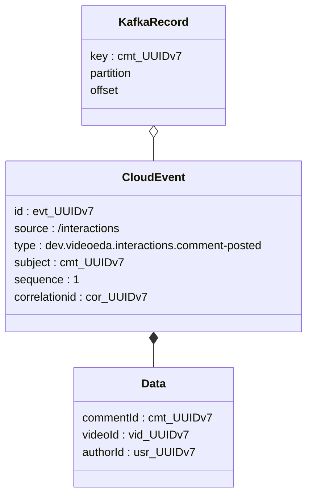
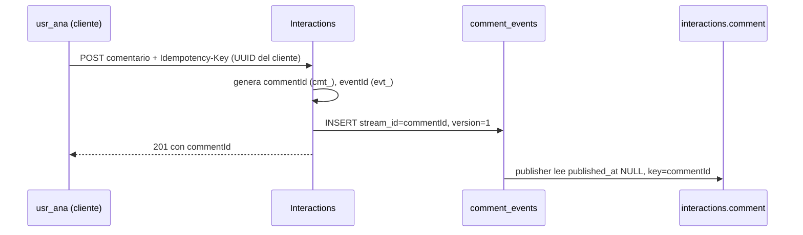

# Identificadores y nombres

> **Estado:** borrador · **Versión de referencia:** RFC 9562, CloudEvents 1.0.2, PostgreSQL 18, Kotlin 2.4.0 · **Última actualización:** 2026-10-12

## Resumen
Un identificador responde "¿de qué cosa hablo y cómo la distingo?", y no es lo mismo que la versión del evento, su posición en el log o su offset en Kafka. Los ids de ejemplo `c-1`, `v-1` y `u-42` sirven para leer escenarios pero no para un sistema real. **Propuesta:** `<prefijo>_<UUIDv7>` generado por el servicio dueño (`cmt_01a13161-129c-76ff-af15-e5821d573d09`), el mismo texto en la base, en el evento y en la key de Kafka, y el id del stream igual al id del agregado.

## Por qué importa
- **Orden y concurrencia:** en un event store el stream tiene que existir con un id **antes** del primer evento; si el id sale de una secuencia de la base, no se puede conocer antes de insertar.
- **Idempotencia:** el inbox deduplica por `source` + `id` (nota 03). Si el `id` se repite o se regenera en un reenvío, el efecto ocurre dos veces o se pierde.
- **Contratos:** si `videoId` y `commentId` son strings indistinguibles, un campo cruzado pasa todos los schemas y falla en producción.
- **Operación:** en un log o en una DLQ, `cmt_…` dice qué es sin buscar nada; `c-1` no.

## Cómo funciona

### Qué identidades hay (no son lo mismo)

| Identidad | Responde | Quién la asigna | Cambia en un reenvío |
|---|---|---|---|
| **Id del agregado** (`commentId`) | ¿Qué comentario es? | El servicio dueño, al crearlo | No |
| **Id del stream** | ¿Dónde está la historia de ese agregado? | Es el id del agregado | No |
| **Id del evento** (`id` de CloudEvents) | ¿Qué hecho es este? | El productor, al registrarlo | No (un reenvío conserva el `id`) |
| **Versión** (`sequence`) | ¿Qué lugar ocupa en la historia del agregado? | El agregado | No |
| **Posición global** (`global_seq`) | ¿En qué orden se guardó en esta base? | La base | No expuesta |
| **Offset de Kafka** | ¿Dónde cayó el mensaje en la partición? | El broker | **Sí** (otro topic, otra partición) |

La última fila es la que **no** se usa nunca como identidad.



*Por qué este diagrama:* es de **clases**, porque la pregunta es cómo se estructura un evento y qué campo identifica qué; `partition` y `offset` aparecen sin valor a propósito: no identifican nada nuestro.



*Por qué este diagrama:* es de **secuencia**, porque muestra **quién genera cada id y en qué momento**; el punto es que ambos ids existen antes del `INSERT`.

### Formato del id de agregado
- **UUIDv4:** 122 bits aleatorios, sin orden. RFC 9562 §2.1 dice que las versiones no ordenadas por tiempo, "such as UUIDv4", tienen "poor database-index locality".
- **UUIDv7:** 48 bits de milisegundos Unix al principio y el resto aleatorio (RFC 9562 §5.7). Ordena por creación como bytes crudos (§6.11). §5.6: "Systems that do not involve legacy UUIDv1 SHOULD use UUIDv7".
- **ULID:** 128 bits, 48 de timestamp y 80 aleatorios, 26 caracteres en Crockford base32; dentro del mismo milisegundo solo ordena con un generador monótono (README de la especificación).
- **KSUID:** 20 bytes, 32 bits de timestamp en segundos desde 2014 y 128 aleatorios, 27 caracteres base62; el README aclara que el orden "is not a strong guarantee".
- **Prefijado:** el tipo va en el propio id. **TypeID** especifica `prefijo_sufijo` con el sufijo como UUIDv7 en 26 caracteres base32 y un prefijo de hasta 63 letras minúsculas y guiones bajos (especificación 0.3.0). Stripe usa la misma idea (`cus_`, `pi_`); esa justificación la leí solo en fuentes secundarias.

### Id del stream y categorías
En un event store con muchos tipos de agregado, el id del stream lleva el tipo: KurrentDB lo organiza como "typically only one stream per entity" y su proyección `$by_category` parte el id por el primer `-` (`account-9E76…` queda en la categoría `account`). Desde KurrentDB 25.1 esa proyección está superada por un índice secundario de categoría integrado. Axon pide que el identificador sea "globally unique in your event store": si dos tipos comparten id, al cargar mezcla los eventos.

Para nosotros el prefijo `cmt_` **cumple el papel de la categoría**: el id ya dice de qué tipo es el stream, y cada agregado event-sourced tendría su tabla. No hace falta un id de stream distinto del id del agregado.

### Id del evento y "commit"
CloudEvents 1.0.2: `id` es obligatorio, "MUST be unique within the scope of the producer", y "Producers MUST ensure that `source` + `id` is unique for each distinct event"; un reenvío "MAY have the same `id`". Es la clave del inbox.

El "commit" viene de event stores históricos. NEventStore guarda en su tabla `Commits` las columnas `StreamId`, `StreamRevision`, `CommitId`, `CommitSequence` y `CheckpointNumber` (visto en un blog de terceros): el commit agrupa los eventos que se agregaron juntos en un solo append. En nuestra tabla **un comando agrega un evento, y la fila es la unidad atómica**; no hace falta un `commit_id` aparte. Si algún día un comando generara varios eventos, se agrupan con `correlationid`.

### Idempotency-Key de comandos
El borrador del IETF (revisión 07, expirado) define `Idempotency-Key` como un string que **genera el cliente**, recomienda "a UUID or similar random identifier", exige que no se reutilice con otro payload y sugiere 422 si se reutiliza distinto y 409 si el original sigue en curso. Es un id **del request**, no del agregado: no se mezcla con `commentId`.

### Nombres de `source`, `subject`, `type` y topics
- **`source`:** URI-reference, "An absolute URI is RECOMMENDED"; los ejemplos de la especificación incluyen una referencia relativa (`/sensors/tn-1234567/alerts`).
- **`subject`:** "the subject of the event in the context of the event producer (identified by `source`)".
- **`type`:** `dev.videoeda.<contexto>.<evento>` sin sufijo (ADR 0002); no cambia.
- **Topics:** `<contexto>.<agregado>` (ADR 0003); no cambia.

## Aplicación por componente

| Componente | Ids que genera | Ids que guarda de otros |
|---|---|---|
| **Videos** | `vid_`, `evt_` de cada evento, `cor_` si el comando no trae uno | `usr_` del creator (llega en el request) |
| **Interactions** | `cmt_`, `evt_`; la puntuación no tiene id propio: su identidad es `{videoId}:{userId}` | `vid_` (read model de publicados), `usr_` |
| **Feed** | `evt_` de `CreatorFollowed` y `CreatorUnfollowed`; el follow se identifica por `{followerId}:{creatorId}` | `vid_`, `usr_` |
| **Notifications** | `ntf_` de cada notificación | `vid_`, `cmt_`, `usr_`, `evt_` (para su inbox) |
| **Transversal** | Idempotency-Key lo genera el cliente; `correlationid` nace en el borde | |

## Ejemplos del dominio

**El caso que falla.** Interactions usa una secuencia de su base y asigna `c-1`, `c-2`…

```gherkin
Escenario: ID-X1 (falla) el id sale de una secuencia
  Dado que Interactions asigna commentId con la secuencia de su base
  Cuando restauran un backup y la secuencia vuelve a emitir c-4521
  Entonces dos comentarios distintos comparten el stream c-4521
  Y la restricción UNIQUE (stream_id, version) los trata como uno solo
  Y no se puede conocer el commentId antes del primer INSERT, aunque el cliente lo necesite en el 201
```

Otros fallos del mismo origen: `GET /comments/4521` revela cuántos comentarios hay; en `videoId:raterId` un campo cruzado (`c-1:u-42`) pasa cualquier schema porque todo es string.

**El que funciona.** El servicio genera el id al crear el agregado.

```json
{
  "specversion": "1.0",
  "id": "evt_01a13161-130b-746b-a4cf-411498498e7c",
  "source": "/interactions",
  "type": "dev.videoeda.interactions.comment-posted",
  "subject": "cmt_01a13161-129c-76ff-af15-e5821d573d09",
  "time": "2026-10-12T18:30:07.402Z",
  "datacontenttype": "application/json",
  "correlationid": "cor_01a13161-596e-7cc9-94db-a57740b2d002",
  "sequence": 1,
  "data": {
    "commentId": "cmt_01a13161-129c-76ff-af15-e5821d573d09",
    "videoId": "vid_01a13161-1208-73ad-b8df-5e1e8e69b948",
    "authorId": "usr_01a13161-112a-7681-b280-02ac0205cd15",
    "text": "Muy buena la explicación del outbox",
    "postedAt": "2026-10-12T18:30:07.402Z"
  }
}
```

Key de Kafka: `cmt_01a13161-129c-76ff-af15-e5821d573d09`. Los ids se generaron con la estructura del RFC 9562 §5.7 y **este payload valida contra `specs/03-events/schemas/comment-posted.json`** (jsonschema Draft 7, sin errores). Ese schema hoy solo pide `string`: no impone el formato, eso queda como regla.

**Follow y puntuación (ids compuestos).**
`feed.follow` key = `usr_01a13161-112a-7681-b280-02ac0205cd15:usr_01a13161-11be-7119-8e3e-bf07f13eb833` (follower primero, creator después). El alfabeto del id (letras minúsculas, dígitos, `_` y `-`) **no contiene `:`**, así que el par se separa sin ambigüedad con un `split(':')`; los ids de ejemplo `c-1` y `u-42` no lo garantizaban.

### El esquema de `comment_events` con estos ids (propuesta, no ejecutada)

```sql
CREATE TABLE comment_events (
  global_seq   BIGINT GENERATED ALWAYS AS IDENTITY PRIMARY KEY,
  event_id     TEXT        NOT NULL UNIQUE,   -- evt_<uuidv7> = id del CloudEvent
  stream_id    TEXT        NOT NULL,          -- cmt_<uuidv7> = commentId = key en Kafka
  version      INT         NOT NULL,          -- = sequence del CloudEvent
  type         TEXT        NOT NULL,
  data         JSONB       NOT NULL,
  metadata     JSONB       NOT NULL,          -- correlationid, actor
  recorded_at  TIMESTAMPTZ NOT NULL DEFAULT now(),
  published_at TIMESTAMPTZ,
  UNIQUE (stream_id, version),
  CHECK (stream_id ~ '^cmt_[0-9a-f]{8}-[0-9a-f]{4}-7[0-9a-f]{3}-[89ab][0-9a-f]{3}-[0-9a-f]{12}$'),
  CHECK (event_id  ~ '^evt_[0-9a-f]{8}-[0-9a-f]{4}-7[0-9a-f]{3}-[89ab][0-9a-f]{3}-[0-9a-f]{12}$')
);
```

La expresión regular de los `CHECK` sí se probó en Python contra los seis ids del ejemplo; **el DDL no se ejecutó en PostgreSQL**.

## Alternativas y trade-offs

| Opción | Ventaja | Costo | Veredicto |
|---|---|---|---|
| Secuencia de la base (`bigint`) | Corto, índice óptimo | No se conoce antes del INSERT; colisiona al restaurar o con varias instancias; revela volumen | **No** |
| UUIDv4 | Estándar, sin coordinación | Sin orden temporal: mala localidad de índice (RFC 9562 §2.1) | No |
| UUIDv7 sin prefijo | Estándar, ordenable, nativo en PostgreSQL 18 | Un `videoId` y un `commentId` son indistinguibles | Lo mínimo |
| ULID / KSUID | Compactos, ordenables | No son UUID: no hay tipo `uuid` nativo ni función en la base | No |
| **`<prefijo>_<UUIDv7>` en texto (propuesta)** | Dice de qué es; se pega en `psql`, logs y Pact; el mismo texto en todas partes; sin librería | 40 caracteres; **no es TypeID** (que usa base32) | **Elegida** |
| TypeID con base32 | Especificación publicada, 31 caracteres | Codificar y decodificar en cada borde; librería o código propio | Camino de crecimiento |

## Reglas para el spec
1. **R1:** todo id de agregado es `<prefijo>_<UUIDv7 en hex con guiones>`, en minúsculas. Prefijos: `vid`, `cmt`, `usr`, `ntf`, `evt`, `cor`.
2. **R2:** el id lo genera el servicio dueño, nunca la base ni el cliente; se genera **antes** de la primera escritura.
3. **R3:** el id del stream es el id del agregado; no existe un segundo identificador de stream.
4. **R4:** el mismo texto es el `subject`, el `commentId` en `data`, el `stream_id` y la key de Kafka (ADR 0003).
5. **R5:** `id` del evento = `evt_<UUIDv7>`, único por evento y estable en reenvíos; no se usa offset, partición ni `global_seq` como identidad.
6. **R6:** los ids compuestos son `{a}:{b}` con ambos ids completos; ningún id puede contener `:`.
7. **R7:** los schemas imponen el formato con `pattern`; un id con prefijo equivocado en un campo se rechaza (`videoId` con `cmt_…` falla).
8. **R8:** la `Idempotency-Key` la genera el cliente (UUID) y no se confunde con ningún id de dominio.
9. **R9:** el generador es único por proceso y monótono dentro del mismo milisegundo (experimento ID-03).
10. **R10:** `subject` es el id del agregado, sin tipo adicional (`cmt_…` y no `comment/cmt_…`).

Escenarios propuestos (ZOMBIES):

```gherkin
@zero @unit
Escenario: ID-01 un id sin prefijo o con prefijo ajeno se rechaza
  Dado un comando con videoId "cmt_01a13161-129c-76ff-af15-e5821d573d09"
  Cuando Interactions valida el comando
  Entonces se rechaza porque videoId exige el prefijo vid_
```

```gherkin
@one @unit
Escenario: ID-02 un comentario nuevo recibe un id válido antes de persistirse
  Dado que usr_ana envía un comentario
  Cuando Interactions crea el agregado
  Entonces commentId tiene prefijo cmt_ y es un UUIDv7
  Y es el stream_id del evento CommentPosted con version 1
```

```gherkin
@many @integracion @experimento
Escenario: ID-03 muchos ids en el mismo milisegundo
  Dado que se generan 10.000 commentId en un mismo proceso
  Cuando se los ordena como texto
  Entonces el orden coincide con el de generación
```

## Fuentes
- [RFC 9562 – UUIDs](https://www.rfc-editor.org/rfc/rfc9562.html) — §2.1, §5.4, §5.6, §5.7, §6.2, §6.4, §6.11, §6.13, §8. Consultada 2026-10-12; **leídos los primeros 100.000 de 119.565 caracteres**.
- [PostgreSQL 18 – UUID functions](https://www.postgresql.org/docs/current/functions-uuid.html) — `uuidv7()`, `uuidv4()`, `uuid_extract_timestamp`; doc de la versión 18.6. Consultada 2026-10-12.
- [PostgreSQL 18 – Release notes](https://www.postgresql.org/docs/18/release-18.html) — `uuidv7()` agregado en 18, lanzada 2025-09-25. Consultada 2026-10-12.
- [Kotlin 2.4.0 – What's new](https://kotlinlang.org/docs/whatsnew24.html) y [kotlin.uuid.Uuid](https://kotlinlang.org/api/core/kotlin-stdlib/kotlin.uuid/-uuid/-companion/), [UUIDs](https://kotlinlang.org/docs/uuids.html) — API estable salvo `generateV4` y `generateV7`, que siguen experimentales con opt-in. Consultadas 2026-10-12.
- [JDK 26 – java.util.UUID](https://docs.oracle.com/en/java/javase/26/docs/api/java.base/java/util/UUID.html) y [JDK 25](https://docs.oracle.com/en/java/javase/25/docs/api/java.base/java/util/UUID.html) — `UUID.ofEpochMillis` desde 26; sin v7 en 25. Consultadas 2026-10-12.
- [CloudEvents 1.0.2 – spec](https://github.com/cloudevents/spec/blob/v1.0.2/cloudevents/spec.md) — `id`, `source`, `subject`. Consultada 2026-10-12 (resumen de la herramienta de fetch).
- [TypeID – especificación 0.3.0](https://github.com/jetify-com/typeid/blob/main/spec/README.md) y [README](https://github.com/jetify-com/typeid/blob/main/README.md) — formato y reglas de prefijo.
- [ULID spec](https://github.com/ulid/spec) y [KSUID](https://github.com/segmentio/ksuid) — longitud, codificación y orden.
- [KurrentDB v25.0 – Streams](https://docs.kurrent.io/server/v25.0/features/streams.html) y [v26.1 – System projections](https://docs.kurrent.io/server/v26.1/features/projections/system.html) — streams por entidad, `$by_category`, índice de categoría integrado.
- [Axon Framework – Aggregate](https://docs.axoniq.io/axon-framework-reference/5.0/commands/modeling/aggregate/) (4.13 y 5.0, vía resultado de búsqueda) — unicidad global del identificador.
- [Marten – Appending events](https://martendb.io/events/appending.html) — id de stream asignado o provisto, versión esperada.
- [Event-Driven.io – On putting stream id in event data](https://event-driven.io/en/on_putting_stream_id_in_event_data/) (2024-01-21) — el id del agregado repetido en el dato del evento.
- [IETF – Idempotency-Key header, draft 07](https://datatracker.ietf.org/doc/draft-ietf-httpapi-idempotency-key-header/) — definición, UUID recomendado, 422 y 409. Borrador expirado; leído en su versión HTML.
- [Mikhail Shilkov – NEventStore SQL read performance](https://www.mikhail.io/2017/01/event-sourcing-optimizing-neventstore-sql-read-performance/) — columnas de la tabla `Commits` (fuente secundaria).

## No verificado
- **El formato propuesto no es TypeID:** TypeID codifica el sufijo en base32; nosotros usamos el UUID en hex con guiones. Es **decisión nuestra** por legibilidad y por no escribir un codec; mantiene la regla de prefijo de la especificación.
- **Texto vs `uuid`:** RFC 9562 §6.13 dice "SHOULD be stored … as the underlying 128-bit binary value" y que un id generado por la base da "the best UUID monotonicity". Elegimos `TEXT` generado por el servicio por tener una sola representación y conocer el id antes del INSERT. Es una discrepancia **asumida**, reversible, sin medición de costo.
- **Monotonía de `generateV7()`:** la página de Kotlin no explica su garantía; el nombre `generateV7NonMonotonicAt` sugiere que `generateV7()` sí es monótono, pero es **inferencia**. ID-03 es un experimento.
- **`UUID.ofEpochMillis` (JDK 26)** no impone monotonía: "callers … are expected to ensure" que el timestamp lo sea. No decidimos JDK; con el generador de Kotlin no hace falta depender de él.
- **JDK:** no verifiqué qué versión es LTS ni cuál es la última a la fecha.
- **KurrentDB:** la página de streams que leí **no define reglas de nombre de stream**; la convención `categoría-id` sale de `$by_category` y de resultados de búsqueda.
- **Axon:** no leí la página del event store (`sequence number`, `global index`); solo la del agregado, y vía resultado de búsqueda.
- **NEventStore:** no encontré la definición oficial de `commit`; lo descrito sale de un blog de terceros, y la diferencia entre `StreamRevision` y `CommitSequence` no está confirmada.
- **Marten:** no leí la página de configuración de `StreamIdentity`.
- **Stripe:** no encontré un texto de ingeniería de Stripe; el porqué de los prefijos está en fuentes secundarias.
- **Timestamp en el id:** RFC 9562 §8 lo trata como "a very small attack surface"; no se evaluó más (seguridad fuera de alcance).
- **Distribución de keys en Kafka:** que los ids ordenados por tiempo no afecten el reparto entre particiones es **inferencia** (el partitioner aplica un hash a los bytes de la key); no leí la implementación ni se probó.
- **Borrador de Idempotency-Key:** está expirado y "intended status: none"; sus códigos 422 y 409 son recomendación (`SHOULD`), no estándar.
- **Inconsistencias previas en el repo:** el envelope describe `subject` como `video/9f3a`, la nota 01 usa `videos/{videoId}` y los AsyncAPI usan `comment/c-1`; R10 propone unificar en el id del agregado.
- **Nada se ejecutó contra PostgreSQL ni contra un broker:** el DDL y las expresiones de los `CHECK` son propuesta.

## Historial

| Fecha | Cambio |
|---|---|
| 2026-10-12 | Creación a partir de la pregunta de Laura: los ids `c-1` no sirven; se buscan mejores prácticas para nombrar ids de agregado, stream y evento |
| 2026-10-12 | Ids de los ejemplos alineados con `specs/01-domain/ids-de-ejemplo.md` (el caso que falla conserva `c-1` y `c-4521` a propósito) |
