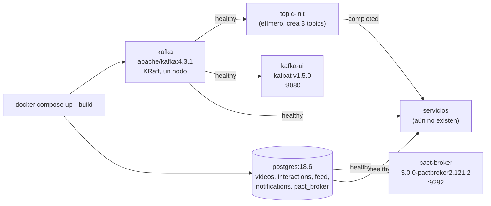

# Spike de verificación: resultados

> **Estado:** vigente (Fase 0 y S1 a S5 ejecutados; el detalle de cada uno está en las secciones y en `spikes/*/RESULTADOS.md`) · **Versión de referencia:** Kafka 4.3.1, PostgreSQL 18.6, Docker 28.5.1 · **Última actualización:** 2026-10-12

## Resumen
Hasta la nota 17 todo lo que decía "verificado" era lectura de documentación. Esta nota registra lo que **se ejecutó de verdad**. La **Fase 0** levanta el ecosistema base con un solo comando (`docker compose up --build`), con solo Docker como requisito: broker Kafka 4.3.1, creación de topics, PostgreSQL con una base por servicio, Pact Broker y una interfaz web para ver los eventos. Los servicios todavía no existen, y las preguntas S1 a S4 siguen pendientes.

## Por qué importa
- Un ejemplo que "se clona y se levanta de una" es parte de la demostración, igual que el ordering o los contratos.
- Si la imagen de Kafka, la configuración de share groups o la base no se comportan como dice la documentación, es mejor enterarse antes de escribir cuatro servicios.
- Se conecta con el ADR 0007 (Compose + GitHub Actions) y con los experimentos pendientes de `specs/07-nfr/garantias.md`.

## Cómo funciona



*Por qué este diagrama:* es de **despliegue** y responde en qué orden y con qué dependencias arranca cada pieza.

## Fase 0: el ecosistema base

### Qué se creó
| Archivo | Para qué |
|---|---|
| `compose.yaml` (raíz) | Define los cinco contenedores, sus dependencias y volúmenes |
| `deploy/kafka/create-topics.sh` | Crea los topics, idempotente (`--if-not-exists`) |
| `deploy/postgres/init-databases.sql` | Crea las cinco bases la primera vez |

### Imágenes (tags fijos, sin `latest`)
| Servicio | Imagen | Tamaño en disco | Cómo se verificó el tag |
|---|---|---|---|
| Kafka | `apache/kafka:4.3.1` | 686 MB | `docker manifest inspect`; Docker Hub lista `4.3.1` (2026-06-23) |
| PostgreSQL | `postgres:18.6` | 644 MB | Docker Hub lista `18.6` (2026-10-07) |
| Pact Broker | `pactfoundation/pact-broker:3.0.0-pactbroker2.121.2` | 292 MB | Docker Hub; es el tag que hoy equivale a `latest` (2026-09-17) |
| Kafka UI | `ghcr.io/kafbat/kafka-ui:v1.5.0` | 635 MB | GitHub releases: v1.5.0 (2026-04-20) es la última |

Total en disco: unos **2,26 GB**. La máquina de prueba tiene 10 CPU y unos 8 GB asignados a Docker.

### Qué se ejecutó y qué dio

| Verificación | Comando | Resultado |
|---|---|---|
| Arranque desde cero | `docker compose up -d --wait` | Todo arriba en 1 min 28 s, **incluida la descarga de imágenes** (una sola medición) |
| Topics creados | `topic-init` | Exit 0; 8 topics: `videos.video`, `interactions.comment`, `feed.follow`, `videos.processing`, `interactions.dlq`, `feed.dlq`, `notifications.dlq`, `videos.processing.dlq` |
| Configuración de topics | `kafka-topics.sh --describe` | Los tres de dominio con `PartitionCount: 3 ReplicationFactor: 1 Configs: min.insync.replicas=1,retention.ms=-1`; los demás con 3 particiones y retención por defecto |
| Auto-creación desactivada | `KAFKA_AUTO_CREATE_TOPICS_ENABLE=false` | Solo existen los 8 topics del script más los internos `__consumer_offsets` y `__share_group_state` |
| PostgreSQL | `select datname from pg_database …` | `feed`, `interactions`, `notifications`, `pact_broker`, `videos`; `PostgreSQL 18.6 (Debian 18.6-1.pgdg13+2)` |
| Pact Broker | `GET /diagnostic/status/heartbeat` | HTTP 200, `{"ok":true,…}` |
| Kafka UI | `GET /` y `GET /api/clusters` | HTTP 200; `"status":"ONLINE","brokerCount":1,"topicCount":8,"controller":"KRAFT"` |
| Mensajes en la UI | Endpoint `…/topics/videos.video/messages/v2` | La UI muestra `partition`, `offset`, `key` (`vid_paella`), `headers` y `value` |
| Producir y consumir con key | `kafka-console-producer.sh` / `kafka-console-consumer.sh` | `Partition:2 Offset:0 vid_paella {…"n":1}` y `Partition:2 Offset:2 vid_surf {…}` |
| Share groups habilitados | `kafka-features.sh describe` | `Feature: share.version … FinalizedVersionLevel: 1` **sin configuración extra** |
| Share group real | `kafka-console-share-consumer.sh` | Grupo `videos-worker` creado, estado `Empty` cuando no hay miembros |
| Reinicio sin `-v` | `down` y `up -d` | `topic-init` exit 0, no recrea nada, el mensaje producido antes **sigue ahí** y `retention.ms=-1` se conserva |
| Limpieza | `down -v` | Sin contenedores, volúmenes ni red residuales |

**Tiempos medidos** (imágenes ya descargadas): desde `up -d` hasta que `topic-init` termina, **56 s** en ciclo limpio y **77 s** en el reinicio sin `-v`. Esas corridas fueron **bajo emulación amd64** (ver hallazgo 10). Con imágenes **arm64 nativas** la misma secuencia tardó **30 s**, y `pull` de las cuatro imágenes arm64 tardó 82 s. Son mediciones sueltas; la variación entre corridas no se estudió.

### Hallazgos

1. **`share.auto.offset.reset` es `latest` por defecto (confirmado ejecutando).** Se produjo un mensaje en `videos.processing` y recién después se creó el share group `videos-worker`: el consumer procesó **0 mensajes**. Con `kafka-configs.sh … --add-config share.auto.offset.reset=earliest` sobre el grupo, el mismo consumer procesó **1 mensaje**. Es la trampa de la nota 07 y la razón de la regla del ADR 0005.
2. **Los share groups no requieren habilitar nada en Kafka 4.3.1.** `share.version` ya está finalizada en 1 (cierra el pendiente "confirmar que no requieren habilitar nada" del ADR 0007). Con un solo broker sí hace falta bajar la replicación del topic interno: `KAFKA_SHARE_COORDINATOR_STATE_TOPIC_REPLICATION_FACTOR=1` y `…_MIN_ISR=1`; `__share_group_state` se creó con eso.
3. **La imagen escribe los datos en `/tmp/kafka-logs` por defecto.** El primer intento dejaba el volumen sin usar y los datos se perdían al recrear el contenedor. Se corrigió con `KAFKA_LOG_DIRS=/var/lib/kafka/data` y se comprobó que el directorio de cada partición queda en el volumen.
4. **`docker compose up --wait` vuelve antes de que `topic-init` termine**, porque ese contenedor no tiene healthcheck. En primer plano (`docker compose up`) no molesta; para los servicios la dependencia correcta será `condition: service_completed_successfully`.
5. **`pg_isready` no alcanza como healthcheck.** Responde "listo" mientras el script de inicio todavía no creó las bases. Se reemplazó por `psql -d pact_broker -c 'select 1'`, que solo pasa cuando la base existe.
6. **Kafbat UI v1.5.0 no listó el share group.** El endpoint de consumer groups devolvió `{"pageCount":0,"consumerGroups":[]}` aunque `kafka-share-groups.sh --list` mostraba `videos-worker`. Es probable que esa versión no soporte share groups; los mensajes y los topics sí se ven. No se probó visualmente en un navegador.
7. **Las herramientas de línea de comandos de 4.3 avisan que `--property` está deprecado**; hay que usar `--reader-property` y `--formatter-property`. El script usa los nuevos.
8. **`kafka-topics.sh` avisa por cada topic con punto** ("topics with a period ('.') or underscore ('_') could collide"). Es cosmético: usamos solo puntos.
9. **`vid_paella` y `vid_surf` cayeron en la misma partición (2)** con 3 particiones. Es coincidencia del hash; no demuestra nada sobre el orden ni sobre la distribución.
10. **El entorno de Laura define `DOCKER_DEFAULT_PLATFORM=linux/amd64`**, así que todo corrió emulado en un Mac arm64 (PostgreSQL informaba `x86_64-pc-linux-gnu`). Se repitió el arranque sin esa variable y con las cuatro imágenes bajadas con `--platform linux/arm64`: todo sano, `topic-init` exit 0, Pact Broker y UI con HTTP 200, `share.version` en 1 y `aarch64-unknown-linux-gnu` en PostgreSQL. Las cuatro imágenes publican manifiestos `amd64` y `arm64`. Consecuencia: `compose.yaml` **no fuerza plataforma**; funciona en ambas, y quien tenga esa variable exportada corre emulado y más lento.

### Decisiones nuestras (a confirmar)
- **DLQ con 3 particiones y retención por defecto.** Los ADR 0003 y 0008 no fijan su configuración; se eligió igual que `videos.processing`.
- **Credenciales `videoeda`/`videoeda`** en Compose para todo: es un ejemplo y el repositorio no guarda secretos reales.
- **Puertos del host:** 9092 (Kafka), 5432 (PostgreSQL), 9292 (Pact Broker), 8080 (UI). Si alguno está ocupado en tu máquina, `compose.yaml` hay que editarlo.

## S1: los tres consumers arrancan con Spring Kafka 4.1.1 y `kafka-clients` 4.3.x (CTR-08)
**Pasó** (corrida 2026-10-12, `./gradlew clean test` en `spikes/stack-check/`, 12 pruebas en verde, broker `apache/kafka:4.3.1` por Testcontainers). Detalle y salidas literales: [`RESULTADOS.md`](../../spikes/stack-check/RESULTADOS.md).

| Pregunta | Veredicto |
|---|---|
| `kafka-clients` en el classpath | **4.3.1** (Spring Kafka 4.1.1 y la BOM de Boot piden 4.2.1; gana la dependencia directa por conflicto) |
| Cero mensajes: arrancan el consumer clásico, el KIP-848 y el share consumer en un contexto Boot real | **Pasó**; el broker los lista como Classic, Consumer y Share |
| Uno y muchos (20 keys distintas) | **Pasó**, sin duplicados |

Combinación verificada: Boot 4.1.1, Spring Kafka 4.1.1, Kotlin 2.4.21, Testcontainers 2.0.5, Gradle 9.8.1, Corretto 21.0.10 (la decisión de JDK sigue abierta). Sin choque de dependencias transitivas.

## S2: share group con Spring Kafka (RENEW, release, conteo de entregas)
**Pasó con una refutación importante.** Detalle: [`RESULTADOS.md`](../../spikes/stack-check/RESULTADOS.md).

| Pregunta | Veredicto |
|---|---|
| 20 mensajes con 3 consumers, uno por mensaje | **Pasó** (reparto desparejo 9/6/5) |
| ACCEPT, RELEASE, REJECT | **Pasó**: RELEASE re-entrega en ~0,5 s con `deliveryCount=2`; REJECT no vuelve |
| Lock vencido | **Pasó**: con una partición por miembro vuelve al *mismo* miembro; a otro solo si hay más miembros que particiones |
| `ShareAcknowledgment.renew()` de Spring dentro del listener | **Refutado**: cinco renovaciones no evitaron la re-entrega (la causa, que solo encola la confirmación, es inferencia) |
| `RENEW` con el cliente directo (`acknowledge(RENEW)` + `commitSync()` + `poll()`) | **Pasó**: una sola entrega con `deliveryCount=1` |
| `ConsumerRecord.deliveryCount()` | **Se expone** (`Optional<Short>`, valores 1, 2, 3); Spring dice lo contrario: discrepancia cerrada a favor del cliente |
| `share.auto.offset.reset=earliest` | **Pasó**; con el valor por defecto el grupo nuevo no recibe lo anterior |

Un falso verde corregido durante el spike: en modo `EXPLICIT` el `ShareAcknowledgment` llega nulo y la excepción terminaba en un `REJECT` silencioso. Las pruebas ahora fallan si el ack es nulo en modo `MANUAL`.

## S3: Pact de mensajes con Kotlin 2.4, JUnit 5 y Boot 4.1
**Pasó.** 13 pruebas en verde (`./gradlew clean test` en `spikes/pact-check/`, 9 s) y el flujo contra el Pact Broker real (`./run-broker-flow.sh`, log en `broker-flow.log`). Detalle: [`RESULTADOS.md`](../../spikes/pact-check/RESULTADOS.md).

| Pregunta | Veredicto |
|---|---|
| Pact JVM **4.7.5** con Kotlin 2.4.21, JUnit 5, Boot 4.1.1 y JDK 21: message pacts de `VideoPublished` para Feed y Notifications (cero, uno, dos) | **Pasó** |
| Romper un campo falla con mensaje legible | **Pasó**: `Actual map is missing the following keys: creatorId`; tipo cambiado falla; un campo opcional nuevo pasa (CTR-02) |
| Key = `subject` = `videoId` (CTR-05) | **Pasó** con test propio |
| Validación contra el JSON Schema real | **Pasó con un ajuste, ya resuelto (2026-10-16):** `networknt 3.0.8` rechazaba el `$id` relativo; los schemas ahora usan URN y validan sin parche |
| Pact Broker 3.0.0 y `can-i-deploy` | **Pasó**: verde con exit 0 (Videos 1.0.0 y 1.2.0) y rojo con exit 1 (1.1.0 sin `creatorId`, 1.3.0 con key equivocada) |

Hallazgos: la **key se puede verificar con Pact** como metadata del mensaje (`kafka_key` con matcher regex), pero falla solo el pact que la declara, así que CTR-05 sigue siendo necesario; los resultados de verificación solo se publican con pacts **bajados del broker**; el environment `production` ya viene creado y el provider necesita `record-deployment` de los consumers para tener contra qué comparar; la CLI en Docker no alcanza los links del broker salvo con `--network container:<broker>`.

## S4: event store de `Comment` en PostgreSQL
**Pasó.** 18 pruebas en verde (`./gradlew clean test` en `spikes/event-store-check/`, 34 s) contra `postgres:18.6` y `apache/kafka:4.3.1`, con JDBC plano. Detalle y evidencia literal: [`RESULTADOS.md`](../../spikes/event-store-check/RESULTADOS.md).

| Pregunta | Veredicto |
|---|---|
| Rehidratar con cero, uno y muchos eventos (ES-01 a 05) | **Pasó** |
| Dos ediciones sobre la versión 1 (ES-06) | **Pasó**: 20 repeticiones, un ganador y un `VersionConflict` (`23505`); con 8 escritores, 1 y 7 |
| La proyección se revierte con el append | **Pasó** |
| Reproyección idéntica (ES-07, G8) | **Pasó** (30 streams) |
| `CHECK` de ids | **Pasó**: acepta UUIDv7; rechaza v4, prefijo equivocado, sin prefijo y `c-1` (`23514`) |
| `generateV7()` en el mismo milisegundo (ID-03) | **Pasó en lo medido**: 200.000 ids de un hilo, 0 fuera de orden y 0 repetidos |
| Caída entre publicar y marcar (ES-08) | **Pasó**: el mismo `event_id` sale dos veces y el inbox aplica el efecto una |
| Dos publishers sin bloqueo | **Duplica todo** (100 registros, 50 `event_id`) |
| Dos publishers con `SKIP LOCKED` | **Sin duplicados pero rompe el orden por key** (versiones `[2, 1]`) |
| `pg_try_advisory_lock` | **Pasó**: solo un publisher a la vez |

La hipótesis de la nota 16 (el publisher lee del event store por `published_at`, `UNIQUE (stream_id, version)` como concurrencia optimista) queda **verificada experimentalmente en un nodo**. El índice parcial `comment_events_unpublished` fue decisión del agente.

## JDK 25 y prueba exploratoria de Kafka 4.4.0 (2026-10-14)
**JDK 25 LTS (Corretto 25.0.1+8), con los pines sin cambios:**

| Módulo | JDK 21 | JDK 25 |
|---|---|---|
| `stack-check` (S1+S2) | 12/12 | **12/12** |
| `pact-check` (S3) | 13/13 | **13/13** |
| `event-store-check` (S4) | 18/18 | **18/18** |

Sin warnings del compilador de Kotlin; solo avisos de la JVM (carga dinámica de agente por ByteBuddy, Class Data Sharing). En contenedor, `eclipse-temurin:25-jdk` y `gradle:9-jdk25` compilan con `--platform linux/arm64`. No se probó `run-broker-flow.sh` (Pact Broker) con JDK 25. Un `./gradlew build -x test` falla en `:bootJar` por falta de `main` en el spike, no por el JDK.

**Kafka 4.4.0 (cliente 4.4.0 + broker `apache/kafka:4.4.0-rc4`):** `stack-check` 12/12 y `event-store-check` 18/18; los share groups se comportan igual y `renew()` de Spring sigue sin mantener el lock. `AppInfoParser` pasó a `org.apache.kafka.common.utils.internals` (el test se resolvió por reflexión). Observación sin conclusión: más reintentos `NOT_LEADER_OR_FOLLOWER` en un topic recién creado, con el broker rc4 emulado `amd64`. **GA no confirmado:** la página oficial de descargas llega hasta 4.3.1 y `downloads.apache.org/kafka/4.4.0/` da 404; el jar está en Maven Central y Docker Hub solo tiene `rc1` a `rc4`. Decisión: mantener 4.3.1 hasta el anuncio y el tag `4.4.0`.

## Aplicación por componente

| Componente | Qué dejó la Fase 0 |
|---|---|
| Videos | Base `videos` y topics `videos.video` y `videos.processing` listos |
| Interactions | Base `interactions`; topic `interactions.comment` con retención infinita |
| Feed | Base `feed`; topic `feed.follow` con retención infinita |
| Notifications | Base `notifications` y `notifications.dlq` |
| Transversal | Pact Broker con su base, UI de eventos y topic-init idempotente |

## Ejemplos del dominio

**Caso que falla (confirmado):** el worker de video se suscribe a `videos.processing` con un share group nuevo, después de que Videos ya publicó `ProcessVideo` para `vid_ramen`. Con la configuración por defecto (`latest`) el worker no ve nada y el video queda en `PROCESSING` para siempre, sin error.

**Caso que funciona:** el grupo `videos-worker` se crea con `share.auto.offset.reset=earliest` antes del primer consumo; el mismo mensaje se entrega.

```gherkin
Escenario: worker nuevo recibe el trabajo publicado antes de existir el grupo
  Dado que Videos publicó ProcessVideo para vid_ramen en videos.processing
  Y el share group videos-worker no existía todavía
  Cuando el grupo se crea con share.auto.offset.reset=earliest y el worker se suscribe
  Entonces el worker recibe el mensaje de vid_ramen
```

## Alternativas y trade-offs

| Opción | Ventaja | Costo | Cuándo |
|---|---|---|---|
| Compose en la raíz con UI por defecto (elegida) | Un solo comando; la UI muestra todo el tráfico | Una imagen más (635 MB) | Ejemplo para aprender y demostrar |
| UI como perfil opcional | Arranque más liviano | Hay que acordarse del perfil | Si el equipo no la necesita |
| Testcontainers para toda la infra | Aislado por test | Dos definiciones de infraestructura | Tests de integración; se evalúa en S1 |

## Reglas para el spec
1. El entorno completo se levanta con `docker compose up --build` y solo requiere Docker.
2. Los topics se crean únicamente con `deploy/kafka/create-topics.sh`; el broker no los crea solo.
3. Todo share group del proyecto se crea con `share.auto.offset.reset=earliest` (confirmado con un experimento).
4. Los servicios dependen de `kafka` (healthy), `topic-init` (completed_successfully) y `postgres` (healthy).
5. Las versiones de las imágenes se fijan con tag exacto; subirlas es un cambio explícito.

## Fuentes
- [Docker Hub: apache/kafka](https://hub.docker.com/r/apache/kafka/tags) — tag `4.3.1` (2026-06-23). Consultado 2026-10-12.
- [Docker Hub: postgres](https://hub.docker.com/_/postgres) — tag `18.6` (2026-10-07). Consultado 2026-10-12.
- [Docker Hub: pactfoundation/pact-broker](https://hub.docker.com/r/pactfoundation/pact-broker/tags) — tag `3.0.0-pactbroker2.121.2`. Consultado 2026-10-12.
- [GitHub: kafbat/kafka-ui releases](https://github.com/kafbat/kafka-ui/releases) — v1.5.0 (2026-04-20). Consultado 2026-10-12.
- Nota 07 (share groups), nota 11 (infraestructura), ADR 0005, ADR 0007 y ADR 0008 del repositorio.
- Salidas de los comandos de esta nota: ejecutadas 2026-10-12 en la máquina de Laura (Docker Desktop 28.5.1).

## No verificado
- **JDK 25 y Kafka 4.4.0:** no se probó el flujo del Pact Broker con JDK 25; la comparación de reintentos con rc4 no es válida (emulación `amd64`); el anuncio de GA de Kafka 4.4.0 no se encontró y puede existir fuera de lo consultado.
- **S3:** no se probó pending ni WIP pacts (CTR-03), el plugin de Gradle de Pact, un `KafkaProducer` real, GitHub Actions ni webhooks. La CLI de Pact corrió por Docker.
- **S4:** sin varios procesos o máquinas (los escritores fueron hilos), sin `kill -9`, sin streams largos, sin upcasting, sin monotonía de `generateV7()` con varios hilos; la demora de una instancia se simuló con una pausa.
- **S1 y S2:** no se probó caída abrupta del consumer, rebalances en share groups, el límite de 5 entregas con archivado, el rango de lock por defecto del broker ni `@KafkaListener` en modo `MANUAL` (ver `RESULTADOS.md`). Los ajustes de `share.coordinator.state.topic.*` de un nodo no se probaron sin ellos.
- **Nada de los servicios:** no existe código ni se probó ningún cliente Java/Kotlin; S1 a S4 siguen pendientes.
- **Primera descarga en una máquina limpia:** una sola medición (1 min 28 s) en una red rápida; las imágenes de PostgreSQL y Kafka pudieron estar parcialmente en caché.
- **Pact Broker 3.0.0:** solo se comprobó el heartbeat. No se publicó un pact ni se probó `can-i-deploy`. Es una versión mayor nueva y su configuración puede diferir de la 2.x.
- **Kafbat UI:** la lista de mensajes se verificó por su API, no en un navegador; no se confirmó que muestre share groups (el endpoint de grupos vino vacío) ni los headers de un CloudEvent.
- **Docker en `ubuntu-latest` y cabida en el runner de GitHub Actions:** no medido (ADR 0007, pendiente).
- **Comportamiento con varias instancias o varios brokers:** un solo nodo por diseño.
- **Otras plataformas:** se probó amd64 (emulado) y arm64 (nativo) en la misma máquina de Laura; no se ejecutó en Linux x86_64 real, en Windows ni en un runner de GitHub Actions.

## Historial

| Fecha | Cambio |
|---|---|
| 2026-10-12 | Creación: Fase 0 (ecosistema base) ejecutada y verificada; S1 a S4 pendientes |
| 2026-10-12 | S1 y S2 ejecutados: CTR-08 verificado; `ShareAcknowledgment.renew()` refutado dentro del listener; `deliveryCount()` se expone |
| 2026-10-12 | S3 y S4 ejecutados: Pact con Kotlin 2.4 y `can-i-deploy` funcionan; el event store de `Comment` se sostiene en PostgreSQL 18.6; dos publishers rompen el orden salvo con un lock |
| 2026-10-16 | Agregado el spike S5 (resiliencia: DLQ secuenciada y redrive en orden, 12 pruebas); el detalle vive en `spikes/resilience-check/RESULTADOS.md` y en la nota 19 |
| 2026-10-14 | JDK 25 LTS adoptado (los tres spikes verdes); Kafka 4.4.0 probado con rc4, sin GA confirmado |
| 2026-10-16 | Renombrado semántico de los spikes (41 pruebas verdes); `$id` de los schemas a URN, verificado con `SchemaContractTest` |
