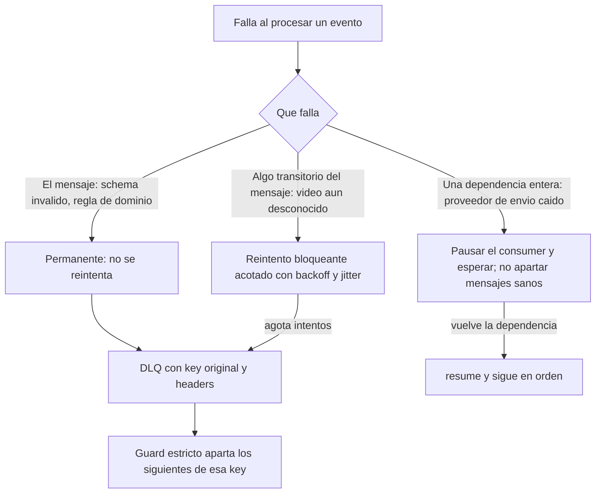
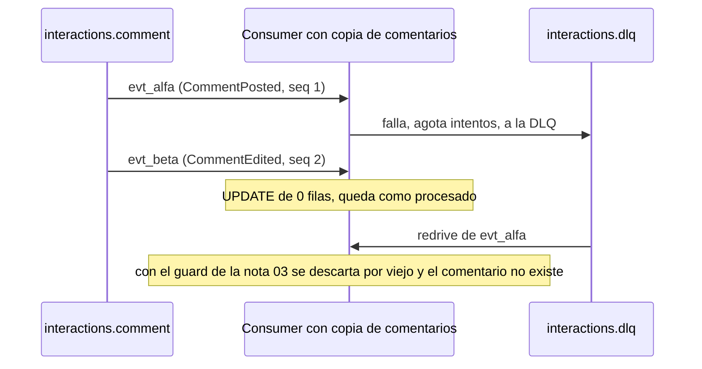
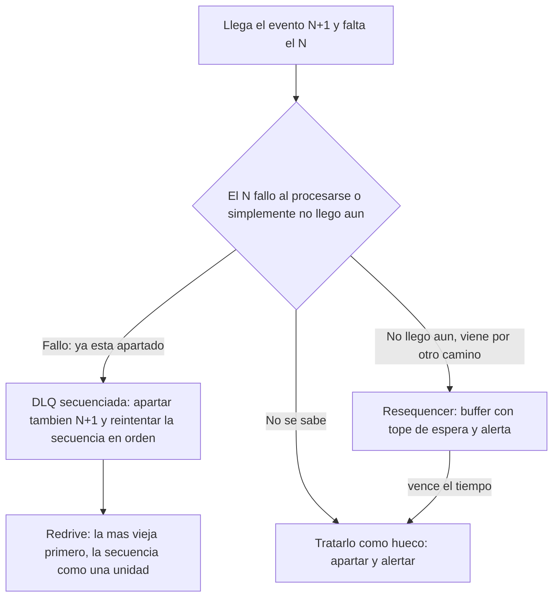
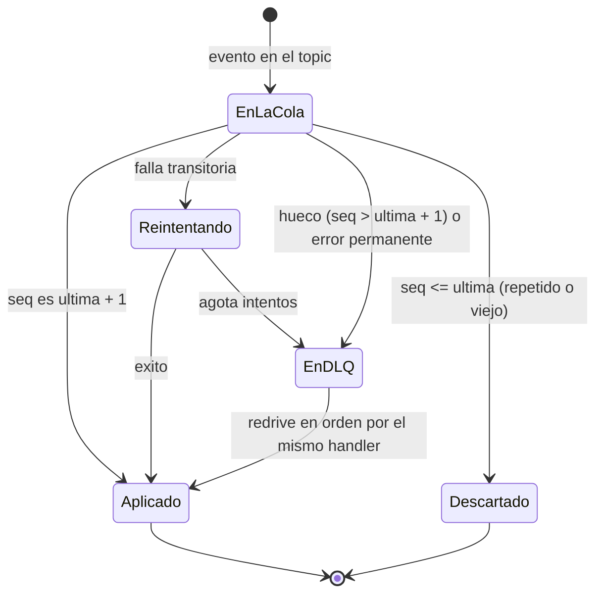

# Resiliencia, volumen y reprocesamiento ordenado

> **Estado:** vigente (estudio; las propuestas de diseño están sin probar) · **Versión de referencia:** Kafka 4.3, Spring Kafka 4.1.1, Spring Framework 7.0 · **Última actualización:** 2026-10-16

## Resumen
Tres preguntas distintas con herramientas distintas: **volumen** (que un pico no tumbe a nadie: Kafka ya es la cola que lo absorbe, y se regula con particiones, tamaño de lote y límites de concurrencia), **falla** (qué hacer cuando una parte no responde o un mensaje no se puede procesar: reintento acotado, clasificación del error, pausa o DLQ) y **reproceso** (volver a aplicar lo que falló o lo que ya pasó, **sin romper el orden por agregado**). Hallazgo central: una DLQ que solo aparta el mensaje fallido **rompe el orden por key** si los mensajes siguientes de esa key se siguen aplicando. Patrón de la industria que lo resuelve: la **DLQ secuenciada** (Axon). Propuesta nuestra, una variante sin estado: un guard de `sequence` **estricto** (solo se aplica `última + 1`) que aparta solos a los siguientes, y un redrive que reaplica en orden por el mismo handler. Decisión recomendada: **sin circuit breaker ni Resilience4j**; con Spring Framework 7 alcanza (`@Retryable` y `@ConcurrencyLimit`).

## Por qué importa
- Sin una política de volumen, el primer pico (un video viral con `usr_viewer-01` a `usr_viewer-50` comentando a la vez) se convierte en lag creciente, rebalances por `max.poll.interval.ms` y una cadena de reintentos que empeora todo.
- Sin una política de falla, o se frena la partición entera por un mensaje venenoso, o se manda a la DLQ y se pierde la consistencia por agregado (garantías G1, G4, G5, G8).
- Sin reproceso ordenado, la DLQ es un cementerio (nota 04) y "reprocesar" duplica efectos externos (nota 03).

## Cómo funciona

### 1. Volumen: ya hay una cola; falta regularla
Kafka es el *queue-based load leveling* del que habla Azure: una cola entre quien produce y quien procesa, para que el servicio trabaje "at its own pace". Dos propiedades del diseño de Kafka lo sostienen: es **pull** ("the consumer simply falls behind and catches up when it can") y una partición la consume **un solo consumer por grupo** (Design, *Consumer Position*). Lo que se regula:

| Palanca | Qué hace | Valor/Default (Kafka 4.3) | Para nosotros |
|---|---|---|---|
| Particiones | Tope de paralelismo de un grupo: más consumers que particiones quedan ociosos | 3 por topic de dominio (ADR 0003) | Alcanza para el ejemplo; subir particiones cambia el mapeo key→partición (nota 02) |
| `max.poll.records` | Registros por `poll()` | 500 | Bajarlo si procesar un lote tarda cerca de `max.poll.interval.ms` |
| `max.poll.interval.ms` | Si no se llama a `poll()` a tiempo, el consumer se da por fallado y hay rebalance | 300000 (5 min) | Es el límite que rompen los reintentos bloqueantes largos |
| `fetch.min.bytes`, `fetch.max.wait.ms`, `max.partition.fetch.bytes` | Cuánto y cuándo trae el broker | 1, 500 ms, 1 MiB | Sin tocar sin medir |
| Producer `linger.ms`, `batch.size`, `compression.type` | Lotes más grandes, más throughput, algo más de latencia | 5 ms (cambió de 0 a 5 en 4.0), 16 KiB, none | Sin tocar sin medir |
| Producer `enable.idempotence` | Reintentos del producer sin duplicar ni reordenar | `true` (requiere `acks=all`, `retries`>0, in-flight ≤ 5) | Ya es el default; sostiene G1 |
| Cuotas del broker | Limitan ancho de banda o tiempo de I/O por cliente | Sin cuotas por defecto | Camino de crecimiento, no se usan |

**Backpressure hacia atrás (el consumer protege a lo que llama).** Si el consumer llama a un proveedor externo (envío de notificaciones), la presión se corta del lado del consumer, no del broker:
- `@ConcurrencyLimit(n)` de Spring Framework 7 limita los hilos concurrentes sobre un método (útil con hilos virtuales, que no tienen tope).
- `pause()`/`resume()` del listener container: el container sigue llamando a `poll()` (evita el rebalance) pero no trae registros.
- Azure advierte que autoescalar consumers "sin acotar" la tasa agregada hacia abajo "only moves the overload to downstream dependencies".

**Monitoreo mínimo:** el lag por partición (`kafka-consumer-groups.sh --describe --group …` muestra `CURRENT-OFFSET`, `LOG-END-OFFSET`, `LAG`). Si el promedio de producción supera al de consumo la cola crece sin fin (Azure): hay que escalar dentro de límites o descartar trabajo en origen.

### 2. Falla: tres clases de problema, tres respuestas



*Por qué este diagrama:* es de **actividad**, porque es una decisión con ramas; la pregunta es "¿cómo clasifico la falla para elegir la respuesta?".

Lo que dicen las fuentes:
- **Reintento bloqueante conserva el orden.** `DefaultErrorHandler` (Spring Kafka 4.1.1) hace seek para reentregar el registro fallido antes que los siguientes de su partición; el default es `FixedBackOff(0L, 9)`; solo llama al recoverer cuando se agotan los intentos. Los `DeserializationException`, `ConversionException`, `ClassCastException` y similares son **no reintentables** de fábrica. Un `Error` (no `RuntimeException`) saltea el handler y mata el consumer.
- **Backoff + jitter.** AWS: reintentar solo en **un** punto de la pila ("If each layer retries independently, the load on the database will increase 243x"), poner **timeout a toda llamada remota**, y "retries are selfish" (en sobrecarga empeoran todo). `@Retryable` de Spring 7 ya trae `maxRetries` (3 por defecto), `delay`, `jitter`, `multiplier`, `maxDelay`, `includes`/`excludes` y publica un `MethodRetryEvent` por intento.
- **Circuit breaker, para qué y para qué no.** Azure: sirve para cortar llamadas a algo que "is likely to fail" y evitar el agotamiento de hilos y conexiones; **no** es adecuado "if you have a message-driven or event-driven architecture", porque ahí la DLQ y los reintentos propios del broker alcanzan. AWS: los circuit breakers introducen "modal behavior … difficult to test" y pueden alargar la recuperación. En un consumer Kafka el rol del breaker lo cumple **pausar el container**: los mensajes esperan en el log.
- **Bulkhead.** Azure: aislar recursos por dependencia; con mensajería, "different sets of queues"; los contenedores dan buen aislamiento a bajo costo. Para nosotros ya está resuelto por diseño: un servicio por contexto, un contenedor por servicio, una DLQ por contexto (ADR 0005, 0007).
- **Dependencia caída ≠ mensaje malo.** Factor House (blog, 2026): las fallas transitorias no deben ir directo a la DLQ; "the DLQ is the terminal state for records that need intervention".

### 3. Reproceso en el orden correcto

**El caso que falla (ejecutado en el spike S5).** Un consumer mantiene una copia de comentarios y aplica `CommentEdited` como `UPDATE`. `cmt_gracias` genera `evt_alfa` (`CommentPosted`, `sequence 1`, texto "Gracias") y `evt_beta` (`CommentEdited`, `sequence 2`, "Gracias, quedó riquísima"). `evt_alfa` falla por un video aún desconocido y, agotados los intentos, va a la DLQ. El consumer sigue (el offset avanzó): `evt_beta` hace `UPDATE` sobre una fila que no existe, afecta 0 filas y **queda registrado como procesado**. Después, al reprocesar la DLQ:
- **Con el guard de la nota 03** (descarta `sequence <= última`): `evt_alfa` (seq 1) se descarta *por viejo*, porque la edición ya fijó la posición en 2. **El comentario no existe**, sin error alguno.
- **Sin guard:** `evt_alfa` inserta el comentario con "Gracias" y **la edición se perdió**, también sin error.



*Por qué este diagrama:* es de **secuencia**, porque el defecto depende del orden en que llegan los mensajes en el tiempo.

**Qué dice la nota 03 y por qué no alcanza.** El guard por `sequence` descarta lo viejo ("¿este evento es más nuevo que el estado?"). No detecta un **hueco**: `seq 2` sobre un estado en `seq 0` pasa.

**Cómo lo resuelve la industria (patrones con nombre).** La pregunta es siempre la misma: *el evento N no se pudo procesar, N+1 sí podría; ¿cómo evito aplicar N+1 sin N y cómo recupero el orden cuando N se pueda?* Cinco respuestas encontradas:

| Patrón | Idea | Fuente | Estado de la fuente | Encaja acá |
|---|---|---|---|---|
| **DLQ secuenciada** (Axon `SequencedDeadLetterQueue`) | Se aparta el evento fallido **y todos los siguientes de la misma secuencia** (por defecto, el mismo agregado); se reintenta la secuencia entera, la más vieja primero; si falla de nuevo vuelve a la cola | Documentación de Axon Framework 5.x | Oficial del fabricante | **Sí: es el patrón base** |
| **Resequencer** (EIP) | Un filtro con estado guarda en un buffer los mensajes desordenados y los publica cuando forman una secuencia completa | enterpriseintegrationpatterns.com | Oficial del patrón; esa página no explica completitud ni huecos | Solo si el faltante está *atrasado*, no *fallido* (otro topic, otro camino) |
| **Orden por key con reintento en memoria** (Confluent Parallel Consumer, modo `KEY`) | Un registro fallido vuelve a su cola y se reintenta con demora; solo bloquea a su key; "no terminal error support" (reintenta para siempre) | README del proyecto | Oficial, pero **"no longer maintained"** (apunta a share consumers y a un fork) | No: sin DLQ terminal y sin mantenimiento; los share groups no dan orden |
| **Detección de huecos en proyecciones** (Ecotone) | Registrar el hueco y seguir (non-blocking), o bloquear hasta que aparezca (time-based) | Documentación de Ecotone | Vendor; trata streams **globales**; en versión por agregado "gaps … cannot happen" porque el lock optimista mantiene las versiones secuenciales | Confirma que, por agregado, la contigüidad la da el **write side** |
| **Buffer por `sequence` con TTL** (blogs; guía de Dapr) | Guardar en una tabla los eventos adelantados, ordenarlos y drenarlos al llegar el faltante; TTL y alerta si el faltante nunca llega | Blogs | Ilustrativo, no normativo | Sí para atrasos, con cuidado: crece sin cota si el evento se perdió de verdad |



*Por qué este diagrama:* es de **actividad**, porque ayuda a elegir el patrón según una pregunta (¿fallido o atrasado?).

Detalles de la DLQ secuenciada de Axon que importan para diseñar la nuestra (documentación 5.x):
- Cachea los ids de las secuencias que están en la cola y, antes de procesar, consulta ese cache: si la secuencia está apartada, el evento se aparta sin procesarse. Nosotros lo **inferimos del hueco de `sequence`**, sin estado extra; el costo es exigir `sequence` contigua.
- La cola tiene capacidad (1024 secuencias y 1024 letters por secuencia por defecto) y, al desbordarse, "that isolation disappears" y puede frenar todo un segmento: hace falta **alerta y límite explícitos**.
- Omitir un evento es "a deliberate trade-off: you accept a gap in the affected sequence" que luego se corrige con replay o a mano; descartarlo (`evict`) es permanente. Esas dos decisiones deben ser **explícitas y registradas**, nunca por defecto.
- El encolado en la DLQ, el trabajo del handler y el avance del token comparten **una transacción** (su DLQ vive en base de datos). La nuestra, en un topic de Kafka, no puede: un fallo entre publicar en la DLQ y confirmar el offset duplica la entrada, que absorbe el inbox por `eventId`.
- Los handlers deben ser idempotentes porque el reintento re-invoca a los que ya habían corrido.

**Variante a evaluar:** una DLQ en **tabla de la base del servicio** (como `JdbcSequencedDeadLetterQueue` de Axon) daría encolado transaccional y consultas por key en orden, a costa de perder la visibilidad en Kafbat y de agregar una tabla. Hoy recomiendo mantener el topic DLQ (ya está en `compose.yaml`).

**Propuesta nuestra (variante sin estado de la DLQ secuenciada; verificada en el spike S5 con clientes planos, ver `spikes/resilience-check/RESULTADOS.md`):**

1. **Guard estricto:** el consumer solo aplica un evento si `sequence == últimaAplicada + 1` (o `1` si no hay estado). Si `sequence <= última`, es repetido o viejo: se descarta (igual que hoy). Si `sequence > última + 1`, hay un **hueco**: el evento no se aplica y va a la DLQ con causa `SEQUENCE_GAP`. Resultado: tras apartar `evt_alfa`, `evt_beta` se aparta solo. No hace falta una tabla de "keys en cuarentena".
2. **DLQ conserva la key original y las particiones del origen** (Spring lo hace por defecto: mismo número de partición, `<topic>-dlt`, headers `DLT_ORIGINAL_TOPIC/PARTITION/OFFSET`). Así `evt_alfa` y `evt_beta` quedan en la misma partición de la DLQ y en orden.
3. **Redrive por el mismo handler, no por el topic principal:** una herramienta de operación (proceso aparte, con el consumer principal en marcha o no) lee la DLQ en orden de offset y llama al mismo handler que usa el consumer (inbox + guard + efecto en una transacción). `evt_alfa` (seq 1) se aplica, después `evt_beta` (seq 2). Lo ya aplicado se descarta por el inbox. Reinyectar al topic principal reintercalaría con eventos nuevos de la misma key.
4. **Condición:** `sequence` debe ser **contigua** por agregado. Para `Comment` está dada por `UNIQUE (stream_id, version)` con `expectedVersion + 1` (verificado en el spike S4). Para `Video` y `Follow` (outbox) **no está verificado** que el outbox asigne números contiguos; habría que definirlo antes de aplicar el guard estricto ahí.



*Por qué este diagrama:* es una **máquina de estados**, porque describe los estados por los que pasa un evento y cuándo cambia de uno a otro.

**Reprocesar todo (replay).** Para reconstruir un read model, o tras corregir un bug de proyección, un consumer puede rebobinar: "A consumer can deliberately rewind back to an old offset and re-consume data" (Kafka, Design). Operativamente: con el grupo **inactivo**, `kafka-consumer-groups.sh --reset-offsets --group … --topic … --to-earliest` (o `--to-datetime`, `--by-duration`, `--shift-by`, `--to-offset`); sin `--execute` solo muestra lo que haría. Condiciones del proyecto: `retention.ms=-1` en los topics reproyectables (nota 14, G8) y **vaciar también el inbox** del read model (si no, todo se descarta como duplicado). **Los efectos externos no se pueden reproyectar**: reiniciar Notifications reenviaría avisos; hace falta que el envío sea idempotente por `ntf_` derivado de `eventId` (Stripe, nota 03) o que Notifications no sea reproyectable. Factor House: "Blind replay is safe only for consumers whose operations are idempotent".

**Del lado productor.** El outbox ya cubre "una parte no funcionó": si Kafka está caído, las filas esperan sin publicar y salen en orden de `global_seq` cuando vuelve, con el polling publisher de instancia única (ADR 0004, spike S4: dos publishers rompen el orden). `delivery.timeout.ms` (2 min) acota cuánto insiste el producer en un envío; si vence, el publisher no marca la fila y reintenta en el siguiente ciclo.

## Aplicación por componente

| Componente | Volumen | Falla | Reproceso |
|---|---|---|---|
| Videos (outbox) | Un publisher por servicio; tamaño de lote y período a medir | Kafka caído: el outbox acumula y publica en orden | Reenvío del mismo `eventId`; el inbox del consumer lo absorbe (S4) |
| Videos (worker de procesamiento) | Share group: más workers hasta el límite de particiones | Release, límite de entregas, `RENEW` con cliente directo (nota 07, S2) | DLQ propia `videos.processing.dlq` |
| Interactions | Event store con proyección en la misma transacción; el cuello es la base | Conflicto de versión: relee y reintenta (S4) | Reproyección de `comment_view` desde `comment_events` (S4) |
| Feed | Consumer clásico; escala hasta 3 particiones | Hueco de `sequence` ⇒ DLQ | Redrive en orden; reproyección desde `videos.video` (sin probar) |
| Notifications | `@ConcurrencyLimit` sobre la llamada al proveedor | **Proveedor caído: pausar el container, no apartar mensajes**; mensaje malo: DLQ | **No reproyectable** salvo envío idempotente |

## Ejemplos del dominio

```gherkin
Escenario: un hueco de sequence aparta el evento en vez de perderlo
  Dado que evt_alfa (CommentPosted, sequence 1) de cmt_gracias fue a la DLQ
  Cuando llega evt_beta (CommentEdited, sequence 2)
  Entonces no se aplica
  Y se publica en interactions.dlq con causa SEQUENCE_GAP y la key original
  Y el redrive aplica evt_alfa y después evt_beta
  Y el comentario queda con el texto "Gracias, quedó riquísima"
```

```gherkin
Escenario: el proveedor de envío está caído
  Dado que el proveedor de notificaciones no responde
  Cuando Notifications procesa VideoPublished de vid_paella
  Entonces el container se pausa tras agotar el reintento acotado
  Y ningún mensaje sano va a notifications.dlq
  Y al volver el proveedor se retoma desde el mismo offset
```

## Alternativas y trade-offs

| Opción | Ventaja | Costo | Cuándo |
|---|---|---|---|
| **Guard estricto + DLQ + redrive por el handler** (propuesta) | Orden por key sin tablas extra; un solo mecanismo para repetidos, viejos y huecos | Exige `sequence` contigua; el redrive es una herramienta a construir | Consumers que dependen del orden por agregado |
| Parar la partición (stop-on-failure) | Orden perfecto, sin lógica | Un mensaje malo frena a todas las keys de la partición | Cuando el volumen es bajo y alguien atiende la alerta |
| Retry topics (no bloqueante) | No frena el tráfico | Pierde el orden (nota 04) | Eventos independientes entre sí |
| Tabla de keys en cuarentena | Aísla solo la key afectada | Estado extra y condiciones de carrera con el redrive | Si el guard estricto no es posible |
| Circuit breaker (Resilience4j) | Estándar para HTTP síncrono | Dependencia sin starter oficial verificado para Boot 4; Azure lo desaconseja con mensajería; no es necesario con pause/resume | No para este proyecto |
| Spring Framework 7 `@Retryable` + `@ConcurrencyLimit` | Sin dependencia nueva; jitter incluido | Sin circuit breaker, bulkhead por pool ni rate limiter | **Recomendado** |

## Reglas para el spec
1. Cada consumer clasifica la falla en **mensaje** (permanente o transitorio) o **dependencia**; la de dependencia pausa el container y no aparta mensajes.
2. Reintento en **un solo punto** de la pila, con timeout en toda llamada remota, backoff exponencial y jitter, y tope.
3. Los consumers que dependen del orden usan **guard estricto de `sequence`**; un hueco va a la DLQ con causa `SEQUENCE_GAP`.
4. La DLQ conserva la **key original**, las particiones del origen y los headers de origen; nunca se publica sin key.
5. El redrive reaplica **en orden de offset por el mismo handler** (inbox + guard + efecto en una transacción); no reinyecta al topic principal.
6. Reproyectar implica vaciar el read model **y su inbox**; los efectos externos solo se reproyectan si son idempotentes.
7. El tope de paralelismo hacia una dependencia externa es explícito (`@ConcurrencyLimit` o equivalente).
8. Se observa el lag por grupo y la profundidad de cada DLQ (alerta ya prevista en G5).

## Fuentes
- [Kafka 4.3 – Consumer configs](https://kafka.apache.org/43/configuration/consumer-configs/) y [Producer configs](https://kafka.apache.org/43/configuration/producer-configs/) — valores por defecto de `max.poll.*`, `fetch.*`, `linger.ms`, `batch.size`, idempotencia. Consultado 2026-10-16.
- [Kafka 4.3 – Design](https://kafka.apache.org/43/design/design/) — pull, un consumer por partición y grupo, rebobinar, cuotas. Consultado 2026-10-16 (leído vía herramienta de fetch).
- [Kafka 4.3 – Basic operations](https://kafka.apache.org/43/operations/basic-kafka-operations/) — `--reset-offsets`, `--describe` y lag. Consultado 2026-10-16.
- [Spring Kafka 4.1.1 – Error handling](https://docs.spring.io/spring-kafka/reference/kafka/annotation-error-handling.html) — `DefaultErrorHandler`, seeks, `DeadLetterPublishingRecoverer`, no reintentables. Consultado 2026-10-16.
- [Spring Kafka – Pausing and resuming](https://docs.spring.io/spring-kafka/reference/kafka/pause-resume.html) — `pause()`/`resume()`. Consultado 2026-10-16.
- [Spring Framework – Core resilience features](https://docs.spring.io/spring-framework/reference/core/resilience.html) — `@Retryable`, `@ConcurrencyLimit`, `RetryTemplate` (desde 7.0). Consultado 2026-10-16.
- [Azure – Queue-Based Load Leveling](https://learn.microsoft.com/en-us/azure/architecture/patterns/queue-based-load-leveling) (ms.date 2026-06-09), [Circuit Breaker](https://learn.microsoft.com/en-us/azure/architecture/patterns/circuit-breaker) (2025-02-05) y [Bulkhead](https://learn.microsoft.com/en-us/azure/architecture/patterns/bulkhead) (2026-03-19). Consultados 2026-10-16.
- [AWS Builders' Library – Timeouts, retries, and backoff with jitter](https://builder.aws.com/content/3EumjoZascWd1oZiEgL8ORlv3qE/timeouts-retries-and-backoff-with-jitter) — 2019-12-05 (la URL de aws.amazon.com redirige acá). Consultado 2026-10-16.
- [Factor House – Dead letter queues in Kafka](https://factorhouse.io/articles/dead-letter-queues-kafka/) — blog, 2026-06-26 (actualizado 2026-10-09): lección operativa, no norma. Consultado 2026-10-16.
- [Axon Framework – Dead-Letter Queue (referencia 5.x)](https://docs.axoniq.io/axon-framework-reference/5.3/dead-letter-queue/) y [API `SequencedDeadLetterQueue`](https://apidocs.axoniq.io/latest/org/axonframework/messaging/deadletter/SequencedDeadLetterQueue.html) — DLQ secuenciada. Consultado 2026-10-16.
- [Enterprise Integration Patterns – Resequencer](https://www.enterpriseintegrationpatterns.com/patterns/messaging/Resequencer.html). Consultado 2026-10-16.
- [Confluent Parallel Consumer (README)](https://github.com/confluentinc/parallel-consumer) — modos de orden y reintento por key; proyecto sin mantenimiento. Consultado 2026-10-16.
- [Ecotone – Gap detection and consistency](https://docs.ecotone.tech/modelling/event-sourcing/setting-up-projections/gap-detection-and-consistency) — huecos en streams globales vs por agregado. Consultado 2026-10-16.
- [Resilience4j – Getting started](https://resilience4j.readme.io/docs/getting-started) — módulos y "requires Java 17"; la página no menciona un starter para Boot 4. Consultado 2026-10-16.

## No verificado
- **Guard estricto, `SEQUENCE_GAP` y el redrive por el handler:** son una variante nuestra, **ejecutada en S5** con clientes Kafka y JDBC planos, sin Spring (12 pruebas en verde). No se probó la carrera entre el consumer en vivo y el redrive, `kill -9`, rebalances, ni quién decide omitir un evento perdido. Lo que sí respalda una fuente oficial es el principio (Axon: la DLQ "must enqueue both the failed event and all subsequent events in the same sequence"). Que el hueco de `sequence` sustituya al cache de secuencias apartadas es inferencia nuestra. 
- **Axon:** la página no declara versión (enlaza a 5.3 y el selector marca 5.4 como última); no describe la política de secuencia por defecto ni `enqueueIfPresent` (que aparece en el API doc). No usamos Axon: es una referencia de diseño.
- **Resequencer (EIP):** la página no explica completitud, numeración ni timeouts; eso lo vi en un resultado de búsqueda sobre documentación de WSO2 (producto, versión vieja).
- **Confluent Parallel Consumer:** se leyó el README hasta el carácter 100.000 de 128.238; el proyecto se declara sin mantenimiento.
- **Ecotone y los blogs de buffer por `sequence`:** documentación de un vendor y blogs; ilustrativos, no normativos.
- **Contigüidad de `sequence` en Video y Follow:** no verificada; solo `Comment` (S4).
- **Pausar el container como sustituto del circuit breaker:** inferencia a partir de Azure (breaker no recomendado con mensajería) y de la página de pausa de Spring Kafka. Esa página no describe auto-pausa por `max.poll.interval.ms` ni backpressure.
- **Resilience4j con Boot 4:** la issue #2371 pide un módulo `resilience4j-spring-boot4`; solo la vi en un resultado de búsqueda, sin respuesta de los mantenedores. Los sitios que dicen que `resilience4j-spring-boot3` sirve para Boot 4 no son oficiales.
- ~~**Spring Framework 7.0 en Boot 4.1.1**~~ **Confirmado el 2026-10-17:** el BOM de Boot 4.1.1 fija Spring Framework 7.0.9, que incluye `@Retryable` y `@ConcurrencyLimit`; queda sin probar su uso con listeners de Kafka.
- **`@Retryable` junto con listeners de Kafka:** no probado (el reintento del listener lo hace `DefaultErrorHandler`; `@Retryable` serviría para la llamada al proveedor).
- **Valores numéricos** (intentos, esperas, `max.poll.records`, tamaño de lote del outbox, período de polling): sin medir; los de la nota 04 siguen siendo provisorios.
- **Cuotas del broker, particiones y rebalances bajo carga:** no probados.
- **AWS Builders' Library:** leída por resumen de herramienta de fetch.

## Historial

| Fecha | Cambio |
|---|---|
| 2026-10-16 | Spike S5 ejecutado: la propuesta funciona con clientes planos; corregido el caso que falla (con el guard de la nota 03 el comentario no existe); el redrive debe asignar una partición por vez |
| 2026-10-16 | Agregada la comparación de patrones con nombre (DLQ secuenciada de Axon, Resequencer, orden por key, huecos en proyecciones, buffer por `sequence`) y la variante sin estado de nuestra propuesta |
| 2026-10-16 | Creación a partir del pedido de Laura: estrategias para volumen, fallas parciales y reproceso en el orden correcto |
