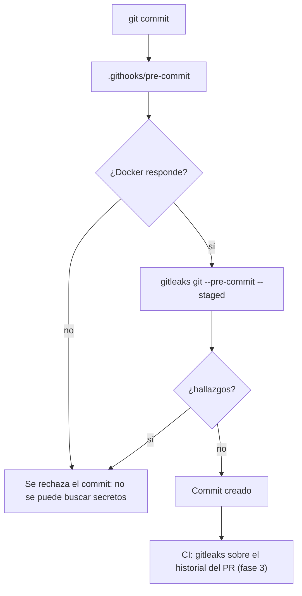

# Seguridad del repositorio

> **Estado:** vigente (fase 0 del ADR 0012; crece con cada fase) · **Versión de referencia:** gitleaks 8.30.1 · **Última actualización:** 2026-10-17

## Resumen
El repositorio es público, así que un secreto que se commitea queda expuesto aunque se borre después. La primera defensa es **gitleaks**: corre antes de cada commit (hook) y en CI (fase 3), desde su imagen oficial de Docker. Esta nota arranca con esa defensa y se amplía en las fases siguientes (escaneo de dependencias y contenedores, autenticación, endurecimiento).

## Por qué importa
Un token en el historial de git no se revoca borrando el archivo: hay que rotarlo. Detectarlo **antes del commit** cuesta segundos; después, rotar credenciales y reescribir historia. Además la decisión original del proyecto ("seguridad fuera de alcance, salvo no subir credenciales reales") dependía de que alguien se acordara: ahora lo verifica una herramienta.

## Cómo funciona



*Por qué este diagrama:* es de **actividad** (flujo con decisiones), porque lo importante es en qué punto se frena el commit y qué pasa si falta Docker (falla cerrado, no abierto).

- El hook vive en `.githooks/pre-commit` y se activa con `deploy/dev/install-git-hooks.sh` (`core.hooksPath`). Lo versionado es el hook; activarlo es un paso por clon.
- `.gitleaks.toml` extiende las reglas por defecto y agrega excepciones con motivo.
- `git commit --no-verify` saltea el hook: por eso CI repite el escaneo y no depende del hook.

## Aplicación por componente

| Componente | Cómo aplica | Decisión / regla |
|---|---|---|
| Videos, Interactions, Feed, Notifications | Todo el árbol se escanea igual | Credenciales de desarrollo (`videoeda`/`videoeda`) en `compose.yaml` y `application.yaml`; se mueven a `.env` en la fase 6 |
| Transversal | Hook, `.gitleaks.toml`, CI | Una excepción solo entra con descripción y regex acotada |

## Ejemplos del dominio
**Caso que falla (falso positivo real):** la primera corrida sobre el árbol marcó `docs/study/17-identificadores-y-nombres.md:144` con la regla `generic-api-key`. La línea decía ``Key de Kafka: `cmt_01a13161-129c-76ff-af15-e5821d573d09` ``: la palabra "Key" junto a un valor de entropía alta (3,94) parece una clave de API, pero es el id de ejemplo de un `Comment` (nota 17).

**Caso que funciona:** en lugar de desactivar la regla o exceptuar el archivo, se hereda la regla `generic-api-key` y se le suma una excepción que solo acepta el formato exacto `<prefijo>_<UUIDv7>` con los prefijos del proyecto. Un secreto real de otro formato sigue detectándose: se verificó plantando un token falso con forma de PAT de GitHub (generado al azar en la prueba, no guardado), que el hook rechazó con `RuleID: github-pat`.

```gherkin
Escenario: SEC-01 un secreto en el contenido preparado frena el commit
  Dado que preparé un archivo con un token con forma de PAT de GitHub
  Cuando hago git commit
  Entonces el hook termina con código 1 y nombra la regla github-pat
  Y el valor aparece redactado en la salida

Escenario: SEC-02 un id de ejemplo del dominio no se confunde con un secreto
  Dado que una nota documenta la key de Kafka cmt_01a13161-129c-76ff-af15-e5821d573d09
  Cuando se escanea el árbol completo
  Entonces gitleaks no reporta hallazgos
```

## Alternativas y trade-offs

| Opción | Ventaja | Costo | Veredicto |
|---|---|---|---|
| **gitleaks vía Docker** | Una imagen oficial, sin instalar nada | Exige Docker para commitear | **Elegida** (ADR 0007: solo Docker) |
| Framework `pre-commit` | Gestiona varios hooks | Requiere Python y otra herramienta | Descartada por ahora |
| Solo secret scanning de GitHub | Cero mantenimiento | Actúa después del push; no es versionado | Complemento, lo activa Laura |
| TruffleHog | Verifica si el secreto sigue vivo | Más pesado; no se evaluó | No evaluada |

## Reglas para el spec
1. Nada que parezca un secreto entra al repo; las credenciales de desarrollo son placeholders conocidos y se mueven a `.env.example`.
2. El hook falla cerrado: sin Docker no hay commit.
3. Toda excepción de `.gitleaks.toml` lleva `description` y una regex acotada, nunca un archivo entero.
4. CI repite el escaneo (el hook se puede saltear con `--no-verify`).

## Fuentes
- gitleaks v8.30.1, README: https://github.com/gitleaks/gitleaks/blob/v8.30.1/README.md — configuración (`[extend] useDefault`, `[[rules]]` heredada, `[[rules.allowlists]]`, `regexTarget`) y `--redact`. Consultado 2026-10-17.
- gitleaks v8.30.1, `git --help` de la imagen `ghcr.io/gitleaks/gitleaks:v8.30.1`: `--pre-commit` y `--staged` ("good for pre-commit"). Ejecutado 2026-10-17.
- Release más reciente, vía API de GitHub: https://api.github.com/repos/gitleaks/gitleaks/releases/latest → `v8.30.1`, publicada el 2026-03-21. Consultado 2026-10-17.

## No verificado
- **CI:** el escaneo en GitHub Actions no existe todavía (fase 3).
- **Cobertura de reglas:** solo se probó un tipo de secreto (PAT de GitHub). No se probó una clave de AWS, una clave privada ni una cadena de conexión.
- **Secret scanning y push protection de GitHub:** dependen de configuración de Laura en GitHub; no se verificaron.
- **Historial:** el repo no tiene commits, así que el escaneo del historial (`gitleaks git` sin `--staged`) no se ejercitó.
- **Imagen:** no verifiqué la firma ni el digest de la imagen; se usa por tag (el endurecimiento por digest es la fase 6).

## Historial

| Fecha | Cambio |
|---|---|
| 2026-10-17 | Creación: hook de gitleaks, `.gitleaks.toml` con una excepción acotada, repo propio, MIT, `SECURITY.md`, `CODEOWNERS` |
