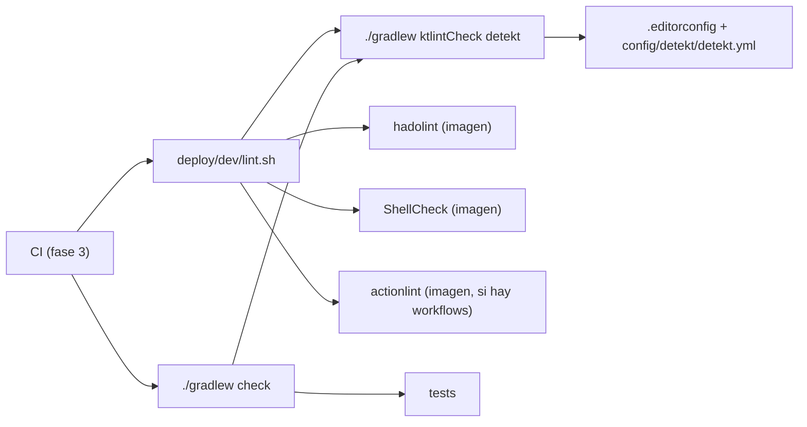

# Lint, formato y análisis estático

> **Estado:** vigente (fase 1 del ADR 0012) · **Versiones de referencia:** ktlint 1.8.0, detekt 1.23.8, hadolint 2.15.1, ShellCheck 0.11.0 · **Última actualización:** 2026-10-17

## Resumen
Cuatro linters con un solo punto de entrada (`deploy/dev/lint.sh`, el mismo gate que CI): **ktlint** (formato Kotlin), **detekt** (olores y complejidad), **hadolint** (Dockerfile) y **ShellCheck** (scripts). Kotlin corre dentro de `./gradlew check`; lo demás, desde imágenes de Docker. Encontraron problemas reales en el código que ya teníamos y se arreglaron en la misma fase.

## Por qué importa
Un linter que no falla no protege nada, y uno que se instala distinto en cada máquina da resultados distintos. Por eso las versiones están fijadas y las herramientas fuera de Gradle corren desde imágenes versionadas. Los hallazgos de detekt además apuntan a decisiones de diseño: ver el caso de `OutboxPublisher` abajo.

## Cómo funciona



*Por qué este diagrama:* es de **componentes** (flowchart): muestra quién invoca a quién y qué archivos configuran cada herramienta, que es la pregunta al tocar el gate.

- **ktlint** se configura en `.editorconfig` (`ktlint_code_style = intellij_idea`, `max_line_length = 140`) y se fija en `videos/build.gradle.kts` (`ktlint { version.set("1.8.0") }`). Elegí `intellij_idea` porque coincide con el formateador del IDE del proyecto; con `ktlint_official` el código actual tenía 287 hallazgos y con `intellij_idea` 40.
- **detekt** corre sobre sus reglas por defecto más `config/detekt/detekt.yml`, que solo contiene lo que se aparta del default, con su motivo. **No usa el plugin de Gradle**: es una tarea `JavaExec` que ejecuta `detekt-cli` 1.23.8 con un JDK 21 por toolchain (ver abajo, hallazgo del 2026-10-17).
- Ambos se enganchan a `check`.

## Aplicación por componente

| Componente | Cómo aplica | Decisión / regla |
|---|---|---|
| Videos | ktlint + detekt en `:videos:check`; hadolint sobre su `Dockerfile` | Hecho |
| Interactions, Feed, Notifications | Heredan la configuración al sumarse al build | Se agregan los plugins al módulo nuevo |
| Transversal | `deploy/dev/lint.sh` | ShellCheck sobre `deploy/` y `.githooks/` |

## Ejemplos del dominio
**Caso que falla:** detekt marcó `OutboxPublisher.logPublished` con `NestedBlockDepth`: para poner siete campos en el log (`correlationId`, `eventId`, `aggregateId`, `sequence`, `topic`, `partition`, `offset`) anidaba siete `MDC.putCloseable(...).use { }`. Funcionaba, pero era ilegible y el worker tenía su propia copia de ese patrón.

**Caso que funciona:** un único `withLogContext("correlationId" to ..., "eventId" to ..., ...) { log.info(...) }` en `LogContext.kt`, usado por el publisher y por el worker. Los 71 tests siguieron en verde.

```gherkin
Escenario: LNT-01 una violación de formato o de diseño rompe el build
  Dado un archivo Kotlin con un import sin usar, espaciado roto y un catch (e: Exception) que se traga la excepción
  Cuando corro ktlintCheck y detekt
  Entonces ktlintCheck termina con 15 hallazgos y código de salida 1
  Y detekt reporta TooGenericExceptionCaught y SwallowedException con código de salida 1

Escenario: LNT-02 el código real pasa el gate
  Dado el código de services/videos
  Cuando corro deploy/dev/lint.sh
  Entonces termina con código 0
```

Triaje de los 19 hallazgos de detekt sobre el código existente (con 140 columnas):

| Regla | Qué pasó | Qué se hizo |
|---|---|---|
| `NestedBlockDepth` (2) | `logPublished` y una fixture de test | Extraer `withLogContext`; aplanar el bucle de la fixture |
| `TooManyFunctions` (2) | `ProcessVideoShareWorker` (por la copia privada de `withLogContext`) y `VideosConfiguration` (14 beans) | Se eliminó la copia; las clases `@Configuration` quedan exceptuadas en `detekt.yml` |
| `SwallowedException` (5) | Excepciones esperadas (`WakeupException`, `TimeoutException`, transiciones inválidas) | Variables renombradas `expected…`, que la regla acepta por convención |
| `TooGenericExceptionCaught` (5) | Redes de seguridad del worker y del scheduler; `catch (Exception)` en el parser | El parser ahora captura `JacksonException`; las otras se renombraron `expectedFailure` (ya no hay `@Suppress`) |
| `ThrowsCount`, `LongParameterList`, `SpreadOperator`, `MagicNumber` | Parser con 3 `throw`, bean con 6 parámetros, `main` de Spring, defaults de `Duration` | Parser dividido en funciones; `ProcessVideoWorkerSettings` como bean; `@Suppress` en `main`; defaults a constante |

hadolint señaló `DL3066` en el `Dockerfile` (`USER videos`, nombre en lugar de UID); ahora es `USER 10001` y el contenedor corre como `uid=10001`. ShellCheck no encontró nada.

### Hallazgo: detekt 1.23.8 y el JDK de Gradle (2026-10-17)
El plugin de detekt corre dentro del JVM de Gradle. Con Gradle sobre JDK 25 (por ejemplo tras `sdk env`, que activa el JDK del `.sdkmanrc`), la tarea fallaba con el mensaje `25.0.1`: el compilador Kotlin 2.0.21 que trae no entiende esa versión de Java. Con JDK 21 funcionaba, y mi primera verificación pasó porque la tarea estaba `UP-TO-DATE` y no se ejecutaba de verdad; solo `--rerun-tasks` lo mostró. Mi workflow de CI usaba Java 25, así que **habría fallado en el primer push**. Se resolvió ejecutando detekt como `JavaExec` con un toolchain JDK 21: ahora pasa y detecta violaciones con Gradle sobre JDK 21 o 25 (probado con una violación plantada).

## Alternativas y trade-offs

| Opción | Ventaja | Costo | Veredicto |
|---|---|---|---|
| ktlint con `intellij_idea` | Coincide con el IDE; poco cambio sobre el código | Menos estricto que `ktlint_official` | **Elegida** |
| ktlint con `ktlint_official` | Más opinado | 287 hallazgos iniciales, mucho reformateo | Descartada |
| **detekt 1.23.8** | Última versión **estable**; reglas de olores y complejidad | No soporta oficialmente JDK 25 ni Kotlin 2.4 (ver abajo) | **Elegida con una salvedad** |
| detekt 2.0.0-alpha.x | Soporte más nuevo | Es alpha; el proyecto no adopta versiones no estables (`docs/metodo-de-trabajo.md`) | Descartada |
| Solo Sonar | Una herramienta menos | Feedback tarde y no está en el commit | Complemento (fase 4), no reemplazo |

## Reglas para el spec
1. `./gradlew check` y `deploy/dev/lint.sh` son el gate; CI no agrega reglas propias.
2. No hay comentarios en el código: una captura amplia e intencional se expresa con el nombre de la variable (`expectedFailure`, `expectedWakeup`, que detekt acepta por convención) y no con `@Suppress`; una excepción global va en `detekt.yml` y su motivo en esta nota.
3. Las versiones de ktlint y de las imágenes de Docker se fijan; subirlas es un cambio explícito.
4. No se baja el nivel de una regla para que pase el código: se arregla el código o se documenta la excepción.
5. Cuando una regla de complejidad marca una clase, se evalúa primero si el código se puede **simplificar** (KISS, `docs/metodo-de-trabajo.md`); dividirlo en más clases es el último recurso, no el primero.

## Fuentes
- detekt, releases (API de GitHub): https://api.github.com/repos/detekt/detekt/releases — última estable `v1.23.8` (2025-02-21); `v2.0.0-alpha.1` a `alpha.6` son pre-releases. Consultado 2026-10-17.
- detekt v1.23.8, `gradle/libs.versions.toml`: `kotlin = "2.0.21"`. https://raw.githubusercontent.com/detekt/detekt/v1.23.8/gradle/libs.versions.toml. Consultado 2026-10-17.
- Error observado ejecutando detekt 1.23.8: `Invalid value (25) passed to --jvm-target, must be one of [1.6, 1.8, 9, …, 22]`.
- ktlint, última release (API de GitHub): https://api.github.com/repos/ktlint/ktlint/releases/latest → `1.8.0` (2025-11-14). Consultado 2026-10-17.
- Plugin ktlint-gradle 14.2.0 y plugin de detekt 1.23.8: metadatos de https://plugins.gradle.org/m2/. Consultado 2026-10-17.
- hadolint v2.15.1 (2026-07-31), ShellCheck v0.11.0 (2025-08-04), actionlint v1.7.12 (2026-03-30): releases de GitHub. Consultado 2026-10-17. Imágenes ejecutadas: `ghcr.io/hadolint/hadolint:v2.15.1` y `koalaman/shellcheck:v0.11.0`.

## No verificado
- **detekt con Kotlin 2.4 / JDK 25:** corre en un proceso JDK 21 con `--jvm-target 22`: la CLI rechaza 25 y su compilador embebido es Kotlin 2.0.21. Lo ejecuté sobre 42 archivos sin errores de análisis, pero **no** probé que reconozca toda la sintaxis de Kotlin 2.4; podría ignorar construcciones nuevas sin avisar. Se revisa al salir una detekt 2.x estable.
- **Reglas con resolución de tipos** (`detektMain`/`detektTest`): solo corrí la tarea `detekt` sin resolución de tipos.
- **ktlint-gradle y archivos borrados:** tras borrar un archivo con violaciones, `ktlintMainSourceSetCheck` siguió fallando con el resultado viejo (`UP-TO-DATE`); con `--rerun-tasks` pasó. Da un falso fallo local, no un falso pase; en CI (checkout limpio) no ocurre. No investigué la causa.
- **actionlint:** la imagen `rhysd/actionlint:1.7.12` no se descargó todavía (no hay workflows); se verifica en la fase 3.
- **Versión previa de ktlint:** el plugin trae una versión por defecto que no identifiqué; al fijar 1.8.0 aparecieron reglas nuevas (se aplicaron con `ktlintFormat`).

## Historial

| Fecha | Cambio |
|---|---|
| 2026-10-17 | Creación: ktlint 1.8.0, detekt 1.23.8 con `jvmTarget` 22, hadolint, ShellCheck; `deploy/dev/lint.sh`; triaje de 19 hallazgos y refactor de `withLogContext` |
| 2026-10-17 | detekt pasa de plugin a `JavaExec` con JDK 21: el plugin fallaba con `25.0.1` si Gradle corría en JDK 25 (lo escondía un `UP-TO-DATE`), y habría roto el CI |
| 2026-10-19 | Sin comentarios en el código: `@Suppress` reemplazados por nombres (`expectedFailure`); `check-no-comments.sh` en `lint.sh`; el worker se dividió en `HeldShareRecord` y `ProcessVideoGiveUp` porque detekt marcó 19 funciones |
