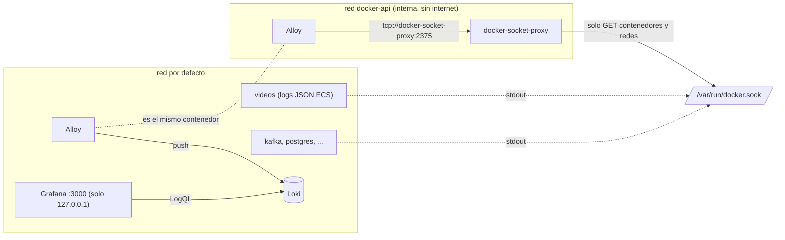

# Observabilidad: logs con Loki, Alloy y Grafana

> **Estado:** vigente (fase 2 del ADR 0012, implementa el ADR 0010) · **Versiones de referencia:** Loki 3.7.8, Grafana 13.2.4, Alloy 1.20.1, docker-socket-proxy 0.5.0 · **Última actualización:** 2026-10-17

## Resumen
Los servicios escriben una línea JSON por hecho con `correlationId`, `eventId`, `aggregateId` y más. **Alloy** lee los logs de los contenedores del proyecto y los manda a **Loki**; **Grafana** los consulta. Con un `correlationId` se recupera todo el flujo de un video a través de la API, el outbox y el worker. Alloy no toca el socket de Docker: pasa por **docker-socket-proxy**, que solo permite leer contenedores y redes.

## Por qué importa
Sin un lugar donde unir los logs, seguir un video entre servicios es abrir cada `docker logs` y comparar a ojo. Y como Alloy necesita hablar con el motor de Docker, el camino ingenuo (montar `/var/run/docker.sock`) le daría control total de la máquina a un contenedor de recolección: se evitó.

## Cómo funciona



*Por qué este diagrama:* es de **componentes y despliegue** (flowchart con subgrafos), porque la pregunta es qué servicio habla con cuál y por qué red; Alloy aparece en las dos redes (es un único contenedor).

- **Etiquetas de Loki:** solo `container` y `service` (bajas en cardinalidad). `correlationId` **no** es una etiqueta: se filtra al consultar (`|= "cor_…"` o `| json | correlationId="cor_…"`), porque una etiqueta por cada valor único multiplicaría los flujos.
- **Alcance:** `discovery.docker` filtra por `com.docker.compose.project=video-eda`; no se leen contenedores ajenos al proyecto.
- **Retención:** 7 días en Loki (`limits_config.retention_period` con `compactor.retention_enabled`).
- **Dashboard** provisionado "Flujo por correlationId": una variable de texto, un panel con todos los logs de ese `correlationId` en orden, un panel de alertas del worker (`| json | alert="true"`) y el volumen de líneas por servicio.

## Aplicación por componente

| Componente | Cómo aplica | Decisión / regla |
|---|---|---|
| Videos | Ya emite JSON ECS con el MDC | El worker y el publisher comparten `withLogContext` (nota 21) |
| Interactions, Feed, Notifications | Al sumarse, sus logs entran solos por la etiqueta de Compose | Deben propagar `correlationid` del CloudEvent al MDC antes de procesar (ADR 0010) |
| Kafka, PostgreSQL, Pact Broker, Kafbat | Sus logs de texto también llegan a Loki | No se parsean; se filtran por `service` |

## Ejemplos del dominio
**Caso que falla:** sin esta pieza, para seguir `vid_01a14c95-1037-73a9-b078-8bd615c67d67` había que correr `docker logs videos`, buscar a mano el `cor_…` y cruzarlo con lo que hizo el worker.

**Caso que funciona:** un `POST /videos` con `X-Correlation-Id: cor_01a14c95-0f72-7961-be2f-c181e33658af` y la consulta `{service=~".+"} |= "cor_01a14c95-0f72-7961-be2f-c181e33658af"` devolvió, ordenadas, cuatro líneas: *UploadVideo aceptado*, *evento publicado* (`process-video`), *ProcessVideo procesado: el video quedó publicado* y *evento publicado* (`VideoPublished`).

```gherkin
Escenario: OBS-01 un correlationId reconstruye el flujo de un video
  Dado que subo un video con X-Correlation-Id cor_01a14c95-0f72-7961-be2f-c181e33658af
  Cuando consulto Loki, a través de Grafana, por ese correlationId
  Entonces veo el video aceptado, process-video publicado, el video procesado y VideoPublished publicado, en ese orden

Escenario: OBS-02 una falla permanente aparece en el panel de alertas
  Dado que subo un video con el título "Tortilla [falla-permanente]"
  Cuando el worker lo manda a la DLQ
  Entonces la consulta {service="videos"} | json | alert="true" devuelve la línea "ALERTA: ProcessVideo rendido tras 1 entrega(s)…"

Escenario: OBS-03 el proxy de Docker deniega todo lo que no sea leer contenedores
  Dado un contenedor en la red docker-api
  Cuando hace POST /containers/create o GET /images/json
  Entonces recibe 403 Forbidden
```

## Alternativas y trade-offs

| Opción | Ventaja | Costo | Veredicto |
|---|---|---|---|
| **Alloy + Loki + Grafana** | Filtra por campo entre servicios | Cuatro contenedores (con el proxy) | **Elegida** |
| Montar el socket de Docker en Alloy | Un contenedor menos | Un compromiso de Alloy da control del motor | Descartada |
| Driver de logging de Loki | Sin colector | Hay que instalar un plugin en el motor de Docker | Descartada (rompe "solo Docker") |
| Promtail | Conocido | Fue reemplazado por Alloy; no se evaluó su estado | No evaluada |
| Dozzle | Casi sin configuración | Búsqueda entre servicios pobre (ADR 0010) | Alternativa |
| OpenTelemetry (trazas) | Árbol de spans | Instrumentación y backend extra | Camino de crecimiento |

## Reglas para el spec
1. `correlationId` nunca es una etiqueta de Loki.
2. Alloy accede a Docker solo por docker-socket-proxy, con `POST=0` y solo `CONTAINERS` y `NETWORKS`.
3. Grafana sin acceso anónimo y publicado solo en `127.0.0.1`; Loki no se publica.
4. Un servicio nuevo hereda la recolección sin tocar Alloy (la etiqueta de Compose lo incluye).
5. Los dashboards se versionan como JSON provisionado, no se editan en la UI (`allowUiUpdates: false`).

## Fuentes
- Loki v3.7.8, ejemplo de configuración local: https://raw.githubusercontent.com/grafana/loki/v3.7.8/cmd/loki/loki-local-config.yaml. Consultado 2026-10-17. La configuración del proyecto parte de ese ejemplo.
- Alloy v1.20.1, `loki.source.docker`: https://github.com/grafana/alloy/blob/v1.20.1/docs/sources/reference/components/loki/loki.source.docker.md — argumentos `host`, `targets`, `refresh_interval`, `forward_to`. Consultado 2026-10-17.
- Alloy v1.20.1, `discovery.docker`: https://github.com/grafana/alloy/blob/v1.20.1/docs/sources/reference/components/discovery/discovery.docker.md — bloque `filter` y etiquetas `__meta_docker_container_name` / `__meta_docker_container_label_*`. Consultado 2026-10-17.
- Versiones (API de GitHub, `releases/latest`): Grafana `v13.2.4` (2026-10-13), Loki `v3.7.8` (2026-09-17), Alloy `v1.20.1` (2026-09-28), docker-socket-proxy `v0.5.0` (2026-07-27). Existencia de las imágenes comprobada con `docker manifest inspect`. Consultado 2026-10-17.
- Ejecución propia: consultas a la API de Grafana (`/api/datasources/proxy/uid/loki/...`) y pruebas del proxy desde un contenedor en la red `docker-api`.

## No verificado
- **Linux / CI:** solo se ejecutó en Docker Desktop para Mac. **Corrección (2026-10-17):** la primera corrida usó imágenes amd64 emuladas porque el shell exportaba `DOCKER_DEFAULT_PLATFORM=linux/amd64`; se repitió con las imágenes arm64 nativas y `smoke.sh` pasó igual. Con esa variable exportada, `docker compose` vuelve a usar amd64 (ver README).
- **Persistencia y retención:** no se probó `down`/`up` con volúmenes ni se esperó a que venza la retención de 7 días.
- **Render en el navegador:** se verificaron las consultas de los tres paneles por API; no vi la pantalla ni el comportamiento de la variable `correlationId` en la UI.
- **Reenvío de logs viejos tras reiniciar (hallazgo 2026-10-19):** al reiniciar el stack, Alloy reenvió logs de días anteriores y Loki los rechazó con `entry too far behind` (HTTP 400), lo que descartó el lote completo, incluidas líneas nuevas; el primer `smoke.sh` tras el reinicio falló con 0 líneas y el segundo pasó. No investigué por qué Alloy pierde su posición ni probé `stage.drop` con `older_than` como mitigación.
- **Healthcheck de Loki:** la imagen no trae shell ni `wget`, así que no tiene healthcheck; los dependientes esperan solo a que arranque. Tras `up` Loki respondió 503 en `/ready` unos segundos hasta estar listo (no medí cuántos).
- **docker-socket-proxy:** probé que `CONTAINERS=1` y `NETWORKS=1` bastan para Alloy; no revisé si el proxy filtra por método además de por ruta más allá de lo que mostraron las pruebas (GET permitido, POST denegado).
- **Contenido sensible en logs:** no se auditó que ningún servicio escriba datos que no deban salir (hoy solo hay ids y títulos de ejemplo).
- **Mediciones de recursos:** no medí la RAM que suma el stack.

## Historial

| Fecha | Cambio |
|---|---|
| 2026-10-17 | Creación: stack Loki 3.7.8 + Alloy 1.20.1 + Grafana 13.2.4 con docker-socket-proxy 0.5.0, dashboard provisionado y verificación extremo a extremo |
| 2026-10-17 | Corregida la plataforma verificada (arm64 nativo, no emulado) |
