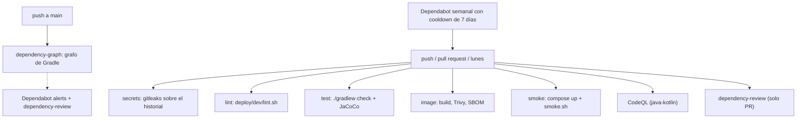

# CI y cadena de suministro

> **Estado:** vigente, **sin ejecutar todavía en GitHub** (fase 3 del ADR 0012) · **Versiones de referencia:** Trivy 0.76.0, JaCoCo 0.8.15, CodeQL action 4.39.0, zizmor 1.31.1, actionlint 1.7.12 · **Última actualización:** 2026-10-17

## Resumen
Un pipeline de GitHub Actions con cinco jobs (secretos, lint, tests con cobertura, imagen con Trivy y SBOM, humo de punta a punta), más CodeQL, revisión de dependencias, grafo de dependencias y Dependabot. Cada job ejecuta el mismo comando que corre en local. Antes de escribir el workflow, Trivy ya encontró 12 vulnerabilidades reales en la imagen, y se corrigieron.

## Por qué importa
Un pipeline que nunca se probó localmente falla por motivos tontos en el primer push, y uno que "pasa" sin mirar dependencias da una falsa seguridad. Además un repositorio público atrae ataques a la cadena de suministro: acciones de terceros, versiones recién publicadas y dependencias transitivas con CVE.

## Cómo funciona



*Por qué este diagrama:* es de **actividad** (flowchart): muestra qué dispara cada job y cómo se alimentan entre sí.

- **Permisos:** `permissions: contents: read` a nivel de workflow; cada job eleva solo lo que necesita (`security-events: write` en CodeQL, `pull-requests: write` en la revisión de dependencias, `contents: write` en el envío del grafo, que la API exige).
- **Acciones fijadas por SHA de commit** (con el tag en un comentario), `persist-credentials: false` en cada checkout y `timeout-minutes` en cada job.
- **JDK:** los jobs que ejecutan `./gradlew check` instalan Java **25 y 21** (`setup-java` con dos versiones): 25 compila y 21 corre detekt por toolchain (nota 21).
- **Herramientas por Docker**, con las mismas imágenes y versiones que en local: Trivy `0.76.0`, gitleaks `8.30.1`, hadolint, ShellCheck, actionlint y zizmor.
- **Trivy** escanea la imagen exportada con `docker save`, para no darle el socket de Docker, con `--ignore-unfixed` y `--exit-code 1` en HIGH/CRITICAL; la configuración del Dockerfile falla desde MEDIUM; el SBOM sale en CycloneDX.
- **Cobertura:** JaCoCo 0.8.15 con un piso (92,9 % de instrucciones y 76,2 % de ramas medidos; pisos de 90 % y 70 %).

## Aplicación por componente

| Componente | Cómo aplica | Decisión / regla |
|---|---|---|
| Videos | Tests, cobertura, imagen, humo | El módulo `videos` hereda ktlint, detekt y JaCoCo |
| Interactions, Feed, Notifications | Al sumarse, entran a `./gradlew check`; su imagen se agrega al job `image` | Un Dockerfile y un módulo por servicio |
| Transversal | Workflows, Dependabot, `smoke.sh` | `docker-compose` y `gradle` se vigilan en `/` y `/services` |

## Ejemplos del dominio
**Caso que falla:** el escaneo de la imagen de Videos devolvió 12 hallazgos HIGH/CRITICAL con arreglo disponible: Tomcat embebido 11.0.24 (3 críticos), `tools.jackson.core` 3.1.5 (5 altos), `lz4-java` 1.10.2 (1 alto, transitiva de `kafka-clients`) y 3 CVE de la stdlib de Go en `/usr/bin/pebble`, un binario de la imagen base que la app no usa.

**Caso que funciona:** Spring Boot 4.1.1 es la última versión estable y todavía trae las vulnerables, así que se fijaron versiones corregidas con restricciones de Gradle (Tomcat 11.0.27, Jackson BOM 3.1.8, lz4-java 1.11.4), cada una con el CVE que la motiva, y se quitó `pebble` de la imagen. El escaneo quedó en cero y los 71 tests siguieron en verde.

```gherkin
Escenario: CI-01 una dependencia transitiva con CVE crítico rompe el build de la imagen
  Dado una imagen con tomcat-embed-core 11.0.24
  Cuando corre Trivy con --severity HIGH,CRITICAL --ignore-unfixed --exit-code 1
  Entonces el job termina con código 1 y lista CVE-2026-65182, CVE-2026-65905 y CVE-2026-68525

Escenario: CI-02 el ecosistema completo publica un video y deja su rastro en Loki
  Dado docker compose up --build -d --wait terminado
  Cuando corre deploy/dev/smoke.sh
  Entonces el video queda PUBLISHED y Loki devuelve al menos 4 líneas con el correlationId
```

## Alternativas y trade-offs

| Opción | Ventaja | Costo | Veredicto |
|---|---|---|---|
| **Trivy sobre la imagen** | Ve las dependencias reales dentro del jar | No ve `compose.yaml` | **Elegida** |
| Trivy sobre `gradle.lockfile` | Escaneo sin construir | El proyecto no usa dependency locking | No aplica |
| OWASP Dependency-Check | Base de datos NVD | Más lento y depende de una API externa; no se evaluó | No evaluada |
| Acciones por tag (`@v4`) | Cómodo | Un tag se puede mover: riesgo de cadena de suministro | Descartada: SHA |
| Dependabot sin cooldown | Actualiza al instante | Adopta versiones recién publicadas | Descartada (zizmor lo marcó) |

## Reglas para el spec
1. Nada corre en CI que no corra en local (`lint.sh`, `./gradlew check`, `smoke.sh`).
2. Las acciones se fijan por SHA y Dependabot las actualiza; ningún job tiene más permisos que los que usa.
3. Un override de versión en `build.gradle.kts` declara el CVE que lo motiva en `because(...)` y se quita cuando el BOM de Spring Boot lo incluye.
4. El piso de cobertura solo sube por decisión explícita.

## Fuentes
- Versiones y SHAs de las acciones (API de GitHub: `releases/latest` y `git/ref/tags`): checkout v7.0.1, setup-java v6.1.0, gradle/actions v6.4.0, upload-artifact v7.0.2, codeql-action v4.39.0, dependency-review-action v5.0.0. Consultado 2026-10-17.
- Trivy v0.76.0 y imágenes `ghcr.io/aquasecurity/trivy:0.76.0`; zizmor v1.31.1; actionlint 1.7.12. Existencia de las imágenes comprobada con `docker manifest inspect`. Consultado 2026-10-17.
- CodeQL, lenguajes y versiones soportadas: https://codeql.github.com/docs/codeql-overview/supported-languages-and-frameworks/ — "Kotlin 1.8.0 to 2.4.20" y "Java 7 to 26". Consultado 2026-10-17.
- Versiones corregidas en Maven Central (`maven-metadata.xml`): `tomcat-embed-*` 11.0.25 a 11.0.27, `tools.jackson:jackson-bom` 3.1.7 y 3.1.8, `at.yawk.lz4:lz4-java` 1.11.4. Consultado 2026-10-17.
- Spring Boot, releases (API de GitHub): `v4.1.1` (2026-08-20) es la última estable. Consultado 2026-10-17.
- Ejecución propia: Trivy sobre la imagen exportada, antes y después de las correcciones; JaCoCo sobre los 71 tests.

## No verificado
- **Caché vacía:** `verification-metadata.xml` se generó el 2026-10-18 con la caché de Gradle caliente y habría fallado en el primer CI; se regeneró con caché vacía y se probó así (nota 24). Los runners de GitHub parten de una caché limpia, así que es la condición real.
- **Ninguna corrida real en GitHub Actions.** Reproduje en local cada comando de cada job (`lint.sh`, `./gradlew check`, build + Trivy + SBOM, `compose up` + `smoke.sh`), y actionlint y zizmor validan los workflows, pero la primera corrida verde se confirma al subir el repo.
- **CodeQL con Kotlin 2.4.21:** la documentación declara soporte hasta **2.4.20**; el proyecto usa 2.4.21. Probablemente funcione (es un parche), pero no hay forma de comprobarlo sin ejecutarlo en GitHub. Si el extractor falla, hay que decidir entre bajar Kotlin o esperar.
- **Dependabot:** no probé que `docker-compose` y `cooldown` se acepten juntos; el archivo valida sintácticamente en zizmor, pero Dependabot lo valida al subirlo.
- **Dependency-review:** exige que el grafo de dependencias esté habilitado en el repositorio (configuración de Laura).
- **Online audits de zizmor:** corrí solo las auditorías offline (`--no-online-audits`); las que consultan la API de GitHub (por ejemplo acciones con vulnerabilidades conocidas) requieren un token.
- **`gradle/actions/dependency-submission`:** nunca se ejecutó; comparte el SHA de `setup-gradle` porque pertenecen al mismo repositorio.
- **Trivy no analiza `compose.yaml`:** solo vio el Dockerfile. Los hallazgos de Compose dependen de la fase 6 (revisión manual).
- **`--ignore-unfixed`:** oculta vulnerabilidades sin arreglo disponible; no sé cuántas hay.
- **Hallazgo LOW de Trivy** (`DS-0026`, sin `HEALTHCHECK` en la imagen): se acepta; el healthcheck vive en Compose porque la imagen no trae `curl`.
- **Corrección de Boot:** las versiones forzadas (Tomcat 11.0.27, Jackson 3.1.8) no están certificadas por el equipo de Spring; la evidencia es que los 71 tests y el humo pasan.

## Historial

| Fecha | Cambio |
|---|---|
| 2026-10-17 | Creación: workflows `ci`, `codeql`, `dependency-review` y `dependency-graph`; Dependabot; `deploy/dev/smoke.sh`; JaCoCo con piso; 12 vulnerabilidades corregidas en la imagen de Videos |
| 2026-10-18 | El humo de CI levanta también Keycloak y valida con tokens reales (fase 5) |
