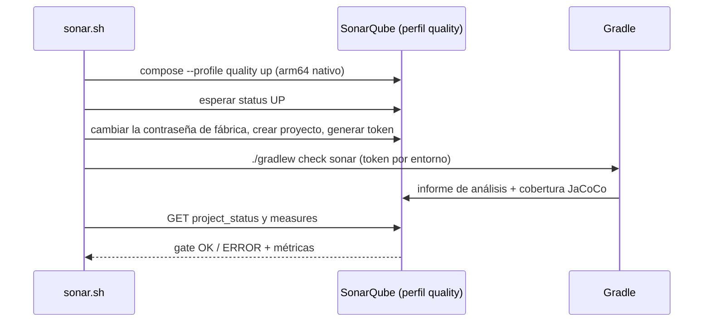

# SonarQube y verificación de dependencias

> **Estado:** vigente (fase 4 del ADR 0012) · **Versiones de referencia:** SonarQube Community Build 26.10.0.133078, plugin Gradle `org.sonarqube` 7.5.0.8588 · **Última actualización:** 2026-10-17

## Resumen
SonarQube corre **a pedido** en el perfil `quality` de Compose (`./deploy/dev/sonar.sh`): levanta el servidor, ejecuta tests y análisis, y muestra el quality gate y las métricas. En su primera corrida marcó una vulnerabilidad real: las dependencias de Gradle **no se verificaban**. Se agregó `gradle/verification-metadata.xml` (410 componentes, 692 checksums SHA-256) y el build ahora falla si un artefacto no coincide.

## Por qué importa
Sin verificación, Gradle descarga de Maven Central y confía en lo que llegue. Un artefacto alterado en tránsito o reemplazado en un repositorio comprometido se compilaría dentro de la app sin avisar. Es la clase de ataque a la cadena de suministro que Trivy (versiones con CVE conocidos) no cubre: aquí el CVE no existe todavía.

## Cómo funciona



*Por qué este diagrama:* es de **secuencia** porque el valor del script es el orden de pasos entre el script, el servidor y Gradle (el token nace en el servidor y solo vive en una variable).

- **Servidor:** imagen `sonarqube:26.10.0.133078-community`, `read_only: true`, base H2 embebida (el ejemplo oficial `sq-with-h2`; SonarQube la admite solo para evaluación, y aquí es una herramienta local descartable), puerto solo en `127.0.0.1`, límite de 3 GB de memoria. No arranca con `docker compose up`.
- **Token:** se regenera en cada corrida y vive solo en la variable `SONAR_TOKEN` del proceso de Gradle; no se escribe en ningún archivo.
- **Quality gate:** el de fábrica ("Sonar way"). `sonar.sh` sale con código 1 si no está en `OK`.
- **Verificación de dependencias:** `services/gradle/verification-metadata.xml` con SHA-256 (sin firmas PGP). Se regenera con `deploy/dev/update-gradle-verification.sh`, que **hay que revisar con `git diff`**: es confianza en el primer uso, Gradle anota lo que descarga en ese momento.

## Aplicación por componente

| Componente | Cómo aplica | Decisión / regla |
|---|---|---|
| Videos | Analizado: 1.143 líneas de código | Cobertura vía JaCoCo XML |
| Interactions, Feed, Notifications | Se suman al análisis al agregarse al build (`sonar` agrega los subproyectos) | Sin configuración extra |
| Transversal | `deploy/dev/sonar.sh`, `sonarcloud.yml` (opcional), `verification-metadata.xml` | Dependabot no puede regenerar los checksums |

## Ejemplos del dominio
**Caso que falla:** el primer análisis de `services/videos` dio 0 bugs, 0 code smells, 0 % de duplicación, 92,5 % de cobertura y **1 vulnerabilidad** (`kotlin:S6474`, MINOR, 15 min): *"Dependencies are not verified because the verification-metadata.xml file is missing"*. El gate por defecto estaba en `OK` igual: no bloquea una vulnerabilidad menor en código no nuevo, así que hay que mirar las métricas y no solo el semáforo.

**Caso que funciona:** con `gradle/verification-metadata.xml`, alterar un dígito del checksum de `tomcat-embed-core-11.0.27.jar` hace fallar la compilación con *"One artifact failed verification: tomcat-embed-core-11.0.27.jar"*; restaurado, vuelve a pasar. El segundo análisis dio 0 vulnerabilidades.

```gherkin
Escenario: SNR-01 el análisis completo termina con el gate en OK
  Dado SonarQube levantado por ./deploy/dev/sonar.sh
  Cuando corre ./gradlew check sonar
  Entonces el quality gate está en OK, hay 0 vulnerabilidades y la cobertura es 92,5 %

Escenario: SNR-02 un artefacto alterado rompe el build
  Dado un checksum modificado en gradle/verification-metadata.xml
  Cuando corro ./gradlew :videos:compileKotlin
  Entonces falla con "Dependency verification failed" y nombra el artefacto
```

### Hallazgo: la verificación rompía la sincronización del IDE (2026-10-18)
Al abrir el proyecto en IntelliJ, la sincronización de Gradle falló con `Dependency verification failed ... kotlin-stdlib-2.4.21-sources.jar, kotlin-reflect-2.3.21-sources.jar, gradle-9.8.1-src.zip`. El IDE baja los archivos de **fuentes** de las dependencias para poder navegar el código, y esos archivos nunca habían pasado por Gradle desde la línea de comandos, así que no tenían checksum. Reproducido con un script de inicialización que pide los `-sources.jar` como lo hace el IDE: eran **82** archivos, no 3. Registrarlos uno por uno era inmantenible; se agregó un bloque `<trusted-artifacts>` que confía en `*-sources.jar`, `*-javadoc.jar` y las fuentes de Gradle (`gradle-*-src.zip`): son solo documentación para el IDE y nunca entran a un classpath ni se ejecutan. Todo lo que se compila o ejecuta sigue verificado por checksum (se repitió la prueba con el checksum de `tomcat-embed-core` alterado y falla). `deploy/dev/lint.sh` ahora simula la sincronización del IDE para que este fallo no vuelva a pasar inadvertido.

### Hallazgo: los metadatos estaban incompletos y habrían roto el CI (2026-10-18)
Tras el arreglo de las fuentes, IntelliJ siguió fallando (el log de IDEA mostraba `kotlin-stdlib-2.4.10.module` y `kotlin-reflect-2.4.10.pom`, versiones de Kotlin que agrega el propio IDE). Al reproducirlo con una caché de Gradle **nueva** aparecieron 7 artefactos más sin checksum (`jackson-base-3.1.5.pom`, tres versiones de `junit-bom`, etc.), y ninguno era de Kotlin. La causa: `--write-verification-metadata` solo anota lo que descarga en esa corrida, y yo lo había corrido con la caché caliente, así que omitió los metadatos de versiones que ya tenía. El archivo pasaba en mi máquina y fallaba en cualquier clon nuevo o en CI. Se regeneró con una caché vacía (425 → 444 componentes), `deploy/dev/update-gradle-verification.sh` ahora lo hace siempre así, y se agregó confianza solo en los **metadatos** (`.pom`, `.module`) del grupo `org.jetbrains.kotlin`, no en sus binarios. La comprobación definitiva fue `./gradlew check bootJar --rerun-tasks` con `GRADLE_USER_HOME` vacío: 91 tests en verde.

## Alternativas y trade-offs

| Opción | Ventaja | Costo | Veredicto |
|---|---|---|---|
| **SonarQube local con H2** | Sin cuenta ni token externo; a pedido | H2 sin migraciones; un contenedor de ~1,9 GB | **Elegida** |
| SonarQube con PostgreSQL | Como producción | Otro contenedor | Descartada (herramienta local) |
| SonarCloud | Sin servidor | Exige cuenta y token | Opcional en CI (`sonarcloud.yml`, apagado por defecto) |
| Verificación con firmas PGP | Más fuerte que el checksum | Muchas dependencias no publican claves; fricción alta | Descartada por ahora |
| Verificación solo SHA-256 | Detecta alteraciones posteriores al primer uso | Confianza en el primer uso | **Elegida** |
| No verificar | Cero fricción | Sin defensa ante un artefacto alterado | Descartada |

## Reglas para el spec
1. `verification-metadata.xml` se versiona y su diff se revisa en cada cambio de dependencias.
2. Cualquier cambio de versión (incluido un PR de Dependabot) requiere correr `deploy/dev/update-gradle-verification.sh`.
3. El token de análisis nunca se escribe en un archivo ni en el repositorio.
4. SonarQube no forma parte del arranque por defecto.

## Fuentes
- SonarQube, imagen oficial (Docker Hub, etiquetas de `library/sonarqube`): `26.10.0.133078-community`. Consultado 2026-10-17.
- Ejemplos de Compose oficiales: https://github.com/SonarSource/docker-sonarqube/tree/master/example-compose-files (`sq-with-h2`, `sq-with-postgres`; `read_only: true` y `tmpfs` en `/tmp`). Consultado 2026-10-17.
- Plugin Gradle `org.sonarqube` 7.5.0.8588 (metadatos de https://plugins.gradle.org/m2/org/sonarsource/scanner/gradle/sonarqube-gradle-plugin/). Consultado 2026-10-17.
- Regla `kotlin:S6474` ("Remote artifacts should be verified for authenticity and integrity"), leída desde la API de SonarQube (`/api/issues/search`, `/api/rules/show`). 2026-10-17.
- Gradle, verificación de dependencias: `--write-verification-metadata sha256` y mensaje de fallo observado al alterar un checksum. Ejecutado 2026-10-17 (Gradle 9.8.1).
- Ejecución propia: dos análisis completos (antes y después de la verificación).

## No verificado
- **Metadatos de Kotlin que agrega el IDE:** confío en cualquier `.pom`/`.module` del grupo `org.jetbrains.kotlin`; un metadato alterado no puede introducir un binario sin checksum (el jar fallaría), pero no lo probé. No probé el IntelliJ real después de este arreglo, solo la simulación con caché nueva.
- **Confianza en fuentes:** un `-sources.jar` alterado no podría ejecutar código en el build, pero sí podría engañar a quien lo lee en el IDE; es un riesgo bajo que se aceptó. Probé solo la sincronización simulada, no el IntelliJ real después del arreglo.
- **Documentación de verificación de Gradle:** usé el comportamiento observado, no leí la guía oficial completa; no sé si hay opciones (por ejemplo, `ignored-keys` o `trusted-artifacts`) que convenga usar.
- **Dependabot y la verificación:** no probé el flujo; asumo que los PR de Gradle fallarán hasta regenerar los checksums.
- **El analizador de Kotlin de SonarQube con Kotlin 2.4.21** funcionó (1.143 líneas analizadas, 0 errores de análisis); no sé cuál es su rango oficialmente soportado.
- **Quality gate más estricto:** el de fábrica no bloquea la vulnerabilidad menor del caso anterior; no definí un gate propio.
- **SonarCloud:** `sonarcloud.yml` no se ejecutó (necesita cuenta, token y variables de Laura).
- **Chequeos de Elasticsearch:** el servicio desactiva los chequeos de arranque (`SONAR_ES_BOOTSTRAP_CHECKS_DISABLE=true`) porque Docker Desktop no garantiza `vm.max_map_count` alto; no probé SonarQube con los chequeos activos ni en un Linux real.
- **Estabilidad de SonarQube:** la primera vez que lo levanté en emulación amd64 Elasticsearch no arrancó (`seccomp unavailable`); en arm64 nativo arrancó en ~42 s. No probé amd64 en un Linux real.
- **Memoria:** SonarQube usó ~1,9 GB con el resto del stack levantado; no medí el pico durante el análisis.

## Historial

| Fecha | Cambio |
|---|---|
| 2026-10-17 | Creación: SonarQube en el perfil `quality`, `sonar.sh`, plugin Gradle, `sonarcloud.yml` opcional, verificación SHA-256 de dependencias |
| 2026-10-18 | La verificación de dependencias bloqueaba la sincronización de IntelliJ (fuentes sin checksum): se confía en `-sources.jar`, `-javadoc.jar` y `gradle-*-src.zip`; `lint.sh` simula la sincronización del IDE |
| 2026-10-18 | Metadatos incompletos (generados con caché caliente): regenerados con caché vacía, script corregido, confianza en metadatos `.pom`/`.module` de Kotlin; comprobado con `GRADLE_USER_HOME` vacío |
