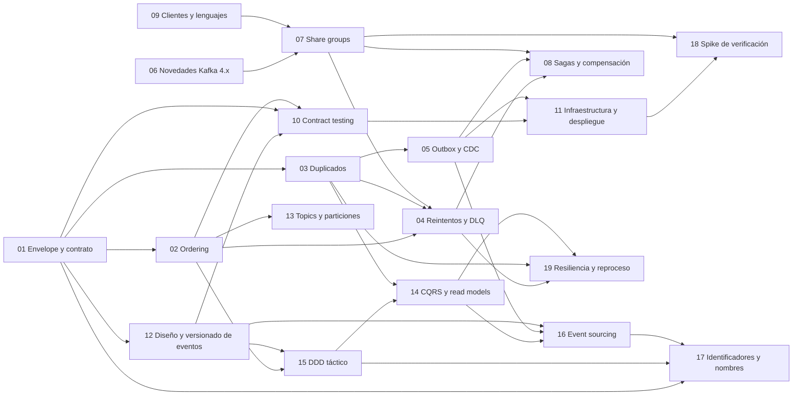

# Notas de estudio

Índice de los temas estudiados. Las reglas para escribir y mantener estas notas están en [`../metodo-de-trabajo.md`](../metodo-de-trabajo.md) y la estructura base en [`_template.md`](_template.md).

**Se actualiza en cada turno en que se aprende algo.**

## Notas

| # | Tema | Estado | Última actualización |
|---|---|---|---|
| 01 | [Envelope y contrato de eventos](01-envelope-y-contrato-de-eventos.md) (CloudEvents, AsyncAPI, JSON:API) | Vigente | 2026-10-12 |
| 02 | [Ordering en Kafka](02-ordering-en-kafka.md) | Vigente | 2026-10-12 |
| 03 | [Duplicados e idempotencia](03-duplicados-e-idempotencia.md) | Vigente | 2026-10-12 |
| 04 | [Reintentos y DLQ](04-reintentos-y-dlq.md) | Vigente | 2026-10-12 |
| 05 | [Outbox y CDC](05-outbox-y-cdc.md) | Vigente (con vacíos) | 2026-10-12 |
| 06 | [Novedades de Kafka 4.x](06-novedades-de-kafka-4x.md) | Vigente | 2026-10-12 |
| 07 | [Share groups](07-share-groups.md) (actualizada con el worker de Videos: RENEW exige poll, particiones por miembro) | Vigente | 2026-10-17 |
| 08 | [Sagas y compensación](08-sagas-y-compensacion.md) | Vigente | 2026-10-12 |
| 09 | [Clientes de Kafka y lenguajes](09-clientes-y-lenguajes.md) | Vigente (con vacíos) | 2026-10-12 |
| 10 | [Contract testing de eventos](10-contract-testing.md) (Pact, `can-i-deploy`, compatibilidad de schemas) | Vigente (con vacíos) | 2026-10-12 |
| 11 | [Infraestructura y despliegue](11-infraestructura-y-despliegue.md) (Strimzi, Argo CD, kind) | Vigente (con vacíos) | 2026-10-12 |
| 12 | [Diseño y versionado de eventos](12-diseno-y-versionado-de-eventos.md) (dónde vive la versión, varios consumidores por topic) | Vigente (con vacíos) | 2026-10-12 |
| 13 | [Topics y particiones](13-topics-y-particiones.md) (cómo se configuran, por qué, qué hacen otras compañías) | Vigente (con vacíos) | 2026-10-12 |
| 14 | [CQRS y read models](14-cqrs-y-read-models.md) (niveles de separación, consistencia eventual, reproyección) | Vigente (con vacíos) | 2026-10-12 |
| 15 | [DDD táctico](15-ddd-tactico.md) (agregados, invariantes, context map, evento de dominio vs publicado) | Vigente (con vacíos) | 2026-10-12 |
| 16 | [Event sourcing](16-event-sourcing.md) (event store, rehidratación, upcasting; aplicado a `Comment`) | Vigente (con vacíos) | 2026-10-12 |
| 17 | [Identificadores y nombres](17-identificadores-y-nombres.md) (id de agregado, de stream y de evento; `<prefijo>_<UUIDv7>`; alias de ejemplo) | Vigente (con vacíos) | 2026-10-12 |
| 18 | [Spike de verificación: resultados](18-spike-resultados.md) (ecosistema base con Docker Compose ejecutado; S1 a S4 pendientes) | Fase 0 verificada | 2026-10-12 |
| 19 | [Resiliencia, volumen y reprocesamiento ordenado](19-resiliencia-volumen-y-reprocesamiento.md) (guard estricto de `sequence`, DLQ y redrive en orden, pausa ante dependencia caída; verificado en el spike S5 con clientes planos) | Vigente (estudio) | 2026-10-16 |
| 20 | [Seguridad del repositorio](20-seguridad-del-repositorio.md) (gitleaks; crece con las fases del ADR 0012) | Vigente | 2026-10-17 |
| 21 | [Lint, formato y análisis estático](21-lint-y-analisis-estatico.md) (ktlint, detekt, hadolint, ShellCheck) | Vigente | 2026-10-17 |
| 22 | [Observabilidad: logs con Loki, Alloy y Grafana](22-observabilidad-loki-grafana.md) | Vigente | 2026-10-17 |
| 23 | [CI y cadena de suministro](23-ci-y-cadena-de-suministro.md) (GitHub Actions, Trivy, CodeQL, Dependabot, JaCoCo) | Vigente (sin correr aún en GitHub) | 2026-10-17 |
| 24 | [SonarQube y verificación de dependencias](24-sonarqube-y-verificacion-de-dependencias.md) | Vigente | 2026-10-17 |
| 25 | [Autenticación con Keycloak y JWT](25-autenticacion-keycloak-jwt.md) | Vigente | 2026-10-18 |

## Dependencias entre notas

## Vacíos conocidos (resumen de las secciones "No verificado")

- **Cambio de particiones y rebalances** sobre el orden: no leído en documentación oficial (02).
- **Retención del inbox**: ninguna fuente, decisión nuestra (03).
- **Polling publisher y logical decoding messages**: nombrados, no leídos (05).
- **Kafka 4.3**: sin release notes encontradas (06).
- **Resto de la KIP-932** y soporte de clientes Java/Kotlin y Spring (07).
- **Resiliencia (19):** guard estricto, redrive en orden y pausa verificados en S5 solo con clientes planos (sin Spring); falta la carrera consumer/redrive, `kill -9`, rebalances y la decisión de omitir un evento; `sequence` contigua solo verificada en `Comment`.
- **Pact con Kotlin y Spring Boot 4.1**, y qué cubre Pact de la key y los headers (10).
- **Retención y reconstrucción de read models**: retención por defecto de Kafka 4.3 leída, reproyección no probada (14).
- **DDD, CQRS y event sourcing**: fuentes leídas como resumen de herramienta de fetch en varios casos; ni el SQL ni el Kotlin de las notas 15 y 16 se ejecutaron (15, 16).
- **Identificadores (17)**: la monotonía de `Uuid.generateV7()` de Kotlin dentro del mismo milisegundo no está documentada (inferencia, experimento ID-03); la definición oficial de *commit* en NEventStore no se encontró (solo un blog); guardar el id como texto y no como binario es decisión nuestra, sin medir, contra la preferencia del RFC 9562 §6.13; nada corrió contra PostgreSQL.
- **Servicios**: no existen; el ecosistema base y los spikes S1 a S5 sí se ejecutaron (18, y `spikes/*/RESULTADOS.md`).
- **Probado contra un broker real (2026-10-12):** el ecosistema base (nota 18, Fase 0), la pila Boot + Spring Kafka + `kafka-clients` 4.3.1 y los share groups (S1 y S2). Y también Pact con Kotlin y `can-i-deploy` (S3) y el event store de `Comment` en PostgreSQL (S4). **Sin probar:** los servicios, el pipeline en GitHub Actions, `kill -9` real, varios procesos y el upcasting.

## Temas por estudiar

- Variantes del relay: polling publisher, log tailing, logical decoding messages
- Persistencia del estado del process manager (tabla propia vs event sourcing, ver nota 16) y motores de workflow
- Cierre del módulo de consumer: rebalances y cambio de particiones
- Stack de cliente: documentación de Spring Kafka 4.1.1 verificada (nota 09); verificado contra un broker real en el spike S1 y S2 (nota 18); queda la configuración de Spring Boot y la caída abrupta de consumers
- Contract testing, segunda pasada: experimento real con Pact JVM + Kotlin + Spring Boot 4.1; qué hace el broker OSS en CI; bi-directional de PactFlow
- Observabilidad: propagación de contexto en headers, consumer lag
- Delivery, segunda pasada: pipeline de CI concreto, Helm vs Kustomize, share groups bajo Strimzi, entornos por PR probados
- Leer los libros localizados en la nota 12 (Bellemare, Stopford, Kleppmann cap. 4) y la regla #213 completa de Zalando
