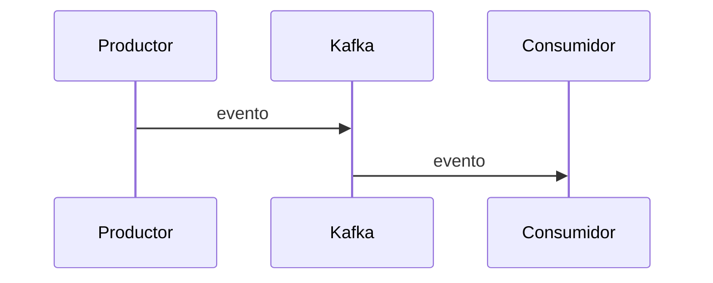

# <Tema>

> **Estado:** borrador | vigente | obsoleto · **Versión de referencia:** Kafka x.y · **Última actualización:** AAAA-MM-DD

## Resumen
Tres líneas: qué es, qué problema resuelve y qué decidimos para el proyecto.

## Por qué importa
Qué se rompe si no se entiende o no se aplica. Vincular con ordering, idempotencia, contratos o delivery.

## Cómo funciona
Explicación del mecanismo.



*Por qué este diagrama:* una línea explicando la elección del tipo UML.

## Aplicación por componente

| Componente | Cómo aplica | Decisión / regla |
|---|---|---|
| Videos | | |
| Interactions | | |
| Feed | | |
| Notifications | | |

## Ejemplos del dominio
Evento, topic, key y escenario concretos (`VideoPublished`, `CommentPosted`, ...). Mostrar primero el caso que falla y después el que funciona.

```gherkin
Escenario: ...
  Dado que ...
  Cuando ...
  Entonces ...
```

## Alternativas y trade-offs

| Opción | Ventaja | Costo | Cuándo |
|---|---|---|---|
| | | | |

## Reglas para el spec
Reglas verificables que salen de esta nota y van a `specs/` (ADR, NFR o escenario).

## Fuentes
- [Título](url) — versión, fecha de consulta, qué se tomó de ahí.

## No verificado
- Lo inferido, lo recordado sin fuente, lo leído parcialmente, las discrepancias entre fuentes.

## Historial
| Fecha | Cambio |
|---|---|
| AAAA-MM-DD | Creación |
