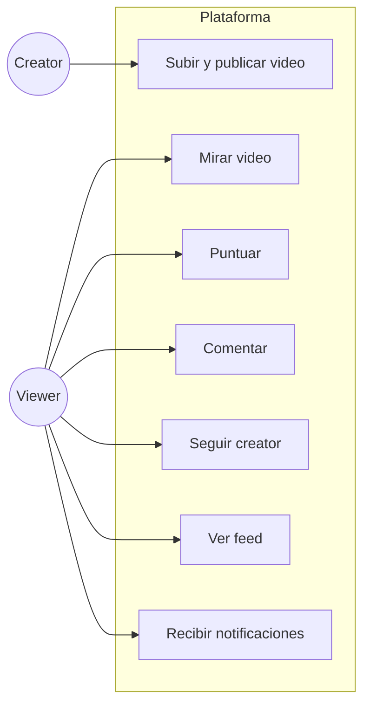

# Visión

> **Estado:** borrador para revisión · **Última actualización:** 2026-10-12

## Problema
Construir un ecosistema de microservicios sobre eventos que permita **estudiar, demostrar y verificar** las garantías que un backend sobre Kafka suele prometer sin probar: orden por agregado, idempotencia de efectos, contratos entre servicios que se rompen en CI y no en staging, y releases que se bloquean solos cuando un contrato no se cumple.

## Producto (el vehículo)
Una plataforma de videos simple: los **creators** publican videos; otras personas los **miran, puntúan y comentan**; los **seguidores** ven las publicaciones en su feed y reciben notificaciones.

El dominio es deliberadamente chico. El valor del proyecto está en las garantías y en el delivery, no en la complejidad del negocio.

## Alcance

*Por qué este diagrama:* es de **casos de uso**, porque define quién hace qué y fija el alcance funcional.

### Dentro
- Publicación de video con procesamiento asincrónico (saga con pivote en `VideoPublished`).
- Puntuaciones y comentarios (crear, editar, borrar).
- Seguir y dejar de seguir creators; feed por seguidor.
- Notificaciones por publicación de video y por comentario.

### Fuera (no-objetivos)
- Streaming real de video: el "procesamiento" es un paso simulado con duración configurable.
- Búsqueda, recomendaciones, monetización, moderación (extensión opcional).
- Autenticación completa: se asume una identidad ya resuelta (`userId`) en el borde.
- Multi-región y multi-cluster.

## Criterios de éxito
Cada uno se demuestra con un test o un gate, no con una afirmación.

| # | Criterio | Evidencia |
|---|---|---|
| 1 | Los eventos de un mismo agregado se aplican en orden | Test de orden por key contra broker real (`07-nfr/garantias.md`) |
| 2 | Un evento duplicado no duplica su efecto | Test de duplicados con inbox |
| 3 | Un cambio incompatible en un evento rompe el build del productor | Contract test y chequeo de compatibilidad en CI |
| 4 | Un consumer no se despliega si el productor ya no cumple su contrato | Gate `can-i-deploy` |
| 5 | Un mensaje que agota reintentos termina en una DLQ con causa y alerta | Escenario Given/When/Then |
| 6 | Cada servicio se levanta y prueba sin staging compartido | Entorno efímero por pull request |
| 7 | Cada decisión técnica tiene un ADR con fuentes y versión | `02-adr/` |

## Método
Spec primero, código después (ver `docs/metodo-de-trabajo.md`). Flujo por feature: spec → revisión → contrato → test que falla → implementación → gate en CI.

## Mapa de documentos
- Estudio de respaldo: [`../docs/study/README.md`](../docs/study/README.md).
- Dominio: [`01-domain/`](01-domain/).
- Decisiones: [`02-adr/`](02-adr/).
- Garantías: [`07-nfr/garantias.md`](07-nfr/garantias.md).

## Pendiente
- Nombre final del proyecto (`video-eda` es de trabajo).
- ~~Si será repositorio público de demostración.~~ Resuelto 2026-10-12: **será público**. Implica licencia, README orientado a quien lo lee sin contexto, y ninguna credencial en el repositorio.
