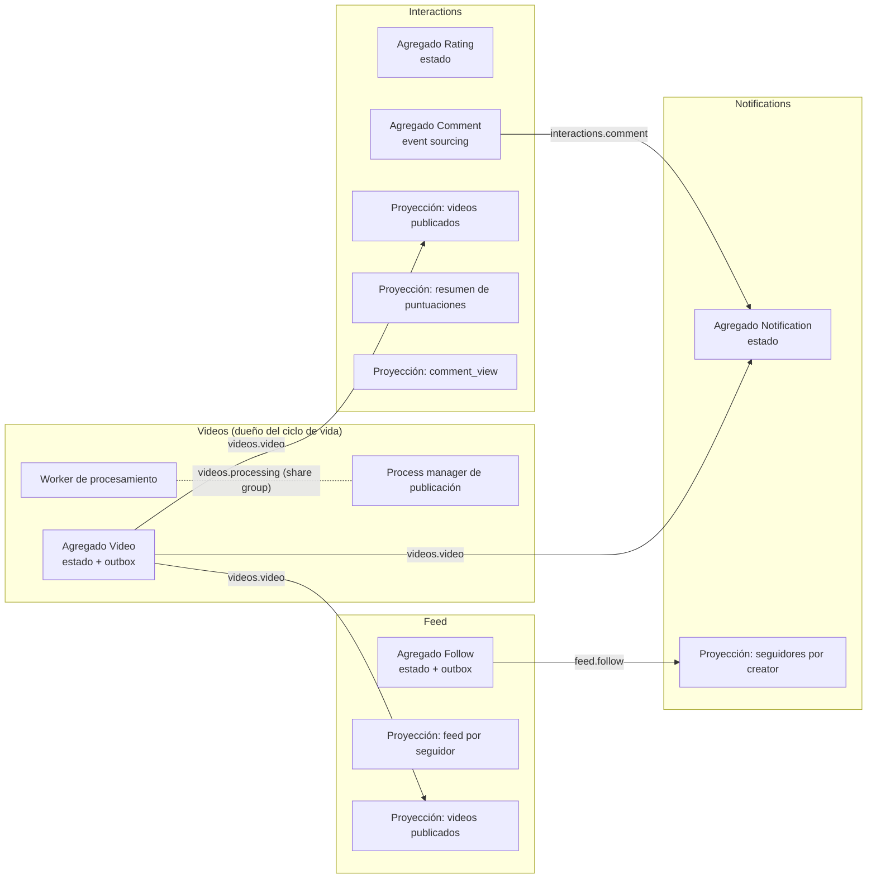
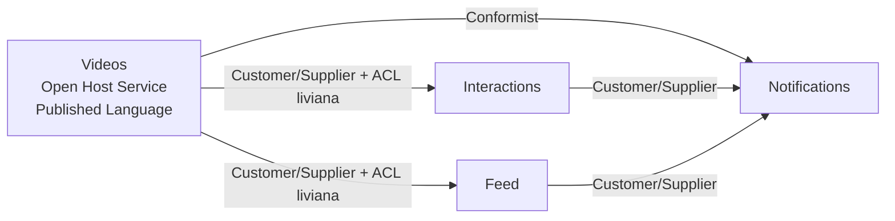

# Bounded contexts

> **Estado:** borrador para revisión · **Última actualización:** 2026-10-12 (`feed.follow` por la opción a)
> Incluye el modelado táctico de la nota 15 (propuesta) y el nivel de CQRS de la nota 14. La regla de publicación "un evento se publica solo si otro contexto lo consume" fue **aprobada por Laura el 2026-10-12**; ver `03-events/README.md`.

## Mapa

*Por qué este diagrama:* es de **componentes**, porque muestra qué contexto publica y consume cada topic y qué es agregado y qué proyección. Lo que no cruza una frontera (puntuaciones, entradas de feed) no aparece como topic: se resuelve dentro del servicio.

## Contextos

| Contexto | Responsabilidad | Agregados | Proyecciones (no son agregados) | Publica | Consume | Estilo de consumo | CQRS (nota 14) |
|---|---|---|---|---|---|---|---|
| **Videos** | Ciclo de vida del video y su publicación | `Video` (estado + outbox) | — | `videos.video`, `videos.processing` | `videos.processing` (worker) | Share group para el worker | Nivel 1 |
| **Interactions** | Puntuaciones, comentarios, vistas | `Rating` (estado), `Comment` (**event sourcing**) | Videos publicados, resumen de puntuaciones, `comment_view` | `interactions.comment` | `videos.video` | Consumer group con orden por key | Nivel 1 dentro; nivel 2 con Videos |
| **Feed** | Seguimientos y feed por seguidor | `Follow` (estado + outbox) | Videos publicados, `feed_entry` | `feed.follow` | `videos.video` | Consumer group con orden por key | Nivel 1 dentro; nivel 2 con Videos. Es casi solo lado query |
| **Notifications** | Avisos a usuarios | `Notification` (estado) | Seguidores por creator (desde `feed.follow`) | *(ninguno: el estado vive en su tabla propia)* | `videos.video`, `interactions.comment`, `feed.follow` | Consumer group con orden por key; el envío es simulado | Nivel 0 |

Notas sobre la tabla:
- Con la regla de publicación, `interactions.rating`, `interactions.view` y `feed.entry` **no se publican**: nadie fuera del contexto los consume. `feed.follow` **sí**, porque Notifications consume los follows (opción a, Laura, 2026-10-12). Las proyecciones de Interactions y Feed se actualizan en la transacción del comando (nivel 1), sin pasar por el broker.
- Un agregado event-sourced no tiene tabla `outbox`: el event store (`comment_events`) cumple ese papel (nota 16, ADR 0009 aceptado). `Video` y `Follow` conservan estado + outbox (ADR 0004): son los dos agregados que publican y no usan event sourcing.
- Las proyecciones no tienen repositorio de dominio ni invariantes más allá de la unicidad (nota 15).
- Creator y Viewer no existen como agregado: solo hay `userId` (no hay perfil ni autenticación en el alcance).

## Agregados e invariantes (propuesta, nota 15)

| Agregado | Identidad (= key del topic) | Invariantes verdaderas | Escenarios |
|---|---|---|---|
| `Video` | `videoId` | Transiciones `UPLOADED → PROCESSING → PUBLISHED \| FAILED` y `PUBLISHED → DELETED`; `VideoPublished` una sola vez; un borrado no vuelve | AGG-04 a AGG-06, PUB-02 |
| `Rating` | `videoId:raterId` | Una vigente por par; valor en rango *(supuesto)*; `sequence` crece | AGG-07 a AGG-09, RAT-05 |
| `Comment` | `commentId` | Un borrado no se edita ni se borra de nuevo; `version` crece en 1 por cambio; texto no vacío *(supuesto)* | COM-02, COM-05, ES-05, ES-09 |
| `Follow` | `followerId:creatorId` | Una relación por par; follow y unfollow se alternan; `sequence` crece | AGG-10 a AGG-12, FEED-03 |
| `Notification` | `notificationId` | `REQUESTED → SENT \| FAILED \| CANCELLED`; una `SENT` no se cancela; una por destinatario y causa | AGG-13 a AGG-16, NOT-10 |

Lo que **no** es un agregado: el resumen de puntuaciones (derivado, se recalcula), la lista de videos publicados (read model) y la entrada de feed `(followerId, videoId)` (fila de proyección con unicidad, FEED-11). El process manager de publicación tampoco: coordina, y el estado que consulta vive en `Video.status` (nota 08).

La regla "solo se puntúa o comenta un video publicado" **no** es invariante de `Rating` ni de `Comment`: cruza servicios y se verifica contra la proyección local de videos publicados con consistencia eventual (RAT-02, RAT-07, AGG-03).

## Context map (propuesta, nota 15)

Los patrones son de Evans (2015). Las relaciones entre equipos no existen acá, porque hay uno solo: la clasificación es por forma técnica.

| Upstream | Downstream | Patrón | Qué se garantiza | Dónde se prueba |
|---|---|---|---|---|
| Videos | Interactions | **Open Host Service + Published Language** (CloudEvents + AsyncAPI); **Customer/Supplier** probado con Pact; **ACL liviana** (Interactions traduce a su proyección) | Estructura de `VideoPublished` y `VideoDeleted` | Pact, ADR 0006 |
| Videos | Feed | Igual que el anterior | Ídem | Pact |
| Videos | Notifications | **Conformist**: toma `creatorId` y `title` tal como vienen | Ídem | Pact |
| Interactions | Notifications | **Customer/Supplier** + Published Language | Estructura de `CommentPosted`, `CommentEdited` y `CommentDeleted` | Pact |
| Feed | Notifications | **Customer/Supplier** + Published Language | Estructura de `CreatorFollowed` y `CreatorUnfollowed`, y la key `followerId:creatorId` | Pact (estructura); test propio (key, nota 10) |
| Moderación *(opcional)* | — | **Separate Ways** hasta que exista | Sin relación definida | — |

*Por qué este diagrama:* es un **mapa de contextos**, porque la pregunta es qué patrón rige cada relación y en qué dirección; el diagrama de arriba responde, en cambio, qué topic une a quién.

**No se usa:** *Shared Kernel* (no hay librería de dominio compartida; se comparte el schema, no el código), *Partnership* (con un solo equipo no distingue nada) ni *ACL completa* (el upstream es propio y está bien definido). Los patrones asignados son inferencia de la nota 15; la asignación de Conformist a Notifications es opinable.

Los contratos entre estos pares son los que se prueban con contract testing (`05-contracts/`, a crear).

## Reglas
1. Un servicio, una base de datos, un contexto. Ningún servicio lee tablas de otro.
2. La comunicación entre contextos es por eventos; las únicas llamadas síncronas son de consulta hacia el borde (API del cliente).
3. Cada contexto mantiene sus propios read models; no hay joins entre servicios.
4. Los eventos publicados son el contrato público; los modelos internos no se exponen. El evento de dominio es interno y el publicado se arma con una función de mapeo explícita contra el schema de `03-events/`.
5. Cada topic tiene un único contexto productor.
6. Un evento se publica solo si otro contexto lo consume (aprobada 2026-10-12).
7. La identidad del agregado es la key de su topic; un comando modifica **un** agregado por transacción; los agregados se referencian por id.
8. No hay librería de clases de dominio compartida entre servicios.
9. Todo read model es reconstruible desde sus eventos (G8).

## No resuelto
- Definición de Moderación como contexto opcional.
- Si el cliente consulta por un BFF o por cada servicio.
- Cómo se persisten los agregados (¿Spring Data JDBC?): sin ADR todavía (nota 15).
