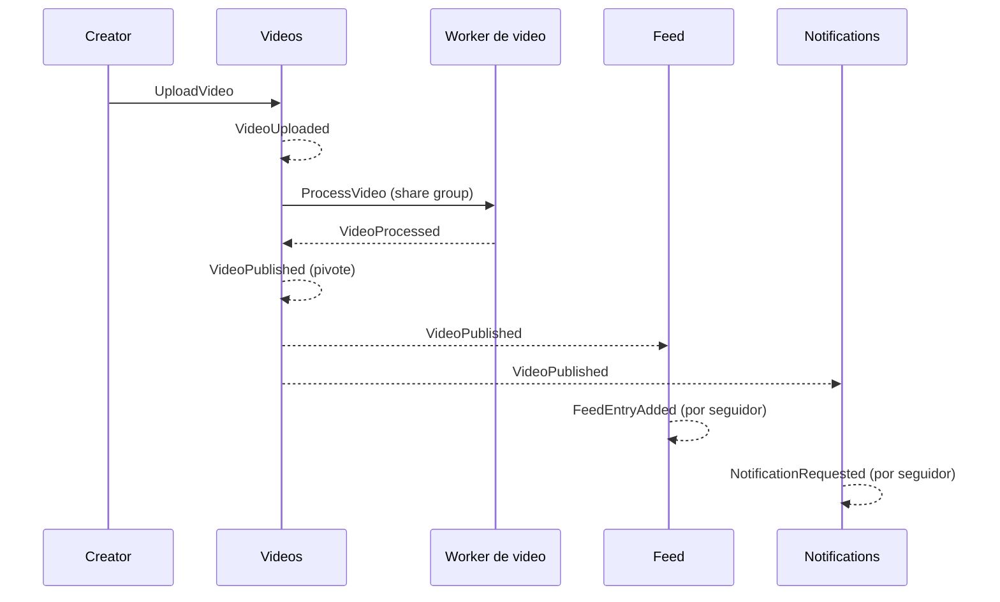

# Event storming (primera pasada)

> **Estado:** borrador para revisión · **Última actualización:** 2026-10-12
> Resultado de un ejercicio de papel, no de un taller con personas del negocio. Todo es propuesta nuestra.

## Convenciones
- **Evento:** hecho en pasado (`VideoPublished`).
- **Comando:** intención en imperativo (`PublishVideo`); lo recibe un agregado, que lo acepta o rechaza.
- **Política:** "cuando ocurre X, entonces hacer Y".
- **Key:** identificador del agregado que fija el orden en Kafka (`../02-adr/0003-ordering-y-keys.md`).

## Línea de tiempo de la publicación

*Por qué este diagrama:* es de **secuencia**, porque lo que interesa es el orden causal de comandos y eventos entre contextos.

## Evento de dominio vs evento publicado

Son dos objetos que cuentan el mismo hecho (nota 15). El **evento de dominio** es interno: lo devuelve el agregado y puede cambiar con un refactor. El **evento publicado** es un CloudEvent con schema, contrato público, que existe después del commit, vía outbox o event store (ADR 0004, nota 16). La regla de publicación (aprobada por Laura el 2026-10-12) dice que un evento se publica **solo si otro contexto lo consume**.

Publicados en Kafka: `VideoPublished` y `VideoDeleted` (`videos.video`), `CommentPosted`, `CommentEdited` y `CommentDeleted` (`interactions.comment`), `CreatorFollowed` y `CreatorUnfollowed` (`feed.follow`) y la tarea `ProcessVideo` (`videos.processing`). El resto de los eventos de la tabla es **interno**: sirve para entender el flujo y para el estado del servicio, pero no cruza el broker.

## Eventos por contexto

| Contexto | Evento | Disparado por | Key | Alcance | Notas |
|---|---|---|---|---|---|
| Videos | `VideoUploaded` | `UploadVideo` | `videoId` | Interno | Inicia la saga |
| Videos | `VideoProcessed` | resultado del worker | `videoId` | Interno | Paso reintentable |
| Videos | `VideoProcessingFailed` | worker agota intentos | `videoId` | Interno | Dispara compensación |
| Videos | `VideoPublished` | saga completa | `videoId` | **Publicado** (`videos.video`) | **Pivote**: desde acá no hay compensación |
| Videos | `VideoDeleted` | `DeleteVideo` | `videoId` | **Publicado** (`videos.video`) | Interactions, Feed y Notifications reaccionan |
| Interactions | `VideoRated` | `RateVideo` | `videoId:raterId` | Interno | Una puntuación por par; reemplaza la anterior; actualiza la proyección en la misma transacción |
| Interactions | `CommentPosted` | `PostComment` | `commentId` | **Publicado** (`interactions.comment`) | Versión 1 del stream de `Comment` (event sourcing) |
| Interactions | `CommentEdited` | `EditComment` | `commentId` | **Publicado** (`interactions.comment`) | |
| Interactions | `CommentDeleted` | `DeleteComment` | `commentId` | **Publicado** (`interactions.comment`) | Caso de orden crítico (nota 02); borrado lógico |
| Interactions | `VideoViewed` | `RegisterView` | `videoId` | Interno | Volumen alto; tolerar pérdida a decidir |
| Feed | `CreatorFollowed` | `FollowCreator` | `followerId:creatorId` | **Publicado** (`feed.follow`) | Lo consume Notifications (opción a, 2026-10-12). Dentro de Feed el conflicto lo resuelve `sequence` en la fila; fuera, el orden por key |
| Feed | `CreatorUnfollowed` | `UnfollowCreator` | `followerId:creatorId` | **Publicado** (`feed.follow`) | Caso de orden crítico para Notifications: no debe llegar antes que su `CreatorFollowed` |
| Feed | `FeedEntryAdded` | política de publicación | `followerId` | Interno | El feed es una proyección; nadie lo consume |
| Notifications | `NotificationRequested` | políticas | `notificationId` | Interno | No se publica (ADR 0008) |
| Notifications | `NotificationSent` / `NotificationFailed` | proveedor | `notificationId` | Interno | |

## Políticas

| Cuando | Entonces | Dónde | Estilo |
|---|---|---|---|
| `VideoUploaded` | pedir procesamiento | Videos (process manager) | Orquestación |
| `VideoProcessingFailed` | compensar y marcar `FAILED` | Videos | Orquestación |
| `VideoPublished` | agregar entrada al feed de cada seguidor | Feed | Coreografía |
| `VideoPublished` | notificar a seguidores | Notifications | Coreografía |
| `CommentPosted` | notificar al creator del video | Notifications | Coreografía |
| `VideoDeleted` | ocultar comentarios y entradas de feed | Interactions, Feed | Coreografía |
| `VideoDeleted` | cancelar notificaciones pendientes (`CANCELLED`) | Notifications | Coreografía |
| `CreatorFollowed` | traer las N publicaciones recientes del creator | Feed | Interna |
| `CreatorFollowed` / `CreatorUnfollowed` | agregar o quitar al seguidor de la lista de destinatarios | Notifications | Coreografía |

## Reglas que surgen
- **Semantic lock:** Interactions solo acepta puntuaciones y comentarios de videos `PUBLISHED`. Para eso mantiene un read model local de videos publicados, alimentado por `VideoPublished` y `VideoDeleted` (nota 08, regla 7).
- **Orden entre topics:** un `CommentPosted` puede llegar antes que el `VideoPublished` correspondiente; la política (buffer, placeholder o tolerancia) se define en el ADR 0003.
- **Fan-out:** `VideoPublished` genera N entradas de feed y N notificaciones; cada una es un trabajo independiente.
- **Event sourcing:** `Comment` guarda `CommentPosted`, `CommentEdited` y `CommentDeleted` como su fuente de verdad (`comment_events`); el estado y la vista se derivan. Los demás agregados guardan estado (nota 16).
- **Proyección local:** una proyección dentro del mismo servicio (resumen de puntuaciones, `feed_entry`) se actualiza en la transacción del comando y no pasa por el broker (nota 14).

## Preguntas abiertas
1. ¿Quién es dueño de la relación de seguimiento: Feed o un contexto propio? Hoy: Feed.
2. ¿`VideoViewed` se registra por cada reproducción o se agrega por ventana? (Hoy es interno: nadie fuera de Interactions lo consume.)
3. ~~¿Qué pasa con las notificaciones pendientes cuando se borra el video?~~ Resuelto 2026-10-12: se cancelan y se conservan.
4. ¿Se puede editar un video ya publicado? Hoy: no.
