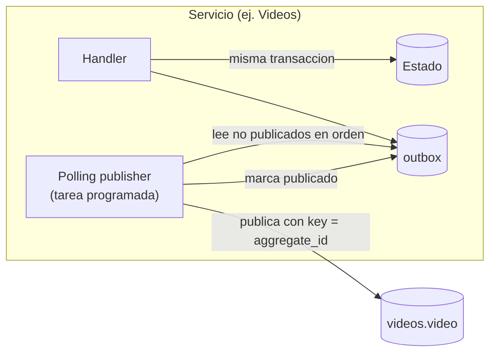

# ADR 0004: Publicación con Transactional Outbox y polling publisher

> **Verificado el 2026-10-12 (spike S4, nota 18):** con dos instancias del publisher sin bloqueo se duplica todo; con `SKIP LOCKED` no hay duplicados pero se rompe el orden por key; con `pg_try_advisory_lock` publica una sola. La regla de una sola instancia publicadora queda justificada con evidencia.
> **Estado:** Aceptado el 2026-10-12 por Laura · **Actualizado el 2026-10-12 por el ADR 0008 (aprobado):** el relay pasa de Debezium a un *polling publisher* dentro del servicio. **Excepción definida por el ADR 0009:** `Comment` usa su event store en lugar de outbox.

## Contexto
Un servicio que actualiza su base y publica a Kafka hace una escritura doble: si falla entre las dos, el estado y los eventos divergen. Una transacción distribuida no es una opción (nota 05).

## Decisión
1. Ningún handler publica a Kafka directamente: **todo evento se escribe en una tabla `outbox` en la misma transacción que el cambio de estado**.
2. Un **polling publisher** (una tarea programada dentro del mismo servicio) lee los eventos no publicados de la tabla `outbox`, los publica a Kafka con `aggregate_id` como key y los marca como publicados.
3. El `id` de la fila del outbox es el `id` del CloudEvent y **no se regenera** en reenvíos.
4. Los eventos se leen en orden de inserción (una columna de secuencia propia del outbox) y **hay una sola instancia publicadora por servicio**.
5. La publicación es **at-least-once**: si el servicio cae después de publicar y antes de marcar, el evento se publica de nuevo. Los consumers aplican inbox (ADR 0005).
6. Las filas ya publicadas se borran con una tarea programada (retención a decidir). **No aplica a `comment_events`**: es el historial del agregado, append-only; allí `published_at` solo marca lo ya publicado y nunca se borra (ADR 0009).

*Por qué este diagrama:* es de **componentes**, porque muestra qué piezas intervienen y dónde está la frontera transaccional.

## Por qué
- El patrón es el de microservices.io: *"Messages are guaranteed to be sent if and only if the database transaction commits"*, con la advertencia de que el relay puede publicar un mensaje más de una vez y por eso *"a message consumer must be idempotent"*.
- El *polling publisher* es una de las dos formas de implementar el relay; la otra es leer el log de transacciones. Según esa fuente: *"Works with any SQL database"*, y su inconveniente es que es *"Tricky to publish events in order"*.
- **Menos es más (ADR 0008):** no hay Kafka Connect, ni conector, ni lectura del WAL. Todo vive dentro del servicio.

## Consecuencias
- La latencia entre el commit y la publicación es el intervalo de polling; es mayor que la de leer el log. El valor del intervalo no está medido.
- Hay carga periódica de lectura sobre la base propia del servicio.
- El orden depende de **una sola instancia publicadora** y de leer por la columna de secuencia. Escalar el publicador a varias instancias exige una estrategia que no está estudiada.
- Alertas propias: edad del evento más viejo sin publicar y tamaño de la tabla.

## Excepción: `Comment` con event sourcing (ADR 0009, aceptado)
Para el agregado `Comment` **no hay tabla `outbox`**: el event store `comment_events` ocupa su lugar. El append del evento es la escritura atómica, y el polling publisher lee de esa tabla las filas con `published_at IS NULL`, ordenadas por `global_seq`, y las marca después de publicar. El `id` del CloudEvent es `event_id`, la key es `stream_id` y el `sequence` es `version`. Todo lo demás de este ADR (una instancia publicadora, at-least-once, inbox en consumidores) sigue igual, y los otros agregados que publican, **`Video` y `Follow`** (este último desde que Notifications consume `feed.follow`, opción a, Laura, 2026-10-12), mantienen estado + outbox. `Rating` y `Notification` no publican y no usan outbox. Que el publisher lea del event store es una **hipótesis sin fuente directa** (nota 16, ADR 0009).

## Alternativas
| Opción | Estado |
|---|---|
| Polling publisher dentro del servicio | **Elegida** |
| Transaction log tailing con Debezium | Camino de crecimiento, documentado en la nota 05; Strimzi 1.3.0 soporta Kafka 4.3.1 (nota 11) |
| Logical decoding messages | Nombrada, no leída (nota 05) |
| Publicar en el handler y reintentar | Descartada: pierde eventos ante un fallo entre ambos pasos |

## Verificado en el servicio Videos (2026-10-17, PostgreSQL 18.6, `services/videos`)
La escritura atómica estado + outbox se probó con Testcontainers: si falla el outbox, el cambio de estado se revierte; el `sequence` se asigna en el mismo `INSERT` como `max + 1` dentro del stream (agregado, topic) y salió contiguo (1, 2); dos workers sobre el mismo video **solo** producen un `VideoPublished` gracias a `SELECT … FOR UPDATE` del agregado (sin él, la mutación publicó con `sequence` 1 y 2 a la vez), y `UNIQUE (aggregate_id, topic, sequence)` queda como red de seguridad. **El orden global de `outbox_seq` puede no coincidir con el orden de commit entre agregados distintos**; solo se garantiza dentro de un mismo agregado, que es lo que necesita la key. **Publisher (2026-10-17, Kafka 4.3.1 real):** `OutboxPublisher` publica por `outbox_seq` con key = `aggregateId`, espera la confirmación y recién entonces marca `published_at`; los 40 eventos de 20 videos salieron con `VideoPublished` antes que `VideoDeleted` en la misma partición; una caída simulada entre el envío y el marcado reenvió `ProcessVideo` con el **mismo `event_id`**; con Kafka inalcanzable no se marcó nada y al volver salió todo en orden; dos instancias a la vez publican una sola (`pg_try_advisory_lock`, 7001). Mutaciones: **marcar antes de enviar** deja la fila como publicada aunque Kafka estuviera caído (pérdida de eventos) y **sin el lock** la segunda instancia publicó las mismas 10 filas. **Sin probar:** `kill -9` real del proceso, varias instancias del servicio en máquinas distintas, intervalo de polling, tamaño del lote, el borrado de filas publicadas y la retención.

## Verificación
- Test de caída: matar el servicio entre el commit y la publicación; el evento se publica al reiniciar (PUB-05).
- Test de duplicado: reenviar el mismo `id`; el consumer lo ignora (PUB-06).
- Test de orden: dos eventos del mismo agregado se publican en el orden en que se insertaron.
- Test que falla si un handler importa un producer de Kafka (regla de arquitectura).

## Pendiente
- Intervalo de polling y tamaño del lote.
- Retención de la tabla outbox.
- Base de datos de cada servicio (cualquier SQL alcanza según la fuente; sin decidir).
- Qué pasa si hay dos instancias del servicio.

## Respaldo
Nota 05 (outbox y CDC), nota 03 (inbox), nota 13 (producer y topics), nota 16 (event sourcing). Fuentes: [Transactional Outbox](https://microservices.io/patterns/data/transactional-outbox.html) y [Polling Publisher](https://microservices.io/patterns/data/polling-publisher.html), leídas el 2026-10-12.
