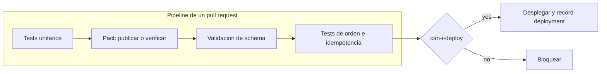

# ADR 0006: Contract testing y gate de despliegue

> **Verificado el 2026-10-12 (spike S3, nota 18):** Pact JVM 4.7.5 con Kotlin 2.4.21, JUnit 5 y Boot 4.1.1; `can-i-deploy` verde y rojo contra el Pact Broker 3.0.0 real; la key se puede verificar como metadata pero no reemplaza al test CTR-05.
> **Estado:** Aceptado el 2026-10-12 por Laura · **Actualizado el 2026-10-12 por el ADR 0008 (aprobado):** sin compatibilidad por registry.

## Contexto
Queremos eliminar el staging compartido y que un cambio incompatible se detecte en el pipeline del productor (nota 10).

## Decisión
1. **Pact (consumer-driven)** para los contratos entre servicios; mensajes con spec V4 y referencia al mensaje de AsyncAPI.
2. **Pact Broker** open source con la imagen oficial, en el entorno de pipeline.
3. **Validación de schema en CI** como segundo control: cada evento de ejemplo y cada mensaje de un pact se valida contra su JSON Schema. **Sin Schema Registry** (ADR 0008). Dentro de un mismo `type` solo se admiten cambios aditivos (ADR 0002).
4. **Tests propios** para key, orden e idempotencia; Pact no los cubre (ADR 0003 y 0005).
5. **Gate:** `can-i-deploy` antes de cada despliegue y `record-deployment` después.
6. Versiones = commit; todos los publish y verify llevan branch; `mainBranch` configurado.
7. Provider verification con `enablePending` e `includeWipPactsSince` (30 días).
8. Adopción gradual: `can-i-deploy` en modo `dry run` hasta que haya contratos estables; luego se aplica.

*Por qué este diagrama:* es de **actividad**, porque expresa las etapas y la decisión del gate.

## Consecuencias
- Un contenedor más (el Pact Broker, con su base) en el Compose (ADR 0007).
- Sin registry no hay chequeo automático de compatibilidad entre versiones de un schema; se apoya en la regla "solo cambios aditivos" y en los pacts de cada consumer.
- Los equipos (aunque sea una persona) deben mantener los pacts con el mensaje mínimo; un pact de más acopla.
- Pact no sustituye ningún test de garantías (G1, G4 en `07-nfr/garantias.md`).

## Alternativas descartadas
- **Spring Cloud Contract:** sin mención de Kafka en la documentación de mensajería 5.0.3; se reabre si se verifica soporte.
- **Solo schemas:** no hay gate por entorno ni sabe qué usa cada consumer.
- **PactFlow (SaaS):** válido, pero es otro servicio externo; se evalúa si el broker propio pesa.

## Verificación
- Experimento: un consumer (Feed) y un provider (Videos) con un pact real contra el broker local.
- Escenario Given/When/Then del cambio incompatible bloqueado (nota 10).
- Test que falla si un contrato no referencia un mensaje de AsyncAPI.

## Pendiente
- Compatibilidad de Pact JVM 4.7.x con Kotlin 2.4, Spring Boot 4.1 y JUnit 5.
- Cómo se levanta el broker y su base en el Compose del runner (ADR 0007).
- Qué entorno de Pact representa un Compose descartable.
- Cómo mantener los pacts alineados con AsyncAPI sin duplicar la fuente de verdad.

## Respaldo
Nota 10 (contract testing), nota 01 (envelope y contrato), nota 02 (ordering).
