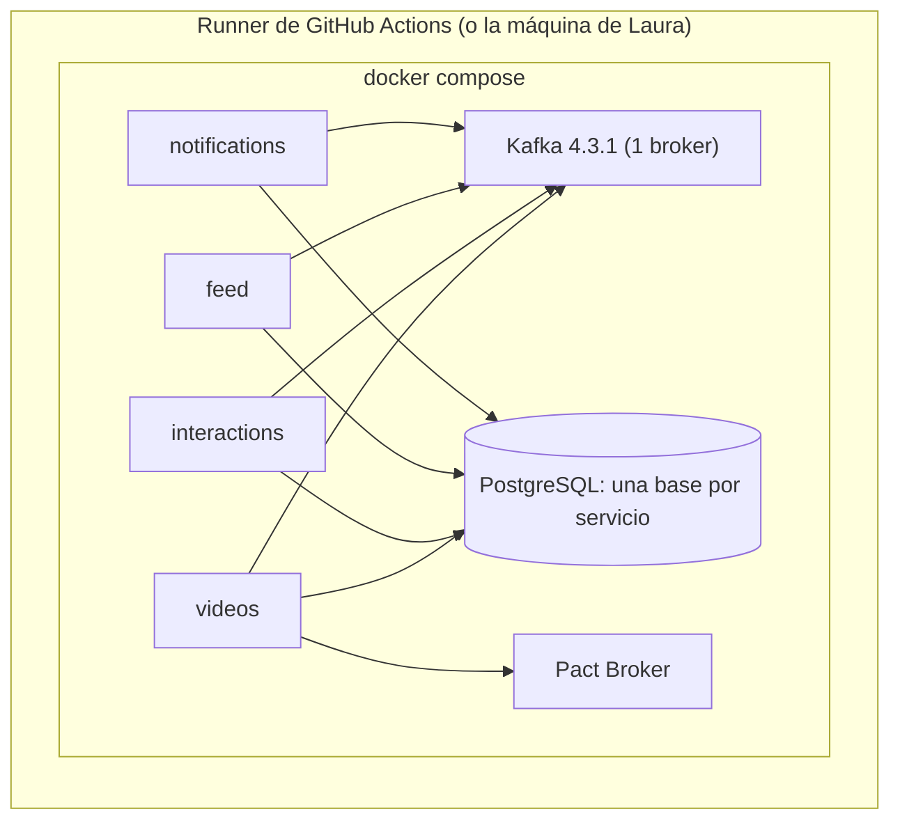

# ADR 0007: Infraestructura y despliegue

> **Estado:** Aceptado el 2026-10-12 por Laura · **Actualizado el 2026-10-12 por el ADR 0008 (aprobado):** Docker Compose reemplaza a Kubernetes + Strimzi.

## Contexto
Necesitamos levantar varios servicios que producen y consumen eventos sobre Kafka, con contract testing y sin staging compartido (visión, criterio 6). El proyecto es un ejemplo: la infraestructura debe poder correrse en una sola máquina y en un runner de GitHub Actions (repositorio público).

## Decisión
1. **Docker Compose** orquesta todo el entorno: Kafka, los cuatro servicios, sus bases, el Pact Broker y su base.
2. **Kafka 4.3.1 en modo KRaft, un solo broker.** Replicación 1 en este entorno (nota 13, T7).
3. **Topics declarados en el repositorio** y creados al arrancar el entorno con un script; un test los cruza contra el AsyncAPI.
4. **Una instancia de PostgreSQL** con una base por servicio (un servicio, una base).
5. **Pact Broker** en un contenedor (imagen oficial `pactfoundation/pact-broker`) con su base (ADR 0006).
6. **GitHub Actions** ejecuta el pipeline: en cada PR levanta el entorno con Compose dentro del runner, corre los tests y lo descarta al terminar; la consulta a `can-i-deploy` es un paso más.
7. **Testcontainers** con Kafka 4.3.1 para los tests de integración (ADR 0001).
8. **Release gates:** los *environments* de GitHub (disponibles en repositorios públicos) con revisor, opcional.

## Fases

| Fase | Entrega | Verificación |
|---|---|---|
| 0 | Testcontainers con Kafka 4.3.1 | CTR-08 |
| 1 | `docker compose up` levanta Kafka y los topics | Cada topic de AsyncAPI existe y viceversa |
| 2 | Servicios y bases en el Compose | PUB-05 y PUB-06 contra el entorno |
| 3 | Pact Broker en el Compose y workflow de GitHub Actions por PR | Un PR publica y verifica pacts y consulta `can-i-deploy` |

*Por qué este diagrama:* es de **despliegue**, porque responde qué corre dónde.

## Qué se difirió y por qué
| Componente | Estado | Razón |
|---|---|---|
| Kubernetes + Strimzi + kind | Camino de crecimiento (nota 11) | Operadores y CRDs que un ejemplo no necesita; Compose orquesta varios servicios |
| Debezium + Kafka Connect | Camino de crecimiento (ADR 0004, nota 05) | El polling publisher cubre la garantía |
| Argo CD | Fuera de alcance | Requiere un cluster persistente que no existe |
| Terraform / OpenTofu | Fuera de alcance | No hay infraestructura en la nube |
| Helm / Kustomize | Fuera de alcance | Solo hacen falta con Kubernetes |

## Consecuencias
- Un solo archivo `docker-compose.yml` describe el entorno; es el que corre localmente y en CI.
- Los topics no se declaran como recurso de Kubernetes; se crean por script y un test valida que coincidan con AsyncAPI.
- No se demuestran réplicas ni tolerancia a la caída de un broker: la replicación es 1.
- La nota 11 se conserva como estudio; su recomendación queda como camino de crecimiento.

## Alternativas descartadas
- **Kubernetes + Strimzi + Argo CD:** más completo, contrario a "menos que más" (ADR 0008).
- **Solo Testcontainers, sin Compose:** sirve para tests, pero no para ver el sistema corriendo entero.

## Verificación
- Test que cruza `03-events/` (AsyncAPI) contra los topics creados por el script.
- El workflow de un PR crea el entorno, corre los tests y no deja nada corriendo.
- Prueba de que un cambio de key hace fallar CTR-05 en el entorno del PR.

## Enmienda 2026-10-12: plug and play
Pedido de Laura: que el proyecto se clone y se levante de una. Se agrega, sin cambiar el estado **Aceptado**:
1. **Un solo comando:** `docker compose up --build` desde la raíz del repositorio.
2. **Único requisito en la máquina: Docker.** Los servicios se compilan dentro de Docker con un `Dockerfile` multi-etapa; no hace falta JDK ni Gradle.
3. **`compose.yaml` en la raíz** (no en `deploy/`); los scripts de apoyo viven en `deploy/`.
4. **Interfaz web incluida en el arranque por defecto** (Kafbat UI, puerto 8080) para ver topics, mensajes y consumer groups; no es un perfil opcional.
5. **Versiones fijadas con tag exacto**, sin `latest` (nota 18).
Verificado en la Fase 0 (nota 18): el ecosistema base arranca sano, `topic-init` es idempotente y los share groups no requieren habilitar nada en Kafka 4.3.1. Los servicios no existen todavía.

## Pendiente
- ~~**Imagen de Kafka 4.3.1 y su configuración KRaft de un solo nodo:** no verificadas.~~ Verificado el 2026-10-12 (nota 18, Fase 0).
- **Cabida en el runner:** que Kafka, cuatro servicios, PostgreSQL y el Pact Broker entren en el runner (16 GB en repositorios públicos, según la documentación de GitHub); no medido.
- **Entorno de Pact** (`record-deployment`): qué entorno representa un Compose que muere con el job.
- **Docker preinstalado en `ubuntu-latest`:** la página de runners no lo afirma; `helm/kind-action` sí. Verificar.
- ~~**Share groups con la imagen elegida:** confirmar que no requieren habilitar nada.~~ Verificado el 2026-10-12: `share.version` queda finalizada en 1 sin configuración extra (nota 18).

## Respaldo
Nota 11 (infraestructura y despliegue, estudio previo), nota 10 (contract testing), nota 13 (topics y particiones), ADR 0008.
