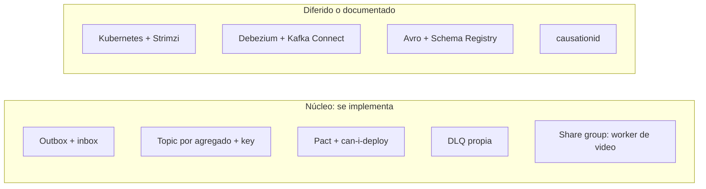

# ADR 0008: Alcance mínimo suficiente

> **Estado:** **Aceptado** (Laura, 2026-10-12: "aprobado el recorte completo") · **Última actualización:** 2026-10-12

## Contexto
El proyecto es un **ejemplo bien implementado de arquitectura orientada a eventos**, no un sistema de producción. Laura pidió explícitamente "siempre menos que más" y no caer en sobreingeniería (2026-10-12). Varias decisiones previas fueron tomadas buscando "lo último" y las mejores prácticas de escala; este ADR las revisa contra ese criterio.

## Decisión
**Cada componente entra solo si demuestra una garantía que el proyecto quiere mostrar** (orden por agregado, efecto único, contratos verificados, nada se pierde en silencio). Lo que solo existe "por si acaso" se recorta o se difiere.

## Revisión de decisiones previas

| # | Componente | Hoy | Propuesta | Por qué | Efecto |
|---|---|---|---|---|---|
| 1 | Formato de payload | JSON Schema (propuesto) | **JSON Schema, sin Avro ni Schema Registry** | Avro y el registry suman un componente a operar; Pact y la validación de schema en CI cubren el contrato | Se simplifica el ADR 0002 y el ADR 0006 |
| 2 | Orquestación local y de CI | Kubernetes + Strimzi + kind (ADR 0007) | **Docker Compose**; Kubernetes queda como "siguiente paso" documentado | Compose orquesta varios servicios y Kafka sin operadores ni CRDs | Cambia el ADR 0007; se pierde la declaración de topics como recurso |
| 3 | Publicación del outbox | Debezium + Kafka Connect (ADR 0004) | **Polling publisher dentro del servicio**; Debezium queda como alternativa de escala | Elimina Connect, el WAL y el conector; el patrón está nombrado en la nota 05 | Cambia el ADR 0004; sube la latencia y la carga sobre la base |
| 4 | Notifications | Dos etapas: intake en consumer group + envío en share group (ADR 0005) | **Un consumer group**; el envío es una llamada simulada | El problema de orden entre `VideoPublished` y `VideoDeleted` desaparece sin partir el contexto | Se simplifica el ADR 0005 y los escenarios NOT |
| 5 | Share groups | Worker de video y Notifications | **Solo el worker de procesamiento de video** | Es el caso donde se justifican (trabajo largo, RENEW); un uso demuestra la capacidad | Un solo caso de share group |
| 6 | Kafka en CI y local | 3 nodos (ADR 0007) | **Un broker** | Entra en el runner; la replicación no es lo que demostramos | RF 1 en entornos de prueba (nota 13, T7) |
| 7 | Extensiones de CloudEvents | `correlationid`, `causationid`, `sequence` | **`sequence` y `correlationid`**; `causationid` diferido | `sequence` es necesaria para el guard de orden; `causationid` no tiene un escenario que la exija | Menos campos |
| 8 | Argo CD, Terraform | Fuera (ADR 0007) | **Sin cambios** | Ya se descartaron | — |
| 9 | Pact + Pact Broker | Núcleo del rol | **Sin cambios** | Es la garantía G6 | — |
| 10 | Outbox, inbox, `sequence`, DLQ | Núcleo | **Sin cambios** | Son las garantías G1 a G5 | — |
| 11 | Saga de publicación | Process manager con estados | **Sin cambios, sin motor de workflow** | Una columna de estado y un scheduler alcanzan | — |
| 12 | Escenarios | 74 | **Marcar un núcleo** (aprox. uno por garantía y proceso) y dejar el resto como extensión | No todo se implementa en la primera pasada | Orden de implementación |

*Por qué este diagrama:* es de **componentes**, porque separa lo que se construye de lo que solo se documenta.

## Consecuencias
- Menos conceptos, menos infraestructura y un repositorio que alguien puede entender y correr en una máquina.
- Se pierde parte de lo que demuestra un perfil de plataforma (operadores, GitOps, CDC). Queda documentado como camino de crecimiento, no implementado.
- **Riesgo:** el rol que motivó el proyecto menciona delivery y staging compartido; Docker Compose con `can-i-deploy` en GitHub Actions cubre el requisito, pero es menos "enterprise" que Kubernetes. Es una decisión de Laura.

## Alternativas
- **Mantener todo lo decidido hasta ahora:** más completo y más pesado; contradice "menos que más".
- **Recortar aún más (por ejemplo, un solo servicio):** deja de mostrar contratos entre servicios.

## Verificación
- Cada componente del núcleo tiene al menos un escenario que lo exige.
- Ningún componente diferido aparece en `docker-compose.yml`.
- El README explica por qué se difirió cada uno.

## Aplicación (2026-10-12)
Los ADR 0002, 0004, 0005 y 0007 fueron actualizados. Dos consecuencias **no estaban en la tabla** aprobada y se aplicaron por derivar de ella; Laura puede revertirlas:
1. **`notifications.notification` deja de existir.** Con un solo consumer group y el envío simulado, nadie consume ese topic; el estado de las notificaciones vive en la tabla propia de Notifications (`REQUESTED`, `SENT`, `FAILED`, `CANCELLED`) y no se publica.
2. **Una DLQ por contexto consumidor:** `interactions.dlq`, `feed.dlq` y `notifications.dlq`, además de `videos.processing.dlq` para el worker. Resuelve el pendiente "DLQ por consumer" con la opción más simple.

## Respaldo
Nota 13 (topics y particiones), nota 12 (versionado), nota 11 (infraestructura), nota 05 (outbox y CDC), nota 07 (share groups).
