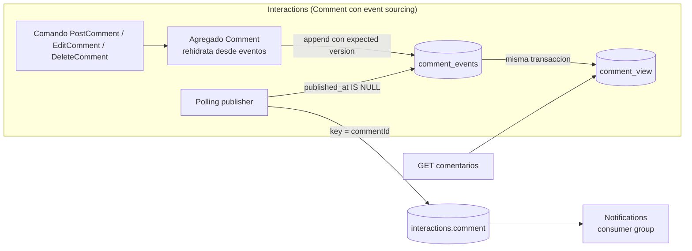

# ADR 0009: DDD táctico, CQRS y event sourcing de `Comment`

> **Verificado el 2026-10-12 (spike S4, nota 18):** concurrencia por `UNIQUE (stream_id, version)`, publisher por `published_at`, proyección en la misma transacción, reproyección y `CHECK` de ids, en un nodo de PostgreSQL 18.6. Sin probar: varios procesos, `kill -9`, upcasting.
> **Estado:** Aceptado el 2026-10-12 por Laura · **Última actualización:** 2026-10-12 (formato de ids, nota 17) · **Enmienda el alcance del ADR 0008** y ajusta los ADR 0003, 0004 y 0005.

## Contexto
Laura pidió incorporar DDD, CQRS y, "si se puede", event sourcing (2026-10-12). **No responde a una necesidad del dominio:** una plataforma de videos simple no exige auditoría estricta ni reconstrucción histórica, y la nota 16 lo dice así (Microsoft lista el CRUD simple como caso donde no conviene). Es una ampliación **didáctica**, pedida con conocimiento de que contradice parte de "menos es más" (ADR 0008).

Para no romper ese principio, la ampliación se acota: cada patrón entra en el mínimo que lo demuestra.

## Decisión

### A. DDD táctico (nota 15)
1. Agregados: **`Video`, `Rating`, `Comment`, `Follow` y `Notification`**. Son **proyecciones, no agregados:** `FeedEntry`, el resumen de puntuaciones y el read model de videos publicados.
2. **El id del agregado es la key del topic** (ADR 0003): `videoId`, `commentId`, `videoId:raterId`, `followerId:creatorId`.
3. **Evento de dominio ≠ evento publicado.** El método del agregado devuelve el evento de dominio y la capa de aplicación lo **mapea de forma explícita** al CloudEvent. Sin dispatcher en memoria: el caso de uso escribe en el outbox (o en el event store).
4. **Sin librería de dominio compartida:** lo compartido entre contextos es el schema publicado (*published language*), no clases.
5. Un módulo Gradle por servicio con paquetes `domain`, `application` e `infrastructure`; `domain` no depende de Spring ni de Kafka. Sin hexagonal ceremonial.
6. Context map: Videos es *Open Host Service* con *Published Language* hacia Interactions y Feed (Customer/Supplier verificado por Pact); Notifications es *Conformist* respecto de Videos y *Customer/Supplier* respecto de Interactions y de Feed (`feed.follow`). Sin Shared Kernel ni Partnership.

### B. CQRS (nota 14)
7. **Nivel 1 dentro de cada servicio:** modelo de escritura (agregado) y modelo de lectura (proyección) separados, en la **misma base**. **Nivel 2 entre contextos:** proyecciones alimentadas por eventos.
8. **Sin bus de comandos** y sin segunda base por servicio. Un caso de uso por comando.
9. **Notifications queda sin CQRS** (nivel 0): su estado vive en una tabla propia.
10. Los `GET` no escriben. Los comandos devuelven el recurso con su `sequence`; la lectura inmediata no se promete.
11. **Todo read model es reconstruible.** Para poder reproyectar desde el topic, **`retention.ms=-1`** en `videos.video` e `interactions.comment` (la retención por defecto de Kafka 4.3 es de 7 días, nota 14). Decisión de Laura. Se extiende a `feed.follow` (fuente de la lista de seguidores de Notifications), **a confirmar por Laura**.
12. **Regla de publicación** (decisión de Laura, 2026-10-12): *un evento se publica en Kafka solo si otro contexto lo consume.* Una proyección dentro del mismo servicio se actualiza sin pasar por el broker. Sus consecuencias sobre escenarios, ADR 0003 y nota 13 se aplican aparte.

### C. Event sourcing solo en `Comment` (nota 16)
13. **Un solo agregado:** `Comment` (Interactions). El resto sigue con estado. Usan outbox `Video` y `Follow`, porque son los otros agregados que publican (`Follow` desde la opción a: Notifications consume `feed.follow`); `Rating` y `Notification` no publican. **`Follow` es el segundo candidato natural a event sourcing** (su stream de follow y unfollow por par es de una forma muy parecida al de `Comment`); **no se aplica** por decisión de alcance, salvo que Laura lo pida.
14. **El event store es una tabla en la base de Interactions**, no un topic de Kafka. Kafka es solo el canal de publicación.
15. Tabla `comment_events`: `global_seq BIGINT` (identidad, solo orden de publicación, nunca identidad del evento), `event_id TEXT` (= `id` del CloudEvent, `evt_<UUIDv7>`, `UNIQUE`), `stream_id TEXT` (= `commentId` = key = `subject`, `cmt_<UUIDv7>`), `version INT` (= `sequence` del CloudEvent), `type`, `data JSONB`, `metadata JSONB`, `recorded_at`, `published_at`, con `CHECK` por expresión regular sobre el prefijo y la versión 7 de `stream_id` y `event_id`. No hay un id de "commit": un comando produce un evento y una fila (nota 17; el DDL no se ejecutó en PostgreSQL). **`UNIQUE (stream_id, version)`** como control de concurrencia optimista (*expected version*).
16. Es **append-only**: solo `published_at` se actualiza.
17. **Sin snapshots** hasta que una medición los pida.
18. **La proyección de lectura (`comment_view`) se actualiza en la misma transacción** que el append. Decisión de Laura. Consecuencia: lectura propia consistente; el costo es acoplar la proyección al camino de escritura.
19. **El polling publisher lee del event store** por marca `published_at IS NULL`, ordenado por `global_seq`, y marca después de publicar. La tabla ocupa el lugar del outbox para `Comment`. **Hipótesis sin fuente directa**, **verificada experimentalmente en un nodo** (spike S4, 2026-10-12; ver abajo).
20. **`CommentDeleted` es borrado lógico:** el texto queda en el historial. Decisión de Laura; la seguridad está fuera de alcance y no se usa crypto-shredding.
21. **El evento guardado es el contrato publicado** (sin evento resumen aparte). Un cambio incompatible sigue la regla de `.v2` (ADR 0002) y agrega un **upcaster** al rehidratar.

*Por qué este diagrama:* es de **componentes**, porque muestra dónde está la frontera transaccional y qué lee cada lado.

## Alternativas

| Opción | Por qué no |
|---|---|
| **Estado + outbox con columna `version`** | Es la más simple y da la misma concurrencia optimista (nota 16). **Es la que elegiríamos sin el pedido didáctico**; se conserva para todos los demás agregados |
| **Event sourcing en `Video`** | Más rico por su ciclo de vida, pero arrastra la saga y el pivote del process manager (nota 08) y complica el ejemplo |
| **Event sourcing en todos los agregados** | Contradice ADR 0008 y multiplica el costo (upcasting, reproyección) sin demostrar nada nuevo |
| **Kafka como event store** | Confluent (Narkhede, 2016) lo presenta como "natural backbone"; Microsoft y Dudycz señalan que no permite leer el stream de una entidad ni verificar versión esperada. Con una base propia hay una sola transacción |
| **Snapshots desde el principio** | Streams de 3 a pocos eventos; Dudycz los marca como último recurso |
| **Bus de comandos / mediator** | Ceremonia sin garantía asociada |

## Consecuencias
- **Se amplía el alcance del ADR 0008:** hay un patrón más que entender, un agregado con persistencia distinta y una tabla de eventos que requiere upcasting ante un cambio incompatible.
- El README debe decirlo con franqueza: es una elección didáctica; sin event sourcing la concurrencia y el resultado serían los mismos.
- **Dos modelos de persistencia conviven** (estado + outbox y event store). Es intencional: event sourcing se elige por agregado, no por sistema.
- El formato guardado queda **atado al contrato público**; un error de diseño del evento es costoso de corregir porque el historial es inmutable.
- El borrado lógico deja el texto en el historial.
- **Se modifican:** ADR 0004 (la tabla reemplaza al outbox para `Comment`; `Video` y `Follow` usan outbox), ADR 0005 (aclaración: los guards del consumidor no cambian), ADR 0003 (retención y regla de publicación, aplicado aparte).

## Hipótesis y experimentos pendientes
Nada de esto se ejecutó.

| # | Hipótesis | Estado | Experimento |
|---|---|---|---|
| 1 | El polling publisher puede leer del event store por `published_at` y `global_seq` | **Inferencia propia** apoyada en el ADR 0004; ninguna fuente leída lo describe | Matar el servicio tras el append y antes de publicar; verificar que se publica al reiniciar y el orden por stream |
| 2 | `UNIQUE (stream_id, version)` da la concurrencia optimista | El concepto está en KurrentDB, Dudycz y Microsoft; **la restricción única en SQL es inferencia** (Marten no la menciona en la página leída) | Dos `EditComment` concurrentes sobre la misma versión: uno falla |
| 3 | La vista se reconstruye desde el store y coincide | Sin probar | Reproyectar desde cero y comparar con `comment_view` (ES-07, garantía G8) |
| 4 | Una caída entre append y publicación no pierde ni duplica en consumidores | Sin probar | Reiniciar a mitad; el inbox absorbe el duplicado |
| 5 | Reconstruir un read model desde el topic con `retention.ms=-1` | Sin probar | Reproyección de Feed desde `videos.video` |

## Verificación
- Test: rehidratar `Comment` con cero, uno y muchos eventos (ZOMBIES).
- Test: dos escrituras concurrentes con la misma versión esperada; una falla.
- Test: reproyección completa y comparación con la vista actual.
- Test que falla si un agregado de dominio importa Spring o Kafka (regla de arquitectura).
- Test de arranque que verifica `retention.ms=-1` en los topics reproyectables.

## Pendiente
- **Capa de persistencia:** Spring Data JDBC u otra; sin decidir. No está probada su compatibilidad con Spring Boot 4.1.1 y Kotlin 2.4.
- **JDK:** sin decidir.
- Intervalo de polling y retención de `published_at` (ADR 0004).
- Qué pasa con varias instancias del servicio (ADR 0004).
- Escenarios QRY, AGG y ES en `specs/06-scenarios`, garantía G8 y context map en `bounded-contexts` (en curso, aparte).

## Respaldo
Notas 14 (CQRS y read models), 15 (DDD táctico), 16 (event sourcing), y las 03, 05, 08 y 12. Fuentes primarias que usan: Fowler (CQRS, Event Sourcing, DDD Aggregate), Microsoft Learn (CQRS, Event Sourcing, DDD táctico), Greg Young (*CQRS Documents*), Evans (*DDD Reference*, 2015), Vernon (*Effective Aggregate Design*), microservices.io, KurrentDB, Marten, Dudycz y Confluent; todas leídas el 2026-10-12, varias solo como resumen de herramienta de fetch (ver *No verificado* de cada nota).
