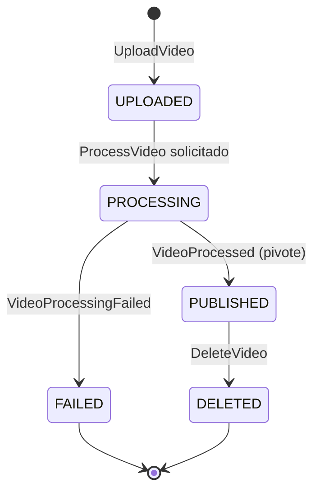

# Publicación de video

> **Estado:** borrador · **Contexto:** Videos · **ADR:** 0003, 0004, 0005 · **Nota de respaldo:** 08

## Estados del video



*Por qué este diagrama:* es una **máquina de estados**, porque la saga se define por los estados del video y sus transiciones válidas.

## Escenarios

```gherkin
@G2 @ADR-0004 @integracion
Escenario: PUB-01 publicar un video completo
  Dado que el creator usr_lucia subió el video vid_paella y está en UPLOADED
  Cuando el worker termina de procesar vid_paella con éxito
  Entonces vid_paella pasa a PUBLISHED
  Y se publica VideoPublished en videos.video con key vid_paella
  Y el estado y el evento se guardaron en la misma transacción (outbox)
```

```gherkin
@G1 @ADR-0003 @unit
Escenario: PUB-02 el video rechaza transiciones inválidas
  Dado que el video vid_paella está en FAILED
  Cuando llega VideoProcessed para vid_paella
  Entonces el estado de vid_paella sigue siendo FAILED
  Y no se publica VideoPublished
```

```gherkin
@ADR-0005 @integracion
Escenario: PUB-03 un video procesado por lock expirado no se procesa dos veces
  Dado que el worker worker-transcode-1 transcodifica vid_paella con un lock de 30 segundos
  Cuando el procesamiento dura 90 segundos y worker-transcode-1 renueva el lock (RENEW)
  Entonces ningún otro worker toma vid_paella
  Y VideoProcessed se emite una sola vez
```

```gherkin
@G5 @ADR-0005 @integracion
Escenario: PUB-04 falla permanente: DLQ, alerta y video en FAILED
  Dado que el procesamiento de vid_paella falla en cada entrega
  Cuando se agota el límite de entregas
  Entonces el worker publica el mensaje en videos.processing.dlq con causa, intentos y eventId
  Y emite VideoProcessingFailed
  Y vid_paella queda en FAILED
  Y se dispara una alerta
  Y no se emite VideoPublished
```

```gherkin
@G2 @ADR-0004 @integracion
Escenario: PUB-05 caída entre el commit y la publicación
  Dado que Videos guardó vid_paella como PUBLISHED y el evento en el outbox
  Cuando el servicio se cae antes de que el polling publisher publique
  Y luego se recupera
  Entonces VideoPublished se publica igualmente
  Y conserva el mismo id que tenía en el outbox
```

```gherkin
@G3 @G4 @ADR-0005 @integracion
Escenario: PUB-06 el polling publisher publica el mismo VideoPublished dos veces
  Dado que el servicio cae después de publicar VideoPublished (id evt_alfa) y antes de marcarlo como publicado
  Cuando Feed lo recibe dos veces
  Entonces la entrada del feed existe una sola vez
  Y processed_events contiene evt_alfa una sola vez
```

```gherkin
@ADR-0005 @integracion
Escenario: PUB-07 error transitorio del worker se reintenta
  Dado que el procesamiento de vid_paella falla por un timeout del storage
  Cuando el worker hace RELEASE
  Entonces el registro vuelve a estar disponible
  Y el procesamiento se reintenta
  Y VideoProcessed se emite al tener éxito
```

```gherkin
@ADR-0005 @unit
Escenario: PUB-08 reenvío del mismo UploadVideo
  Dado que el creator usr_lucia envió UploadVideo con Idempotency-Key idk_subida
  Cuando reenvía el mismo request con idk_subida
  Entonces recibe el mismo resultado
  Y existe un solo video
```

```gherkin
@experimento
Escenario: PUB-09 falla de Feed después de la publicación
  Dado que vid_paella ya está PUBLISHED (pivote superado)
  Cuando Feed falla de forma permanente al agregar la entrada
  Entonces vid_paella sigue PUBLISHED
  Y no hay compensación
  Y el mensaje de Feed queda en feed.dlq con alerta
```

## Trazabilidad
- **Implementados el 2026-10-17 (worker de Videos):** PUB-01 (`ProcessVideoShareWorkerTest` y `VideoProcessingApplicationTest`, de la API a `VideoPublished`), PUB-03 (dos pruebas: con RENEW una transcodificación; sin RENEW dos, pero un solo `VideoPublished`), PUB-04 (DLQ con causa e intentos, `FAILED`, alerta, sin `VideoPublished`) y PUB-07 (liberar y reintentar). La lógica sin Kafka está en `ProcessVideoRequestHandlerTest`. Las fallas se pueden provocar con `curl` poniendo `[falla-transitoria]` o `[falla-permanente]` en el título (transcoder simulado).
- PUB-09 aplica la decisión de la nota 08: después del pivote no se compensa; Feed y Notifications son coreografía. No es una decisión de producto abierta sino una ya tomada; falta **demostrarla** con un experimento (recuperación hacia adelante: se reintenta y, si no se resuelve, DLQ y alerta).
- PUB-03 reproduce el "caso que falla" de la nota 07 (video transcodificado dos veces) y exige el caso que funciona.
- Regla de publicación (2026-10-12): `VideoUploaded`, `VideoProcessed` y `VideoProcessingFailed` son estados internos del process manager de Videos y **no se publican** en Kafka. Los escenarios PUB-02 a PUB-04 los nombran como eventos internos; lo único publicado es `VideoPublished`/`VideoDeleted` en `videos.video` y `ProcessVideo` en `videos.processing`.
