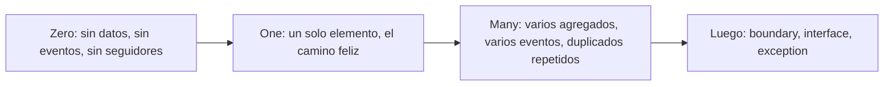

# ZOMBIES: cero, uno, muchos

> **Estado:** borrador para revisión · **Última actualización:** 2026-10-12 · **Cubre:** Z, O, M (el resto de las letras queda para una segunda pasada; ES-09 y ES-10 de `10-event-sourcing.md` ya adelantan Boundary y Exception)

## Qué es y cómo lo usamos
ZOMBIES es una heurística de TDD atribuida a James Grenning para decidir **qué test escribir primero y cuál sigue**: **Z**ero, **O**ne, **M**any, **B**oundary behaviors, **I**nterface definition, **E**xceptional behavior, **S**imple scenarios and simple solutions.

Para nosotros el orden es una regla de implementación: **cada comportamiento se implementa primero para cero, después para uno y después para muchos**. El caso "muchos" es el que suele exponer desorden, duplicados y fan-out, que es lo que este proyecto quiere demostrar.



*Por qué este diagrama:* es de **actividad**, porque fija el orden en que se escriben los tests.

## Cobertura por proceso

`E` = escenario ya existente; `N` = escenario nuevo en este archivo.

| Proceso | Zero | One | Many |
|---|---|---|---|
| Puntuaciones | **N** RAT-08 | E RAT-01 · **N** RAT-09 | E RAT-03, RAT-04, RAT-05 · **N** RAT-10 |
| Comentarios | **N** COM-10, COM-13 | E COM-01 · **N** COM-11 | E COM-02, COM-03, COM-04 · **N** COM-12 |
| Feed | **N** FEED-08 | E FEED-01 · **N** FEED-09 | E FEED-02, FEED-03 · **N** FEED-10, FEED-11, FEED-14 |
| Notificaciones | **N** NOT-07 | **N** NOT-08 · **N** NOT-13 | E NOT-01 · **N** NOT-09, NOT-14, NOT-15 |
| Publicación | **N** PUB-10 | E PUB-01, PUB-08 | E PUB-04 · **N** PUB-13 |
| Inbox (transversal) | **N** INB-01 | **N** INB-02 | **N** INB-03 |

El hueco más claro era **Zero**: casi ningún escenario previo cubría "no hay nada".

### Cobertura de CQRS, agregados y event sourcing (notas 14 a 16)

Los escenarios de estos archivos ya nacen con letra ZOMBIES; no se duplican arriba.

| Archivo | Zero | One | Many | Boundary / Exception |
|---|---|---|---|---|
| [`08-cqrs`](08-cqrs.md) | QRY-02 | QRY-01, QRY-03, QRY-06 | QRY-04 | QRY-05 (consulta sin escritura) |
| [`09-agregados`](09-agregados.md) | AGG-04, AGG-13 | AGG-02, AGG-03, AGG-05, AGG-07, AGG-10, AGG-14 | AGG-01, AGG-06, AGG-08, AGG-11, AGG-12, AGG-15, AGG-16 | AGG-09 (rango, supuesto) |
| [`10-event-sourcing`](10-event-sourcing.md) | ES-01, ES-02 | ES-03, ES-04 | ES-05, ES-06, ES-07, ES-08 | ES-09, ES-10 |

## Escenarios nuevos

### Puntuaciones

```gherkin
@zero @unit
Escenario: RAT-08 video sin puntuaciones
  Dado que el video vid_paella está PUBLISHED y nadie lo puntuó
  Cuando se consulta su puntuación
  Entonces el conteo es 0
  Y el promedio no está definido (no es 0 ni falla por división por cero)
```

```gherkin
@one @unit
Escenario: RAT-09 una sola puntuación
  Dado que vid_paella no tiene puntuaciones
  Cuando usr_ana lo puntúa con 4
  Entonces el conteo es 1
  Y el promedio es 4.0
```

```gherkin
@many @integracion @concurrencia
Escenario: RAT-10 muchos viewers puntúan el mismo video a la vez
  # Corregido 2026-10-12: antes consumía 50 VideoRated del broker; por la regla de publicación
  # las puntuaciones son filas de Interactions (PK videoId:raterId) y no hay topic.
  Dado que 50 viewers distintos puntúan vid_paella en simultáneo
  Cuando Interactions procesa los 50 comandos RateVideo (filas vid_paella:usr_viewer-01 a vid_paella:usr_viewer-50)
  Entonces el conteo es 50
  Y el promedio coincide con el de las 50 puntuaciones
  Y repetir cualquiera de los comandos con la misma Idempotency-Key no cambia el resultado
```

### Comentarios

```gherkin
@zero @unit
Escenario: COM-10 video sin comentarios
  Dado que vid_paella no tiene comentarios
  Cuando se listan sus comentarios
  Entonces el resultado es una lista vacía y no un error
```

```gherkin
@one @unit
Escenario: COM-11 un único comentario
  Dado que vid_paella no tiene comentarios
  Cuando usr_ana publica cmt_gracias
  Entonces se publica un solo CommentPosted con sequence 1
  Y se acepta sin buffer ni espera
```

```gherkin
@many @integracion @G1
Escenario: COM-12 muchos comentarios en un mismo video
  Dado que 100 viewers distintos comentan vid_paella
  Cuando se consumen los 100 CommentPosted (cada uno con su propia key commentId)
  Entonces los 100 comentarios existen
  Y el orden se garantiza dentro de cada comentario, no entre comentarios distintos
```

```gherkin
@zero @integracion @G1
Escenario: COM-13 primer evento visto de un comentario no es el primero
  Dado que el consumer no tiene estado de cmt_gracias
  Cuando llega CommentEdited(cmt_gracias, sequence 2) antes que CommentPosted(cmt_gracias, sequence 1)
  Entonces el evento se guarda en buffer con timeout
  Y al llegar sequence 1 se aplican ambos en orden
  Y si el timeout vence, se consulta el estado real o va a la DLQ
```

### Feed

```gherkin
@zero @integracion
Escenario: FEED-08 creator sin seguidores publica un video
  Dado que usr_mateo no tiene seguidores
  Cuando Feed consume VideoPublished de un video de usr_mateo
  Entonces no se crea ninguna entrada
  Y el evento se da por procesado sin error ni reintento
```

```gherkin
@one @integracion
Escenario: FEED-09 un único seguidor
  Dado que solo usr_ana sigue a usr_lucia
  Cuando se publica un video de usr_lucia
  Entonces existe exactamente una entrada de feed, la de usr_ana
```

```gherkin
@many @integracion @G4
Escenario: FEED-10 fan-out a muchos seguidores
  Dado que usr_lucia tiene 10.000 seguidores  # tamaño de prueba, no un objetivo de servicio
  Cuando Feed consume VideoPublished
  Entonces existen 10.000 entradas, una por seguidor
  Y la falla de una escritura no frena las demás
```

```gherkin
@many @integracion @G4 @experimento
Escenario: FEED-11 caída a mitad del fan-out
  Dado que Feed creó 5.000 de 10.000 entradas y el proceso cae
  Cuando el evento se reentrega y se reprocesa
  Entonces existen 10.000 entradas, sin duplicadas
  # La unicidad por (followerId, videoId) es necesaria; cómo se realiza el fan-out
  # (una transacción, lotes o un evento por seguidor) está sin decidir.
```

### Notificaciones

```gherkin
@zero @integracion
Escenario: NOT-07 publicación sin seguidores
  Dado que Notifications no conoce seguidores de usr_mateo (no procesó ningún CreatorFollowed)
  Cuando se publica un video de usr_mateo
  Entonces no se solicita ninguna notificación
```

```gherkin
@one @integracion
Escenario: NOT-08 una notificación de punta a punta
  Dado que Notifications solo procesó CreatorFollowed de usr_ana sobre usr_lucia
  Cuando se publica un video de usr_lucia
  Entonces se solicita una notificación para usr_ana
  Y se envía una vez
  Y queda registrada como NotificationSent
```

```gherkin
@many @integracion @G5
Escenario: NOT-09 falla del proveedor para algunos destinatarios
  Dado que usr_lucia tiene 100 seguidores y el proveedor rechaza el envío a 3 de ellos
  Cuando Notifications procesa las 100 notificaciones
  Entonces las 97 restantes se envían
  Y las 3 fallidas se reintentan de forma bloqueante hasta el tope y van a notifications.dlq con alerta
  Y el resto se retrasa por esos reintentos pero no se pierde
```

### Publicación

```gherkin
@zero @unit
Escenario: PUB-10 archivo de video vacío
  Dado que el creator usr_lucia sube un archivo de 0 bytes
  Cuando envía UploadVideo
  Entonces se rechaza antes de crear el video
  Y no se escribe nada en el outbox
```

```gherkin
@many @integracion
Escenario: PUB-13 muchos videos se procesan en paralelo
  Dado que 20 creators suben un video cada uno
  Cuando el share group los reparte entre los workers
  Entonces cada video se publica exactamente una vez
  Y no se asume ningún orden entre videos distintos
```

### Inbox (transversal)

```gherkin
@zero @unit @G4
Escenario: INB-01 tabla de eventos procesados vacía
  Dado que processed_events no tiene filas
  Cuando llega el primer evento evt_alfa
  Entonces se procesa y se registra evt_alfa
```

```gherkin
@one @integracion @G4
Escenario: INB-02 el mismo evento llega dos veces
  Dado que evt_alfa fue procesado
  Cuando llega otra vez
  Entonces el efecto de negocio ocurre una sola vez
  Y el offset se confirma
```

```gherkin
@many @integracion @G4
Escenario: INB-03 el mismo evento llega muchas veces
  Dado que un rebalance y un reinicio del relay entregan evt_alfa cinco veces
  Cuando el consumer las procesa
  Entonces el efecto ocurre una sola vez
  Y las otras cuatro se ignoran sin error
```

## Orden de implementación sugerido
1. **Zero** de cada proceso (el más barato; fija valores por defecto y listas vacías).
2. **One**, el camino feliz completo de punta a punta con un solo elemento.
3. **Many**, empezando por INB-03 y RAT-10 (duplicados y concurrencia), después FEED-10 y FEED-11 (fan-out).

## Qué falta (segunda pasada)
- **B**oundary: límite de entregas (5), tope de reintentos (3), lock de 30 s, 2000 locks por partición. Ya hay dos: ES-09 (editar un comentario borrado sobre el stream) y AGG-09 (valor fuera de rango, supuesto).
- **I**nterface: forma exacta de eventos y endpoints (depende de `03-events/` y `04-apis/`).
- **E**xception: ya hay varios (COM-08, PUB-04, NOT-03, ES-10); falta ordenarlos.
- **S**imple: revisar que cada escenario pida la solución más simple.

## Fuentes
- [Agile Alliance – Test-Driven Development](https://agilealliance.org/agile101/test-driven-development) y la sesión de Grenning sobre ZOMBIES — descripción del acrónimo. Consultadas 2026-10-12 vía resultados de búsqueda.
- [Opensource.com – My handy guide to software development and testing](https://opensource.com/article/21/1/zombies-zero) — explicación de Zero, One, Many.

## No verificado
- **Fuente primaria:** no encontré la entrada original del blog de Grenning; las fuentes son secundarias y las leí solo como resumen de búsqueda. La atribución a Grenning y el significado de cada letra salen de esos resúmenes.
- **Tamaños de prueba:** 50, 100 y 10.000 son valores ilustrativos de test, no objetivos de servicio.
- **Diseño del fan-out:** no está decidido; FEED-10 y FEED-11 definen el resultado esperado, no el mecanismo.
- **Nada se ejecutó:** son criterios de aceptación, sin código ni broker.
