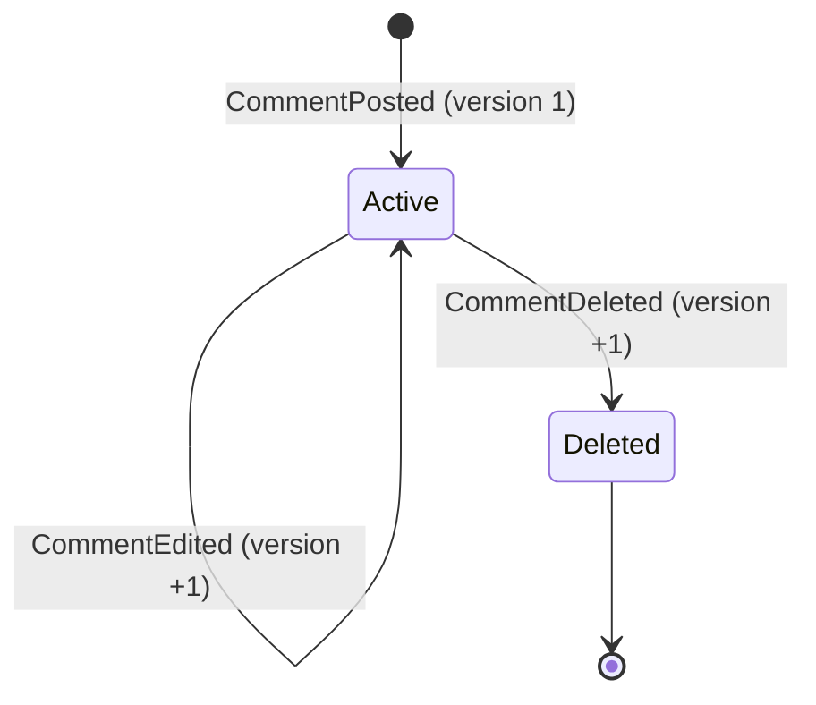

# Event sourcing de `Comment`

> **Estado:** borrador para revisión · **Última actualización:** 2026-10-12 · **Contexto:** Interactions · **Notas:** 16, 02, 03, 05, 12 · **ADR:** 0004, 0009 (aceptado)

Criterios de aceptación del agregado `Comment` con event sourcing (decisión de Laura, 2026-10-12; **didáctica**, no una necesidad del dominio). Es el **único** agregado event-sourced; los demás siguen con estado.

## Decisiones que asumen estos escenarios

| Tema | Decisión | Estado |
|---|---|---|
| Dónde vive el event store | Tabla `comment_events` en la base de Interactions; Kafka solo publica | Aprobada por Laura (2026-10-12); hipótesis pendiente de experimento |
| Proyección de lectura (`comment_view`) | En la **misma transacción** que el append | Aprobada |
| Concurrencia optimista | `UNIQUE (stream_id, version)`; `version` = `sequence` del CloudEvent | Propuesta; ninguna fuente leída describe la restricción única |
| Publicación | El polling publisher lee `published_at IS NULL` por `global_seq`; sin tabla `outbox` para `Comment` | Propuesta; el uso del store como fuente del publisher es inferencia |
| Borrado | `CommentDeleted` es borrado **lógico**; el texto queda en el historial | Aprobada |
| Snapshots | No hay hasta que una medición los pida | Propuesta |
| Retención de `interactions.comment` | `retention.ms=-1` | Aprobada |



*Por qué este diagrama:* es de **máquina de estados**, porque la pregunta es qué estado resulta de reproducir el stream en orden; un stream sin eventos no tiene estado.

## Orden ZOMBIES

| Letra | Escenarios |
|---|---|
| Zero | ES-01, ES-02 |
| One | ES-03, ES-04 |
| Many | ES-05, ES-06, ES-07, ES-08 |
| Boundary | ES-09 |
| Exception | ES-10 |

Orden de implementación: ES-01 a ES-04 fijan el esquema; ES-05 y ES-06 son el corazón; ES-07 y ES-08 recién después.

### Zero

```gherkin
@zero @unit
Escenario: ES-01 stream sin eventos
  Dado que el stream de cmt_inexistente no tiene eventos
  Cuando se rehidrata cmt_inexistente o se intenta EditComment sobre cmt_inexistente
  Entonces el comentario no existe
  Y el EditComment se rechaza sin escribir nada
```

```gherkin
@zero @G1 @integracion
Escenario: ES-02 el primer append espera un stream inexistente
  Dado que el stream de cmt_gracias no existe
  Cuando se agrega CommentPosted esperando "stream inexistente"
  Entonces se guarda con version 1
```

### One

```gherkin
@one @G1 @integracion
Escenario: ES-03 publicar un comentario guarda un evento y actualiza la vista
  Dado que vid_paella está PUBLISHED
  Cuando usr_ana publica el comentario cmt_gracias
  Entonces comment_events tiene una fila CommentPosted con version 1
  Y comment_view tiene cmt_gracias con status ACTIVE
  Y ambas escrituras ocurrieron en la misma transacción
```

```gherkin
@one @unit
Escenario: ES-04 rehidratar un stream de un evento
  Dado que el stream de cmt_gracias tiene solo CommentPosted con el texto "Muy bueno"
  Cuando se rehidrata cmt_gracias
  Entonces el estado es Active con el texto original y version 1
```

### Many

```gherkin
@many @G1 @integracion
Escenario: ES-05 la historia completa se conserva
  Dado que cmt_gracias recibe CommentPosted, dos CommentEdited y CommentDeleted
  Cuando se lee el stream
  Entonces tiene las versiones 1 a 4 sin huecos ni repetidas
  Y el estado final es Deleted
  Y el texto de cada versión anterior sigue en el stream
```

```gherkin
@many @G1 @integracion
Escenario: ES-06 dos ediciones concurrentes, una gana y la otra reintenta
  Dado que el stream de cmt_gracias tiene CommentPosted (version 1)
  Cuando dos EditComment leen la version 1 y ambos intentan agregar la version 2
  Entonces el primero queda guardado como CommentEdited version 2
  Y el segundo recibe un conflicto de versión
  Y el segundo relee el stream, decide de nuevo y agrega la version 3
  Y el stream tiene tres eventos sin huecos ni repetidos
```

```gherkin
@many @G8 @integracion
Escenario: ES-07 reproyección de la vista
  Dado que comment_events tiene los streams de N comentarios con eventos mezclados
  Cuando se vacía comment_view y se reprocesa comment_events por global_seq
  Entonces comment_view queda igual que antes
  Y la reproyección no publica ningún evento (published_at no cambia)
```

```gherkin
@many @G2 @G3 @G4 @integracion
Escenario: ES-08 caída entre el append y la publicación
  Dado que se guardó CommentPosted (cmt_gracias, version 1) y el servicio cae antes de publicarlo
  Cuando el servicio reinicia
  Entonces el polling publisher publica el evento con el mismo event_id
  Y Notifications, por su inbox, aplica el efecto una sola vez aunque lo reciba dos veces
```

### Boundary y Exception

```gherkin
@unit
Escenario: ES-09 editar un comentario borrado
  Dado que el stream de cmt_gracias termina en CommentDeleted
  Cuando usr_ana intenta editarlo
  Entonces se rechaza sin escribir ningún evento
  # Es el mismo comportamiento de COM-05, ahora sobre el stream.
```

```gherkin
@G1 @integracion
Escenario: ES-10 la restricción de unicidad impide repetir una versión
  Dado que cmt_gracias ya tiene la version 2
  Cuando se inserta a mano otra fila con (stream_id cmt_gracias, version 2)
  Entonces el insert falla por la restricción UNIQUE (stream_id, version)
```

## Trazabilidad

| Escenario | Relación con lo previo |
|---|---|
| ES-03, ES-05 | COM-01 y COM-02: `sequence` pasa a ser la `version` del stream; los IDs no cambian |
| ES-06 | Sin event sourcing, la misma concurrencia se resuelve con una columna `version` en estado + outbox: lo propio de event sourcing es la historia y la reproyección |
| ES-07 | G8 (`../07-nfr/garantias.md`); QRY-04 es el equivalente entre contextos |
| ES-08 | PUB-06 (reinicio a mitad de lote) y INB-02; ejercita G2, G3 y G4 sobre el event store |
| ES-09 | COM-05 |
| COM-04, COM-13 | **Siguen valiendo** del lado consumidor (Notifications): sus guards por `sequence` no cambian |

## No cubierto
- **Upcasting:** al primer cambio incompatible (`.v2`) hace falta un upcaster al rehidratar y un test propio; sin escenario hasta que exista ese cambio (nota 12 y nota 16).
- **Snapshots:** no se implementan (regla R7 de la nota 16).
- **Varias instancias del publisher:** igual que en el ADR 0004, sin estudiar.
- **Marca vs cursor:** el razonamiento de que un cursor de "última posición vista" saltaría filas que confirman tarde es conocimiento previo; hay que reproducirlo con dos transacciones contra PostgreSQL (`../07-nfr/garantias.md`).
- **Borrado físico o privacidad** (crypto-shredding, forgettable payload): fuera de alcance; `CommentDeleted` es lógico y se declara en el README.
